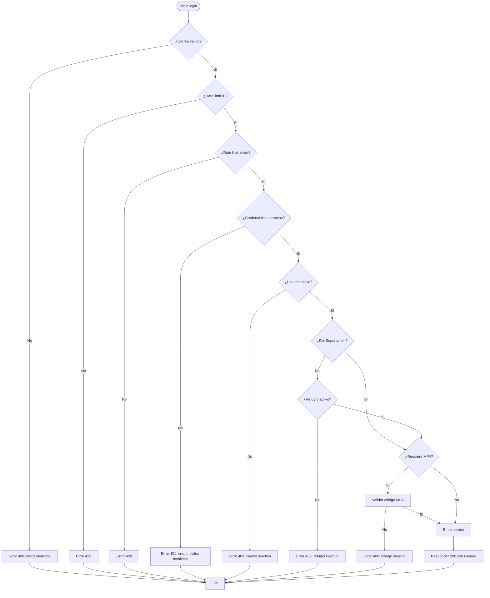
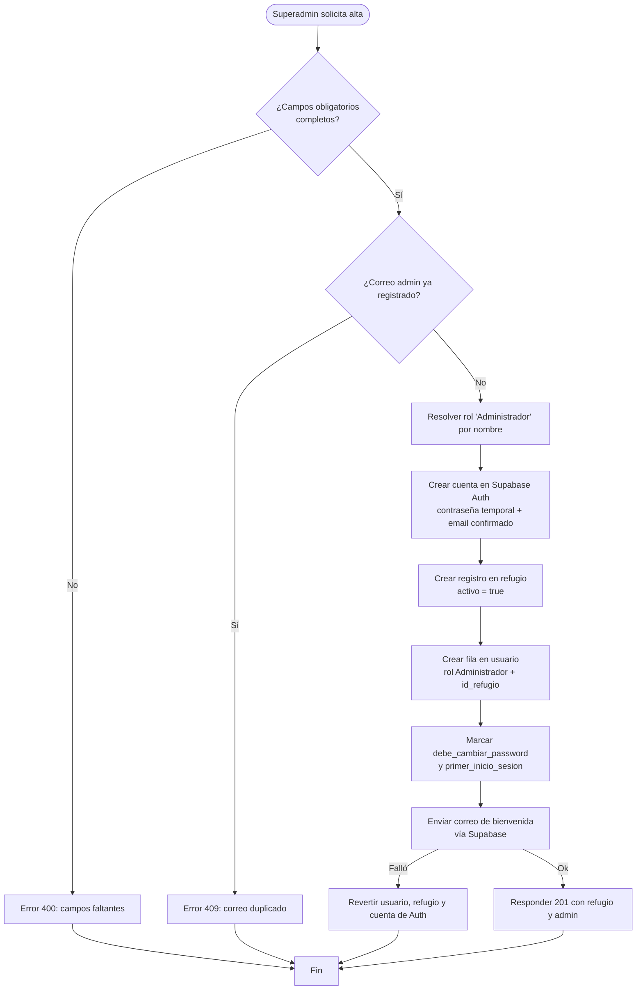
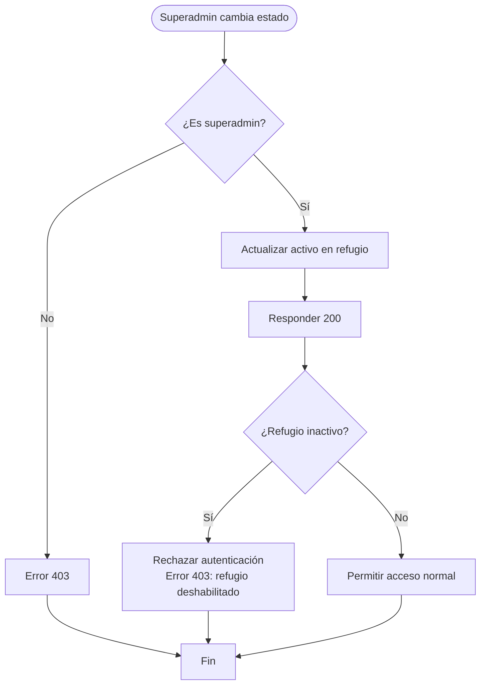
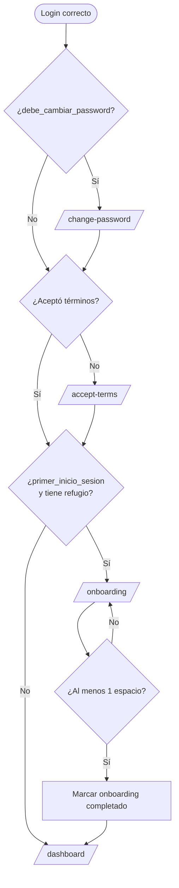

# Requerimiento 00 — Épica 0: Gestión Global de Refugios y Configuración Inicial

## Título

Gestión global de refugios, autenticación RBAC, onboarding y configuración inicial de la plataforma Pixkki.

## Descripción

Pixkki es una plataforma SaaS multitenant para la gestión integral de refugios de animales. La Épica 0 cubre los cimientos del sistema: autenticación segura, control de acceso basado en roles (RBAC), gestión global de refugios por superusuario, alta de refugios con provisión automática de credenciales, modulación de estados operativos, gestión de personal interno, recuperación de contraseñas, aceptación de términos y condiciones, modelado de infraestructura física y verificación de cuenta con asistente de onboarding.

Cada refugio es un tenant independiente identificado por `id_refugio` (entero). El superadmin opera a nivel global sin estar asociado a ningún `id_refugio`. Cada refugio tiene su propio administrador que gestiona personal, espacios y operaciones diarias.

## Objetivo

Proveer los módulos fundamentales de autenticación, multitenancy y configuración inicial que permitan:

1. Dar de alta refugios y administrar su estado operativo desde un panel global.
2. Autenticar usuarios con control de acceso basado en roles.
3. Onboardear nuevos refugios y administradores de forma automatizada.
4. Establecer las reglas de negocio base que todos los módulos posteriores heredarán.

## Alcance

Incluye:

- RF0.1: Gestión global de refugios por superusuario (US31, US33)
- RF0.2: Alta de refugios y provisión automática de credenciales (US32)
- RF0.3: Modulación de estados operativos de refugios (US33)
- RF0.4: Gestión de personal interno del refugio (US02, US27)
- RF0.5: Autenticación segura y control de acceso basado en roles (RBAC) (US03)
- RF0.6: Recuperación autónoma de contraseñas (US04) — Should Have
- RF0.7: Gestión y aceptación de términos y condiciones (US27)
- RF0.8: Modelado de infraestructura física del refugio (US29)
- RF0.9: Verificación de cuenta y asistente de onboarding (US30, US01, US29)

No incluye:

- Gestión clínica de animales (Épica 1 y 2)
- Procesos de adopción (Épica 5)
- Donaciones e inventario (Épica 6)
- Reportes de inteligencia de datos (Épica 7)
- Migración de datos históricos (Épica 8)

## Actores

| Actor | Descripción |
|-------|-------------|
| Superadmin | Fila en `usuario` con `rol = 3` (`nombre_rol = 'Superadmin'`) y `id_refugio = NULL`. Opera a nivel global y no pasa por el onboarding de espacios. |
| Administrador de refugio | Usuario con `rol = 1` (`nombre_rol = 'Administrador'`) asociado a un `id_refugio`. Gestiona personal, espacios y la configuración de su refugio. |
| Personal del refugio | Veterinario (`rol = 2`). Acceso limitado a su refugio. |
| Usuario no autenticado | Puede acceder a rutas públicas y al flujo de recuperación de contraseña. |

> Roles reales en base de datos: `1 Administrador`, `2 Veterinario`, `3 Superadmin`. No existen roles Operador/Coordinador/Evaluador; cualquier regla escrita antes con esos nombres se interpreta con este catálogo. La autorización compara por **nombre normalizado** (`isAdminRole` / `isSuperadminRole`), no por id.

## Reglas de negocio

1. **Superadmin global**: es una fila de `usuario` con el rol `Superadmin` y `id_refugio` NULL. No está asociado a ningún refugio.
2. **Listado global de refugios**: muestra nombre, ciudad/estado, fecha de registro y estado operativo (activo/inactivo), con filtrado y búsqueda textual. El superadmin ve todos; el resto solo el suyo.
3. **Alta de refugio**: campos obligatorios: nombre del refugio, nombre del administrador, correo del administrador, ciudad/estado y correo de contacto; teléfono opcional. El correo del administrador debe ser **único globalmente** (es una cuenta de acceso).
4. **Provisión automática**: al crear el refugio se crea la cuenta de Auth en Supabase (contraseña temporal y correo confirmado), la fila de `usuario` con rol `Administrador`, estado `activo`, y los flags `debe_cambiar_password = true` y `primer_inicio_sesion = true`. Supabase envía el correo de bienvenida con el enlace para establecer la contraseña definitiva. El `id_refugio` lo genera la base (identidad entera).
5. **Estado operativo**: al marcar un refugio como inactivo se rechazan los intentos de autenticación de sus usuarios. El superadmin está exento (auto-lock).
6. **Personal interno**: solo el administrador de ese refugio gestiona su personal. Correo único global. Contraseña temporal gestionada por Supabase.
7. **Autenticación RBAC**: login con correo + contraseña. Se valida el rol y sus permisos; cada petición revalida usuario activo y rol permitido. MFA opcional (TOTP).
8. **Recuperación de contraseña**: gestionada por Supabase Auth (enlace temporal por correo); no se almacenan tokens propios.
9. **Términos y condiciones**: ruta canónica pública `/terminos-condiciones` (alias `/terminos`). Checkbox obligatorio antes de entrar al panel. La aceptación se registra en `aceptacion_terminos` con `terminos_version`, `aceptado_en` e `id_usuario`; sin aceptación se responde 400 y no se escribe nada.
10. **Espacios físicos**: los gestionan Administrador y Superadmin. Campos: nombre (obligatorio), tipo (Canil/Gatera/Cuarentena/Rehabilitación/Otro, validado en Zod), capacidad (entero ≥ 1), descripción. No se puede eliminar un espacio con animales asignados.
11. **Verificación de cuenta**: la verificación de correo la gestiona Supabase Auth. `primer_inicio_sesion = true` redirige a `/onboarding`; el wizard exige crear al menos 1 espacio físico antes de finalizar. `debe_cambiar_password = true` redirige a `/change-password`.

## Historias de usuario

| ID | Historia de Usuario | Prioridad | Épica | RF relacionados |
|----|---------------------|-----------|-------|-----------------|
| US01 | Registro de nuevo refugio (Onboarding) | Must Have | Épica 0 | RF0.9 |
| US02 | Registro de usuarios y gestión de roles | Must Have | Épica 0 | RF0.4 |
| US03 | Inicio de sesión y control de acceso por rol (RBAC) | Must Have | Épica 0 | RF0.5 |
| US04 | Recuperación de contraseña | Should Have | Épica 0 | RF0.6 |
| US27 | Gestión y aceptación de términos y condiciones | Must Have | Épica 0 | RF0.4, RF0.7 |
| US29 | Modelado de infraestructura física del refugio | Must Have | Épica 0 | RF0.8 |
| US30 | Verificación de cuenta y asistente de onboarding | Must Have | Épica 0 | RF0.9 |
| US31 | Gestión global de refugios por superusuario | Must Have | Épica 0 | RF0.1 |
| US32 | Alta de refugios y provisión automática de credenciales | Must Have | Épica 0 | RF0.2 |
| US33 | Modulación de estados operativos de refugios | Must Have | Épica 0 | RF0.1, RF0.3 |

## Contrato de API

Los endpoints siguen el patrón `/api/v1/<recurso>`. La validación de entrada se hace con Zod antes de cualquier efecto. Los errores se devuelven con formato uniforme. Los contratos completos viven en:

- `modules/auth/contracts/openapi.yaml`
- `modules/shelters/contracts/openapi.yaml`
- `modules/spaces/contracts/openapi.yaml`
- `modules/animals/contracts/openapi.yaml`

### Formato de respuesta de éxito

```json
{
  "success": true,
  "data": { ... }
}
```

### Formato de error uniforme

```json
{
  "success": false,
  "error": {
    "code": "ERROR_CODIGO",
    "message": "Mensaje en español para el usuario final",
    "statusCode": 400
  }
}
```

### RF0.1 / RF0.2 / RF0.3 — Gestión global de refugios

| Método | Ruta | Descripción | Acceso |
|--------|------|-------------|--------|
| GET | `/api/v1/refugios` | Listar refugios con filtros y búsqueda | Autenticado (alcance por tenant) |
| GET | `/api/v1/refugios/{id}` | Detalle de un refugio | Autenticado (superadmin: cualquiera; resto: el suyo) |
| POST | `/api/v1/refugios` | Crear refugio + administrador | Superadmin |
| PATCH | `/api/v1/refugios/{id}` | Edición parcial del refugio | Superadmin o admin del propio refugio |

**Request (POST):**

```json
{
  "nombre_albergue": "Refugio Patitas",
  "nombre_admin": "Ana Pérez",
  "correo_admin": "ana@patitas.org",
  "ciudad": "Guadalajara",
  "estado": "Jalisco",
  "correo_contacto": "contacto@patitas.org",
  "telefono": "3312345678"
}
```

**Response (201):**

```json
{
  "success": true,
  "data": {
    "shelter": { "id": 12, "nombre": "Refugio Patitas" },
    "admin": { "id": 45, "email": "ana@patitas.org", "nombreCompleto": "Ana Pérez" }
  }
}
```

**Request (PATCH):** cualquier subconjunto de los campos anteriores (incluye `calle`, `numero`, `colonia`, `codigo_postal`, `direccion`, `latitud`, `longitud`). La respuesta es `{ shelter, changes }`.

**Errores:**
- `400` — Datos inválidos.
- `403` — Usuario sin permisos para la operación.
- `404` — Refugio no encontrado o de otro tenant.
- `409` — Nombre de refugio duplicado.
- `500` — Error interno.

### RF0.5 — Autenticación y RBAC

| Método | Ruta | Descripción | Acceso |
|--------|------|-------------|--------|
| POST | `/api/v1/auth/login` | Autenticar usuario, emitir sesión | Público |
| POST | `/api/v1/auth/logout` | Cerrar sesión | Autenticado |
| GET | `/api/v1/auth/me` | Usuario autenticado actual | Autenticado |
| POST | `/api/v1/auth/recover-password` | Solicitar recuperación de contraseña | Público |
| POST | `/api/v1/auth/reset-password` | Restablecer contraseña | Sesión de recuperación |
| POST | `/api/v1/auth/mfa/verify` | Verificar código MFA | Público (tras login) |

**Request (login):**

```json
{
  "email": "ana@patitas.org",
  "password": "********"
}
```

**Response (200) — sin MFA:**

```json
{
  "success": true,
  "data": {
    "step": "success",
    "user": {
      "id": 45,
      "email": "ana@patitas.org",
      "role": "Administrador",
      "permissions": ["animals.view", "..."],
      "shelterId": 12,
      "emailVerified": true,
      "requiresOnboarding": true
    }
  }
}
```

**Response (200) — con MFA pendiente:** `data: { step: "mfa", factorId, challengeId }`.

**Errores:**
- `401` — Credenciales inválidas.
- `403` — Cuenta inactiva, refugio inactivo, correo sin verificar o MFA requerido.
- `429` — Rate limit excedido (IP: 10/15 min; correo: 5/15 min).

### RF0.6 — Recuperación de contraseña

`POST /api/v1/auth/recover-password` responde siempre con un mensaje genérico para evitar enumeración de usuarios. Supabase Auth gestiona el enlace y la vigencia del token.

### RF0.7 — Términos y condiciones

La aceptación se realiza desde el panel con la Server Action `acceptTermsAction` (equivalente web de la API; no hay endpoint v1 dedicado). Se registra en `aceptacion_terminos` (`id_usuario`, `id_refugio`, `terminos_version`, `aceptado_en`). La versión vigente está en `modules/auth/constants.ts`.

### RF0.8 — Espacios físicos (infraestructura)

| Método | Ruta | Descripción | Acceso |
|--------|------|-------------|--------|
| GET | `/api/v1/espacios` | Listar espacios (filtros `shelterId`, `available`, `type`, `search`) | Autenticado (alcance por tenant) |
| GET | `/api/v1/espacios/{id}` | Detalle de un espacio | Autenticado (alcance por tenant) |
| POST | `/api/v1/espacios` | Crear espacio físico | Admin / Superadmin |
| PATCH | `/api/v1/espacios/{id}` | Editar espacio (parcial) | Admin / Superadmin |
| DELETE | `/api/v1/espacios/{id}` | Eliminar espacio vacío | Admin / Superadmin |

**Request (POST):**

```json
{
  "name": "Canil A",
  "type": "Canil",
  "capacity": 20,
  "description": "Canil para perros pequeños",
  "shelterId": 12
}
```

> `shelterId` solo lo usa el superadmin (obligatorio en ese caso). Para Admin y demás roles se ignora y se aplica el refugio de la sesión.

**Response (201):**

```json
{
  "success": true,
  "data": {
    "id": 10,
    "shelterId": 12,
    "name": "Canil A",
    "description": "Canil para perros pequeños",
    "capacity": 20,
    "type": "Canil",
    "available": true
  }
}
```

**Errores:**
- `400` — Datos inválidos.
- `403` — Rol sin permisos o usuario sin refugio.
- `404` — Espacio no encontrado o de otro tenant.
- `409` — Capacidad por debajo de la ocupación actual, espacio con animales o nombre duplicado.
- `500` — Error interno.

## Plan de implementación backend-first

| Paso | Acción | Artefacto |
|------|--------|-----------|
| 1 | Definir OpenAPI por módulo | `modules/*/contracts/openapi.yaml` |
| 2 | Implementar Zod schemas de entrada | `modules/*/schemas.ts` |
| 3 | Implementar repositories con filtro `id_refugio` | `modules/*/repositories/` |
| 4 | Implementar services (lógica pura, sin Supabase) | `modules/*/service.ts` |
| 5 | Implementar Route Handlers versionados `/api/v1/` | `app/api/v1/...` |
| 6 | Pruebas aisladas del backend | Equipo de QA (externo a este documento) |
| 7 | Congelar contrato v1 | Tag git `api-v1.0` |
| 8 | Frontend consume contrato vía Server Actions | Server Actions como adaptador |

## Riesgos y dependencias

| Riesgo | Mitigación |
|--------|------------|
| Superadmin sin `id_refugio` rompe el filtro multitenant estándar | Los repositories reciben `shelterId` opcional; los services deciden según el rol (`isSuperadmin`) |
| Contrato OpenAPI y código divergen | Tipos derivados de Zod + contratos en `modules/*/contracts/` |
| Correo de bienvenida no enviado tras crear refugio | Caso de uso con compensación (rollback de usuario, refugio y cuenta de Auth) |
| Rate limit de login no implementado en producción distribuida | Contador en memoria por instancia (`lib/rate-limit.ts`); migrar a almacén compartido |
| Migraciones no aplicadas en entornos existentes | Script idempotente en `database/migrations/20261112_requerimiento_00_superadmin_terminos_onboarding.sql` |

**Dependencias:** Supabase Auth (solo nube), servicio de correo de Supabase, tablas `refugio`, `usuario`, `rol`, `rol_permiso`, `espacio`, `aceptacion_terminos`, Zod.

## Glosario

| Término | Definición |
|---------|------------|
| Tenant / Refugio | Organización independiente identificada por `id_refugio` (entero). Cada uno tiene sus propios usuarios, espacios y datos. |
| Superadmin | Usuario con rol `Superadmin` e `id_refugio` NULL. Gestiona todos los refugios. |
| id_refugio | Entero que identifica un refugio. Filtro multitenant en todas las consultas de repository. |
| RBAC | Control de acceso basado en roles. Cada usuario tiene un rol con permisos asociados. |
| DoR | Definition of Ready. Condiciones que deben cumplirse antes de iniciar una feature. |
| DoD | Definition of Done. Condiciones que deben cumplirse antes de considerar una feature terminada. |
| OpenAPI | Especificación de contrato de API (YAML/JSON) que define endpoints, request, response y errores. |

## Diagramas de flujo (mermaid)

### Flujo de login (RF0.5)



### Flujo de alta de refugio (RF0.2)



### Flujo de modulación de estado operativo (RF0.3)



### Flujo de onboarding (US30)



## Criterios de aceptación por historia de usuario

| US | Criterios de aceptación |
|----|------------------------|
| US01 | El superadmin registra un nuevo refugio con nombre, nombre y correo del administrador, ciudad/estado y correo de contacto. El sistema crea el refugio y la cuenta de administrador automáticamente. |
| US02 | El administrador de refugio puede crear, editar, activar/desactivar y eliminar personal interno. El correo es único globalmente. |
| US03 | Un usuario puede iniciar sesión con correo y contraseña. El sistema valida rol, permisos, estado del usuario, estado del refugio y MFA. |
| US04 | Un usuario puede solicitar recuperación de contraseña y recibir un enlace por correo gestionado por Supabase. |
| US27 | Antes de entrar al panel, el usuario debe aceptar los términos (checkbox obligatorio). La aceptación se registra con versión y fecha; sin aceptación se rechaza con 400. |
| US29 | Administrador y Superadmin pueden crear espacios físicos. Un espacio no se puede eliminar si tiene animales asignados. |
| US30 | Si `primer_inicio_sesion = true`, el usuario se redirige a `/onboarding` y debe crear al menos 1 espacio físico antes de finalizar. La verificación de correo la gestiona Supabase. |
| US31 | El superadmin ve un listado global de refugios con nombre, ciudad/estado, fecha de registro y estado operativo, con filtros y búsqueda. |
| US32 | Al dar de alta un refugio se crea la cuenta de administrador en Supabase Auth (contraseña temporal, correo confirmado) y se envía el correo de bienvenida con el enlace para establecer su contraseña. |
| US33 | El superadmin puede activar/desactivar un refugio. Los usuarios de un refugio inactivo no pueden autenticarse; el superadmin queda exento. |

## Esquema de base de datos implicado

| Tabla | Campo clave | Descripción |
|-------|-------------|-------------|
| `refugio` | `id_refugio` (integer, PK) | Registro de cada tenant. Campos: nombre, ciudad, estado, correo_contacto, telefono, calle, numero, colonia, codigo_postal, direccion, latitud, longitud, fecha_registro, activo. |
| `usuario` | `id_usuario` (PK), `id_refugio` (FK nullable) | Usuarios de cada refugio. Campos: nombre_completo, correo, rol, activo, auth_user_id, ultimo_login, debe_cambiar_password, primer_inicio_sesion. `id_refugio` es NULL solo para el superadmin. |
| `rol` | `id_rol` (PK) | Catálogo de roles: 1 Administrador, 2 Veterinario, 3 Superadmin. |
| `rol_permiso` | `id_rol`, `id_permiso` | Asociación rol → permisos. |
| `espacio` | `id_espacio` (PK), `id_refugio` (FK) | Espacios físicos del refugio. Campos: nombre_espacio, tipo, capacidad, descripcion, disponible. |
| `aceptacion_terminos` | `id_aceptacion` (PK) | Aceptación auditable de términos: id_usuario, id_refugio, terminos_version, aceptado_en; unicidad por (id_usuario, terminos_version). |
| `auth.users` (Supabase Auth) | `id` (UUID, PK) | Usuarios de autenticación de Supabase. Campos: email, email_confirmed_at, created_at. |

**Regla multitenant:** toda consulta a `usuario`, `espacio` y tablas relacionadas filtra por `id_refugio` obtenido de la sesión. Las tablas `refugio`, `rol` y `rol_permiso` son globales y su acceso se restringe por rol en el service.

## Plan de implementación backend-first (detallado por módulo)

| Módulo | Archivos clave | Endpoints `/api/v1/` |
|--------|---------------|----------------------|
| auth | `modules/auth/contracts/openapi.yaml`<br>`modules/auth/schemas.ts`<br>`modules/auth/repository.ts`<br>`modules/auth/service.ts` | `POST /auth/login`<br>`POST /auth/logout`<br>`GET /auth/me`<br>`POST /auth/mfa/verify`<br>`POST /auth/recover-password`<br>`POST /auth/reset-password` |
| shelters | `modules/shelters/contracts/openapi.yaml`<br>`modules/shelters/schemas.ts`<br>`modules/shelters/repository.ts`<br>`modules/shelters/service.ts` | `GET /refugios`<br>`GET /refugios/{id}`<br>`POST /refugios`<br>`PATCH /refugios/{id}` |
| spaces | `modules/spaces/contracts/openapi.yaml`<br>`modules/spaces/schemas.ts`<br>`modules/spaces/repositories/repository.ts`<br>`modules/spaces/service.ts` | `GET /espacios`<br>`GET /espacios/{id}`<br>`POST /espacios`<br>`PATCH /espacios/{id}`<br>`DELETE /espacios/{id}` |

---

**Versión**: 1.1  
**Estado**: Completado  
**Última actualización**: 12/11/2026
