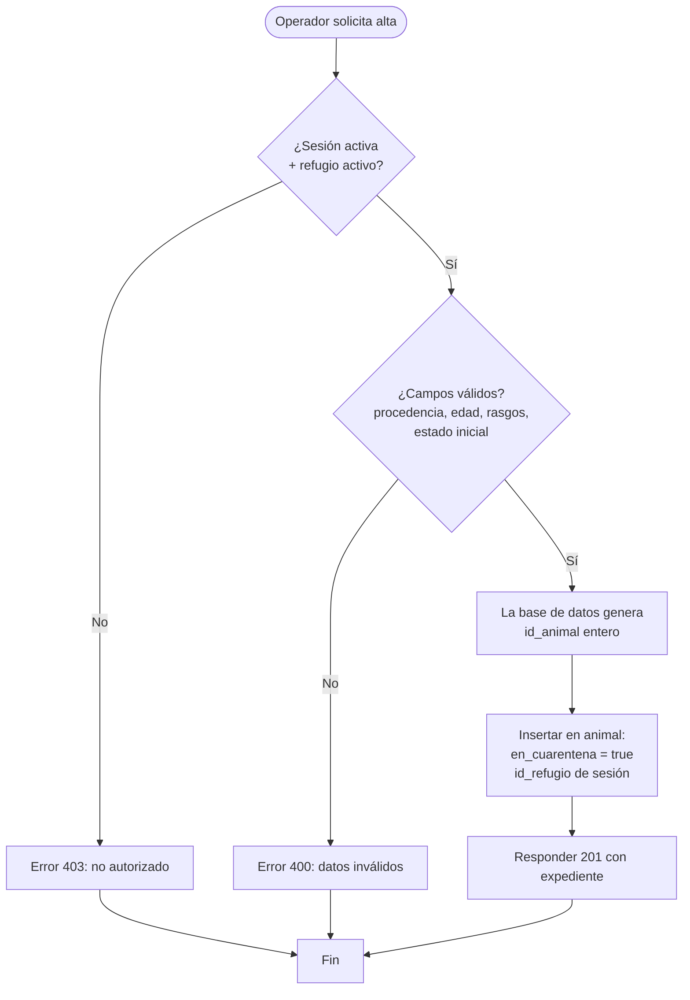
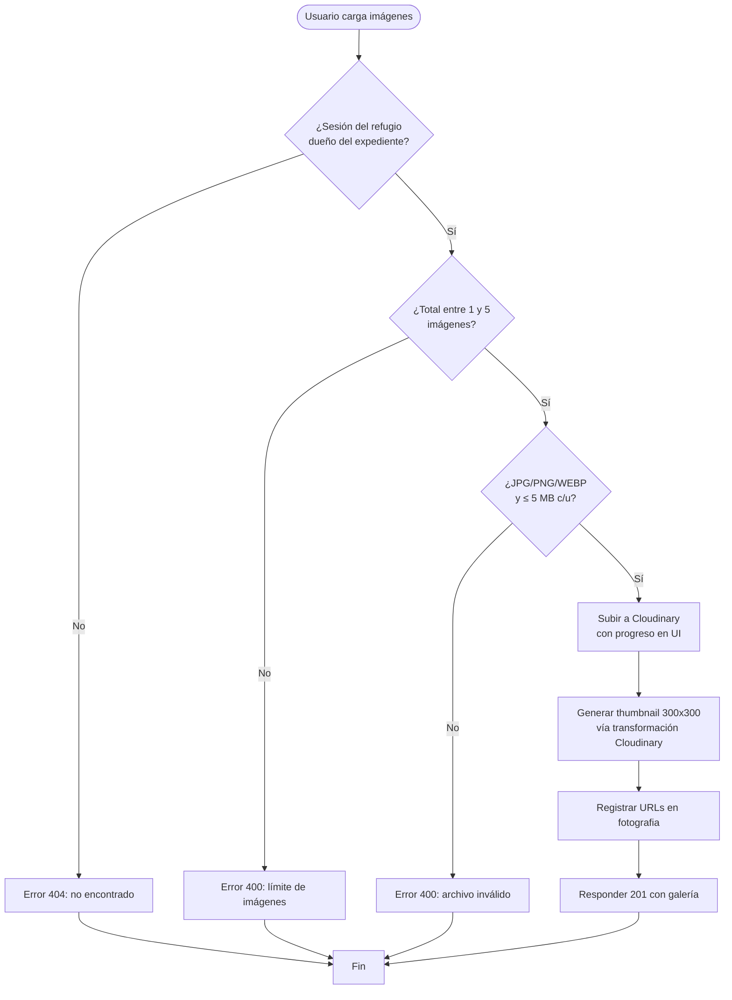
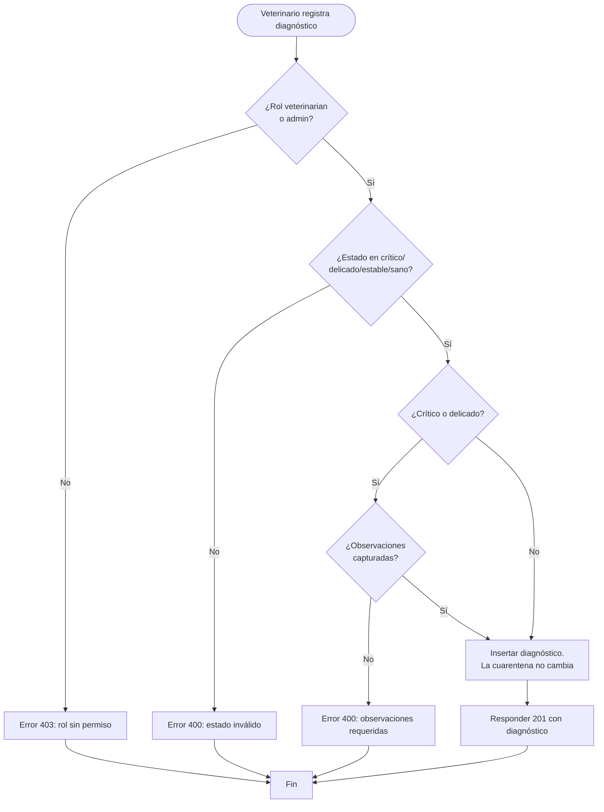
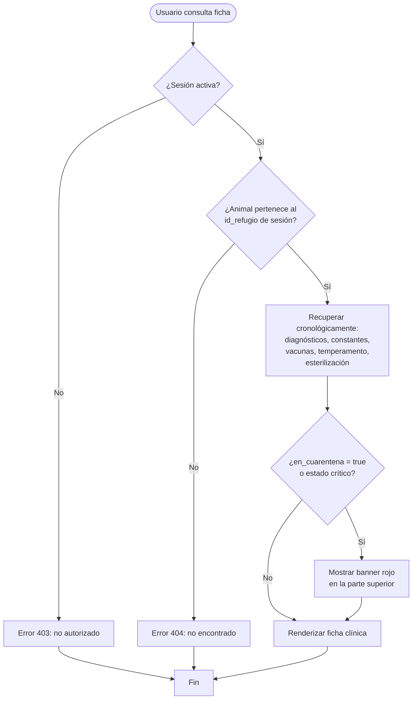

# Requerimiento 01 — Épica 1: Ingresos y Expedientes (Intake)

## Título

Alta de pacientes con expediente clínico único, gestión de archivos multimedia, diagnóstico veterinario de ingreso y ficha clínica centralizada en los refugios Pixkki.

## Descripción

La Épica 1 cubre el proceso de **intake** (ingreso) de animales rescatados: el registro inicial del paciente en la tabla `animal` con identidad autogenerada por la base de datos, la carga de archivos multimedia asociados al expediente con versiones optimizadas en miniatura, la captura del dictamen veterinario inicial y la consolidación de toda la información histórica, médica y operativa del paciente en una única interfaz unificada.

Todo expediente se vincula de forma indisoluble al `id_refugio` del usuario operador que ejecuta la acción. Cada paciente entra al sistema con `en_cuarentena = true` por defecto hasta que el control clínico (Épica 2) determine lo contrario.

## Objetivo

Proveer los módulos de ingreso de pacientes que permitan:

1. Registrar de forma estructurada el ingreso de un animal rescatado y generar su expediente clínico con identidad única.
2. Asociar evidencia multimedia al expediente para facilitar el reconocimiento visual del animal.
3. Capturar el diagnóstico veterinario inicial con reglas condicionales por severidad.
4. Consolidar la información clínica e histórica del paciente en una vista cronológica unificada con alertas de prioridad.

## Alcance

Incluye:

- RF1.1: Alta de paciente y generación de expediente clínico (US05)
- RF1.2: Gestión de archivos multimedia del paciente (US06)
- RF1.3: Registro de diagnóstico veterinario de ingreso (US07)
- RF1.4: Ficha clínica centralizada (US08)

No incluye:

- Registro de chequeo médico inicial y constantes vitales (Épica 2, US09)
- Protocolos de vacunación y desparasitación de entrada (Épica 2, US10)
- Control de aislamiento, alertas de cuarentena y salida de cuarentena (Épica 2, US11)
- Evaluación de temperamento y compatibilidad (Épica 3, US13) — solo se consulta en la ficha
- Procedimientos quirúrgicos y esterilización (Épica 4, US15) — solo se consultan en la ficha
- Validación de aptitud para adopción (Épica 4, US16)
- Publicación de perfiles públicos y portal de adopciones (Épica 5)
- Importación masiva de pacientes históricos (Épica 8, US24)

## Actores

| Actor | Descripción |
|-------|-------------|
| Personal del refugio (operador/coordinador) | Usuario autenticado del refugio. Registra el alta del paciente y gestiona la galería multimedia. |
| Veterinario | Usuario con rol `veterinarian`. Registra el diagnóstico veterinario de ingreso. |
| Administrador de refugio | Usuario con rol `admin`. También puede registrar diagnósticos de ingreso. |
| Sistema (Cloudinary) | Proveedor externo de almacenamiento multimedia. Almacena imágenes y genera miniaturas 300x300. |

## Reglas de negocio

1. **Alta de paciente**: Campos obligatorios: `especie` (Perro/Gato), Procedencia (texto libre, 2–200 caracteres), Rasgos físicos distintivos, Estado inicial (texto descriptivo amplio), `idEstado` e `idEspacio`. La Edad estimada es opcional y se expresa en meses (`edadEstimada`, entero entre 0 y 300).
2. **Identidad única**: El sistema genera automáticamente el identificador entero `id_animal` al insertar el registro. Nunca es capturado por el usuario.
3. **Cuarentena por defecto**: Toda inserción en `animal` establece `en_cuarentena = true`. La salida de cuarentena pertenece a la Épica 2.
4. **Vínculo multitenant**: El expediente se vincula de forma indisoluble al `id_refugio` del operador en sesión. Toda consulta posterior filtra por `id_refugio`; los accesos cruzados entre refugios se rechazan como no encontrados (404).
5. **Galería multimedia**: Entre 1 y 5 imágenes por expediente. Las imágenes no son obligatorias en el alta: el expediente puede crearse sin ellas y completarse después desde la galería. Extensiones permitidas: JPG, PNG y WEBP. Tamaño máximo 5 MB por archivo. La validación se realiza en el servidor e incluye la verificación del tipo MIME real del contenido.
6. **Progreso de subida**: La interfaz muestra un componente interactivo con el progreso de subida de cada archivo.
7. **Miniaturas**: Cloudinary genera los thumbnails de 300x300 píxeles mediante transformación determinista de URL, sin proceso asíncrono.
8. **Portada única**: Máximo una imagen con `es_portada = true` por expediente. Designar una nueva portada desmarca la anterior. Si se elimina la imagen portada, la primera imagen restante se designa automáticamente.
9. **Diagnóstico de ingreso**: El Estado general de salud acepta exclusivamente las categorías: Crítico, Delicado, Estable o Sano. Las observaciones médicas son obligatorias cuando la categoría es Crítico o Delicado. La cuarentena no se decide desde el diagnóstico: todo ingreso ya nace en cuarentena y solo el alta médica de la Épica 2 la libera.
10. **Restricción de rol**: El diagnóstico de ingreso solo puede persistir usuarios con rol Veterinario o Administrador (`veterinarian` | `admin`). La restricción se verifica en el servidor, no únicamente en la UI.
11. **Ficha clínica consolidada**: Organiza cronológicamente diagnósticos, variaciones de constantes vitales, vacunas aplicadas, pruebas de temperamento y estatus de esterilización. Muestra un banner rojo de alta prioridad en la parte superior si `en_cuarentena = true` o el estado de salud es Crítico. La consulta filtra estrictamente por el `id_refugio` activo en sesión.

## Historias de usuario

| ID | Historia de Usuario | Prioridad | Épica | RF relacionados |
|----|---------------------|-----------|-------|-----------------|
| US05 | Creación del perfil y ficha de ingreso (alta del paciente) | Must Have | Épica 1 | RF1.1 |
| US06 | Carga de imágenes del paciente | Must Have | Épica 1 | RF1.2 |
| US07 | Registro de diagnóstico veterinario inicial | Must Have | Épica 1 | RF1.3 |
| US08 | Visualización de la ficha clínica centralizada | Should Have | Épica 1 | RF1.4 |

## Contrato de API

Los endpoints siguen el patrón `/api/v1/<recurso>`. La validación de entrada se hace con Zod antes de cualquier efecto. Los errores se devuelven con formato uniforme.

### Formato de respuesta de éxito

```json
{
  "success": true,
  "data": { ... }
}
```

### Formato de error uniforme

```json
{
  "success": false,
  "error": {
    "code": "ERROR_CODIGO",
    "message": "Mensaje en español para el usuario final",
    "statusCode": 400
  }
}
```

### RF1.1 — Alta de paciente y expediente clínico

| Método | Ruta | Descripción | Acceso |
|--------|------|-------------|--------|
| POST | `/api/v1/animales` | Registrar alta de paciente y expediente | Personal del refugio |
| GET | `/api/v1/animales` | Listar pacientes del refugio | Personal del refugio |
| GET | `/api/v1/animales/{id}` | Detalle del expediente | Personal del refugio |

**Request (POST):**

```json
{
  "especie": "Perro | Gato",
  "procedencia": "string (obligatorio, 2–200 caracteres)",
  "edadEstimada": "integer (opcional, 0–300 meses)",
  "rasgosFisicos": "string (obligatorio, 2–500 caracteres)",
  "estadoInicial": "string (obligatorio, 2–100 caracteres)",
  "idEstado": "integer (obligatorio)",
  "idEspacio": "integer (obligatorio)",
  "idRefugio": "integer (opcional; solo superadmin)",
  "nombre": "string (opcional)",
  "raza": "string (opcional)",
  "sexo": "M | H (opcional)",
  "peso": "number (opcional, > 0)",
  "color": "string (opcional)",
  "tamano": "Pequeño | Mediano | Grande (opcional)",
  "microchip": "string (opcional, 9–20 alfanuméricos)",
  "temperamento": "string (opcional)",
  "lugarRescate": "string (opcional)",
  "fechaRescate": "date (opcional, no futura)",
  "situacionRescate": "string (opcional)",
  "rescatistaNombre": "string (opcional)",
  "rescatistaContacto": "string (opcional)",
  "observaciones": "string (opcional)"
}
```

No se envían imágenes en esta petición. El alta crea el expediente y devuelve su `idAnimal` para gestionar la galería después.

**Response (201):**

```json
{
  "success": true,
  "data": {
    "idAnimal": 128,
    "idRefugio": 3,
    "procedencia": "Calle",
    "edadEstimada": 12,
    "rasgosFisicos": "string",
    "estadoInicial": "string",
    "enCuarentena": true,
    "fechaIngreso": "datetime"
  }
}
```

**Errores:**
- `400` — Datos inválidos (procedencia o rasgos fuera de rango, edad fuera de 0–300, referencias inválidas)
- `403` — Sin sesión activa, refugio inactivo o rol sin permiso
- `404` — Animal no encontrado (GET por id, incluye acceso cruzado entre refugios)
- `500` — Error interno

### RF1.2 — Multimedia del paciente

| Método | Ruta | Descripción | Acceso |
|--------|------|-------------|--------|
| POST | `/api/v1/animales/{id}/imagenes` | Cargar de 1 a 5 imágenes (multipart/form-data) | Personal del refugio |
| GET | `/api/v1/animales/{id}/imagenes` | Galería del expediente | Personal del refugio |
| DELETE | `/api/v1/animales/{id}/imagenes/{idImagen}` | Eliminar imagen | Personal del refugio |
| PATCH | `/api/v1/animales/{id}/imagenes/{idImagen}/portada` | Designar imagen como portada | Personal del refugio |

**Request (POST, multipart/form-data):** archivos entre 1 y 5 por petición. Extensiones JPG, PNG y WEBP. Tamaño máximo 5 MB por archivo. El total de imágenes del expediente (existentes + nuevas) no puede exceder 5. Este endpoint se usa después del alta; el expediente puede existir sin imágenes.

**Response (201):**

```json
{
  "success": true,
  "data": {
    "imagenes": [
      {
        "idImagen": 501,
        "idAnimal": 128,
        "urlPublica": "string (Cloudinary)",
        "urlThumbnail": "string (transformación 300x300)",
        "esPortada": false,
        "orden": 1,
        "tamanoBytes": 1048576
      }
    ]
  }
}
```

**Errores:**
- `400` — `ARCHIVO_NO_PERMITIDO`, `TAMANO_EXCEDIDO`, `LIMITE_IMAGENES_EXCEDIDO`
- `404` — Animal o imagen no encontrados (incluye acceso cruzado entre refugios)
- `500` — Error interno (incluye fallo del proveedor Cloudinary)

### RF1.3 — Diagnóstico veterinario de ingreso

| Método | Ruta | Descripción | Acceso |
|--------|------|-------------|--------|
| POST | `/api/v1/animales/{id}/diagnosticos` | Registrar diagnóstico de ingreso | Veterinario o Administrador |
| GET | `/api/v1/animales/{id}/diagnosticos` | Historial de diagnósticos del expediente | Personal del refugio |

**Request (POST):**

```json
{
  "estadoGeneral": "critico | delicado | estable | sano",
  "observaciones": "string (obligatorio si estadoGeneral = critico o delicado)"
}
```

**Response (201):**

```json
{
  "success": true,
  "data": {
    "idDiagnostico": 42,
    "idAnimal": 128,
    "estadoGeneral": "Estable",
    "requiereCuarentena": false,
    "observaciones": "string | null",
    "idUsuarioVeterinario": 7,
    "fechaDiagnostico": "datetime"
  }
}
```

`requiereCuarentena` se conserva como dato histórico de solo lectura y siempre se persiste en `false`: no forma parte del request ni altera `enCuarentena`.

**Errores:**
- `400` — Estado fuera del catálogo exclusivo; observaciones faltantes cuando el estado es Crítico o Delicado (`OBSERVACIONES_REQUERIDAS`)
- `403` — Rol sin permiso (solo `veterinarian` | `admin`)
- `404` — Animal no encontrado
- `500` — Error interno

### RF1.4 — Ficha clínica centralizada

| Método | Ruta | Descripción | Acceso |
|--------|------|-------------|--------|
| GET | `/api/v1/animales/{id}/ficha-clinica` | Ficha consolidada cronológica del paciente | Personal del refugio |

**Response (200):**

```json
{
  "success": true,
  "data": {
    "animal": {
      "idAnimal": 128,
      "procedencia": "string",
      "enCuarentena": true,
      "estadoInicial": "string"
    },
    "alertas": ["cuarentena", "estado_critico"],
    "linea_tiempo": [
      {
        "tipo": "diagnostico | constante_vital | vacuna | prueba_temperamento | esterilizacion",
        "fecha": "datetime",
        "detalle": { }
      }
    ]
  }
}
```

**Errores:**
- `403` — Sin sesión activa
- `404` — Animal no encontrado (incluye intento de acceso cruzado entre refugios)
- `500` — Error interno

## Plan de implementación backend-first

| Paso | Acción | Artefacto |
|------|--------|-----------|
| 1 | Definir OpenAPI para el módulo animals | `modules/animals/contracts/openapi.yaml` |
| 2 | Implementar Zod schemas de entrada (alta, imágenes, diagnóstico) | `modules/animals/validators/` |
| 3 | Implementar repositories con filtro `id_refugio` | `modules/animals/repositories/` |
| 4 | Implementar services (lógica pura, sin Supabase ni Cloudinary) | `modules/animals/services/` |
| 5 | Implementar adaptador de almacenamiento Cloudinary | `lib/storage/` |
| 6 | Implementar Route Handlers versionados `/api/v1/` | `app/api/v1/...` |
| 7 | Pruebas aisladas del backend | Equipo de QA (externo a este documento) |
| 8 | Ampliar contrato v1 | Tag git `api-v1.1` |
| 9 | Frontend consume contrato vía Server Actions | Server Actions como adaptador |

## Riesgos y dependencias

| Riesgo | Mitigación |
|--------|------------|
| Server Actions de Next.js limitan el body por defecto (1 MB), insuficiente para imágenes de 5 MB | Subir archivos vía Route Handler `/api/v1/animales/{id}/imagenes` (multipart) o firma directa de Cloudinary |
| Archivos maliciosos con extensión válida pero contenido distinto | Validar tipo MIME real del contenido en el servidor, no solo la extensión |
| Fallo parcial entre Cloudinary y la base de datos deja registros huérfanos | Ordenar operaciones: subir a Cloudinary primero, insertar el registro después; limpieza compensatoria en fallo |
| Eliminar la imagen portada deja el expediente sin portada | Reasignar automáticamente la primera imagen restante |
| Expediente con 0 o más de 5 imágenes | Validar el conteo total (existentes + nuevas) en el servidor contra la base de datos |
| Miniaturas inconsistentes entre imágenes | Transformación determinista de Cloudinary (misma URL estándar 300x300) |
| Acceso cruzado entre refugios | Filtro `id_refugio` en todos los repositories + RLS como segunda capa |

**Dependencias:** Cloudinary SDK (nueva dependencia, requiere aprobación), tablas `animal` (extensión), `fotografia`, `diagnostico_veterinario`, módulo auth/RBAC de la Épica 0, Zod.

## Glosario

| Término | Definición |
|---------|------------|
| Intake (ingreso) | Proceso inicial de registro de un animal rescatado en el refugio. |
| Expediente clínico | Registro digital único de un paciente, identificado por `id_animal` (entero autogenerado) y vinculado a un `id_refugio`. |
| Portada | Imagen designada como foto principal del expediente. Única por expediente. |
| Thumbnail (miniatura) | Versión optimizada de una imagen con dimensiones fijas de 300x300 píxeles. |
| Cuarentena (`en_cuarentena`) | Flag de control clínico. Se establece en `true` al alta del paciente. Su liberación pertenece a la Épica 2. |
| Estado general de salud | Clasificación exclusiva del diagnóstico de ingreso: Crítico, Delicado, Estable o Sano. |
| Edad estimada | Edad aproximada del paciente en meses (`edadEstimada`, entero entre 0 y 300). Es opcional. |
| Cloudinary | Proveedor de almacenamiento multimedia en la nube elegido para RF1.2, con transformación de imágenes nativa. |
| Transformación determinista | URL de Cloudinary que genera la miniatura 300x300 bajo demanda, sin proceso asíncrono. |
| DoR | Definition of Ready. Condiciones que deben cumplirse antes de iniciar una feature. |
| DoD | Definition of Done. Condiciones que deben cumplirse antes de considerar una feature terminada. |

## Diagramas de flujo (mermaid)

### Flujo de alta de paciente (RF1.1)



### Flujo de carga de imágenes (RF1.2)



### Flujo de diagnóstico veterinario de ingreso (RF1.3)



### Flujo de consulta de ficha clínica (RF1.4)



## Criterios de aceptación por historia de usuario

| US | Criterios de aceptación |
|----|------------------------|
| US05 | El operador registra un paciente con Especie, Procedencia (texto libre), Edad estimada opcional en meses, Rasgos físicos distintivos, Estado inicial descriptivo, estado y espacio. El sistema genera el `id_animal` entero automáticamente, asigna `en_cuarentena = true` y vincula el expediente al `id_refugio` de sesión, impidiendo accesos cruzados. |
| US06 | El expediente puede crearse sin imágenes. El usuario carga entre 1 y 5 imágenes (JPG/PNG/WEBP, ≤ 5 MB por archivo, validado en servidor) desde la ficha del animal. La UI muestra el progreso interactivo de subida por archivo. Puede eliminar imágenes y designar una como portada principal. Las miniaturas 300x300 se generan automáticamente vía Cloudinary. |
| US07 | Solo usuarios con rol Veterinario o Administrador registran el diagnóstico de ingreso con Estado general de salud (Crítico/Delicado/Estable/Sano). Si el estado es Crítico o Delicado, las observaciones médicas son obligatorias (error 400 si faltan). La cuarentena no se modifica desde el diagnóstico. |
| US08 | La ficha clínica muestra cronológicamente diagnósticos, constantes vitales, vacunas, pruebas de temperamento y estatus de esterilización. Presenta banner rojo en la parte superior si `en_cuarentena = true` o el estado de salud es Crítico. La consulta filtra estrictamente por el `id_refugio` activo en sesión. |

## Esquema de base de datos implicado

Las siguientes tablas de Supabase están involucradas en el Requerimiento 1:

| Tabla | Campo clave | Descripción |
|-------|-------------|-------------|
| `animal` | `id_animal` (integer, PK), `id_refugio` (FK) | Paciente y su expediente. Campos: `procedencia` (text), `edad_estimada` (integer, meses), `rasgos_fisicos`, `estado_inicial`, `en_cuarentena` (bool, default true), `fecha_ingreso`. |
| `fotografia` | `id_fotografia` (integer, PK), `id_animal` (FK) | Multimedia del expediente. Campos: `public_id`, `url`, `url_thumbnail` (300x300), `es_principal` (bool), `orden`, `formato`, `tamano_mb`, `fecha_subida`. |
| `diagnostico_veterinario` | `id_diagnostico` (integer, PK), `id_animal` (FK) | Diagnóstico veterinario inicial. Campos: `estado_general`, `requiere_cuarentena` (histórico, siempre false), `descripcion` (observaciones), `id_usuario` (FK), `fecha_diagnostico`. |
| `constantes_vitales` | — | Referenciada por la ficha clínica (solo lectura). Se crea en la Épica 2. |
| `vacunas` | — | Referenciada por la ficha clínica (solo lectura). Se crea en la Épica 2. |
| `pruebas_temperamento` | — | Referenciada por la ficha clínica (solo lectura). Se crea en la Épica 3. |
| `procedimientos_quirurgicos` | — | Referenciada por la ficha clínica (solo lectura; esterilización). Se crea en la Épica 4. |

**Regla multitenant:** Toda consulta a `animal`, `fotografia` y `diagnostico_veterinario` debe filtrar por `id_refugio` obtenido del JWT de sesión. `fotografia` y `diagnostico_veterinario` no exponen `id_refugio` directamente: el acceso se valida comprobando que el animal pertenezca al refugio de la sesión. RLS como segunda capa de defensa.

## Plan de implementación backend-first (detallado por módulo)

| Módulo | Archivos clave | Endpoints `/api/v1/` |
|--------|---------------|----------------------|
| animals (extensión) | `modules/animals/contracts/openapi.yaml`<br>`modules/animals/validators/` (extender `animal.validators.ts`)<br>`modules/animals/repositories/` (`animal-multimedia.repository.ts`, `animal-diagnosis.repository.ts`, `clinical-record.repository.ts`)<br>`modules/animals/services/` (extender `animal.service.ts`)<br>`modules/animals/factories/` | `POST /animales`<br>`GET /animales`<br>`GET /animales/{id}`<br>`POST /animales/{id}/imagenes`<br>`GET /animales/{id}/imagenes`<br>`DELETE /animales/{id}/imagenes/{idImagen}`<br>`PATCH /animales/{id}/imagenes/{idImagen}/portada`<br>`POST /animales/{id}/diagnosticos`<br>`GET /animales/{id}/diagnosticos`<br>`GET /animales/{id}/ficha-clinica` |
| storage (infraestructura transversal) | `lib/storage/storage.adapter.ts` (contrato)<br>`lib/storage/cloudinary.adapter.ts` (implementación) | Sin endpoints. Consumido exclusivamente desde los repositories de `animals`. |

---

**Versión**: 1.1  
**Estado**: Implementado  
**Última actualización**: 16/11/2026
