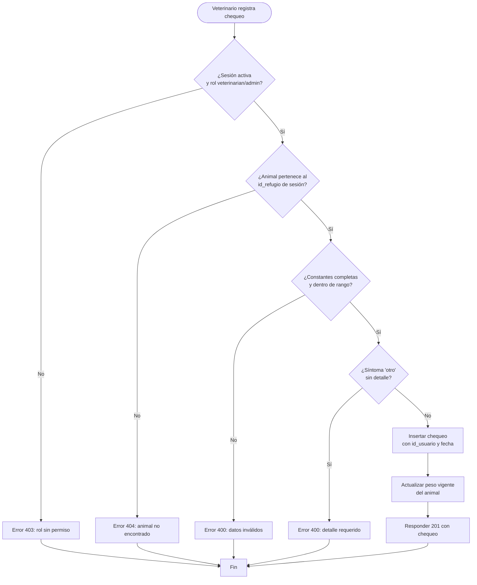
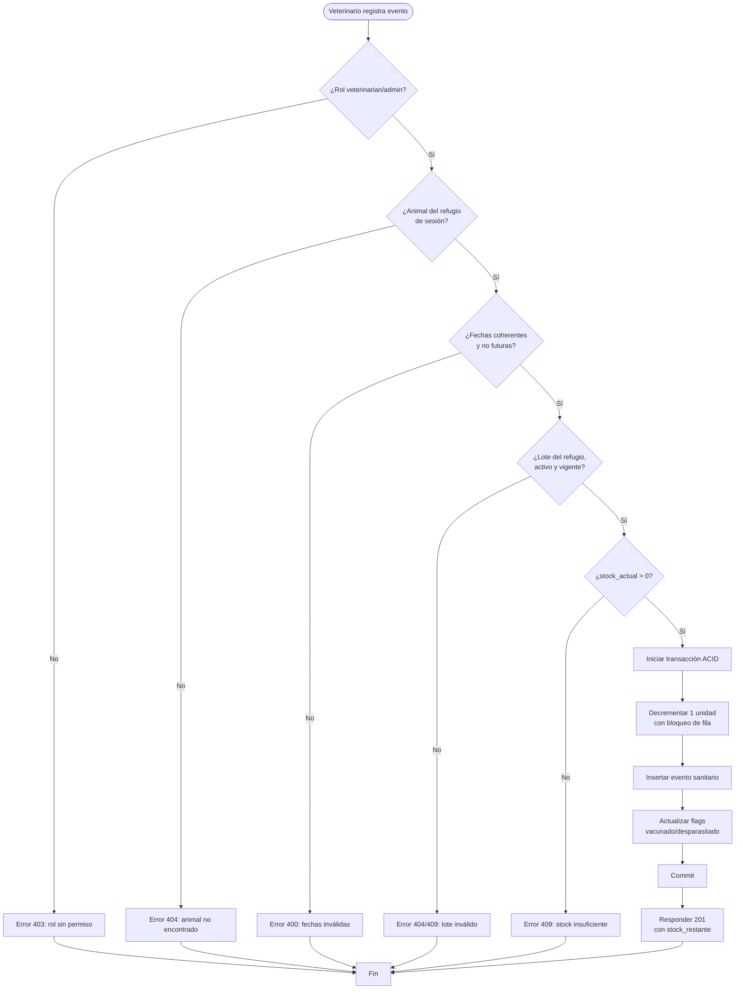
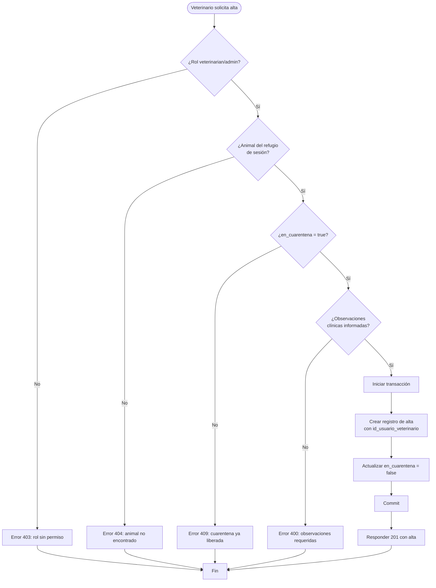
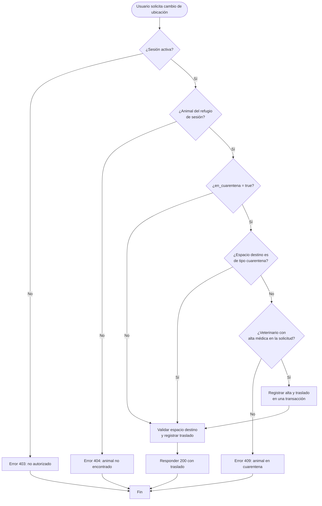

# Requerimiento 02 — Épica 2: Control Clínico y Cuarentena

## Título

Seguimiento clínico preventivo del paciente: chequeos médicos con constantes vitales, vacunación y desparasitación con descuento transaccional de inventario, y control de aislamiento con alta médica de cuarentena en los refugios Pixkki.

## Descripción

La Épica 2 cubre el **control clínico preventivo** del paciente desde su ingreso al refugio. Sobre el expediente creado en la Épica 1, esta épica incorpora tres capacidades:

1. El **chequeo médico** con constantes vitales (peso, temperatura, frecuencias cardiaca y respiratoria) y una checklist estandarizada de sintomatología.
2. El **registro de eventos sanitarios** de vacunación y desparasitación de entrada, con marca/lote, fechas de refuerzo y esquema, descontando automáticamente una unidad del lote de inventario seleccionado dentro de una transacción ACID.
3. El **control de aislamiento**, que mantiene a todo nuevo ingreso en cuarentena, expone una alerta visual de riesgo biológico y bloquea el traslado a áreas generales hasta que un Veterinario registre el alta médica.

Toda operación se vincula de forma indisoluble al `id_refugio` del usuario en sesión. El módulo `animals` es el dueño del dominio clínico; el módulo `inventory` (Épica 6) es el dueño del stock y se consume a través de un puerto público, sin acceso cruzado a sus repositories.

## Objetivo

Proveer los módulos de control clínico y cuarentena que permitan:

1. Registrar y consultar cronológicamente los chequeos médicos del paciente con sus constantes vitales y síntomas.
2. Registrar la vacunación y desparasitación de entrada, descontando el stock de inventario de forma atómica y bloqueando la operación si no hay existencias.
3. Garantizar que todo nuevo ingreso permanezca en cuarentena y que solo un Veterinario o Administrador pueda liberarlo mediante un alta médica.
4. Impedir el traslado de un paciente en cuarentena a áreas generales, preservando la trazabilidad clínica y el aislamiento biológico.
5. Integrar los nuevos eventos en la ficha clínica centralizada (US08) y en las alertas visuales del sistema.

## Alcance

Incluye:

- RF2.1: Registro de chequeo médico y constantes vitales (US09)
- RF2.2: Historial de vacunación y desparasitación de entrada (US10)
- RF2.3: Integración transaccional con inventario para el descuento de stock (US10; regla compartida con US15)
- RF2.4: Cuarentena por defecto, alertas de aislamiento y alta médica (US11)

No incluye:

- Diagnóstico veterinario de ingreso (Épica 1, US07) — solo se consulta y se complementa.
- Ficha clínica centralizada (Épica 1, US08) — esta épica solo aporta nuevos eventos al modelo de lectura.
- Cambio de ubicación a áreas generales (Épica 3, US12) — esta épica define la regla de bloqueo, pero el endpoint de traslado pertenece a US12.
- Evaluación de temperamento y compatibilidad (Épica 3, US13).
- Registro de esterilización/castración (Épica 4, US15) — consume la misma regla de descuento de inventario, pero su implementación es de otra épica.
- CRUD completo de inventario, donaciones y alertas de stock mínimo (Épica 6, US20 y US23) — esta épica solo consume el stock existente.
- Reportes de población, capacidad o inventario (Épica 7).
- Edición y eliminación de registros clínicos: los chequeos, eventos sanitarios y altas de cuarentena son registros append-only; las correcciones se documentan con un nuevo registro.

## Actores

| Actor | Descripción |
|-------|-------------|
| Veterinario | Usuario con rol `veterinarian`. Registra chequeos, eventos sanitarios y altas médicas de cuarentena. |
| Administrador de refugio | Usuario con rol `admin`. Puede ejecutar las mismas operaciones clínicas que el Veterinario dentro de su refugio. |
| Personal del refugio (operador/coordinador/evaluador) | Usuario autenticado del refugio. Puede consultar el historial clínico y el estado de cuarentena, pero no registrar chequeos, eventos sanitarios ni altas médicas. |
| Sistema de inventario | Módulo interno `inventory` (Épica 6). Provee los lotes con stock disponible y ejecuta el descuento atómico. No es un actor humano. |
| Superadmin | Rol global. No participa en el flujo clínico ordinario; su acceso de solo lectura queda sujeto a la política global de la Épica 0. |

## Reglas de negocio

1. **Chequeo médico obligatorio y estructurado**: Todo chequeo registra Peso (kg), Temperatura (°C), Frecuencia cardiaca (lpm) y Frecuencia respiratoria (rpm). Los cuatro campos son obligatorios y deben ser valores numéricos positivos dentro de rangos clínicos razonables.
2. **Rangos de constantes vitales**: Peso `> 0` y `≤ 200` kg; Temperatura entre `30.0` y `45.0` °C; Frecuencia cardiaca entre `20` y `300` lpm; Frecuencia respiratoria entre `5` y `150` rpm. Un valor fuera de rango se rechaza con error de validación.
3. **Checklist de síntomas**: Los síntomas permitidos son `vomito`, `diarrea`, `letargia`, `secrecion_nasal_ocular`, `tos` y `otro`. La lista puede estar vacía (paciente asintomático). Si se selecciona `otro`, el campo `sintoma_otro_detalle` es obligatorio.
4. **Fecha del chequeo**: Se registra automáticamente con la fecha/hora del servidor. Si se captura manualmente, no puede ser futura. Se almacena en UTC y se presenta en la zona horaria del refugio.
5. **Restricción de rol clínico**: Solo los roles `veterinarian` y `admin` pueden registrar chequeos, eventos sanitarios y altas de cuarentena. La restricción se valida en el servidor (Route Handler/Server Action) antes de cualquier efecto, no únicamente en la UI.
6. **Evento sanitario unificado**: La vacunación y la desparasitación se registran como eventos sanitarios con `tipo_evento` (`vacunacion` | `desparasitacion`). Campos obligatorios: tipo de biológico/producto, fecha de aplicación, lote de inventario y esquema (completo/incompleto). Campos opcionales: marca/lote comercial, fecha de refuerzo y observaciones.
7. **Coherencia de fechas**: `fecha_aplicacion` no puede ser futura. Si existe `fecha_refuerzo`, debe ser posterior a `fecha_aplicacion`. Cuando `esquema_completo = true`, `fecha_refuerzo` es obligatoria; cuando es `false`, puede ser nula.
8. **Descuento de inventario**: Al registrar un evento sanitario, el sistema descuenta exactamente **1 unidad** del lote de inventario seleccionado. El lote debe pertenecer al `id_refugio` de sesión y tener `stock_actual > 0`. El descuento y la inserción del evento ocurren en una única transacción ACID.
9. **Bloqueo por stock insuficiente**: Si el lote no existe, está inactivo, pertenece a otro refugio o su stock es `0`, la operación se rechaza y no se crea el evento sanitario. Nunca se permite stock negativo.
10. **Concurrencia de stock**: El descuento se ejecuta con bloqueo de fila o decremento atómico condicional. Si dos usuarios compiten por la última unidad, solo uno completa la operación y el otro recibe un conflicto de stock.
11. **Actualización de flags del expediente**: Al registrar el primer evento de tipo `vacunacion`, el campo `animal.vacunado` pasa a `true`; al registrar el primero de tipo `desparasitacion`, `animal.desparasitado` pasa a `true`. Los flags no se revierten al eliminar eventos, porque los registros clínicos no se eliminan.
12. **Peso vigente del paciente**: `chequeos_medicos.peso_kg` conserva el histórico. El campo `animal.peso` se actualiza con el peso del último chequeo para que catálogo, reportes y listados consuman el valor vigente sin duplicar la fuente histórica.
13. **Cuarentena por defecto**: Todo nuevo ingreso se crea con `en_cuarentena = true` y con `id_estado` apuntando al estado "Cuarentena" del catálogo, resuelto en el servidor por nombre normalizado. El cliente no elige el estado. Esta épica no permite crear un animal fuera de cuarentena ni desactivar el flag por edición directa del expediente.
14. **Alerta de riesgo biológico**: Mientras `en_cuarentena = true`, el paciente muestra el badge rojo de alto contraste **"AISLAMIENTO / RIESGO BIOLÓGICO"** en listados y ficha, y el banner rojo de la ficha clínica (US08). La alerta nunca depende solo del color: incluye texto explícito para accesibilidad.
15. **Alta médica de cuarentena**: Solo `veterinarian` o `admin` pueden registrar el alta. El alta exige observaciones clínicas y establece `en_cuarentena = false` de forma atómica junto con la creación del registro de alta.
16. **Alta única y no repetible**: No se puede registrar un alta sobre un paciente que ya no está en cuarentena. El intento devuelve `CUARENTENA_YA_LIBERADA` sin modificar el expediente.
17. **Bloqueo de traslado**: Mientras `en_cuarentena = true`, ningún paciente puede trasladarse a un espacio de tipo distinto de `cuarentena`. La validación se aplica en el servicio de cambio de ubicación (US12), que debe consultar el estado de cuarentena antes de persistir el movimiento. La única forma de habilitar el traslado es registrar el alta médica en esta épica.
18. **Multitenant**: Toda consulta y mutación filtra por el `id_refugio` obtenido de la sesión. Un acceso a un animal, chequeo, evento o alta de otro refugio se responde como `404` (no se revela su existencia).
19. **Trazabilidad**: Todo registro clínico almacena `id_usuario` responsable y fecha/hora de creación. Las operaciones quedan disponibles para la ficha clínica y para auditoría.
20. **Integración con la ficha clínica**: Los chequeos y eventos sanitarios se incorporan a la línea de tiempo cronológica de US08. El alta de cuarentena se muestra como un evento clínico con su observación y responsable.

## Inconsistencias y alineación con el estado actual del repositorio

| Elemento | Estado actual | Implicación para esta épica |
|----------|---------------|-----------------------------|
| `animal.en_cuarentena` | Ya existe en la tabla `animal`. | Se reutiliza; no requiere nueva columna. |
| Default de `en_cuarentena` en la creación | `CreateAnimalSchema` ya usa `enCuarentena = true` por defecto y `AnimalService.create` lo fuerza a `true` aunque el cliente envíe otro valor. | Regla cubierta; no requiere migración. |
| Estado del catálogo al ingreso | El alta no acepta `idEstado` del cliente. `AnimalStateService.requireCuarentenaId()` resuelve "Cuarentena" por nombre normalizado y el alta falla con `409 ESTADO_CUARENTENA_NO_CONFIGURADO` si no existe. | Regla cubierta; el seed `20261120120000_seed_animal_estado_cuarentena.sql` garantiza la fila en entornos nuevos. |
| `animal.vacunado` / `animal.desparasitado` | Ya existen como flags. | Se actualizan como estado derivado de los eventos sanitarios. |
| `vacunacion` | Existe, pero solo modela vacunas y no tiene `id_refugio`, `tipo_evento` ni vínculo con inventario. | Requiere migración aprobada para convertirse en `evento_sanitario` (o extenderla manteniendo compatibilidad). |
| `chequeos_medicos` | No existe. | Se crea en esta épica. |
| `chequeo_sintomas` | No existe. | Se crea para normalizar la checklist de síntomas. |
| `altas_cuarentena` | No existe. | Se crea para trazabilidad del alta médica. |
| Inventario (`inventario_lote`, `inventario_movimiento`) | No existe en el esquema actual. | Dependencia bloqueante de Épica 6 para cumplir RF2.3. |
| Identificadores | El esquema actual usa enteros autoincrementales (`id_*`), no UUID. | El contrato usa `{id}` genérico y tipos `integer`; no se introduce UUID en esta épica. |
| Módulo `inventory` | No existe. | Debe crearse o adelantarse su contrato mínimo antes de implementar US10. |

> **Decisión aprobada (16/11/2026):** se adopta la alternativa (a): adelantar el contrato mínimo del módulo `inventory` para cumplir US10 sin simular stock. El descuento real se ejecuta en la RPC transaccional `registrar_evento_sanitario` definida en `supabase/migrations/20261116130000_requerimiento_02_inventario_evento_sanitario.sql`. Esa migración se entrega como archivo y requiere `supabase db push` aprobado por el equipo antes de estar disponible en el entorno remoto.

## Historias de usuario

| ID | Historia de Usuario | Prioridad | Épica | RF relacionados |
|----|---------------------|-----------|-------|-----------------|
| US09 | Registro de chequeo médico y constantes vitales | Must Have | Épica 2 | RF2.1 |
| US10 | Gestión de vacunación y desparasitación de entrada | Must Have | Épica 2 | RF2.2, RF2.3 |
| US11 | Control de aislamiento y alertas de cuarentena | Must Have | Épica 2 | RF2.4 |

## Contrato de API

Los endpoints siguen el patrón `/api/v1/<recurso>`. La validación de entrada se hace con Zod antes de cualquier efecto. Los errores se devuelven con formato uniforme.

### Formato de respuesta de éxito

```json
{
  "success": true,
  "data": { ... }
}
```

### Formato de error uniforme

```json
{
  "success": false,
  "error": {
    "code": "ERROR_CODIGO",
    "message": "Mensaje en español para el usuario final",
    "statusCode": 400
  }
}
```

### RF2.1 — Chequeo médico y constantes vitales

| Método | Ruta | Descripción | Acceso |
|--------|------|-------------|--------|
| POST | `/api/v1/animales/{id}/chequeos` | Registrar un chequeo médico | Veterinario o Administrador |
| GET | `/api/v1/animales/{id}/chequeos` | Historial de chequeos del paciente | Personal del refugio |

**Request (POST):**

```json
{
  "peso_kg": 12.4,
  "temperatura_c": 38.5,
  "frecuencia_cardiaca": 110,
  "frecuencia_respiratoria": 28,
  "sintomas": ["vomito", "letargia"],
  "sintoma_otro_detalle": "string (obligatorio solo si sintomas incluye 'otro')",
  "observaciones": "string (opcional)",
  "fecha_chequeo": "datetime (opcional, por defecto now())"
}
```

**Response (201):**

```json
{
  "success": true,
  "data": {
    "id_chequeo": 123,
    "id_animal": 45,
    "id_refugio": 7,
    "peso_kg": 12.4,
    "temperatura_c": 38.5,
    "frecuencia_cardiaca": 110,
    "frecuencia_respiratoria": 28,
    "sintomas": ["vomito", "letargia"],
    "sintoma_otro_detalle": null,
    "observaciones": "string | null",
    "id_usuario": 9,
    "fecha_chequeo": "datetime"
  }
}
```

**Errores:**
- `400` — `DATOS_INVALIDOS`, `CONSTANTE_FUERA_DE_RANGO`, `SINTOMA_OTRO_REQUERIDO`, `FECHA_FUTURA`
- `403` — `ROL_SIN_PERMISO` (solo `veterinarian` \| `admin`)
- `404` — `ANIMAL_NO_ENCONTRADO` (incluye acceso cruzado entre refugios)
- `500` — `ERROR_INTERNO`

### RF2.2 / RF2.3 — Eventos sanitarios y descuento de inventario

| Método | Ruta | Descripción | Acceso |
|--------|------|-------------|--------|
| POST | `/api/v1/animales/{id}/eventos-sanitarios` | Registrar vacunación o desparasitación y descontar stock | Veterinario o Administrador |
| GET | `/api/v1/animales/{id}/eventos-sanitarios` | Historial de eventos sanitarios | Personal del refugio |
| GET | `/api/v1/inventario/lotes` | Listar lotes con stock disponible (contrato mínimo provisto por Épica 6) | Veterinario o Administrador |

**Request (POST de evento sanitario):**

```json
{
  "tipo_evento": "vacunacion | desparasitacion",
  "tipo_biologico": "string (obligatorio)",
  "fecha_aplicacion": "date (obligatorio, no futura)",
  "marca_lote": "string (opcional)",
  "fecha_refuerzo": "date | null (opcional, posterior a fecha_aplicacion)",
  "esquema_completo": "boolean (obligatorio)",
  "id_lote_inventario": "integer (obligatorio, lote del refugio con stock > 0)",
  "observaciones": "string (opcional)"
}
```

> La cantidad descontada no la captura el usuario: US10 establece **1 unidad** por evento. El servidor la fija y la devuelve en la respuesta.

**Response (201):**

```json
{
  "success": true,
  "data": {
    "id_evento": 321,
    "id_animal": 45,
    "id_refugio": 7,
    "tipo_evento": "vacunacion",
    "tipo_biologico": "Rabia",
    "marca_lote": "Nobivac-R-2026",
    "fecha_aplicacion": "2026-11-12",
    "fecha_refuerzo": "2027-11-12",
    "esquema_completo": true,
    "id_lote_inventario": 88,
    "cantidad_descontada": 1,
    "stock_restante": 14,
    "id_usuario": 9,
    "fecha_registro": "datetime"
  }
}
```

**Request (GET `/api/v1/inventario/lotes`):** query params `tipo_insumo` (`vacuna` \| `desparasitante`) y `disponibles=true`.

**Response (200 de lotes):**

```json
{
  "success": true,
  "data": {
    "lotes": [
      {
        "id_lote_inventario": 88,
        "nombre_insumo": "Vacuna antirrábica",
        "tipo_insumo": "vacuna",
        "marca": "Nobivac",
        "lote": "R-2026",
        "stock_actual": 15,
        "unidad_medida": "dosis",
        "fecha_caducidad": "2027-06-30"
      }
    ]
  }
}
```

**Errores:**
- `400` — `DATOS_INVALIDOS`, `TIPO_EVENTO_INVALIDO`, `FECHA_REFUERZO_INVALIDA`, `REFUERZO_REQUERIDO`
- `403` — `ROL_SIN_PERMISO`
- `404` — `ANIMAL_NO_ENCONTRADO`, `LOTE_NO_ENCONTRADO`
- `409` — `STOCK_INSUFICIENTE`, `LOTE_INACTIVO`, `LOTE_VENCIDO`, `CONFLICTO_CONCURRENCIA`
- `500` — `ERROR_INTERNO`, `FALLO_TRANSACCION_INVENTARIO`

### RF2.4 — Cuarentena y alta médica

| Método | Ruta | Descripción | Acceso |
|--------|------|-------------|--------|
| GET | `/api/v1/animales/{id}/cuarentena` | Consultar estado, alerta e historial de altas | Personal del refugio |
| POST | `/api/v1/animales/{id}/alta-cuarentena` | Registrar alta médica y liberar cuarentena | Veterinario o Administrador |

**Response (200 de consulta):**

```json
{
  "success": true,
  "data": {
    "id_animal": 45,
    "en_cuarentena": true,
    "alerta": {
      "codigo": "AISLAMIENTO_RIESGO_BIOLOGICO",
      "color": "rojo",
      "texto": "AISLAMIENTO / RIESGO BIOLÓGICO"
    },
    "fecha_ingreso": "datetime",
    "alta": null,
    "historial_altas": []
  }
}
```

**Request (POST de alta):**

```json
{
  "observaciones": "string (obligatorio, justificación clínica del alta)",
  "fecha_alta": "datetime (opcional, por defecto now())"
}
```

**Response (201):**

```json
{
  "success": true,
  "data": {
    "id_alta": 12,
    "id_animal": 45,
    "id_refugio": 7,
    "en_cuarentena": false,
    "observaciones": "string",
    "id_usuario_veterinario": 9,
    "fecha_alta": "datetime"
  }
}
```

**Errores:**
- `400` — `OBSERVACIONES_REQUERIDAS`, `FECHA_FUTURA`
- `403` — `ROL_SIN_PERMISO`
- `404` — `ANIMAL_NO_ENCONTRADO`
- `409` — `CUARENTENA_YA_LIBERADA`
- `500` — `ERROR_INTERNO`

### Regla de contrato para US12 (fuera de alcance, pero obligatoria)

El endpoint de cambio de ubicación de la Épica 3 debe rechazar el traslado a un espacio de tipo distinto de `cuarentena` cuando `en_cuarentena = true`, con `409 ANIMAL_EN_CUARENTENA`. La única excepción es que la misma operación incluya el alta médica registrada por un Veterinario o Administrador. Este requerimiento documenta la regla; la implementación del endpoint pertenece a US12.

## Plan de implementación backend-first

| Paso | Acción | Artefacto |
|------|--------|-----------|
| 1 | Definir OpenAPI del módulo animals (chequeos, eventos sanitarios, cuarentena) | `modules/animals/contracts/openapi.yaml` |
| 2 | Definir contrato mínimo del módulo inventory | `modules/inventory/contracts/openapi.yaml` |
| 3 | Implementar Zod schemas de entrada | `modules/animals/validators/` |
| 4 | Implementar repositories con filtro `id_refugio` | `modules/animals/repositories/` |
| 5 | Implementar puerto de inventario (interfaz) y su adaptador | `modules/inventory/ports/`, `modules/inventory/factories/` |
| 6 | Implementar services con transacción ACID para eventos sanitarios | `modules/animals/services/` |
| 7 | Implementar Route Handlers versionados `/api/v1/` | `app/api/v1/...` |
| 8 | Extender el modelo de lectura de la ficha clínica | `modules/animals/repositories/clinical-record.repository.ts` |
| 9 | Pruebas aisladas del backend | Equipo de QA (externo a este documento) |
| 10 | Ampliar contrato v1 | Tag git `api-v1.2` |
| 11 | Frontend consume contrato vía Server Actions | Server Actions como adaptador |

## Riesgos y dependencias

| Riesgo | Mitigación |
|--------|------------|
| US10 (Must Have) depende de un módulo de inventario que aún no existe | Aprobar el adelanto del contrato mínimo de `inventory` o reordenar el sprint; no simular stock. |
| Descuento de stock y creación del evento en operaciones separadas deja inconsistencias | Ejecutar ambos efectos en una única transacción/RPC de base de datos. |
| Dos usuarios compiten por la última unidad del lote | Decremento atómico condicional (`stock_actual > 0`) o bloqueo de fila; uno recibe `STOCK_INSUFICIENTE`/`CONFLICTO_CONCURRENCIA`. |
| La tabla `vacunacion` existente no modela desparasitación ni multitenant | Migración aprobada a `evento_sanitario` con `id_refugio`, `tipo_evento` y vínculo a lote. |
| Un usuario sin rol clínico invoca el endpoint directamente | RBAC en el servidor antes de cualquier efecto; la UI solo oculta, no autoriza. |
| El traslado de US12 omite la validación de cuarentena | Regla compartida en el service de ubicación y prueba de integración; `en_cuarentena` como fuente de verdad. |
| La ficha clínica no muestra los nuevos eventos | Extender el read model de `clinical-record` para incluir chequeos, eventos sanitarios y altas. |
| Registros clínicos editados o eliminados rompen la trazabilidad | Diseño append-only; sin endpoints de edición/eliminación en esta épica. |
| Fechas y zonas horarias inconsistentes | Almacenar `timestamptz` en UTC y presentar en la zona del refugio. |
| Alertas que dependen solo del color excluyen usuarios con daltonismo | Badge con texto explícito además del color (RNF3.2). |
| El stock se descuenta dos veces por reintentos del cliente | Idempotencia por clave de operación o confirmación de una sola transacción; el reintento no crea un segundo evento. |
| Lote vencido seleccionado para vacunación | Validar `fecha_caducidad` vigente en el puerto de inventario; rechazar con `LOTE_VENCIDO`. |
| El alta de cuarentena se apoya en un default de `en_cuarentena` que hoy es `false` en el validador de creación | Alinear la Épica 1 con `en_cuarentena = true` por defecto y verificar la restricción en base de datos. |

**Dependencias:** Épica 0 (autenticación, RBAC y `id_refugio` de sesión), Épica 1 (`animal`, `en_cuarentena`, ficha clínica), módulo `inventory` de la Épica 6 (`lote`, movimientos y descuento atómico), Supabase/PostgreSQL, Zod y el equipo de QA para pruebas aisladas.

## Glosario

| Término | Definición |
|---------|------------|
| Chequeo médico | Registro clínico puntual de constantes vitales y sintomatología de un paciente. |
| Constantes vitales | Peso, temperatura corporal, frecuencia cardiaca y frecuencia respiratoria. |
| Síntoma | Manifestación clínica observada: vómito, diarrea, letargia, secreción nasal/ocular, tos u otro. |
| Evento sanitario | Aplicación de una vacuna o desparasitante, con biológico, lote, fechas y esquema. |
| Esquema completo | Indicador de que el protocolo de vacunación/desparasitación incluye las dosis y refuerzos previstos. |
| Lote de inventario | Existencia concreta de un insumo, identificada por marca/lote, con stock y caducidad. |
| Stock | Cantidad disponible de un insumo en un lote del refugio. |
| Cuarentena | Estado de aislamiento clínico obligatorio al ingreso, representado por `en_cuarentena = true`. |
| Alta médica | Registro mediante el cual un Veterinario o Administrador libera al paciente de la cuarentena. |
| ACID | Atomicidad, consistencia, aislamiento y durabilidad de una transacción de base de datos. |
| Append-only | Modelo en el que los registros solo se agregan; no se editan ni se eliminan. |
| RBAC | Control de acceso basado en roles. |
| DoR | Definition of Ready. Condiciones que deben cumplirse antes de iniciar una feature. |
| DoD | Definition of Done. Condiciones que deben cumplirse antes de considerar una feature terminada. |

## Diagramas de flujo (mermaid)

### Flujo de registro de chequeo médico (RF2.1)



### Flujo de evento sanitario y descuento de inventario (RF2.2 / RF2.3)



### Flujo de alta médica de cuarentena (RF2.4)



### Flujo de bloqueo de traslado (RF2.4 + US12)



## Criterios de aceptación por historia de usuario

| US | Criterios de aceptación |
|----|------------------------|
| US09 | Solo un Veterinario o Administrador registra un chequeo con Peso (kg), Temperatura (°C), Frecuencia cardiaca y Frecuencia respiratoria, todos obligatorios y dentro de rango. La checklist permite seleccionar vómito, diarrea, letargia, secreción nasal/ocular, tos u otro; si se marca "otro", el detalle es obligatorio. El chequeo se asocia al animal y al `id_refugio` de sesión, guarda el usuario responsable y la fecha/hora, y aparece cronológicamente en el historial clínico. |
| US10 | Solo un Veterinario o Administrador registra vacunación o desparasitación con tipo de biológico, fecha de aplicación, marca/lote, fecha de refuerzo y esquema (completo/incompleto). El usuario selecciona un lote con stock disponible del refugio; el sistema descuenta exactamente 1 unidad en una transacción ACID. Si el stock es 0, el lote está inactivo/vencido o no pertenece al refugio, no se guarda el evento y se muestra un error claro. El historial queda visible y actualiza los flags `vacunado`/`desparasitado` del expediente. |
| US11 | Todo nuevo ingreso permanece con `en_cuarentena = true` y muestra el badge rojo "AISLAMIENTO / RIESGO BIOLÓGICO" en listados y ficha. El sistema impide el traslado a áreas generales mientras el paciente esté en cuarentena. Solo un Veterinario o Administrador puede registrar el alta médica con observaciones, lo que cambia `en_cuarentena` a `false` atómicamente y deja trazabilidad del responsable y la fecha. Un segundo alta devuelve `CUARENTENA_YA_LIBERADA` sin alterar el expediente. |

## Esquema de base de datos implicado

Las siguientes tablas de Supabase están involucradas en el Requerimiento 2:

| Tabla | Campo clave | Descripción |
|-------|-------------|-------------|
| `chequeos_medicos` | `id_chequeo` (PK), `id_animal` (FK), `id_refugio` (FK) | Chequeo clínico. Campos: peso_kg (numeric), temperatura_c (numeric), frecuencia_cardiaca (int), frecuencia_respiratoria (int), sintoma_otro_detalle (text, obligatorio cuando aplica), observaciones, id_usuario (FK), fecha_chequeo (timestamptz). |
| `chequeo_sintomas` | `id_chequeo` (FK), `sintoma` (enum) | Checklist normalizada. PK compuesta (`id_chequeo`, `sintoma`). Valores: vomito, diarrea, letargia, secrecion_nasal_ocular, tos, otro. |
| `evento_sanitario` | `id_evento` (PK), `id_animal` (FK), `id_refugio` (FK) | Vacunación o desparasitación. Campos: tipo_evento (enum), tipo_biologico, marca_lote, fecha_aplicacion, fecha_refuerzo, esquema_completo (bool), id_lote_inventario (FK), cantidad (int), observaciones, id_usuario (FK), fecha_registro. Migra desde la tabla `vacunacion` existente. |
| `altas_cuarentena` | `id_alta` (PK), `id_animal` (FK), `id_refugio` (FK) | Alta médica de cuarentena. Campos: observaciones, id_usuario_veterinario (FK), fecha_alta (timestamptz). |
| `animal` | `id_animal` (PK), `id_refugio` (FK) | Tabla existente. Campos utilizados: en_cuarentena, vacunado, desparasitado, peso, fecha_ingreso. |
| `inventario_lote` | `id_lote_inventario` (PK), `id_refugio` (FK) | Dependencia de Épica 6. Campos requeridos: id_insumo, stock_actual, stock_minimo, fecha_caducidad, activo, unidad_medida. |
| `inventario_movimiento` | `id_movimiento` (PK), `id_lote_inventario` (FK) | Dependencia de Épica 6. Campos requeridos: tipo_movimiento (entrada/salida), cantidad, motivo, id_referencia, id_usuario, fecha. |
| `auditoria` | `id_auditoria` (PK), `id_refugio` (FK) | Tabla existente. Registra las operaciones clínicas para trazabilidad. |

**Regla multitenant:** Toda consulta a `chequeos_medicos`, `chequeo_sintomas`, `evento_sanitario` y `altas_cuarentena` debe filtrar por `id_refugio` obtenido del JWT de sesión. Adicionalmente, las tablas hijas (`chequeo_sintomas`) se validan a través de su chequeo padre. RLS como segunda capa de defensa.

**Migración requerida (aprobación previa obligatoria):**

1. Crear `chequeos_medicos` y `chequeo_sintomas` con sus índices por `(id_refugio, id_animal, fecha_chequeo)`.
2. Migrar `vacunacion` a `evento_sanitario`, agregando `id_refugio`, `tipo_evento`, `id_lote_inventario` y `cantidad`; preservar los registros existentes con `tipo_evento = 'vacunacion'`.
3. Crear `altas_cuarentena` con índice por `(id_refugio, id_animal, fecha_alta)`.
4. Añadir índices y restricciones de stock no negativo en las tablas de inventario (Épica 6).
5. Definir la función/RPC transaccional `registrar_evento_sanitario` que descuenta stock e inserta el evento.

## Plan de implementación backend-first (detallado por módulo)

| Módulo | Archivos clave | Endpoints `/api/v1/` |
|--------|---------------|----------------------|
| animals (extensión clínica) | `modules/animals/contracts/openapi.yaml`<br>`modules/animals/validators/` (`animal-checkup.validators.ts`, `animal-sanitary-event.validators.ts`, `animal-quarantine.validators.ts`)<br>`modules/animals/repositories/` (`animal-checkup.repository.ts`, `animal-sanitary-event.repository.ts`, `animal-quarantine.repository.ts`)<br>`modules/animals/services/` (`animal-checkup.service.ts`, `animal-sanitary-event.service.ts`, `animal-quarantine.service.ts`)<br>`modules/animals/factories/` | `POST /animales/{id}/chequeos`<br>`GET /animales/{id}/chequeos`<br>`POST /animales/{id}/eventos-sanitarios`<br>`GET /animales/{id}/eventos-sanitarios`<br>`GET /animales/{id}/cuarentena`<br>`POST /animales/{id}/alta-cuarentena` |
| animals (read model) | `modules/animals/repositories/clinical-record.repository.ts`<br>`modules/animals/services/clinical-record.service.ts` | Sin endpoints nuevos. Extiende `GET /animales/{id}/ficha-clinica` con chequeos, eventos sanitarios y altas de cuarentena. |
| inventory (dependencia de Épica 6) | `modules/inventory/contracts/openapi.yaml`<br>`modules/inventory/ports/inventory.port.ts` (interfaz consumida por animals)<br>`modules/inventory/repositories/`<br>`modules/inventory/services/`<br>`modules/inventory/factories/` | `GET /inventario/lotes` (contrato mínimo para US10). El descuento de stock es interno, no un endpoint público. |

> El módulo `animals` no accede directamente a las tablas de inventario: consume el puerto `InventoryPort` inyectado por factory. El módulo `inventory` no conoce el dominio clínico: recibe una referencia opaca (`motivo`, `id_referencia`) para el movimiento de salida.

---

**Versión**: 1.1  
**Estado**: Implementado (RF2.1, RF2.2, RF2.3 y RF2.4). Pendiente de aplicar la migración de inventario en el entorno remoto.  
**Última actualización**: 16/11/2026
