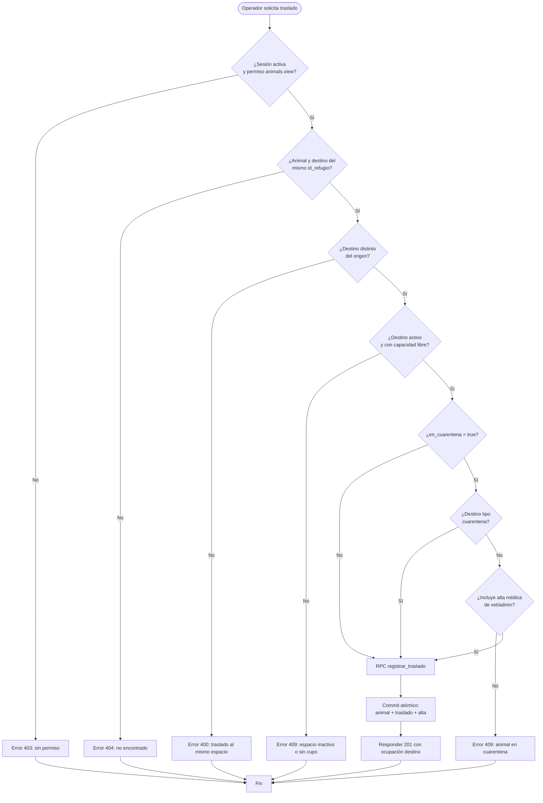
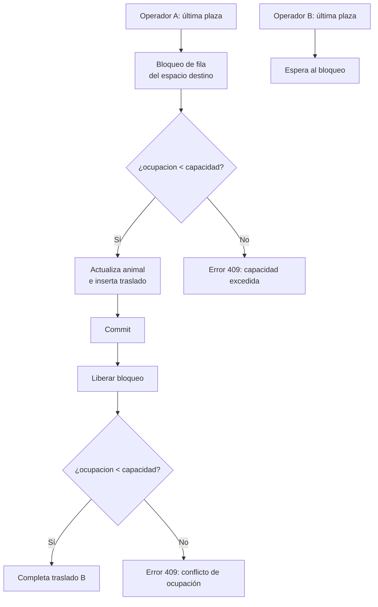
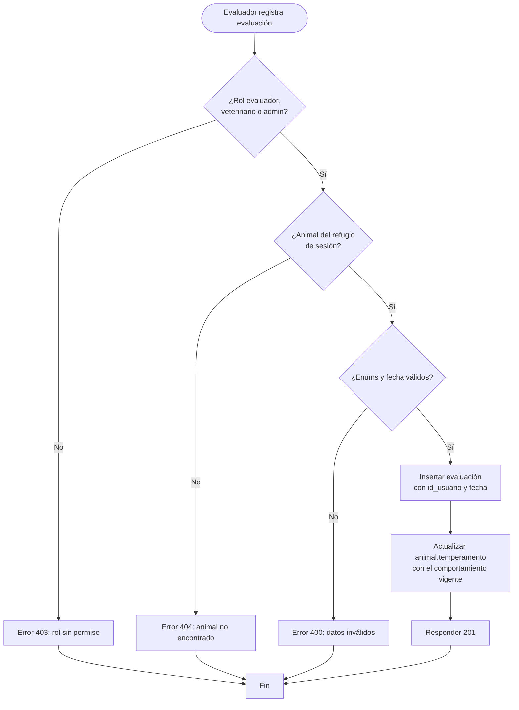
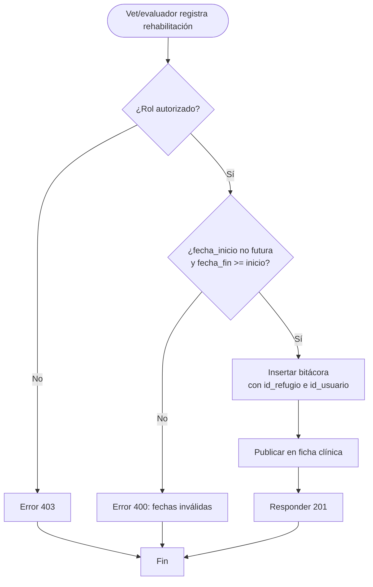

# Requerimiento 03 — Épica 3: Socialización y Espacios

## Título

Gestión de la ubicación física y del proceso de socialización del paciente: traslados entre espacios con control de capacidad y bloqueo por cuarentena, evaluación de temperamento y compatibilidad, y bitácora de rehabilitación física y emocional en los refugios Pixkki.

## Descripción

La Épica 3 cubre la etapa operativa posterior al control clínico preventivo. Sobre el expediente creado en la Épica 1 y estabilizado en la Épica 2, esta épica incorpora tres capacidades:

1. El **cambio de ubicación** del paciente entre espacios físicos del refugio, con validación de capacidad, disponibilidad y tenant, respetando el aislamiento biológico definido en la Épica 2.
2. La **evaluación de temperamento y compatibilidad**, que registra comportamiento, nivel de energía y aptitud para convivir con perros, gatos y niños, y actualiza el rasgo vigente del expediente.
3. La **bitácora de rehabilitación** física y emocional, que documenta el progreso del paciente durante su estancia.

Toda operación se vincula de forma indisoluble al `id_refugio` del usuario en sesión. El módulo `animals` es dueño del expediente y de los eventos clínicos/operativos del paciente; el módulo `spaces` es dueño de los espacios físicos y de su ocupación, y se consume a través de una interfaz pública, sin acceso cruzado a sus repositories.

## Objetivo

Proveer los módulos de socialización y espacios que permitan:

1. Registrar traslados de un paciente entre espacios del mismo refugio con trazabilidad de origen, destino, responsable y motivo.
2. Impedir el traslado a áreas generales mientras el paciente esté en cuarentena, salvo que la misma operación incluya el alta médica de un Veterinario o Administrador.
3. Evitar que un espacio exceda su capacidad máxima, incluso cuando dos operaciones compitan por la última plaza.
4. Registrar evaluaciones de temperamento y compatibilidad de forma cronológica y reflejar el comportamiento vigente en el expediente.
5. Registrar el progreso de rehabilitación física y emocional del paciente.
6. Integrar traslados, evaluaciones y rehabilitaciones en la ficha clínica centralizada (US08) y en las alertas visuales del sistema.

## Alcance

Incluye:

- RF3.1: Consulta de espacios y ocupación dinámica (US12, soporte)
- RF3.2: Cambio de ubicación a áreas generales y bloqueo por cuarentena (US12)
- RF3.3: Registro de evaluación de temperamento y compatibilidad (US13)
- RF3.4: Bitácora de rehabilitación física y emocional (US14)

No incluye:

- Alta médica de cuarentena (Épica 2, US11): esta épica solo la consume como excepción dentro del traslado.
- Rehabilitación como indicador de aptitud para adopción (Épica 4, US16): esta épica solo produce el historial.
- Registro de esterilización/castración (Épica 4, US15).
- Publicación de perfiles y portal de adopciones (Épica 5).
- Donaciones, inventario y alertas de stock (Épica 6).
- Reportes de capacidad y población (Épica 7): esta épica expone los datos de ocupación, no el reporte.
- CRUD completo de espacios: ya existe en `modules/spaces`; esta épica solo consume su superficie pública y documenta las reglas de ocupación.
- Edición y eliminación de traslados, evaluaciones y rehabilitaciones: todos son registros append-only.
- Migración de pacientes históricos (Épica 8).

## Actores

| Actor | Descripción |
|-------|-------------|
| Administrador de refugio | Usuario con rol `admin`. Puede ejecutar todas las operaciones de esta épica dentro de su refugio, incluido el alta médica que habilita un traslado. |
| Veterinario | Usuario con rol `veterinarian`. Puede registrar altas médicas, evaluaciones de temperamento y rehabilitación, y autorizar traslados. |
| Coordinador / Operador | Personal autenticado del refugio. Puede consultar espacios y ocupación, registrar traslados y consultar historiales, pero no registrar altas médicas. |
| Evaluador | Personal con rol `evaluador`. Registra evaluaciones de temperamento y compatibilidad, además de bitácoras de rehabilitación. |
| Personal de solo lectura | Usuario autenticado del refugio. Consulta ficha clínica, historial de traslados, evaluaciones y rehabilitación; no muta datos. |
| Superadmin | Rol global. Acceso de solo lectura según la política de la Épica 0; no participa en el flujo operativo ordinario. |

## Reglas de negocio

1. **Tipos de espacio canónicos**: `espacio.tipo` acepta exclusivamente `canil`, `gatera`, `cuarentena`, `rehabilitacion` u `otro`. El valor se normaliza en base de datos; el texto libre actual se migra de forma controlada.
2. **Identidad y unicidad del espacio**: el nombre del espacio es único dentro de un refugio. La capacidad es un entero `>= 1` y el campo `disponible`define si el espacio puede recibir pacientes.
3. **Ocupación dinámica**: la ocupación de un espacio es el número de animales activos (`deleted_at IS NULL`, `activo = true`) con `id_espacio` igual al del espacio. La capacidad libre es `capacidad - ocupacion`.
4. **Disponibilidad para traslado**: un destino es válido solo si pertenece al refugio en sesión, está `disponible = true`, tiene capacidad libre y no es el mismo espacio de origen.
5. **Origen verificado**: `id_espacio_origen` se obtiene del expediente del animal en el momento de la operación. El cliente no lo captura. Si cambió desde que se cargó la pantalla, la operación se rechaza con `TRASLADO_ORIGEN_DESACTUALIZADO`.
6. **Bloqueo por cuarentena**: mientras `en_cuarentena = true`, el único destino permitido es un espacio de tipo `cuarentena`. Cualquier intento de traslado a otro tipo se rechaza con `409 ANIMAL_EN_CUARENTENA`.
7. **Excepción con alta médica**: un Veterinario o Administrador puede incluir en la misma solicitud un alta médica (`observaciones` obligatorias). El sistema registra el alta y el traslado en una única transacción. Si el paciente ya estaba liberado, se devuelve `CUARENTENA_YA_LIBERADA`.
8. **RBAC en servidor**: la inclusión de `alta_medica` se autoriza en el servidor; la UI solo oculta el control. Un operador que la envíe recibe `403 ROL_SIN_PERMISO`.
9. **Trazabilidad del traslado**: cada traslado registra `id_animal`, `id_espacio_origen`, `id_espacio_destino`, `id_refugio`, `id_usuario`, `fecha_traslado` (UTC) y `motivo`. El registro es append-only.
10. **Atomicidad del traslado**: la actualización de `animal.id_espacio`, la inserción del traslado y, cuando aplica, el alta médica ocurren en una sola RPC transaccional.
11. **Concurrencia de capacidad**: la comprobación y el consumo de plaza se hacen con bloqueo de fila sobre el espacio destino o actualización condicional. Si dos usuarios compiten por la última plaza, solo uno completa y el otro recibe `409 CONFLICTO_OCUPACION`.
12. **Consistencia de la ficha**: el estado de cuarentena que se valida es `animal.en_cuarentena`, no el diagnóstico ni el tipo de espacio de origen.
13. **Evaluación de temperamento estructurada**: `comportamiento` admite `Dócil`, `Sociable`, `Tímido`, `Miedoso`, `Reactivo` o `Agresivo`; `nivel_energia` admite `Baja`, `Media` o `Alta`; `apto_perros`, `apto_gatos` y `apto_ninos` admiten `si`, `no` o `con_supervision`. Todos son obligatorios.
14. **Fecha de evaluación**: se registra automáticamente con la fecha/hora del servidor. Si se captura manualmente, no puede ser futura. Se almacena en UTC y se presenta en la zona horaria del refugio.
15. **Temperamento vigente**: `animal.temperamento` refleja el `comportamiento` de la evaluación más reciente, igual que `animal.peso` refleja el último chequeo (RF2.2, regla 12). El histórico permanece en `evaluacion_temperamento`.
16. **Rol para evaluar**: solo `evaluador`, `veterinarian` y `admin` pueden registrar evaluaciones. El resto del personal solo las consulta.
17. **Evaluaciones append-only**: no existen endpoints de edición ni eliminación. Una corrección se documenta con una nueva evaluación.
18. **Rehabilitación estructurada**: cada entrada registra `tipo` (`fisica`, `emocional`, `conductual`), `fecha_inicio`, `objetivo`, `observaciones`, `id_refugio`, `id_usuario` y, opcionalmente, `fecha_fin`.
19. **Coherencia de fechas de rehabilitación**: `fecha_inicio` no puede ser futura y, si existe `fecha_fin`, debe ser mayor o igual que `fecha_inicio`.
20. **Rol para rehabilitación**: solo `veterinarian`, `admin` y `evaluador` pueden registrar entradas de rehabilitación.
21. **Multitenant**: toda consulta y mutación filtra por `id_refugio` obtenido de la sesión. Un acceso a un animal, espacio, traslado, evaluación o rehabilitación de otro refugio se responde como `404` (no se revela su existencia).
22. **Integración con la ficha clínica**: los traslados, evaluaciones y rehabilitaciones se incorporan a la línea de tiempo cronológica de US08. La alerta de cuarentena sigue siendo gobernada por `animal.en_cuarentena`.
23. **Accesibilidad**: la ocupación y el estado de un espacio se presentan con texto explícito además del color (por ejemplo, “Sin cupo”, “2/4 plazas”), nunca solo con un indicador cromático.
24. **Idempotencia**: los reintentos del cliente no deben crear dos traslados ni dos evaluaciones idénticas; la operación se considera completada una sola vez por transacción y validación de estado.

## Inconsistencias y alineación con el estado actual del repositorio

| Elemento | Estado actual | Implicación para esta épica |
|----------|---------------|-----------------------------|
| `espacio` | Existe con `nombre_espacio`, `capacidad`, `disponible`, `tipo` y `id_refugio`. | Se reutiliza. `tipo` es texto libre: requiere normalización a enum aprobada. |
| `modules/spaces` | CRUD, búsqueda y `checkSpaceAvailability` ya implementados. | Se consume su interfaz pública; no se duplica acceso a Supabase desde `animals`. |
| `animal.id_espacio` | Existe y es obligatorio en el alta. | Es la fuente de verdad del origen del traslado. |
| `traslado` | Existe con origen, destino, motivo y fecha. | No tiene `id_refugio` ni `id_usuario`: requiere migración para multitenant y trazabilidad. |
| `evaluacion_temperamento` | Existe con comportamiento, energía y aptitudes como texto anulable. | No tiene `id_refugio`; requiere migración, campos obligatorios y RLS. |
| `animal.temperamento` | Existe como texto libre en el expediente. | Pasa a ser estado derivado de la última evaluación. |
| Rehabilitación | No existe ninguna tabla. | Requiere creación aprobada para US14. |
| `clinical-record.repository.ts` | Ya consulta `evaluacion_temperamento`, pero sin filtro `id_refugio`. | Debe filtrarse por tenant e incorporar traslados y rehabilitaciones. |
| Regla de cuarentena | `409 ANIMAL_EN_CUARENTENA` ya está definida en `modules/animals/errors.ts`, pero el endpoint de traslado no existe. | US12 es el primer consumidor real de esa regla. |
| Ocupación | `SpaceRepository.getAnimalCount` cuenta todos los animales del espacio. | Debe excluir `deleted_at`/`activo = false` y hacerse dentro de la transacción del traslado. |
| Identificadores | El esquema usa enteros autoincrementales (`id_*`). | No se introduce UUID en esta épica. |

> **Decisión pendiente de aprobación:** crear la tabla `rehabilitacion`, normalizar `espacio.tipo` a un enum, añadir `id_refugio`/`id_usuario` a `traslado` y `id_refugio` a `evaluacion_temperamento`, y definir la RPC transaccional `registrar_traslado` son cambios de base de datos. Requieren aprobación previa y que el equipo ejecute `supabase db push`. No se debe simular ocupación ni capacidad.

## Historias de usuario

| ID | Historia de Usuario | Prioridad | Épica | RF relacionados |
|----|---------------------|-----------|-------|-----------------|
| US12 | Cambio de ubicación a áreas generales (caniles/gateras) | Must Have | Épica 3 | RF3.1, RF3.2 |
| US13 | Registro de evaluación de temperamento y compatibilidad | Must Have | Épica 3 | RF3.3 |
| US14 | Bitácora de rehabilitación física y emocional | Should Have | Épica 3 | RF3.4 |

## Contrato de API

Los endpoints siguen el patrón `/api/v1/<recurso>`. La validación de entrada se hace con Zod antes de cualquier efecto. Los errores se devuelven con formato uniforme.

### Formato de respuesta de éxito

```json
{
  "success": true,
  "data": { ... }
}
```

### Formato de error uniforme

```json
{
  "success": false,
  "error": {
    "code": "ERROR_CODIGO",
    "message": "Mensaje en español para el usuario final",
    "statusCode": 400
  }
}
```

### RF3.1 — Espacios y ocupación

| Método | Ruta | Descripción | Acceso |
|--------|------|-------------|--------|
| GET | `/api/v1/espacios` | Listar espacios del refugio con ocupación calculada | Personal del refugio |
| GET | `/api/v1/espacios/{id}/disponibilidad` | Consultar disponibilidad de un espacio | Personal del refugio |

**Response (GET `/espacios`):**

```json
{
  "success": true,
  "data": {
    "espacios": [
      {
        "id": 12,
        "name": "Canil A",
        "type": "canil",
        "capacity": 8,
        "ocupacion": 5,
        "capacidadLibre": 3,
        "disponible": true,
        "estadoTexto": "5/8 plazas"
      }
    ]
  }
}
```

**Response (GET `/espacios/{id}/disponibilidad`):**

```json
{
  "success": true,
  "data": {
    "idEspacio": 12,
    "disponible": true,
    "ocupacion": 5,
    "capacidad": 8,
    "capacidadLibre": 3
  }
}
```

**Errores:** `404 ESPACIO_NO_ENCONTRADO`, `401` no autenticado.

### RF3.2 — Traslado de ubicación

| Método | Ruta | Descripción | Acceso |
|--------|------|-------------|--------|
| POST | `/api/v1/animales/{id}/traslados` | Registrar cambio de ubicación | Personal del refugio; alta médica solo Veterinario/Admin |
| GET | `/api/v1/animales/{id}/traslados` | Historial de traslados del paciente | Personal del refugio |

**Request (POST):**

```json
{
  "id_espacio_destino": 12,
  "motivo": "Reingreso a área general tras alta médica",
  "alta_medica": {
    "observaciones": "String obligatorio (solo si se incluye)",
    "fecha_alta": "datetime (opcional, por defecto now())"
  }
}
```

> `id_espacio_origen`, `id_refugio` e `id_usuario` los resuelve el servidor. `alta_medica` es opcional; si el paciente no está en cuarentena, no debe enviarse.

**Response (201):**

```json
{
  "success": true,
  "data": {
    "id_traslado": 44,
    "id_animal": 45,
    "id_refugio": 7,
    "id_espacio_origen": 4,
    "id_espacio_destino": 12,
    "fecha_traslado": "datetime",
    "motivo": "string | null",
    "id_usuario": 9,
    "ocupacion_destino": 6,
    "en_cuarentena": false,
    "alta": {
      "id_alta": 12,
      "observaciones": "string",
      "id_usuario_veterinario": 9,
      "fecha_alta": "datetime"
    }
  }
}
```

**Errores:**
- `400` — `DATOS_INVALIDOS`, `TRASLADO_MISMO_ESPACIO`, `FECHA_FUTURA`
- `403` — `ROL_SIN_PERMISO` (alta médica incluida sin rol clínico)
- `404` — `ANIMAL_NO_ENCONTRADO`, `ESPACIO_NO_ENCONTRADO`
- `409` — `ANIMAL_EN_CUARENTENA`, `ESPACIO_INACTIVO`, `CAPACIDAD_EXCEDIDA`, `TRASLADO_ORIGEN_DESACTUALIZADO`, `CONFLICTO_OCUPACION`, `CUARENTENA_YA_LIBERADA`
- `500` — `FALLO_TRANSACCION_TRASLADO`

### RF3.3 — Evaluación de temperamento y compatibilidad

| Método | Ruta | Descripción | Acceso |
|--------|------|-------------|--------|
| POST | `/api/v1/animales/{id}/evaluaciones-temperamento` | Registrar evaluación | Evaluador, Veterinario o Admin |
| GET | `/api/v1/animales/{id}/evaluaciones-temperamento` | Historial de evaluaciones | Personal del refugio |

**Request (POST):**

```json
{
  "comportamiento": "Sociable",
  "nivel_energia": "Media",
  "apto_perros": "si",
  "apto_gatos": "con_supervision",
  "apto_ninos": "si",
  "fecha_evaluacion": "datetime (opcional, por defecto now())"
}
```

**Response (201):**

```json
{
  "success": true,
  "data": {
    "id_evaluacion": 7,
    "id_animal": 45,
    "id_refugio": 7,
    "comportamiento": "Sociable",
    "nivel_energia": "Media",
    "apto_perros": "si",
    "apto_gatos": "con_supervision",
    "apto_ninos": "si",
    "id_usuario": 9,
    "fecha_evaluacion": "datetime",
    "temperamento_vigente": "Sociable"
  }
}
```

**Errores:**
- `400` — `DATOS_INVALIDOS`, `FECHA_FUTURA`, `NIVELES_INVALIDOS`
- `403` — `ROL_SIN_PERMISO`
- `404` — `ANIMAL_NO_ENCONTRADO`
- `500` — `ERROR_INTERNO`

### RF3.4 — Bitácora de rehabilitación

| Método | Ruta | Descripción | Acceso |
|--------|------|-------------|--------|
| POST | `/api/v1/animales/{id}/rehabilitaciones` | Registrar entrada de rehabilitación | Evaluador, Veterinario o Admin |
| GET | `/api/v1/animales/{id}/rehabilitaciones` | Historial de rehabilitación | Personal del refugio |

**Request (POST):**

```json
{
  "tipo": "emocional",
  "fecha_inicio": "date (obligatorio, no futura)",
  "fecha_fin": "date | null (opcional, >= fecha_inicio)",
  "objetivo": "string (obligatorio, 1–500 caracteres)",
  "observaciones": "string | null (opcional, máx. 2000 caracteres)"
}
```

**Response (201):**

```json
{
  "success": true,
  "data": {
    "id_rehabilitacion": 23,
    "id_animal": 45,
    "id_refugio": 7,
    "tipo": "emocional",
    "fecha_inicio": "date",
    "fecha_fin": null,
    "objetivo": "string",
    "observaciones": "string | null",
    "id_usuario": 9,
    "fecha_registro": "datetime"
  }
}
```

**Errores:**
- `400` — `DATOS_INVALIDOS`, `FECHA_FUTURA`, `FECHA_FIN_INVALIDA`
- `403` — `ROL_SIN_PERMISO`
- `404` — `ANIMAL_NO_ENCONTRADO`
- `500` — `ERROR_INTERNO`

### Regla de contrato para US16 (fuera de alcance, pero obligatoria)

El *gatekeeper* de adopción de la Épica 4 debe consultar, antes de marcar `disponible_adopcion = true`: `en_cuarentena = false`, última evaluación con aptitudes compatibles y rehabilitación vigente cuando aplique. Esta épica documenta la regla; su implementación pertenece a US16.

## Plan de implementación backend-first

| Paso | Acción | Artefacto |
|------|--------|-----------|
| 1 | Definir/ampliar OpenAPI de animals y spaces | `modules/animals/contracts/openapi.yaml`, `modules/spaces/contracts/openapi.yaml` |
| 2 | Definir schemas Zod de entrada (traslado, evaluación, rehabilitación) | `modules/animals/validators/` |
| 3 | Implementar repositories con filtro `id_refugio` | `modules/animals/repositories/`, `modules/spaces/repositories/` |
| 4 | Implementar interface pública de espacios (ocupación y disponibilidad) | `modules/spaces/ports/`, `modules/spaces/services/` |
| 5 | Implementar RPC transaccional `registrar_traslado` | Migración Supabase |
| 6 | Implementar services con reglas de cuarentena, capacidad y roles | `modules/animals/services/` |
| 7 | Implementar Route Handlers versionados `/api/v1/` | `app/api/v1/...` |
| 8 | Extender el modelo de lectura de la ficha clínica | `modules/animals/repositories/clinical-record.repository.ts` |
| 9 | Pruebas aisladas del backend | Equipo de QA (externo a este documento) |
| 10 | Ampliar contrato v1 | Tag git `api-v1.3` |
| 11 | Frontend consume contrato vía Server Actions | Server Actions como adaptador |

## Riesgos y dependencias

| Riesgo | Mitigación |
|--------|------------|
| Un traslado omite la validación de cuarentena | Usar `animal.en_cuarentena` como fuente de verdad dentro de la RPC y rechazar con `409 ANIMAL_EN_CUARENTENA`. |
| Dos usuarios compiten por la última plaza | Bloqueo de fila sobre `espacio` o actualización condicional; el perdedor recibe `CONFLICTO_OCUPACION`. |
| El origen cambia entre carga y envío | Validar `id_espacio_origen` contra el expediente dentro de la transacción. |
| El alta médica y el traslado quedan a medias | Ejecutar ambos efectos en una única RPC; sin compensaciones posteriores. |
| Fuga multitenant por tablas sin `id_refugio` | Migración con backfill, filtro explícito en repositories y RLS como segunda capa. |
| `espacio.tipo` libre permite destinos inválidos | Normalizar a enum y validar también en Zod y en la RPC. |
| Conteo de ocupación inconsistente | Excluir animales inactivos/eliminados y calcular dentro de la transacción. |
| La UI pierde el cambio tras la mutación | `revalidatePath` en la Server Action y `router.refresh()` en el cliente. |
| Alertas que dependen solo del color | Texto explícito de ocupación y estado del espacio (RNF3.2). |
| Reintentos generan traslados duplicados | Validación de estado (origen, cuarentena y capacidad) dentro de la transacción. |
| Zonas horarias inconsistentes | Almacenar `timestamptz` en UTC y presentar en la zona del refugio. |
| Tabla de rehabilitación inexistente en entornos sin migrar | Tolerar ausencia en el read model y reportar error claro en las mutaciones. |

**Dependencias:** Épica 0 (autenticación, RBAC y `id_refugio` de sesión), Épica 1 (`animal`, expediente y ficha clínica), Épica 2 (cuarentena y alta médica), módulo `spaces` (espacios y disponibilidad), Supabase/PostgreSQL, Zod y el equipo de QA para pruebas aisladas.

## Glosario

| Término | Definición |
|---------|------------|
| Espacio | Unidad física del refugio (canil, gatera, cuarentena, rehabilitación u otro) con capacidad máxima. |
| Ocupación | Número de animales activos asignados actualmente a un espacio. |
| Capacidad libre | Diferencia entre la capacidad máxima y la ocupación de un espacio. |
| Traslado | Registro append-only del cambio de `id_espacio` de un paciente, con origen, destino, motivo y responsable. |
| Alta médica | Registro de la Épica 2 que establece `en_cuarentena = false`; requisito para trasladar a áreas generales. |
| Área general | Espacio cuyo tipo no es `cuarentena`. |
| Evaluación de temperamento | Registro cronológico de comportamiento, energía y compatibilidad del paciente. |
| Temperamento vigente | Valor derivado de la evaluación más reciente y expuesto en `animal.temperamento`. |
| Compatibilidad | Aptitud declarada del paciente para convivir con perros, gatos y niños. |
| Rehabilitación | Bitácora de intervenciones físicas, emocionales o conductuales con seguimiento en el tiempo. |
| ACID | Atomicidad, consistencia, aislamiento y durabilidad de una transacción de base de datos. |
| Append-only | Modelo en el que los registros solo se agregan; no se editan ni se eliminan. |
| RBAC | Control de acceso basado en roles. |
| DoR / DoD | Definition of Ready / Definition of Done. |

## Diagramas de flujo (mermaid)

### Flujo de traslado con validación de cuarentena (RF3.1 / RF3.2)



### Flujo de concurrencia por capacidad (RF3.1)



### Flujo de evaluación de temperamento (RF3.3)



### Flujo de rehabilitación (RF3.4)



## Criterios de aceptación por historia de usuario

| US | Criterios de aceptación |
|----|------------------------|
| US12 | El personal puede consultar espacios con ocupación calculada y texto explícito de disponibilidad. Un traslado registra origen, destino, motivo, responsable y fecha, y falla si el destino es otro refugio, está inactivo, no tiene cupo o es el mismo espacio. Un paciente en cuarentena solo puede trasladarse a un espacio de tipo `cuarentena`; cualquier otro destino devuelve `409 ANIMAL_EN_CUARENTENA`. Un Veterinario o Administrador puede incluir el alta médica en la misma operación y ambos efectos se persisten atómicamente. Dos operaciones simultáneas por la última plaza no exceden la capacidad. |
| US13 | Solo Evaluador, Veterinario o Administrador registra evaluaciones con comportamiento, nivel de energía y aptitudes para perros, gatos y niños dentro de los enums definidos. La fecha no puede ser futura. El historial es cronológico, append-only, y `animal.temperamento` refleja el comportamiento de la evaluación más reciente. La evaluación aparece en la ficha clínica. |
| US14 | Solo Evaluador, Veterinario o Administrador registra entradas de rehabilitación con tipo, fecha de inicio, objetivo y observaciones opcionales. `fecha_fin` no puede ser anterior a `fecha_inicio` y ninguna fecha puede ser futura. El historial es append-only, filtra por `id_refugio` y aparece en la línea de tiempo de la ficha clínica. |

## Esquema de base de datos implicado

| Tabla | Campo clave | Descripción |
|-------|-------------|-------------|
| `espacio` | `id_espacio` (PK), `id_refugio` (FK) | Espacio físico. Campos: `nombre_espacio`, `tipo` (normalizar a enum), `capacidad`, `disponible`, `descripcion`. |
| `animal` | `id_animal` (PK), `id_refugio` (FK) | Tabla existente. Campos utilizados: `id_espacio`, `en_cuarentena`, `temperamento`, `activo`, `deleted_at`, `disponible_adopcion`. |
| `traslado` | `id_traslado` (PK) | Registro de ubicación. Campos actuales: `id_animal`, `id_espacio_origen`, `id_espacio_destino`, `motivo`, `fecha_traslado`. Requiere `id_refugio` e `id_usuario`. |
| `evaluacion_temperamento` | `id_evaluacion_temperamento` (PK), `id_animal` (FK) | Evaluación. Campos: `comportamiento`, `nivel_energia`, `apto_perros`, `apto_gatos`, `apto_ninos`, `fecha_evaluacion`, `id_usuario`. Requiere `id_refugio`. |
| `rehabilitacion` | `id_rehabilitacion` (PK), `id_animal` (FK), `id_refugio` (FK) | Tabla nueva. Campos: `tipo`, `fecha_inicio`, `fecha_fin`, `objetivo`, `observaciones`, `id_usuario`, `fecha_registro`. |
| `altas_cuarentena` | `id_alta` (PK), `id_animal` (FK), `id_refugio` (FK) | Tabla de la Épica 2. La RPC de traslado la usa cuando se incluye alta médica. |
| `auditoria` | `id_auditoria` (PK), `id_refugio` (FK) | Tabla existente. Registra las operaciones de esta épica para trazabilidad. |

**Regla multitenant:** Toda consulta a `espacio`, `traslado`, `evaluacion_temperamento` y `rehabilitacion` filtra por `id_refugio` obtenido del JWT de sesión. Las tablas hijas se validan además a través de su animal padre. RLS como segunda capa de defensa.

**Migración requerida (aprobación previa obligatoria):**

1. Normalizar `espacio.tipo` a los valores `canil`, `gatera`, `cuarentena`, `rehabilitacion`, `otro`; añadir restricción y unique `(id_refugio, nombre_espacio)`.
2. Añadir `id_refugio` e `id_usuario` a `traslado`, backfill desde `animal` y `usuario`, con RLS.
3. Añadir `id_refugio` a `evaluacion_temperamento`, backfill, RLS y restricciones de enums en los campos de compatibilidad.
4. Crear `rehabilitacion` con índice por `(id_refugio, id_animal, fecha_inicio)` y RLS.
5. Definir la función/RPC transaccional `registrar_traslado` que valide cuarentena, estado del espacio, capacidad y origen, y persista traslado, cambio de espacio y alta médica opcional.
6. Definir la lógica de actualización de `animal.temperamento` desde la última evaluación dentro de la transacción de inserción.
7. Añadir índices por `(id_refugio, id_animal, fecha_*)` en las tablas nuevas.
8. Corregir el filtro de tenant en la consulta de `evaluacion_temperamento` del read model de ficha clínica.

## Plan de implementación backend-first (detallado por módulo)

| Módulo | Archivos clave | Endpoints `/api/v1/` |
|--------|---------------|----------------------|
| animals (socialización) | `modules/animals/validators/`<br>`animal-transfer.validators.ts`, `animal-temperament.validators.ts`, `animal-rehabilitation.validators.ts`<br>`modules/animals/repositories/`<br>`animal-transfer.repository.ts`, `animal-temperament.repository.ts`, `animal-rehabilitation.repository.ts`<br>`modules/animals/services/`<br>`animal-transfer.service.ts`, `animal-temperament.service.ts`, `animal-rehabilitation.service.ts`<br>`modules/animals/factories/` | `POST/GET /animales/{id}/traslados`<br>`POST/GET /animales/{id}/evaluaciones-temperamento`<br>`POST/GET /animales/{id}/rehabilitaciones` |
| spaces (ocupación) | `modules/spaces/ports/space-occupancy.port.ts`<br>`modules/spaces/services/space-occupancy.service.ts`<br>`modules/spaces/repositories/repository.ts` | `GET /espacios`<br>`GET /espacios/{id}/disponibilidad` |
| animals (read model) | `modules/animals/repositories/clinical-record.repository.ts`<br>`modules/animals/services/clinical-record.service.ts` | Sin endpoints nuevos. Extiende `GET /animales/{id}/ficha-clinica` con traslados, evaluaciones y rehabilitación. |

> El módulo `animals` no accede directamente a la tabla `espacio`: consume la interfaz pública `SpaceOccupancyPort` inyectada por factory. El módulo `spaces` no conoce el dominio clínico: solo expone disponibilidad y ocupación calculadas para un `id_refugio`.

## Trazabilidad de implementación (backend)

| RF / US | Archivos principales | Estado |
|---------|----------------------|--------|
| RF3.1 / US12 (ocupación) | `modules/spaces/ports/space-occupancy.port.ts`, `modules/spaces/service.ts`, `modules/spaces/repositories/repository.ts`, `app/api/v1/espacios/route.ts`, `app/api/v1/espacios/[id]/disponibilidad/route.ts` | Implementado |
| RF3.2 / US12 (traslado) | `modules/animals/validators/animal-transfer.validators.ts`, `modules/animals/repositories/animal-transfer.repository.ts`, `modules/animals/services/animal-transfer.service.ts`, `modules/animals/factories/create-animal-transfer-service.ts`, `app/api/v1/animales/[id]/traslados/route.ts`, RPC `registrar_traslado` | Implementado |
| RF3.3 / US13 (temperamento) | `modules/animals/validators/animal-temperament.validators.ts`, `modules/animals/repositories/animal-temperament.repository.ts`, `modules/animals/services/animal-temperament.service.ts`, `modules/animals/factories/create-animal-temperament-service.ts`, `app/api/v1/animales/[id]/evaluaciones-temperamento/route.ts`, RPC `registrar_evaluacion_temperamento` | Implementado |
| RF3.4 / US14 (rehabilitación) | `modules/animals/validators/animal-rehabilitation.validators.ts`, `modules/animals/repositories/animal-rehabilitation.repository.ts`, `modules/animals/services/animal-rehabilitation.service.ts`, `modules/animals/factories/create-animal-rehabilitation-service.ts`, `app/api/v1/animales/[id]/rehabilitaciones/route.ts`, tabla `rehabilitacion` | Implementado |
| Integración con ficha clínica | `modules/animals/repositories/clinical-record.repository.ts`, `modules/animals/services/clinical-record.service.ts`, `modules/animals/types/animales.types.ts` | Implementado |
| Regla 1 (tipos canónicos) | `modules/spaces/schemas.ts` (enum canónico + normalización), restricción `espacio_tipo_check` | Implementado |
| Regla 11 (concurrencia) | `supabase/migrations/20261116145000_requerimiento_03_conflicto_ocupacion.sql` (`CONFLICTO_OCUPACION`) | Implementado |
| Migración base | `supabase/migrations/20261116140000_requerimiento_03_socializacion_espacios.sql` | Aplicada |
| Ajuste de parámetros opcionales de RPC | `supabase/migrations/20261116145500_requerimiento_03_parametros_opcionales_rpc.sql` | Aplicada |
| Frontend (paneles de ficha clínica) | `modules/animals/components/AnimalTransferPanel.tsx`, `AnimalTemperamentPanel.tsx`, `AnimalRehabilitationPanel.tsx` | Implementado en su ejecución de UI; fuera del alcance backend-first |

---

**Versión**: 1.1  
**Estado**: Implementado (RF3.1, RF3.2, RF3.3 y RF3.4), con la migración 20261116140000 aplicada al entorno remoto.  
**Última actualización**: 16/11/2026