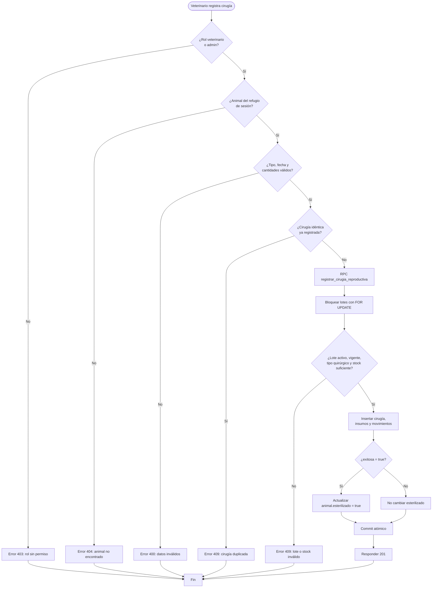
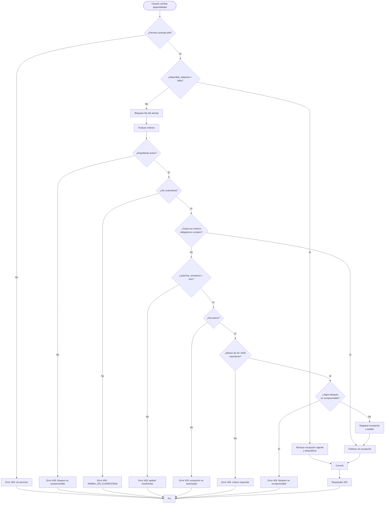
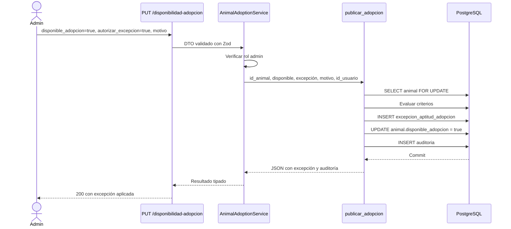
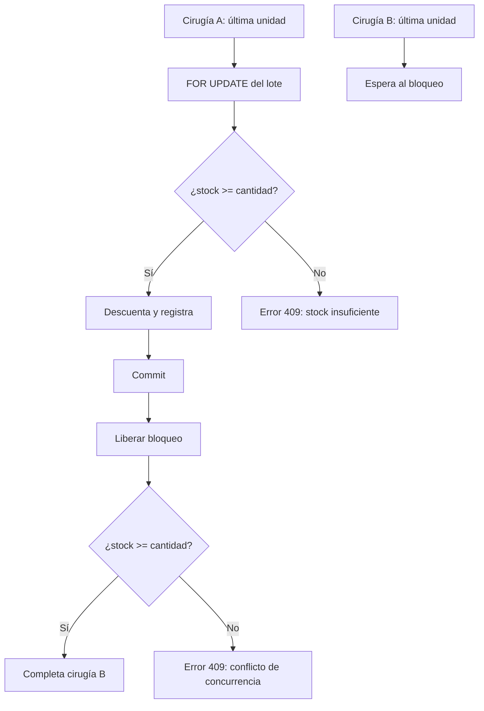

# Requerimiento 04 — Épica 4: Control Poblacional

## Título

Registro del procedimiento quirúrgico reproductivo con consumo transaccional de inventario y validación de aptitud para adopción (*gatekeeper*) en los refugios Pixkki.

## Descripción

La Épica 4 cierra el ciclo clínico-preventivo del paciente y habilita su salida controlada del refugio. Se apoya en el expediente de la Épica 1, en el control clínico y la cuarentena de la Épica 2 y en la socialización de la Épica 3. Incorpora dos capacidades:

1. El **registro del procedimiento quirúrgico reproductivo** (esterilización o castración), con fecha, resultado, notas postoperatorias, responsable y, opcionalmente, los insumos quirúrgicos consumidos. Si la cirugía es exitosa, el expediente queda marcado como esterilizado.
2. La **validación de aptitud para adopción** (*gatekeeper*), que evalúa de forma explícita y trazable si un paciente cumple los criterios clínicos, sanitarios y de comportamiento para ser publicado como adoptable. Un Administrador puede autorizar una excepción motivada y auditada.

Toda operación se vincula de forma indisoluble al `id_refugio` del paciente y al usuario en sesión. El módulo `animals` es dueño del expediente, del acto quirúrgico y del estado de adopción; el módulo `inventory` es dueño de los insumos y lotes. El descuento de stock ocurre dentro de la misma transacción que registra la cirugía, de modo que no existen cirugías sin insumos descontados ni insumos descontados sin cirugía.

> **Nota de alcance:** esta épica **no publica** perfiles ni gestiona postulaciones. Solo deja al paciente correctamente habilitado (o bloqueado) para que la Épica 5 lo publique. La política de publicación pertenece a US17.

## Objetivo

Proveer los módulos de control poblacional que permitan:

1. Registrar cirugías reproductivas de forma append-only, con trazabilidad de tipo, fecha, resultado, notas y responsable.
2. Descontar del inventario los insumos quirúrgicos utilizados, de forma atómica y con control de concurrencia.
3. Actualizar automáticamente `animal.esterilizado` cuando una cirugía de esterilización o castración es exitosa.
4. Evaluar la aptitud para adopción con criterios explícitos, repetibles y consultables antes de publicar.
5. Impedir que un paciente sin aptitud sea marcado como disponible para adopción, salvo excepción motivada de un Administrador.
6. Registrar en auditoría cada excepción, con el usuario, el motivo y los criterios omitidos.
7. Integrar la cirugía en la línea de tiempo de la ficha clínica centralizada (US08).
8. Dejar el estado de adopción listo para el catálogo público de la Épica 5.

## Alcance

Incluye:

- RF4.1: Registro de procedimiento quirúrgico reproductivo (US15).
- RF4.1: Consumo transaccional de insumos quirúrgicos del inventario (US15, soporte de Épica 6).
- RF4.1: Actualización derivada de `animal.esterilizado` (US15).
- RF4.2: Evaluación de aptitud para adopción y *gatekeeper* de publicación (US16).
- RF4.2: Excepción administrativa motivada y auditada (US16).
- Integración de cirugías y bloqueos de aptitud en la ficha clínica y en la consulta del expediente.

No incluye:

- Programación de cirugías futuras, estados `programada`/`cancelada` o reprogramación: el registro es de actos realizados.
- Edición o eliminación de cirugías: son registros append-only.
- CRUD de insumos, lotes, compras, entradas de stock o alertas de stock mínimo (Épica 6, US20 y US23).
- Catálogo público, perfiles publicados, formulario de postulación y entrevistas (Épica 5, US17–US19).
- Gestión de adoptantes, solicitudes, evaluaciones de adopción o cierre de adopción (Épica 5).
- Reportes de población, esterilizaciones o adopciones (Épica 7).
- Importación de pacientes históricos (Épica 8).
- Envío de correos, notificaciones push o mensajería con el adoptante.
- Firma digital, consentimientos del adoptante o contratos de adopción.

## Actores

| Actor | Descripción |
|-------|-------------|
| Administrador de refugio | Usuario con rol `admin`. Registra cirugías, publica o despublica pacientes y es el único que puede autorizar una excepción de aptitud con motivo. |
| Veterinario | Usuario con rol `veterinario`/`veterinarian`. Registra cirugías, consume insumos y consulta la aptitud. No puede autorizar excepciones. |
| Coordinador / Operador | Personal autenticado del refugio con permiso `animals.edit`. Puede publicar o despublicar pacientes que cumplen todos los criterios, pero no registrar cirugías ni autorizar excepciones. |
| Evaluador | Personal con rol `evaluador`. Consulta la aptitud y el historial de temperamento; no registra cirugías ni publica. |
| Personal de solo lectura | Usuario autenticado del refugio. Consulta cirugías, aptitud e historial; no muta datos. |
| Superadmin | Rol global. Puede consultar y operar según la política de la Épica 0; sus operaciones quedan auditadas igual que las de un Administrador. |
| Sistema | Calcula la aptitud, aplica el *gatekeeper* y escribe la auditoría de la excepción. |

## Reglas de negocio

1. **Tipos de cirugía canónicos**: `tipo_cirugia` acepta exclusivamente `Esterilización` o `Castración`, alineado con el `CHECK` vigente. No se introducen tipos nuevos en esta épica.
2. **Cirugía realizada, no programada**: el registro describe un acto quirúrgico ya ejecutado. `fecha_cirugia` es obligatoria y no puede ser futura.
3. **Registro append-only**: no existen endpoints de edición ni eliminación de cirugías. Una corrección se documenta con una nueva cirugía y una nota que explique la diferencia.
4. **Resultado obligatorio**: `exitosa` es booleano y obligatorio. Una cirugía fallida se registra igual, pero no marca al paciente como esterilizado.
5. **Actualización derivada de esterilización**: si `exitosa = true` y `tipo_cirugia` es `Esterilización` o `Castración`, `animal.esterilizado` pasa a `true` dentro de la misma transacción. Si `exitosa = false`, `animal.esterilizado` no cambia.
6. **Nunca se revierte automáticamente**: una cirugía fallida posterior no vuelve `esterilizado` a `false`. La corrección de un dato erróneo requiere una operación administrativa explícita y auditada, fuera del flujo ordinario.
7. **RBAC de cirugía**: solo `veterinario`/`veterinarian` y `admin` pueden registrar cirugías. El Coordinador, el Evaluador y el personal de solo lectura reciben `403 ROL_SIN_PERMISO`.
8. **Responsable y tenant**: `id_usuario` se toma de la sesión y `id_refugio` del paciente. El cliente no los envía. Un paciente de otro refugio se responde como `404 ANIMAL_NO_ENCONTRADO`.
9. **Notas postoperatorias**: `notas_postoperatorias` es opcional, texto libre de hasta 2000 caracteres. No sustituye el diagnóstico ni el tratamiento.
10. **Insumos opcionales**: una cirugía puede registrarse sin insumos (`insumos: []`) cuando el refugio no lleva inventario del material utilizado. No se inventan lotes ni stock.
11. **Insumos válidos**: cada insumo debe referenciar un lote del mismo refugio, activo, no vencido, con stock suficiente y cuyo insumo esté activo y sea de tipo quirúrgico.
12. **Tipo de insumo quirúrgico**: se incorpora `insumo_quirurgico` al dominio de `inventario_insumo.tipo_insumo`, además de `vacuna`, `desparasitante` y `otro`. Un lote de vacuna o desparasitante no puede consumirse como insumo quirúrgico.
13. **Cantidad por insumo**: `cantidad` es un entero mayor o igual a 1. No se permiten cantidades negativas, cero ni decimales. Un mismo lote no puede repetirse en la misma solicitud.
14. **Atomicidad cirugía-inventario**: la inserción de la cirugía, el descuento de cada lote, el registro del movimiento de salida, la relación cirugía-insumo, la actualización de `esterilizado` y la auditoría ocurren en una única RPC transaccional. Si cualquier paso falla, no se persiste nada.
15. **Concurrencia de stock**: cada lote se bloquea con `FOR UPDATE` antes de validar y descontar. Si dos cirugías compiten por la última unidad, solo una completa; la otra recibe `409 CONFLICTO_CONCURRENCIA`.
16. **Idempotencia de cirugía**: se rechaza una cirugía idéntica ya registrada para el mismo animal, tipo y fecha exacta, con `409 CIRUGIA_DUPLICADA`. Esto evita duplicados por reintentos del cliente.
17. **Criterios de aptitud**: la aptitud se evalúa con seis criterios:
    - `expediente_activo`: `animal.activo = true` y `deleted_at IS NULL`.
    - `sin_cuarentena`: `animal.en_cuarentena = false`.
    - `esterilizado`: `animal.esterilizado = true`.
    - `salud_no_critica`: el último diagnóstico veterinario no es `Crítico` ni `Delicado`; `Delicado` es un bloqueo omitible.
    - `temperamento_compatible`: la última evaluación de temperamento (o `animal.temperamento` si no hay evaluación) no es nula ni `Agresivo`. `Reactivo` y `Miedoso` son advertencias que no bloquean.
    - `rehabilitacion_al_dia`: no existe una entrada de rehabilitación abierta (`fecha_fin IS NULL`).
18. **Apto para publicar**: un paciente es apto solo si todos los criterios obligatorios se cumplen. La ausencia de diagnóstico o de temperamento se considera bloqueo, no un aprobado por defecto.
19. **Gatekeeper en servidor**: el paso a `disponible_adopcion = true` se valida siempre en el servidor dentro de una RPC con bloqueo de fila sobre `animal`. La UI puede mostrar el resultado, pero no es la autoridad.
20. **Despublicar siempre es posible**: pasar `disponible_adopcion` a `false` no requiere aptitud y está permitido a cualquier usuario con `animals.edit`. Al despublicar se revoca la excepción vigente, si existe.
21. **Excepción solo de Administrador**: solo `admin` (y el Superadmin según la política global) puede autorizar una excepción. Un Veterinario, Coordinador u Operador recibe `403 EXCEPCION_NO_AUTORIZADA`.
22. **Motivo obligatorio**: la excepción exige `motivo_excepcion` de entre 20 y 1000 caracteres. Sin motivo se devuelve `400 MOTIVO_EXCEPCION_REQUERIDO`.
23. **Bloqueos no excepcionables**: `expediente_activo`, `sin_cuarentena` y un diagnóstico `Crítico` no pueden omitirse por excepción. La cuarentena se libera solo con alta médica (Épica 2), nunca con una excepción de adopción.
24. **Excepción por operación**: la excepción habilita la publicación actual, no un permiso permanente. Queda registrada con los criterios omitidos, el motivo, el usuario y la fecha. Si el paciente se despublica, la excepción se revoca y no se reutiliza.
25. **Auditoría de la excepción**: cada excepción inserta una fila en `auditoria` con `accion = 'excepcion_aptitud_adopcion'`, `modulo = 'animals'`, `entidad_id = id_animal` y una descripción que incluye el motivo y los criterios omitidos. No se registran datos sensibles innecesarios.
26. **Consulta de aptitud**: `GET /aptitud-adopcion` devuelve el estado de cada criterio, los bloqueos, las advertencias y la excepción vigente. Es de solo lectura y no altera el expediente.
27. **Consistencia con la Épica 3**: el temperamento vigente es el de la evaluación más reciente por `fecha_evaluacion`; la rehabilitación abierta es la que tiene `fecha_fin IS NULL`; el diagnóstico vigente es el más reciente por `fecha_diagnostico`.
28. **Multitenant**: toda consulta y mutación filtra por `id_refugio`. Las tablas hijas (`cirugia_insumo`, `excepcion_aptitud_adopcion`) se validan además a través del animal padre. RLS como segunda capa de defensa.
29. **Integración con la ficha clínica**: la cirugía aparece en la línea de tiempo como evento `esterilizacion`, con tipo, fecha, resultado, notas e insumos consumidos. El bloqueo de aptitud no se muestra como evento clínico, sino como estado del expediente.
30. **Accesibilidad**: los bloqueos y advertencias se presentan con texto explícito (“Falta esterilización”, “En cuarentena”, “Rehabilitación abierta”), no solo con color o icono.
31. **Sin efectos colaterales en el catálogo**: esta épica no crea campañas, no publica perfiles y no modifica `campana_publica`. Solo deja `disponible_adopcion` y la aptitud en un estado verificable.
32. **Superadmin**: opera con alcance global, pero cada cirugía, publicación o excepción conserva el `id_refugio` del paciente y el `id_usuario` real.

## Supuestos funcionales (pendientes de validación)

Estos supuestos se derivan del esquema actual y del dominio del refugio. Deben confirmarse antes de implementar; si cambian, cambian las reglas y los criterios de aceptación.

| ID | Supuesto | Impacto si cambia |
|----|----------|-------------------|
| S1 | `Delicado` bloquea la publicación por defecto, pero un Administrador puede omitirlo con excepción. `Crítico` nunca se omite. | Cambia la matriz de criterios y la UI de excepción. |
| S2 | `Reactivo` y `Miedoso` son advertencias, no bloqueos. `Agresivo` y la ausencia de temperamento bloquean. | Cambia el resultado del *gatekeeper*. |
| S3 | Una rehabilitación con `fecha_fin IS NULL` es un bloqueo; las cerradas no bloquean. | Cambia el criterio `rehabilitacion_al_dia`. |
| S4 | La ausencia de diagnóstico veterinario bloquea la publicación; no se asume “sano por defecto”. | Cambia el criterio `salud_no_critica`. |
| S5 | La excepción se limita a `Delicado`, `Reactivo`/`Miedoso`, `esterilizado` y `rehabilitacion_al_dia`. | Cambia la lista de bloqueos omitibles. |
| S6 | La cirugía puede registrarse sin insumos; el inventario es opcional por decisión operativa del refugio. | Cambia la obligatoriedad del campo `insumos`. |
| S7 | Se agrega `insumo_quirurgico` al dominio de tipos de insumo. | Si se prefiere reutilizar `otro`, se elimina la validación de tipo. |
| S8 | La fecha de cirugía se registra en UTC y se presenta en la zona horaria del refugio. | Cambia el formato de fecha y las comparaciones. |
| S9 | La idempotencia se implementa con un índice único `(id_animal, tipo_cirugia, fecha_cirugia)`. | Si se prefiere una clave de idempotencia del cliente, cambia el contrato. |
| S10 | El Superadmin puede autorizar excepciones como un Administrador, con alcance global. | Cambia el RBAC de la excepción. |
| S11 | Una cirugía fallida no revierte `esterilizado` si ya estaba en `true`. | Cambia la regla 6. |
| S12 | El catálogo público de la Épica 5 solo mostrará pacientes con `disponible_adopcion = true`, `activo = true` y sin `deleted_at`. | Cambia la regla de contrato con US17. |

> **Decisión aplicada:** agregar `id_refugio` a `cirugia_reproductiva`, crear `cirugia_insumo` y `excepcion_aptitud_adopcion`, ampliar el `CHECK` de `inventario_insumo.tipo_insumo`, y crear las RPC `registrar_cirugia_reproductiva`, `publicar_adopcion` y `evaluar_aptitud_adopcion` se ejecutaron mediante la migración versionada `20261116150000_requerimiento_04_control_poblacional.sql`, aplicada al entorno remoto.

## Inconsistencias y alineación con el estado actual del repositorio

| Elemento | Estado actual | Implicación para esta épica |
|----------|---------------|-----------------------------|
| `cirugia_reproductiva` | Existe con `id_cirugia`, `id_animal`, `id_usuario`, `tipo_cirugia`, `fecha_cirugia`, `notas_postoperatorias`, `exitosa`. No tiene `id_refugio`. | Se reutiliza. Requiere `id_refugio`, backfill, índice y RLS. |
| `chk_cirugia_tipo` | Solo permite `Esterilización` y `Castración`. | Se mantiene; no se agregan tipos en esta épica. |
| `animal.esterilizado` | Existe y es editable desde el formulario del expediente. | Pasa a ser actualizado por la cirugía exitosa. La edición manual debe revisarse para no contradecir el historial. |
| `animal.disponible_adopcion` | Existe; `animal.service.update` solo bloquea cuando `en_cuarentena = true`. | Debe ampliarse al *gatekeeper* completo y moverse a una operación dedicada. |
| `animal.service.update` | `UpdateAnimalSchema` permite `disponibleAdopcion` y `esterilizado` en la edición general. | Riesgo de saltarse el *gatekeeper*. Se propone retirar `disponibleAdopcion` de la edición general y usar el endpoint dedicado. |
| Endpoints de cirugía | No existen. | US15 es el primer consumidor real de la tabla. |
| `clinical-record.repository.ts` | Ya lee `cirugia_reproductiva` y la mapea a `ClinicalSurgery`, pero sin `id_refugio` ni insumos. | Debe ampliarse con insumos y filtro de tenant. |
| `inventario_insumo.tipo_insumo` | `CHECK` limitado a `vacuna`, `desparasitante`, `otro`. | Requiere `insumo_quirurgico` para validar el consumo quirúrgico. |
| Inventario | Lotes, stock y movimientos existen; la RPC `registrar_evento_sanitario` ya implementa descuento transaccional. | Se reutiliza el patrón y se agrega una RPC específica para cirugía. |
| `diagnostico_veterinario` | Existe con `estado_general` (`Crítico`, `Delicado`, `Estable`, `Sano`) y `fecha_diagnostico`. | Es la fuente del criterio `salud_no_critica`. |
| `evaluacion_temperamento` | Existe desde la Épica 3 con `comportamiento`, `fecha_evaluacion` e `id_refugio`. | Es la fuente del criterio `temperamento_compatible`. |
| `rehabilitacion` | Existe desde la Épica 3 con `fecha_inicio`, `fecha_fin` e `id_refugio`. | Es la fuente del criterio `rehabilitacion_al_dia`. |
| `auditoria` | Existe con `accion`, `modulo`, `entidad_id`, `descripcion`, `id_usuario` e `id_refugio`. | Se usa para la excepción. No existe módulo `audit`; la escritura se hará dentro de la RPC. |
| `adoptante`, `solicitud_adopcion`, `evaluacion_adopcion` | Existen en la base, sin módulo ni endpoints. | Fuera de alcance. La Épica 5 las consumirá. |
| `campana_publica` | Vista pública de campañas, sin relación con adopción individual. | No se toca en esta épica. |
| Roles | `auth/types.ts` define `admin`, `veterinario`, `operador`, `coordinador`, `evaluador`, `superadmin`. | El RBAC de cirugía y excepción se alinea con esos roles. |
| `types/database.ts` | Generado; no incluye `cirugia_insumo` ni `excepcion_aptitud_adopcion`. | Debe regenerarse después de aplicar la migración. |

## Historias de usuario

| ID | Historia de Usuario | Prioridad | Épica | RF relacionados |
|----|---------------------|-----------|-------|-----------------|
| US15 | Registro de procedimiento quirúrgico (esterilización/castración) | Must Have | Épica 4 | RF4.1 |
| US16 | Validación de aptitud para adopción (*Gatekeeper*) | Must Have | Épica 4 | RF4.2 |

## Contrato de API

Los endpoints siguen el patrón `/api/v1/<recurso>`. La validación de entrada se hace con Zod antes de cualquier efecto. Los errores se devuelven con formato uniforme.

### Formato de respuesta de éxito

```json
{
  "success": true,
  "data": { ... }
}
```

### Formato de error uniforme

```json
{
  "success": false,
  "error": {
    "code": "ERROR_CODIGO",
    "message": "Mensaje en español para el usuario final",
    "statusCode": 400,
    "details": { ... }
  }
}
```

> `details` es opcional. En `APTITUD_ADOPCION_INSUFICIENTE` incluye `bloqueos` y `advertencias` para que la UI explique el rechazo sin adivinar.

### RF4.1 — Registro de cirugía reproductiva (US15)

| Método | Ruta | Descripción | Acceso |
|--------|------|-------------|--------|
| POST | `/api/v1/animales/{id}/cirugias` | Registrar cirugía y consumir insumos | Veterinario o Administrador |
| GET | `/api/v1/animales/{id}/cirugias` | Historial de cirugías del paciente | Personal del refugio |

**Request (POST):**

```json
{
  "tipo_cirugia": "Esterilización",
  "fecha_cirugia": "2026-11-16T10:30:00Z",
  "exitosa": true,
  "notas_postoperatorias": "Recuperación favorable. Control en 7 días.",
  "insumos": [
    {
      "id_lote_inventario": 12,
      "cantidad": 1
    }
  ]
}
```

> `id_animal`, `id_refugio`, `id_usuario` y el estado del paciente los resuelve el servidor. `insumos` es opcional y, si se omite, se interpreta como `[]`.

**Response (201):**

```json
{
  "success": true,
  "data": {
    "id_cirugia": 31,
    "id_animal": 45,
    "id_refugio": 7,
    "tipo_cirugia": "Esterilización",
    "fecha_cirugia": "2026-11-16T10:30:00Z",
    "exitosa": true,
    "notas_postoperatorias": "Recuperación favorable. Control en 7 días.",
    "id_usuario": 9,
    "esterilizado_actualizado": true,
    "insumos_consumidos": [
      {
        "id_lote_inventario": 12,
        "nombre_insumo": "Kit de sutura",
        "cantidad": 1,
        "stock_restante": 4
      }
    ]
  }
}
```

**Response (GET):**

```json
{
  "success": true,
  "data": {
    "id_animal": 45,
    "cirugias": [
      {
        "id_cirugia": 31,
        "tipo_cirugia": "Esterilización",
        "fecha_cirugia": "2026-11-16T10:30:00Z",
        "exitosa": true,
        "notas_postoperatorias": "Recuperación favorable. Control en 7 días.",
        "id_usuario": 9,
        "insumos": [
          {
            "id_lote_inventario": 12,
            "nombre_insumo": "Kit de sutura",
            "cantidad": 1
          }
        ]
      }
    ]
  }
}
```

**Errores:**

- `400` — `DATOS_INVALIDOS`, `FECHA_FUTURA`, `INSUMOS_DUPLICADOS`, `CANTIDAD_INVALIDA`
- `403` — `ROL_SIN_PERMISO`
- `404` — `ANIMAL_NO_ENCONTRADO`, `LOTE_NO_ENCONTRADO`
- `409` — `CIRUGIA_DUPLICADA`, `LOTE_INACTIVO`, `LOTE_VENCIDO`, `STOCK_INSUFICIENTE`, `TIPO_INSUMO_INVALIDO`, `CONFLICTO_CONCURRENCIA`
- `500` — `FALLO_TRANSACCION_CIRUGIA`

### RF4.2 — Aptitud para adopción (US16)

| Método | Ruta | Descripción | Acceso |
|--------|------|-------------|--------|
| GET | `/api/v1/animales/{id}/aptitud-adopcion` | Consultar criterios y bloqueos | Personal del refugio |
| PUT | `/api/v1/animales/{id}/disponibilidad-adopcion` | Publicar o despublicar para adopción | `animals.edit`; excepción solo Administrador |

**Response (GET):**

```json
{
  "success": true,
  "data": {
    "id_animal": 45,
    "apto": false,
    "disponible_adopcion": false,
    "bloqueos": ["esterilizado", "rehabilitacion_al_dia"],
    "advertencias": ["temperamento_reactivo"],
    "criterios": [
      {
        "clave": "expediente_activo",
        "etiqueta": "Expediente activo",
        "cumple": true,
        "omitible": false,
        "detalle": "Paciente activo y no eliminado."
      },
      {
        "clave": "sin_cuarentena",
        "etiqueta": "Sin cuarentena",
        "cumple": true,
        "omitible": false,
        "detalle": "Cuarentena liberada."
      },
      {
        "clave": "esterilizado",
        "etiqueta": "Esterilizado",
        "cumple": false,
        "omitible": true,
        "detalle": "No hay cirugía reproductiva exitosa registrada."
      },
      {
        "clave": "salud_no_critica",
        "etiqueta": "Salud no crítica",
        "cumple": true,
        "omitible": true,
        "detalle": "Último diagnóstico: Estable."
      },
      {
        "clave": "temperamento_compatible",
        "etiqueta": "Temperamento compatible",
        "cumple": true,
        "omitible": true,
        "detalle": "Última evaluación: Reactivo (advertencia)."
      },
      {
        "clave": "rehabilitacion_al_dia",
        "etiqueta": "Rehabilitación al día",
        "cumple": false,
        "omitible": true,
        "detalle": "Existe una rehabilitación abierta desde 2026-11-10."
      }
    ],
    "excepcion_vigente": null
  }
}
```

**Request (PUT):**

```json
{
  "disponible_adopcion": true,
  "autorizar_excepcion": false,
  "motivo_excepcion": null
}
```

**Request con excepción (solo Administrador):**

```json
{
  "disponible_adopcion": true,
  "autorizar_excepcion": true,
  "motivo_excepcion": "Paciente con rehabilitación conductual avanzada; el equipo clínico autoriza su publicación supervisada."
}
```

**Response (200):**

```json
{
  "success": true,
  "data": {
    "id_animal": 45,
    "disponible_adopcion": true,
    "apto": false,
    "excepcion_aplicada": true,
    "excepcion": {
      "id_excepcion": 3,
      "id_usuario": 9,
      "motivo": "Paciente con rehabilitación conductual avanzada; el equipo clínico autoriza su publicación supervisada.",
      "criterios_omitidos": ["esterilizado", "rehabilitacion_al_dia"],
      "fecha_excepcion": "2026-11-16T12:00:00Z"
    },
    "auditoria_id": 812
  }
}
```

**Errores:**

- `400` — `DATOS_INVALIDOS`, `MOTIVO_EXCEPCION_REQUERIDO`, `EXCEPCION_INNECESARIA`
- `403` — `EXCEPCION_NO_AUTORIZADA`
- `404` — `ANIMAL_NO_ENCONTRADO`
- `409` — `ANIMAL_EN_CUARENTENA`, `APTITUD_ADOPCION_INSUFICIENTE`, `BLOQUEO_NO_EXCEPCIONABLE`
- `500` — `ERROR_INTERNO`

### Regla de contrato con la Épica 5 (US17)

El catálogo público solo podrá mostrar pacientes con:

- `disponible_adopcion = true`
- `activo = true`
- `deleted_at IS NULL`
- `en_cuarentena = false`

La Épica 5 decide si muestra o no la marca de “publicación por excepción”. Esta épica solo garantiza que el estado es consultable y auditable.

## Plan de implementación backend-first

| Paso | Acción | Artefacto |
|------|--------|-----------|
| 1 | Ampliar el contrato OpenAPI de animals | `modules/animals/contracts/openapi.yaml` |
| 2 | Definir schemas Zod de cirugía y aptitud | `modules/animals/validators/animal-surgery.validators.ts`, `animal-adoption-aptitude.validators.ts` |
| 3 | Definir DTOs derivados con `z.infer` | `modules/animals/dtos/` |
| 4 | Agregar errores de dominio | `modules/animals/errors.ts` |
| 5 | Implementar repository de cirugía con RPC | `modules/animals/repositories/animal-surgery.repository.ts` |
| 6 | Implementar repository de aptitud y publicación | `modules/animals/repositories/animal-adoption.repository.ts` |
| 7 | Implementar services con RBAC y reglas | `modules/animals/services/animal-surgery.service.ts`, `animal-adoption.service.ts` |
| 8 | Implementar factories de composición | `modules/animals/factories/` |
| 9 | Exponer el puerto de lotes quirúrgicos | `modules/inventory/ports/`, `modules/inventory/services/` |
| 10 | Crear y aplicar migración versionada | `supabase/migrations/YYYYMMDDHHMMSS_requerimiento_04_control_poblacional.sql` |
| 11 | Regenerar tipos | `npm run db:types` |
| 12 | Implementar Route Handlers `/api/v1/` | `app/api/v1/animales/[id]/cirugias/route.ts`, `aptitud-adopcion/route.ts`, `disponibilidad-adopcion/route.ts` |
| 13 | Extender el read model de la ficha clínica | `modules/animals/repositories/clinical-record.repository.ts` |
| 14 | Pruebas aisladas del backend | Equipo de QA (externo a este documento) |
| 15 | Ampliar contrato v1 | Tag git `api-v1.4` |
| 16 | Frontend consume el contrato vía Server Actions | Server Actions como adaptador (fuera de alcance de esta entrega) |

## Riesgos y dependencias

| Riesgo | Mitigación |
|--------|------------|
| Cirugía registrada sin descontar stock | Insertar cirugía, insumos y movimientos en una sola RPC transaccional. |
| Stock descontado aunque la cirugía falle | Validar y descontar dentro de la misma transacción; cualquier error hace rollback. |
| `esterilizado` marcado por una cirugía fallida | Actualizar solo cuando `exitosa = true`; probar el caso negativo en QA. |
| Dos cirugías consumen la última unidad | Bloqueo `FOR UPDATE` del lote y actualización condicional; el perdedor recibe `CONFLICTO_CONCURRENCIA`. |
| Lote vencido o inactivo | Validar `activo`, `fecha_caducidad` y stock antes del descuento. |
| Insumo de tipo incorrecto | Validar `tipo_insumo = 'insumo_quirurgico'` en la RPC y en Zod. |
| Reintento crea cirugías duplicadas | Índice único `(id_animal, tipo_cirugia, fecha_cirugia)` y error `CIRUGIA_DUPLICADA`. |
| *Gatekeeper* evaluado con datos obsoletos | Revalidar los criterios dentro de la RPC con bloqueo de fila sobre `animal`. |
| Publicación por excepción sin control | Solo Administrador, motivo obligatorio, registro append-only y revocación al despublicar. |
| Excepción usada para saltar cuarentena | `sin_cuarentena` y `expediente_activo` son bloqueos no excepcionables. |
| Diagnóstico o temperamento ausente tratado como aprobado | La ausencia es bloqueo explícito, nunca un valor por defecto. |
| Rehabilitación cerrada tratada como abierta | Definir el bloqueo como `fecha_fin IS NULL` y probar ambos casos. |
| Fuga multitenant en `cirugia_reproductiva` | Agregar `id_refugio`, backfill, filtro en repositories y RLS. |
| Edición general del expediente salta el *gatekeeper* | Retirar `disponibleAdopcion` de `UpdateAnimalSchema` y usar el endpoint dedicado. |
| `types/database.ts` desactualizado | Aplicar la migración y ejecutar `npm run db:types`; no editar tipos a mano. |
| Auditoría con datos sensibles | Registrar solo usuario, animal, criterios omitidos y motivo; no incluir datos clínicos completos. |
| Superadmin sin refugio propio | Usar el `id_refugio` del paciente y validar el alcance global en el servicio. |

**Dependencias:** Épica 0 (autenticación, RBAC y `id_refugio` de sesión), Épica 1 (`animal`, diagnóstico y expediente), Épica 2 (cuarentena y alta médica), Épica 3 (temperamento y rehabilitación), módulo `inventory` (lotes y stock), Supabase/PostgreSQL, Zod y el equipo de QA para pruebas aisladas.

## Glosario

| Término | Definición |
|---------|------------|
| Cirugía reproductiva | Acto quirúrgico de esterilización o castración registrado en el expediente. |
| Esterilización | Procedimiento quirúrgico que deja al paciente incapaz de reproducirse; en el esquema es un valor de `tipo_cirugia`. |
| Castración | Procedimiento quirúrgico equivalente para machos; en el esquema es un valor de `tipo_cirugia`. |
| Insumo quirúrgico | Material consumible utilizado durante una cirugía (sutura, gasa, antiséptico, etc.). |
| Lote | Unidad de inventario con marca, caducidad y stock propio. |
| Movimiento de salida | Registro de inventario que descuenta unidades de un lote. |
| *Gatekeeper* | Regla de servidor que impide publicar en adopción a un paciente que no cumple los criterios. |
| Aptitud para adopción | Resultado booleano de evaluar todos los criterios obligatorios. |
| Criterio bloqueante | Criterio incumplido que impide la publicación. |
| Criterio omitible | Bloqueo que un Administrador puede saltar con una excepción motivada. |
| Excepción | Autorización administrativa, puntual y auditada, para publicar un paciente con bloqueos omitibles. |
| Advertencia | Condición que no bloquea pero debe mostrarse al personal (por ejemplo, temperamento `Reactivo`). |
| Append-only | Modelo en el que los registros solo se agregan; no se editan ni se eliminan. |
| RPC | Función de base de datos ejecutada de forma transaccional. |
| RLS | *Row Level Security*: segunda capa de defensa multitenant en PostgreSQL. |
| RBAC | Control de acceso basado en roles. |
| ACID | Atomicidad, consistencia, aislamiento y durabilidad de una transacción. |
| DoR / DoD | Definition of Ready / Definition of Done. |

## Diagramas de flujo (mermaid)

### Flujo de cirugía con consumo de inventario (RF4.1)



### Flujo del *gatekeeper* de adopción (RF4.2)



### Secuencia de excepción administrativa (RF4.2)



### Concurrencia de stock (RF4.1)



## Criterios de aceptación por historia de usuario

| US | Criterios de aceptación |
|----|------------------------|
| US15 | Solo un Veterinario o Administrador registra cirugías con `tipo_cirugia` (`Esterilización` o `Castración`), `fecha_cirugia` no futura, `exitosa` y notas opcionales. El servidor resuelve `id_usuario` e `id_refugio`; un animal de otro refugio responde `404`. Una cirugía exitosa deja `animal.esterilizado = true`; una fallida no lo cambia. Los insumos son opcionales; si se envían, cada lote pertenece al refugio, está activo, vigente, es de tipo quirúrgico y tiene stock suficiente. El descuento de stock, el movimiento de salida, la cirugía y la actualización de `esterilizado` son atómicos. Dos cirugías simultáneas no dejan stock negativo. Un reintento idéntico responde `409 CIRUGIA_DUPLICADA`. La cirugía aparece en la ficha clínica con sus insumos. |
| US16 | El personal con `animals.edit` puede consultar la aptitud y despublicar siempre. Para publicar se exigen: expediente activo, sin cuarentena, esterilizado, salud no crítica, temperamento compatible y rehabilitación al día. La ausencia de diagnóstico o temperamento bloquea. Los bloqueos y advertencias se devuelven con texto explícito. Un paciente sin aptitud responde `409 APTITUD_ADOPCION_INSUFICIENTE` con `details.bloqueos`. Un Administrador puede publicar con excepción indicando un motivo de 20–1000 caracteres; la excepción queda auditada con usuario, fecha y criterios omitidos. Un no-Administrador recibe `403 EXCEPCION_NO_AUTORIZADA`. La cuarentena y un diagnóstico `Crítico` nunca se omiten. Al despublicar, la excepción vigente se revoca. |

## Esquema de base de datos implicado

| Tabla | Campo clave | Descripción |
|-------|-------------|-------------|
| `cirugia_reproductiva` | `id_cirugia` (PK), `id_animal` (FK) | Tabla existente. Campos: `tipo_cirugia`, `fecha_cirugia`, `notas_postoperatorias`, `exitosa`, `id_usuario`. Requiere `id_refugio`, índice y RLS. |
| `cirugia_insumo` | `id_cirugia_insumo` (PK), `id_cirugia` (FK), `id_lote_inventario` (FK) | Tabla nueva. Relaciona cada cirugía con los lotes consumidos y la cantidad. |
| `animal` | `id_animal` (PK), `id_refugio` (FK) | Tabla existente. Campos utilizados: `esterilizado`, `disponible_adopcion`, `en_cuarentena`, `activo`, `deleted_at`, `temperamento`. |
| `diagnostico_veterinario` | `id_diagnostico` (PK), `id_animal` (FK) | Tabla existente. `estado_general` y `fecha_diagnostico` alimentan `salud_no_critica`. |
| `evaluacion_temperamento` | `id_evaluacion_temperamento` (PK), `id_animal` (FK) | Tabla existente de la Épica 3. `comportamiento` y `fecha_evaluacion` alimentan `temperamento_compatible`. |
| `rehabilitacion` | `id_rehabilitacion` (PK), `id_animal` (FK) | Tabla existente de la Épica 3. `fecha_fin IS NULL` alimenta `rehabilitacion_al_dia`. |
| `inventario_insumo` | `id_insumo` (PK), `id_refugio` (FK) | Tabla existente. Requiere `insumo_quirurgico` en el `CHECK` de `tipo_insumo`. |
| `inventario_lote` | `id_lote_inventario` (PK), `id_insumo` (FK) | Tabla existente. `stock_actual`, `activo`, `fecha_caducidad`. |
| `inventario_movimiento` | `id_movimiento` (PK), `id_lote_inventario` (FK) | Tabla existente. Registra la salida con `motivo = 'cirugia_reproductiva'` e `id_referencia`. |
| `excepcion_aptitud_adopcion` | `id_excepcion` (PK), `id_animal` (FK), `id_refugio` (FK) | Tabla nueva. Motivo, criterios omitidos, usuario, fecha y vigencia. |
| `auditoria` | `id_auditoria` (PK), `id_refugio` (FK) | Tabla existente. Registra la excepción con `accion = 'excepcion_aptitud_adopcion'`. |
| `adoptante`, `solicitud_adopcion`, `evaluacion_adopcion` | `id_adoptante`, `id_solicitud`, `id_evaluacion_adopcion` | Tablas existentes. Fuera de alcance; la Épica 5 las consumirá. |

**Regla multitenant:** toda consulta a `cirugia_reproductiva`, `cirugia_insumo` y `excepcion_aptitud_adopcion` filtra por `id_refugio` obtenido de la sesión. Las tablas hijas se validan además a través de su animal padre. RLS como segunda capa de defensa.

**Migración requerida (aprobación previa obligatoria):**

1. Añadir `id_refugio` a `cirugia_reproductiva` con backfill desde `animal`, FK a `refugio`, `NOT NULL` e índice `(id_refugio, id_animal, fecha_cirugia DESC)`.
2. Habilitar RLS en `cirugia_reproductiva` con la política tenant usada en la Épica 3.
3. Crear `cirugia_insumo` con `id_refugio`, FKs, `cantidad > 0`, unique `(id_cirugia, id_lote_inventario)` e índice por `id_refugio`.
4. Ampliar el `CHECK` de `inventario_insumo.tipo_insumo` para incluir `insumo_quirurgico`.
5. Crear `excepcion_aptitud_adopcion` con motivo obligatorio, `criterios_omitidos text[]`, vigencia, revocación e índice único parcial de una excepción vigente por animal.
6. Crear el helper `public.evaluar_aptitud_adopcion(p_id_animal integer)` que devuelve el JSON de criterios y bloqueos.
7. Crear la RPC `public.registrar_cirugia_reproductiva(...)` con `p_insumos jsonb`, bloqueo de lotes, descuento, movimientos, relación cirugía-insumo, actualización de `esterilizado` y auditoría.
8. Crear la RPC `public.publicar_adopcion(...)` con bloqueo de fila, revalidación de criterios, excepción administrativa, revocación y auditoría.
9. Crear los índices por `(id_refugio, id_animal, fecha_*)` y las políticas RLS de las tablas nuevas.
10. Regenerar `types/database.ts` con `npm run db:types` después de aplicar.

## Plan de implementación backend-first (detallado por módulo)

| Módulo | Archivos clave | Endpoints `/api/v1/` |
|--------|---------------|----------------------|
| animals (cirugía) | `modules/animals/validators/animal-surgery.validators.ts`<br>`modules/animals/dtos/animal-surgery.dto.ts`<br>`modules/animals/repositories/animal-surgery.repository.ts`<br>`modules/animals/services/animal-surgery.service.ts`<br>`modules/animals/factories/create-animal-surgery-service.ts` | `POST/GET /animales/{id}/cirugias` |
| animals (aptitud) | `modules/animals/validators/animal-adoption-aptitude.validators.ts`<br>`modules/animals/dtos/animal-adoption-aptitude.dto.ts`<br>`modules/animals/repositories/animal-adoption.repository.ts`<br>`modules/animals/services/animal-adoption.service.ts`<br>`modules/animals/factories/create-animal-adoption-service.ts` | `GET /animales/{id}/aptitud-adopcion`<br>`PUT /animales/{id}/disponibilidad-adopcion` |
| animals (errores y acceso) | `modules/animals/errors.ts`<br>`modules/animals/access.ts`<br>`modules/animals/types/animales.types.ts` | Sin endpoints nuevos. Agrega códigos de cirugía, aptitud y excepción. |
| inventory (contrato) | `modules/inventory/ports/inventory.port.ts`<br>`modules/inventory/services/inventory.service.ts`<br>`modules/inventory/repositories/inventory.repository.ts`<br>`modules/inventory/types/inventory.types.ts` | Sin endpoints nuevos. Expone lotes quirúrgicos y valida el tipo de insumo. |
| animals (read model) | `modules/animals/repositories/clinical-record.repository.ts`<br>`modules/animals/services/clinical-record.service.ts` | Sin endpoints nuevos. Extiende `GET /animales/{id}/ficha-clinica` con insumos de cirugía. |
| Base de datos | `supabase/migrations/YYYYMMDDHHMMSS_requerimiento_04_control_poblacional.sql` | RPC `registrar_cirugia_reproductiva`, RPC `publicar_adopcion`, helper `evaluar_aptitud_adopcion`. |

> El módulo `animals` no accede directamente a las tablas de inventario: consume el puerto público del módulo `inventory` para listar lotes y delega el descuento a la RPC transaccional. El módulo `inventory` no conoce el dominio clínico ni el estado de adopción.

### Contrato interno sugerido (puerto de inventario)

```ts
export type SurgicalSupplyLot = {
    idLoteInventario: number;
    nombreInsumo: string;
    tipoInsumo: string;
    marca: string | null;
    lote: string | null;
    stockActual: number;
    unidadMedida: string;
    fechaCaducidad: string | null;
};

export type InventorySurgicalPort = {
    listSurgicalLots(idRefugio: number | null): Promise<SurgicalSupplyLot[]>;
};
```

### Matriz de criterios del *gatekeeper*

| Clave | Fuente | Bloquea | Omitible por Admin | Advertencia |
|-------|--------|---------|--------------------|-------------|
| `expediente_activo` | `animal.activo`, `animal.deleted_at` | Sí | No | No |
| `sin_cuarentena` | `animal.en_cuarentena` | Sí | No | No |
| `esterilizado` | `animal.esterilizado` | Sí | Sí | No |
| `salud_no_critica` | Último `diagnostico_veterinario.estado_general` | Sí (`Crítico` y `Delicado`) | Solo `Delicado` | `Delicado` |
| `temperamento_compatible` | Última `evaluacion_temperamento.comportamiento` o `animal.temperamento` | Sí (nulo o `Agresivo`) | Sí | `Reactivo`, `Miedoso` |
| `rehabilitacion_al_dia` | `rehabilitacion.fecha_fin IS NULL` | Sí | Sí | No |

### Orden de implementación recomendado

1. Migración y RPC (sin tocar UI).
2. Regenerar tipos.
3. Validators, DTOs y errores.
4. Repositories y services.
5. Factories.
6. Route Handlers.
7. Extensión del read model clínico.
8. Verificación: `npm run typecheck`, `npm run lint`, `npm run build`.
9. QA aislado de los casos negativos: stock insuficiente, lote vencido, cirugía duplicada, cuarentena, excepción sin motivo, excepción por no-Admin y despublicación con revocación.

## Trazabilidad de implementación (backend)

| RF / US | Archivos principales | Estado |
|---------|----------------------|--------|
| RF4.1 / US15 (cirugía) | `modules/animals/validators/animal-surgery.validators.ts`, `modules/animals/dtos/animal-surgery.dto.ts`, `modules/animals/repositories/animal-surgery.repository.ts`, `modules/animals/services/animal-surgery.service.ts`, `modules/animals/factories/create-animal-surgery-service.ts`, `app/api/v1/animales/[id]/cirugias/route.ts`, RPC `registrar_cirugia_reproductiva` | Implementado |
| RF4.2 / US16 (aptitud y publicación) | `modules/animals/validators/animal-adoption-aptitude.validators.ts`, `modules/animals/dtos/animal-adoption-aptitude.dto.ts`, `modules/animals/repositories/animal-adoption.repository.ts`, `modules/animals/services/animal-adoption.service.ts`, `modules/animals/factories/create-animal-adoption-service.ts`, `app/api/v1/animales/[id]/aptitud-adopcion/route.ts`, `app/api/v1/animales/[id]/disponibilidad-adopcion/route.ts`, RPC `publicar_adopcion` | Implementado |
| *Gatekeeper* en edición general | `modules/animals/services/animal.service.ts`, `modules/animals/validators/animal.validators.ts` (`GATEKEEPER_ADOPCION_REQUERIDO`) | Implementado |
| Contrato interno de inventario | `modules/inventory/ports/inventory.port.ts`, `modules/inventory/services/inventory.service.ts`, `modules/inventory/types/inventory.types.ts` (`listSurgicalLots`) | Implementado |
| Ficha clínica (cirugía con insumos) | `modules/animals/repositories/clinical-record.repository.ts`, `modules/animals/services/clinical-record.service.ts`, `modules/animals/types/animales.types.ts` | Implementado |
| Errores y envelope | `modules/animals/errors.ts`, `lib/api/responses.ts` (`details` en errores) | Implementado |
| Contrato OpenAPI | `modules/animals/contracts/openapi.yaml` (v1.3.0) | Implementado |
| Migración y RPC | `supabase/migrations/20261116150000_requerimiento_04_control_poblacional.sql` (`current_user_is_admin`, `evaluar_aptitud_adopcion`, `registrar_cirugia_reproductiva`, `publicar_adopcion`, tablas `cirugia_insumo` y `excepcion_aptitud_adopcion`) | Aplicada al entorno remoto |
| Tipos generados | `types/database.ts` (regenerado con `npm run db:types`) | Actualizado |
| Frontend | `AnimalDetailPanel` / `AnimalForm` aún envían `disponibleAdopcion` por `updateAnimalAction`; el backend responde `GATEKEEPER_ADOPCION_REQUERIDO` ante un cambio real | Pendiente (fuera del alcance backend-first) |

### Supuestos aplicados

Se implementaron los supuestos S1–S12 tal como están documentados en la sección **Supuestos funcionales**. Cualquier cambio en ellos requiere ajustar la RPC `evaluar_aptitud_adopcion`, la matriz del *gatekeeper* y los criterios de aceptación.

### Verificación ejecutada

- `npm run typecheck`: sin errores nuevos (los 3 errores reportados pertenecen a `tests/e2e/`, fuera del alcance del agente).
- `npm run lint`: sin errores nuevos en archivos de la feature; los errores restantes son preexistentes.
- `npm run build`: correcto.
- Pruebas de humo contra el entorno remoto (transacciones con `ROLLBACK`): evaluación de aptitud completa, `APTITUD_ADOPCION_INSUFICIENTE` con `details`, `BLOQUEO_NO_EXCEPCIONABLE`, `DATOS_INVALIDOS` en tipo de cirugía y en disponibilidad nula.

---

**Versión**: 1.0  
**Estado**: Implementado (RF4.1 y RF4.2), con la migración 20261116150000 aplicada al entorno remoto. Pendiente la integración de UI con el endpoint dedicado de disponibilidad.  
**Última actualización**: 16/11/2026
