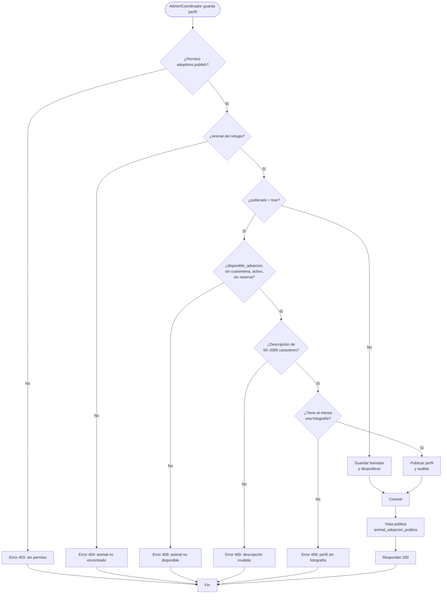
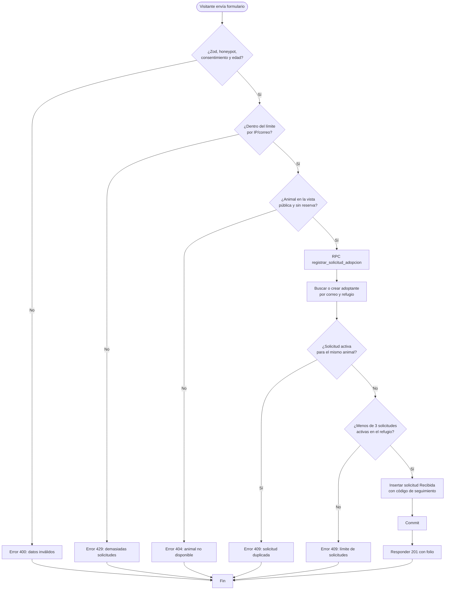
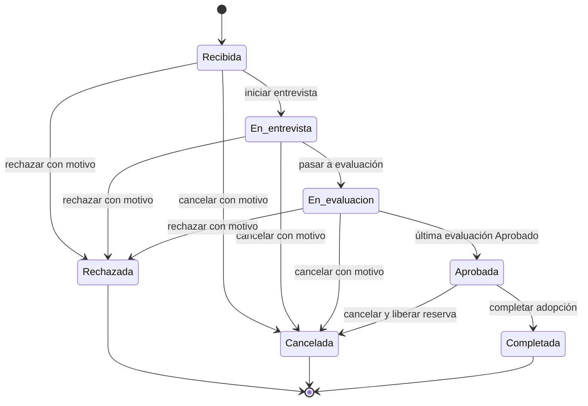
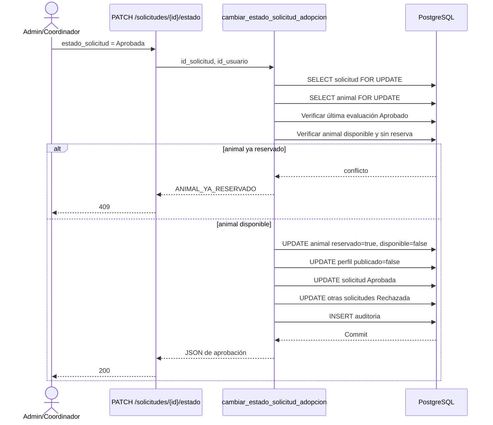
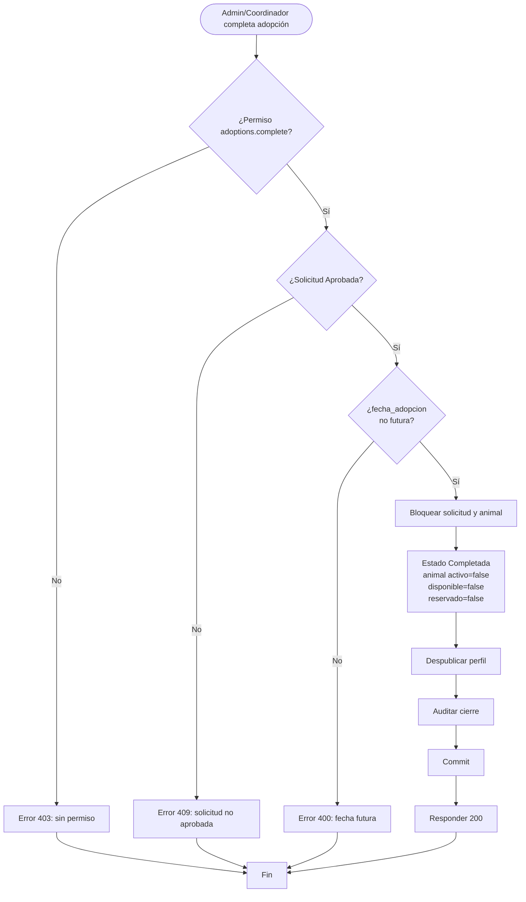

# Requerimiento 05 — Épica 5: Portal de Adopciones

## Título

Publicación del perfil público de adopción, recepción de postulaciones de adoptantes y gestión de entrevistas, compatibilidad y cierre de la adopción en los refugios Pixkki.

## Descripción

La Épica 5 convierte la aptitud interna del paciente —definida en la Épica 4— en un proceso de adopción completo y trazable. Se compone de tres capacidades:

1. El **perfil público de adopción**, que toma un animal con `disponible_adopcion = true` y le agrega una descripción pública, fotos y un estado de publicación. El perfil se muestra en un catálogo global y en una página pública por refugio.
2. La **postulación de adoptantes**, que recibe datos personales, de vivienda, convivencia y motivación, con consentimiento de privacidad y prevención de duplicados, sin exigir cuenta de usuario.
3. La **gestión interna de solicitudes**, que permite entrevistar, evaluar compatibilidad, aprobar, rechazar, reservar al animal, cerrar la adopción y dejar trazabilidad de cada transición.

El módulo `adoptions` es dueño de los perfiles públicos, adoptantes, solicitudes y evaluaciones. Consume del módulo `animals` el estado del paciente (`disponible_adopcion`, `en_cuarentena`, `activo`, `reservado_adopcion`) y la información pública no sensible. La publicación nunca sustituye al *gatekeeper* de la Épica 4: lo presupone.

> **Principio rector:** el catálogo público muestra solo pacientes que cumplen simultáneamente tres condiciones: aptitud vigente (`disponible_adopcion = true`), perfil publicado (`perfil_adopcion.publicado = true`) y ausencia de reserva (`reservado_adopcion = false`). Cualquier cambio que rompa una condición oculta el perfil automáticamente.

## Objetivo

Proveer el portal de adopciones que permita:

1. Crear y mantener un perfil público por animal, con descripción y galería de fotos.
2. Publicar y despublicar perfiles de forma directa por Administrador o Coordinador, sin segunda aprobación.
3. Exponer un catálogo público global y una página pública por refugio, con filtros y datos seguros.
4. Recibir postulaciones públicas con consentimiento de privacidad y sin crear cuentas de adoptante.
5. Prevenir solicitudes duplicadas y limitar el abuso del formulario público.
6. Gestionar el ciclo de vida de la solicitud: recibida, entrevista, evaluación, aprobada, rechazada, cancelada y completada.
7. Registrar evaluaciones múltiples de entrevista, visita al hogar, compatibilidad y referencias.
8. Reservar al animal al aprobar una solicitud y cerrar automáticamente las demás postulaciones activas.
9. Completar la adopción registrando la fecha, despublicando al animal y sacándolo de los conteos de población activa.
10. Auditar cada publicación, cambio de estado, evaluación y cierre.

## Alcance

Incluye:

- RF5.1: Perfil público de adopción y publicación/despublicación (US17).
- RF5.2: Catálogo público global y página pública por refugio (US17).
- RF5.3: Formulario público de postulación de adoptantes (US18).
- RF5.4: Gestión interna de solicitudes y entrevistas (US19).
- RF5.5: Evaluaciones de compatibilidad y filtro de aprobación (US19).
- RF5.6: Reserva del animal al aprobar y rechazo automático de solicitudes competidoras (US19).
- RF5.7: Cierre de la adopción y actualización del estado del animal (US19).

No incluye:

- Registro de cirugías, consumo de inventario y *gatekeeper* de aptitud: pertenecen a la Épica 4 y se consumen como estado previo.
- Cuentas de adoptante, login, historial de postulaciones o seguimiento público por código.
- Notificaciones por correo, SMS, push o WhatsApp. El sistema registra estados; el contacto es manual del refugio.
- Firma digital, contrato de adopción, verificación de identidad o cobro de cuotas.
- Gestión de campañas de difusión: pertenece al módulo `campaigns` y no se modifica.
- CRUD de insumos, donaciones o reportes financieros (Épica 6).
- Reportes de adopciones, población o conversión (Épica 7).
- Moderación automática de texto, detección de fraude o *scoring* crediticio.
- Importación histórica (Épica 8).
- Generación automática de perfiles con IA (US26): el perfil se redacta manualmente en esta épica.
- Aplicación móvil o API pública para terceros.

## Actores

| Actor | Descripción |
|-------|-------------|
| Administrador de refugio | Rol `admin`/`Administrador`. Publica y despublica perfiles, gestiona solicitudes, aprueba, cancela y completa adopciones. |
| Coordinador | Rol `coordinador`. Publica perfiles, gestiona solicitudes, entrevista, evalúa y completa adopciones dentro de su refugio. |
| Evaluador | Rol `evaluador`. Consulta solicitudes y registra evaluaciones de entrevista, visita, compatibilidad y referencias. No aprueba ni completa adopciones. |
| Veterinario | Rol `veterinario`. Consulta la información clínica y de compatibilidad del paciente; no gestiona solicitudes de adopción. |
| Operador | Rol `operador`. Consulta el catálogo interno y las solicitudes; no publica, evalúa ni aprueba. |
| Personal de solo lectura | Usuario autenticado con `adoptions.view`. Consulta perfiles y solicitudes sin mutar. |
| Postulante / Adoptante | Persona anónima que envía una solicitud desde el catálogo público. No tiene cuenta ni sesión. |
| Visitante | Persona anónima que navega el catálogo y los perfiles públicos. |
| Superadmin | Rol global. Puede operar sobre cualquier refugio según la política de la Épica 0; toda operación conserva el `id_refugio` del recurso. |
| Sistema | Publica, oculta, reserva, rechaza solicitudes competidoras, completa adopciones y audita. |

## Reglas de negocio

### Perfil público y catálogo (US17)

1. **Perfil único por animal**: cada animal tiene como máximo un `perfil_adopcion`. El perfil se crea o actualiza por `id_animal`; no se duplica.
2. **Descripción obligatoria para publicar**: `descripcion_publica` tiene entre 50 y 2000 caracteres. Se permite guardar un borrador con descripción vacía, pero no publicarlo.
3. **Foto obligatoria para publicar**: el perfil solo se publica si el animal tiene al menos una fotografía en `fotografia`. Sin foto se devuelve `409 PERFIL_SIN_FOTOGRAFIA`.
4. **Aptitud previa obligatoria**: solo se publica un perfil si el animal tiene `disponible_adopcion = true`, `en_cuarentena = false`, `activo = true`, `deleted_at IS NULL` y `reservado_adopcion = false`. La publicación no reemplaza al *gatekeeper* de la Épica 4.
5. **Publicación directa**: un usuario con `adoptions.publish` (Administrador o Coordinador) publica o despublica sin segunda aprobación. Cada cambio queda auditado.
6. **Despublicar siempre es posible**: pasar `publicado` a `false` no exige descripción, foto ni aptitud. Se registra `fecha_despublicacion`.
7. **Ocultamiento automático**: si el animal deja de estar disponible (cuarentena, pérdida de aptitud, reserva, adopción, baja o eliminación lógica), el perfil se despublica automáticamente y desaparece del catálogo, aunque `perfil_adopcion.publicado` hubiera quedado en `true` por un error previo.
8. **Catálogo global**: el catálogo público agrega todos los perfiles publicados de refugios activos. Permite filtrar por refugio, especie, sexo, tamaño, edad, temperamento y texto.
9. **Página por refugio**: cada refugio tiene una URL pública identificada por `refugio.slug`. El slug es único, estable y se genera a partir del nombre con sufijo numérico en caso de colisión.
10. **Datos públicos seguros**: el catálogo y el perfil exponen nombre, especie, raza, sexo, edad estimada, tamaño, color, temperamento, vacunado, desparasitado, esterilizado, rasgos físicos, descripción pública, fotos, compatibilidad vigente y datos institucionales del refugio (nombre, ciudad, estado, correo y teléfono). Nunca exponen microchip, procedencia, lugar o fecha de rescate, rescatista, observaciones internas, peso, diagnóstico, notas clínicas ni datos del adoptante.
11. **Compatibilidad pública**: el perfil muestra la última evaluación de temperamento (`apto_perros`, `apto_gatos`, `apto_ninos`) como información orientativa. No promete compatibilidad ni reemplaza la evaluación interna.
12. **Fotos ordenadas**: la galería pública muestra primero la foto principal y luego el resto por `orden` e `id_fotografia`. Solo se exponen `url_archivo` y `url_thumbnail`.
13. **Refugio activo**: un refugio inactivo no aparece en el catálogo ni en su página pública, aunque tenga perfiles publicados.
14. **Paginación**: el catálogo usa `page` y `pageSize`, con máximo 50 elementos por página. La respuesta incluye `total` para la paginación.
15. **Caché pública**: las lecturas públicas pueden cachearse por un periodo corto (por ejemplo, 60 segundos) con revalidación; las mutaciones no se cachean. Un perfil reservado o adoptado debe desaparecer en el siguiente ciclo de revalidación.

### Postulación pública (US18)

16. **Solicitud sin cuenta**: el postulante no crea usuario ni inicia sesión. Envía el formulario y recibe un acuse con su folio y estado inicial `Recibida`.
17. **Animal públicamente disponible**: solo se aceptan solicitudes sobre animales presentes en la vista pública (`perfil_adopcion.publicado`, `disponible_adopcion`, `activo`, sin cuarentena y sin reserva). Otro caso responde `404 ANIMAL_NO_DISPONIBLE`.
18. **Datos obligatorios del adoptante**: `nombre_completo` (2–150), `telefono` (7–20), `correo` válido (máx. 150), `direccion` (5–255), `tiene_otras_mascotas`, `tiene_ninos`, `espacio_techado`, `tiempo_solo_horas` (0–24, opcional), `experiencia_mascotas` (opcional, máx. 1000), `motivo_adopcion` (20–1000) y `comentarios_generales` (opcional, máx. 2000).
19. **Consentimiento obligatorio**: `acepta_politica_privacidad = true` y `declara_mayor_edad = true` son obligatorios. Sin ellos se devuelve `400 PRIVACIDAD_NO_ACEPTADA` o `400 MAYORIA_DE_EDAD_NO_DECLARADA`.
20. **Un adoptante por correo y refugio**: el sistema busca un `adoptante` existente por `(id_refugio, lower(correo))`. Si existe, actualiza sus datos de contacto y consentimiento; si no, lo crea. No se duplica la persona por postular a varios animales.
21. **Solicitud duplicada activa**: un adoptante no puede tener dos solicitudes activas para el mismo animal. Se consideran activas `Recibida`, `En entrevista`, `En evaluación` y `Aprobada`. Una solicitud terminal (`Rechazada`, `Cancelada`, `Completada`) permite volver a postular.
22. **Límite de solicitudes activas**: un adoptante puede tener como máximo tres solicitudes activas por refugio. Al superar el límite se devuelve `409 LIMITE_SOLICITUDES`.
23. **Antispam**: el formulario incluye un campo trampa (`sitio_web`) que debe llegar vacío; si viene completo se rechaza como `400 SOLICITUD_INVALIDA`. El adaptador HTTP aplica un límite de solicitudes por IP y correo (por ejemplo, 5 por hora) y devuelve `429 DEMASIADAS_SOLICITUDES`.
24. **Sin auditoría anónima**: como el postulante no tiene `id_usuario`, la solicitud y el adoptante son su propio registro. No se escribe en `auditoria` por una acción anónima.
25. **Folio de seguimiento**: cada solicitud recibe un `codigo_seguimiento` UUID aleatorio, devuelto al postulante y visible para el refugio. La consulta pública por folio queda fuera de alcance.
26. **Confirmación sin promesas**: el acuse informa que la solicitud fue recibida y que el refugio contactará al postulante. No confirma adopción, disponibilidad futura ni tiempos.
27. **Datos del adoptante protegidos**: `adoptante`, `solicitud_adopcion` y `evaluacion_adopcion` son datos personales. Solo el personal autenticado del refugio con `adoptions.view` puede consultarlos. `anon` no tiene acceso directo a esas tablas.

### Gestión de solicitudes y entrevistas (US19)

28. **Estados canónicos**: `Recibida`, `En entrevista`, `En evaluación`, `Aprobada`, `Rechazada`, `Cancelada` y `Completada`. Se agrega `Completada` al `CHECK` existente.
29. **Transiciones permitidas**:
    - `Recibida` → `En entrevista`, `Rechazada`, `Cancelada`.
    - `En entrevista` → `En evaluación`, `Rechazada`, `Cancelada`.
    - `En evaluación` → `Aprobada`, `Rechazada`, `Cancelada`.
    - `Aprobada` → `Completada` (solo por `completar_adopcion`) o `Cancelada`.
    - `Rechazada`, `Cancelada` y `Completada` son terminales.
30. **Motivo de cierre**: `Rechazada` y `Cancelada` exigen `motivo_rechazo` de 10–500 caracteres. `Completada` no lo exige. Una transición inválida devuelve `409 TRANSICION_INVALIDA`.
31. **RBAC de gestión**: `adoptions.manage` (Administrador y Coordinador) cambia estados, aprueba y cancela. `adoptions.evaluate` (Evaluador, Coordinador y Administrador) registra evaluaciones. `adoptions.complete` (Administrador y Coordinador) completa la adopción. `adoptions.publish` (Administrador y Coordinador) publica perfiles.
32. **Evaluaciones múltiples**: una solicitud puede tener varias `evaluacion_adopcion`. Cada una registra `tipo_evaluacion`, `resultado`, `puntuacion` (0–100, opcional), `comentarios` (opcional, máx. 2000) y `fecha_evaluacion` (servidor, no futura).
33. **Tipos de evaluación**: `entrevista`, `visita_hogar`, `compatibilidad`, `referencias` u `otro`.
34. **Resultados de evaluación**: `Pendiente`, `Aprobado`, `Rechazado` o `Con observaciones`.
35. **Última evaluación manda**: para aprobar, la evaluación más reciente por `fecha_evaluacion` e `id_evaluacion_adopcion` debe tener `resultado = 'Aprobado'`. Sin evaluaciones se devuelve `409 EVALUACION_REQUERIDA`; con última evaluación no aprobada, `409 ULTIMA_EVALUACION_NO_APROBADA`.
36. **Compatibilidad asistida**: el detalle de la solicitud muestra señales de compatibilidad: temperamento y aptitudes del animal frente a `tiene_ninos`, `tiene_otras_mascotas` y `espacio_techado` del adoptante. Las señales son advertencias para el evaluador; la decisión formal queda en `evaluacion_adopcion`.
37. **Aprobación con reserva**: al aprobar una solicitud, en una sola transacción:
    - se bloquea la fila del animal;
    - se verifica que siga disponible y sin reserva;
    - se marca `animal.reservado_adopcion = true`, `animal.disponible_adopcion = false` y `animal.fecha_reserva = now()`;
    - se despublica el perfil;
    - se marca la solicitud como `Aprobada` con `fecha_cierre`;
    - se rechazan automáticamente las demás solicitudes activas del mismo animal con motivo “El paciente fue reservado por otra solicitud aprobada.”;
    - se audita.
38. **Concurrencia de aprobación**: si dos usuarios aprueban solicitudes distintas del mismo animal a la vez, solo una completa. La otra recibe `409 ANIMAL_YA_RESERVADO`.
39. **Reserva única**: un animal no puede tener dos solicitudes `Aprobada` ni dos reservas. La reserva se libera solo al cancelar la solicitud aprobada o al completar la adopción.
40. **Cancelar una aprobada**: si se cancela una solicitud `Aprobada`, se libera `reservado_adopcion`, se limpia `fecha_reserva` y el animal queda `disponible_adopcion = false`. El refugio debe volver a publicarlo por el flujo de la Épica 4 y republicar el perfil.
41. **Completar adopción**: solo desde `Aprobada`. Se registra `fecha_adopcion` (no futura), `fecha_cierre`, `id_usuario_cierre` y observaciones opcionales. El animal pasa a `activo = false`, `disponible_adopcion = false`, `reservado_adopcion = false` y `fecha_adopcion`; el perfil se despublica. Sale del catálogo y de los conteos de población activa.
42. **No se borra al animal**: la adopción no aplica `deleted_at` ni elimina el expediente. El historial clínico, las cirugías y las solicitudes permanecen para trazabilidad y reportes.
43. **Solicitud terminal inmutable**: una solicitud `Rechazada`, `Cancelada` o `Completada` no vuelve a estados anteriores. Una corrección se documenta con una nueva solicitud.
44. **Auditoría de gestión**: cada cambio de estado, evaluación, publicación, despublicación y adopción completada escribe en `auditoria` con `modulo = 'adoptions'`, `entidad_id` de la solicitud o del animal, `id_usuario`, `id_refugio`, `accion` y descripción sin datos sensibles.
45. **Multitenant**: toda consulta y mutación interna filtra por `id_refugio`. Un recurso de otro refugio se responde como `404` (no se revela su existencia). RLS como segunda capa.
46. **Superadmin**: opera con alcance global, pero cada perfil, solicitud, evaluación y adopción conserva el `id_refugio` del recurso y el `id_usuario` real.
47. **Consistencia con la Épica 4**: el catálogo y la postulación nunca habilitan a un animal que no pasó el *gatekeeper*. La aprobación revalida `disponible_adopcion`, `en_cuarentena`, `activo`, `deleted_at` y `reservado_adopcion` dentro de la transacción.
48. **Consistencia con campañas**: el módulo `campaigns` sigue usando `animal.disponible_adopcion` para construir campañas. Al reservar o adoptar, el animal deja de estar disponible y las campañas publicadas lo ocultan automáticamente por la vista existente.
49. **Accesibilidad**: los estados de la solicitud y las señales de compatibilidad se muestran con texto explícito, no solo con color.
50. **Idempotencia de transiciones**: repetir la misma transición ya aplicada devuelve `409 TRANSICION_INVALIDA`; no se duplican evaluaciones ni cierres.

## Supuestos funcionales (pendientes de validación)

| ID | Supuesto | Impacto si cambia |
|----|----------|-------------------|
| S1 | El slug del refugio se genera desde el nombre y se hace único con sufijo `-<id_refugio>` en caso de colisión. | Cambia la URL pública y la migración de `refugio`. |
| S2 | Para publicar un perfil se exige al menos una fotografía. | Cambia la regla 3 y el criterio de publicación. |
| S3 | `Completada` se agrega al `CHECK` de `solicitud_adopcion`; no se crea una tabla `adopcion` separada. | Cambia el modelo de cierre y los reportes. |
| S4 | Un adoptante se identifica por `(id_refugio, lower(correo))` y se reutiliza en nuevas postulaciones. | Cambia la deduplicación y el índice único. |
| S5 | El máximo de solicitudes activas por adoptante y refugio es tres. | Cambia el límite y el error `LIMITE_SOLICITUDES`. |
| S6 | Se exige declaración de mayoría de edad; no se almacena fecha de nacimiento. | Cambia el formulario y la validación legal. |
| S7 | La compatibilidad se resuelve con la evaluación formal; las señales del sistema son advertencias, no bloqueos automáticos. | Cambia el filtro de aprobación y la UI de evaluación. |
| S8 | El `codigo_seguimiento` se devuelve al postulante, pero no existe consulta pública por folio en esta épica. | Cambia el contrato y el alcance de US18. |
| S9 | Las notificaciones al postulante están fuera de alcance; el refugio contacta manualmente. | Cambia la integración con correo y las plantillas. |
| S10 | El catálogo público muestra correo y teléfono institucional del refugio, pero nunca su dirección exacta. | Cambia la vista pública y la política de privacidad. |
| S11 | La reserva deja `disponible_adopcion = false`; para volver a publicar tras una cancelación se requiere el flujo de la Épica 4. | Cambia la máquina de estados y la re-publicación. |
| S12 | La adopción usa `activo = false`, no `deleted_at`; el expediente se conserva. | Cambia los conteos de población y los reportes. |
| S13 | El Superadmin puede publicar, evaluar y completar con alcance global, siempre con auditoría. | Cambia el RBAC y las políticas RLS. |
| S14 | La descripción pública admite entre 50 y 2000 caracteres. | Cambia la validación y el formulario. |
| S15 | El catálogo permite como máximo 50 elementos por página. | Cambia la paginación y el rendimiento. |
| S16 | El formulario público acepta solo animales de refugios activos y perfiles publicados; no hay postulación interna manual en esta épica. | Cambia el canal de alta de solicitudes. |
| S17 | La aprobación exige que la última evaluación sea `Aprobado`; `Con observaciones` no habilita la aprobación. | Cambia la regla 35 y el flujo de US19. |

> **Decisión aplicada:** agregar `slug` y `descripcion_publica` a `refugio`, crear `perfil_adopcion`, ampliar `animal`, `adoptante`, `solicitud_adopcion` y `evaluacion_adopcion`, crear las vistas públicas y las RPC de postulación, aprobación y cierre, y sembrar los permisos `adoptions.*` se ejecutaron mediante las migraciones versionadas `20261116160000_requerimiento_05_portal_adopciones.sql` y `20261116161000_requerimiento_05_parametros_opcionales_rpc.sql`, aplicadas al entorno remoto.

## Inconsistencias y alineación con el estado actual del repositorio

| Elemento | Estado actual | Implicación para esta épica |
|----------|---------------|-----------------------------|
| `adoptante` | Existe con datos personales, vivienda, otras mascotas y consentimiento. Tiene `id_refugio`. | Se reutiliza. Requiere `tiene_ninos`, `experiencia_mascotas`, `declara_mayor_edad`, `fecha_aceptacion_privacidad` y unique por correo. |
| `solicitud_adopcion` | Existe con `id_adoptante`, `id_animal`, `estado_solicitud`, fechas, motivo y comentarios. No tiene `id_refugio`. | Requiere `id_refugio`, `codigo_seguimiento`, `motivo_rechazo`, `fecha_cierre`, `id_usuario_cierre` y el estado `Completada`. |
| `evaluacion_adopcion` | Existe con `tipo_evaluacion`, `resultado`, `puntuacion`, `comentarios`, `fecha_evaluacion`, `id_usuario`. No tiene `id_refugio`. | Requiere `id_refugio`, checks de dominio y `puntuacion` de 0–100. |
| `puntuacion` | `numeric(4,2)` admite hasta 99.99. | Debe ampliarse a `numeric(5,2)` si se usa escala 0–100. |
| `perfil_adopcion` | No existe. | Requiere creación aprobada. |
| `refugio.slug` | No existe. | Requiere slug único para la página pública por refugio. |
| `refugio.descripcion_publica` | No existe. | Requiere campo opcional para la página del refugio. |
| `animal.reservado_adopcion` | No existe. | Requiere campo y fecha de reserva para el flujo de aprobación. |
| `animal.fecha_adopcion` | No existe. | Requiere fecha para cierre y reportes. |
| `animal.disponible_adopcion` | Existe y lo gobierna la Épica 4. | La Épica 5 lo consume; no lo vuelve a calcular. |
| `campana_publica` | Vista pública de campañas; filtra por `disponible_adopcion`, `activo` y `deleted_at`. | Se mantiene. La reserva y la adopción ocultan al animal automáticamente. |
| `modules/campaigns` | Gestiona campañas de difusión y usa `AdoptableAnimalsPort`. | No se modifica. La Épica 5 no crea campañas. |
| `app/(protected)/(dashboard)/adoptions/page.tsx` | Página de UI con datos de ejemplo, sin backend real. | Fuera de alcance. El backend se implementa primero; la UI se conectará después. |
| `solicitud_adopcion` y `evaluacion_adopcion` | Sin módulo, endpoints ni RLS específica. | La Épica 5 crea `modules/adoptions` y sus políticas. |
| `auditoria` | Existe con `modulo`, `accion`, `entidad_id`, `id_usuario` e `id_refugio`. | Se usa para las mutaciones autenticadas. Las postulaciones anónimas no generan auditoría. |
| `permiso` / `rol_permiso` | No existen permisos `adoptions.*`. | Requiere siembra y asignación por rol. |
| Roles de base de datos | `Administrador`, `Veterinario`, `Superadmin`, `Coordinador`, `Operador`, `Evaluador` (según el esquema). | El RBAC se alinea con esos nombres. |
| `types/database.ts` | No incluye `perfil_adopcion` ni las vistas nuevas. | Debe regenerarse después de aplicar la migración. |

## Historias de usuario

| ID | Historia de Usuario | Prioridad | Épica | RF relacionados |
|----|---------------------|-----------|-------|-----------------|
| US17 | Publicación de perfil público (catálogo de adopciones) | Must Have | Épica 5 | RF5.1, RF5.2 |
| US18 | Formulario de postulación de adoptantes | Must Have | Épica 5 | RF5.3 |
| US19 | Gestión de entrevistas y filtro de compatibilidad | Must Have | Épica 5 | RF5.4, RF5.5, RF5.6, RF5.7 |

## Contrato de API

Los endpoints siguen el patrón `/api/v1/<recurso>`. Los públicos se agrupan bajo `/api/v1/publico/` y no requieren sesión. La validación de entrada se hace con Zod antes de cualquier efecto. Los errores usan el mismo envelope uniforme.

### Formato de respuesta de éxito

```json
{
  "success": true,
  "data": { ... }
}
```

### Formato de error uniforme

```json
{
  "success": false,
  "error": {
    "code": "ERROR_CODIGO",
    "message": "Mensaje en español para el usuario final",
    "statusCode": 400,
    "details": { ... }
  }
}
```

### RF5.1 — Perfil público y publicación (US17)

| Método | Ruta | Descripción | Acceso |
|--------|------|-------------|--------|
| GET | `/api/v1/animales/{id}/perfil-adopcion` | Consultar perfil y estado de publicación | `adoptions.view` |
| PUT | `/api/v1/animales/{id}/perfil-adopcion` | Crear o actualizar perfil; publicar o despublicar | `adoptions.publish` |

**Request (PUT):**

```json
{
  "descripcion_publica": "Mango es un perro sociable, juguetón y acostumbrado a vivir con niños. Busca una familia responsable que le dé paseos diarios.",
  "publicado": true
}
```

**Response (PUT):**

```json
{
  "success": true,
  "data": {
    "id_perfil_adopcion": 14,
    "id_animal": 45,
    "id_refugio": 7,
    "descripcion_publica": "Mango es un perro sociable, juguetón y acostumbrado a vivir con niños. Busca una familia responsable que le dé paseos diarios.",
    "publicado": true,
    "fecha_publicacion": "2026-11-16T15:00:00Z",
    "fecha_despublicacion": null,
    "puede_publicarse": true,
    "bloqueos": [],
    "id_usuario_actualizacion": 9
  }
}
```

**Response (GET):**

```json
{
  "success": true,
  "data": {
    "id_perfil_adopcion": 14,
    "id_animal": 45,
    "descripcion_publica": "Mango es un perro sociable...",
    "publicado": true,
    "fecha_publicacion": "2026-11-16T15:00:00Z",
    "fecha_despublicacion": null,
    "puede_publicarse": true,
    "bloqueos": [],
    "fotos": [
      {
        "id_fotografia": 81,
        "url_archivo": "https://...",
        "url_thumbnail": "https://...",
        "es_principal": true,
        "orden": 0
      }
    ]
  }
}
```

**Errores:**

- `400` — `DATOS_INVALIDOS`, `DESCRIPCION_INVALIDA`
- `403` — `ROL_SIN_PERMISO`
- `404` — `ANIMAL_NO_ENCONTRADO`
- `409` — `ANIMAL_NO_DISPONIBLE`, `PERFIL_SIN_FOTOGRAFIA`, `PERFIL_YA_PUBLICADO`
- `500` — `ERROR_INTERNO`

### RF5.2 — Catálogo público (US17)

| Método | Ruta | Descripción | Acceso |
|--------|------|-------------|--------|
| GET | `/api/v1/publico/adopciones` | Catálogo global con filtros | Público |
| GET | `/api/v1/publico/adopciones/{id}` | Perfil público de un animal | Público |
| GET | `/api/v1/publico/refugios` | Refugios con adoptables | Público |
| GET | `/api/v1/publico/refugios/{slug}` | Página pública de un refugio | Público |
| GET | `/api/v1/publico/refugios/{slug}/adopciones` | Adoptables de un refugio | Público |

**Query params (catálogo):** `refugio` (slug), `especie`, `sexo`, `tamano`, `edadMin`, `edadMax`, `temperamento`, `q`, `orden`, `page`, `pageSize`.

**Response (GET `/publico/adopciones`):**

```json
{
  "success": true,
  "data": {
    "items": [
      {
        "id_animal": 45,
        "nombre": "Mango",
        "especie": "Perro",
        "raza": "Mestizo",
        "sexo": "M",
        "edad_estimada": 3,
        "tamano": "Mediano",
        "color": "Dorado",
        "temperamento": "Sociable",
        "vacunado": true,
        "desparasitado": true,
        "esterilizado": true,
        "compatibilidad": {
          "apto_perros": "si",
          "apto_gatos": "con_supervision",
          "apto_ninos": "si"
        },
        "foto_principal": "https://...",
        "refugio": {
          "slug": "refugio-huellitas",
          "nombre": "Refugio Huellitas",
          "ciudad": "CDMX",
          "estado": "CDMX"
        },
        "fecha_publicacion": "2026-11-16T15:00:00Z"
      }
    ],
    "page": 1,
    "pageSize": 12,
    "total": 34
  }
}
```

**Response (GET `/publico/adopciones/{id}`):**

```json
{
  "success": true,
  "data": {
    "id_animal": 45,
    "nombre": "Mango",
    "especie": "Perro",
    "raza": "Mestizo",
    "sexo": "M",
    "edad_estimada": 3,
    "tamano": "Mediano",
    "color": "Dorado",
    "temperamento": "Sociable",
    "vacunado": true,
    "desparasitado": true,
    "esterilizado": true,
    "rasgos_fisicos": "Pelaje dorado, orejas caídas.",
    "descripcion_publica": "Mango es un perro sociable...",
    "compatibilidad": {
      "comportamiento": "Sociable",
      "nivel_energia": "Media",
      "apto_perros": "si",
      "apto_gatos": "con_supervision",
      "apto_ninos": "si"
    },
    "fotos": [
      {
        "id_fotografia": 81,
        "url_archivo": "https://...",
        "url_thumbnail": "https://...",
        "es_principal": true,
        "orden": 0
      }
    ],
    "refugio": {
      "slug": "refugio-huellitas",
      "nombre": "Refugio Huellitas",
      "ciudad": "CDMX",
      "estado": "CDMX",
      "correo_contacto": "contacto@huellitas.org",
      "telefono": "5555555555"
    },
    "fecha_publicacion": "2026-11-16T15:00:00Z"
  }
}
```

**Response (GET `/publico/refugios/{slug}`):**

```json
{
  "success": true,
  "data": {
    "refugio": {
      "slug": "refugio-huellitas",
      "nombre": "Refugio Huellitas",
      "ciudad": "CDMX",
      "estado": "CDMX",
      "descripcion_publica": "Rescatamos y rehabilitamos perros y gatos...",
      "correo_contacto": "contacto@huellitas.org",
      "telefono": "5555555555",
      "adoptables": 8
    }
  }
}
```

**Errores:**

- `400` — `FILTROS_INVALIDOS`
- `404` — `PERFIL_NO_ENCONTRADO`, `REFUGIO_NO_ENCONTRADO`
- `500` — `ERROR_INTERNO`

### RF5.3 — Postulación pública (US18)

| Método | Ruta | Descripción | Acceso |
|--------|------|-------------|--------|
| POST | `/api/v1/publico/adopciones/{id}/solicitudes` | Enviar solicitud de adopción | Público |

**Request:**

```json
{
  "nombre_completo": "Ana Torres",
  "telefono": "5555555555",
  "correo": "ana@example.com",
  "direccion": "Calle 1 #123, Colonia Centro",
  "tiene_otras_mascotas": true,
  "tiene_ninos": true,
  "espacio_techado": true,
  "tiempo_solo_horas": 6,
  "experiencia_mascotas": "He tenido perros durante 10 años.",
  "motivo_adopcion": "Busco un compañero para mi familia y tengo espacio para cuidarlo.",
  "comentarios_generales": "Puedo llevarlo al veterinario cada mes.",
  "acepta_politica_privacidad": true,
  "declara_mayor_edad": true,
  "sitio_web": ""
}
```

**Response (201):**

```json
{
  "success": true,
  "data": {
    "id_solicitud": 101,
    "estado_solicitud": "Recibida",
    "fecha_solicitud": "2026-11-16T16:00:00Z",
    "codigo_seguimiento": "3f1c2b9e-8a4d-4c1e-9f7a-2b6d5e8c1a44",
    "mensaje": "Tu solicitud fue recibida. El refugio se pondrá en contacto contigo."
  }
}
```

**Errores:**

- `400` — `DATOS_INVALIDOS`, `PRIVACIDAD_NO_ACEPTADA`, `MAYORIA_DE_EDAD_NO_DECLARADA`, `SOLICITUD_INVALIDA`
- `404` — `ANIMAL_NO_DISPONIBLE`
- `409` — `SOLICITUD_DUPLICADA`, `LIMITE_SOLICITUDES`, `ANIMAL_YA_RESERVADO`
- `429` — `DEMASIADAS_SOLICITUDES`
- `500` — `ERROR_INTERNO`

### RF5.4 — Gestión interna de solicitudes (US19)

| Método | Ruta | Descripción | Acceso |
|--------|------|-------------|--------|
| GET | `/api/v1/adopciones/solicitudes` | Listar solicitudes con filtros | `adoptions.view` |
| GET | `/api/v1/adopciones/solicitudes/{id}` | Detalle con adoptante, animal, evaluaciones e historial | `adoptions.view` |
| PATCH | `/api/v1/adopciones/solicitudes/{id}/estado` | Cambiar estado | `adoptions.manage` |
| POST | `/api/v1/adopciones/solicitudes/{id}/evaluaciones` | Registrar evaluación | `adoptions.evaluate` |
| GET | `/api/v1/adopciones/solicitudes/{id}/evaluaciones` | Historial de evaluaciones | `adoptions.view` |
| POST | `/api/v1/adopciones/solicitudes/{id}/completar` | Completar adopción | `adoptions.complete` |

**Query params (listado):** `estado`, `id_animal`, `q`, `desde`, `hasta`, `page`, `pageSize`.

**Request (PATCH estado):**

```json
{
  "estado_solicitud": "En entrevista",
  "motivo": null
}
```

**Request (PATCH a rechazada o cancelada):**

```json
{
  "estado_solicitud": "Rechazada",
  "motivo": "El adoptante no cuenta con espacio techado ni disponibilidad para el paseo diario."
}
```

**Response (PATCH estado):**

```json
{
  "success": true,
  "data": {
    "id_solicitud": 101,
    "estado_solicitud": "En entrevista",
    "fecha_cierre": null,
    "motivo_rechazo": null,
    "reserva": {
      "id_animal": 45,
      "reservado_adopcion": false
    },
    "auditoria_id": 901
  }
}
```

**Request (POST evaluación):**

```json
{
  "tipo_evaluacion": "compatibilidad",
  "resultado": "Aprobado",
  "puntuacion": 92,
  "comentarios": "La familia tiene experiencia con perros y espacio techado.",
  "fecha_evaluacion": "2026-11-17T10:00:00Z"
}
```

**Response (POST evaluación):**

```json
{
  "success": true,
  "data": {
    "id_evaluacion_adopcion": 22,
    "id_solicitud": 101,
    "id_refugio": 7,
    "tipo_evaluacion": "compatibilidad",
    "resultado": "Aprobado",
    "puntuacion": 92,
    "comentarios": "La familia tiene experiencia con perros y espacio techado.",
    "id_usuario": 11,
    "fecha_evaluacion": "2026-11-17T10:00:00Z"
  }
}
```

**Request (POST completar):**

```json
{
  "fecha_adopcion": "2026-11-20",
  "observaciones": "Adopción completada con seguimiento a los 30 días."
}
```

**Response (POST completar):**

```json
{
  "success": true,
  "data": {
    "id_solicitud": 101,
    "estado_solicitud": "Completada",
    "fecha_cierre": "2026-11-20T18:00:00Z",
    "fecha_adopcion": "2026-11-20",
    "animal": {
      "id_animal": 45,
      "activo": false,
      "disponible_adopcion": false,
      "reservado_adopcion": false,
      "fecha_adopcion": "2026-11-20"
    },
    "auditoria_id": 950
  }
}
```

**Errores:**

- `400` — `DATOS_INVALIDOS`, `MOTIVO_REQUERIDO`, `FECHA_FUTURA`
- `403` — `ROL_SIN_PERMISO`
- `404` — `SOLICITUD_NO_ENCONTRADA`
- `409` — `TRANSICION_INVALIDA`, `EVALUACION_REQUERIDA`, `ULTIMA_EVALUACION_NO_APROBADA`, `ANIMAL_YA_RESERVADO`, `SOLICITUD_YA_CERRADA`, `SOLICITUD_NO_APROBADA`, `ADOPCION_YA_COMPLETADA`
- `500` — `ERROR_INTERNO`

### Contrato con las épicas vecinas

- **Épica 4:** la publicación exige `animal.disponible_adopcion = true` y `en_cuarentena = false`. La Épica 5 no recalcula la aptitud; la revalida al publicar y al aprobar.
- **Módulo `campaigns`:** sigue leyendo `animal.disponible_adopcion` y `animal.activo`. Al reservar o adoptar, el animal desaparece de las campañas publicadas sin cambios en `campaigns`.
- **Épica 6:** el inventario y las donaciones no se tocan. La adopción no genera movimientos de inventario.
- **Épica 7:** los reportes de población deben contar animales adoptados por separado, porque `activo = false` los excluye de los conteos activos.

## Plan de implementación backend-first

| Paso | Acción | Artefacto |
|------|--------|-----------|
| 1 | Ampliar el contrato OpenAPI del módulo | `modules/adoptions/contracts/openapi.yaml` |
| 2 | Definir schemas Zod de perfil, postulación, evaluación y estados | `modules/adoptions/validators/` |
| 3 | Definir DTOs derivados con `z.infer` | `modules/adoptions/dtos/` |
| 4 | Definir errores de dominio y permisos | `modules/adoptions/errors.ts`, `modules/adoptions/access.ts` |
| 5 | Implementar repository del catálogo público | `modules/adoptions/repositories/public-catalog.repository.ts` |
| 6 | Implementar repository de perfiles | `modules/adoptions/repositories/profile.repository.ts` |
| 7 | Implementar repository de solicitudes y adoptantes | `modules/adoptions/repositories/application.repository.ts` |
| 8 | Implementar repository de evaluaciones | `modules/adoptions/repositories/evaluation.repository.ts` |
| 9 | Implementar services con reglas y RBAC | `modules/adoptions/services/` |
| 10 | Implementar factories | `modules/adoptions/factories/` |
| 11 | Crear y aplicar migración versionada | `supabase/migrations/YYYYMMDDHHMMSS_requerimiento_05_portal_adopciones.sql` |
| 12 | Regenerar tipos | `npm run db:types` |
| 13 | Implementar Route Handlers públicos e internos | `app/api/v1/publico/...`, `app/api/v1/adopciones/...`, `app/api/v1/animales/[id]/perfil-adopcion/route.ts` |
| 14 | Integrar el estado de reserva y adopción en el read model de animals | `modules/animals/repositories/animal.repository.ts`, `clinical-record.repository.ts` |
| 15 | Pruebas aisladas del backend | Equipo de QA (externo a este documento) |
| 16 | Ampliar contrato v1 | Tag git `api-v1.5` |
| 17 | Frontend consume el contrato vía Server Actions | Server Actions como adaptador (fuera de alcance de esta entrega) |

## Riesgos y dependencias

| Riesgo | Mitigación |
|--------|------------|
| Fuga de datos personales del adoptante | Vistas públicas con campos seguros, RLS, `anon` sin acceso a tablas y endpoints internos con `adoptions.view`. |
| Perfil publicado de un animal no apto | Revalidar `disponible_adopcion`, cuarentena, estado activo y reserva al publicar; trigger de despublicación automática. |
| Perfil visible tras una reserva o adopción | Trigger y RPC despublican; la vista pública filtra `reservado_adopcion` y `activo`. |
| Solicitudes duplicadas por doble clic | RPC transaccional, verificación de solicitud activa y respuesta idempotente. |
| Spam o bots en el formulario | Honeypot, límite por IP/correo, validación Zod y respuesta genérica. |
| Dos aprobaciones simultáneas del mismo animal | Bloqueo de fila del animal y verificación de reserva dentro de la RPC; perdedor recibe `ANIMAL_YA_RESERVADO`. |
| Aprobar sin evaluación | Validar la última evaluación `Aprobado` dentro de la transacción. |
| Evaluación obsoleta | Ordenar por `fecha_evaluacion` e `id_evaluacion_adopcion`; la última define el resultado. |
| Reserva huérfana | Cancelar una solicitud aprobada libera la reserva; auditoría y estado explícito. |
| Adopción completada dos veces | Verificar estado `Aprobada` y `reservado_adopcion = true`; error `ADOPCION_YA_COMPLETADA`. |
| Correos duplicados con mayúsculas | Índice único `(id_refugio, lower(correo))` y búsqueda normalizada. |
| Slug duplicado o cambiante | Generar slug único y estable; no regenerarlo al editar el nombre. |
| Catálogo con datos clínicos sensibles | La vista pública solo expone campos permitidos; nunca `observaciones`, diagnóstico, microchip ni rescatista. |
| Caché muestra un animal ya adoptado | TTL corto y revalidación; la vista pública filtra el estado real. |
| Migración con datos existentes | Backfill de `id_refugio`, deduplicación de adoptantes y defaults antes de `NOT NULL`; aprobación previa. |
| `puntuacion` fuera de rango | Ampliar a `numeric(5,2)` y `CHECK` de 0–100. |
| `types/database.ts` desactualizado | Aplicar migración y ejecutar `npm run db:types`; no editar tipos a mano. |
| Adopción distorsiona conteos de población | `activo = false`; los reportes deben separar adoptados de activos. |
| Superadmin sin refugio propio | Usar el `id_refugio` del recurso y validar el alcance global en el servicio. |
| UI antigua muestra datos de ejemplo | La página actual de adopciones es estática; el frontend se conecta después del backend. |

**Dependencias:** Épica 0 (autenticación, RBAC y `id_refugio` de sesión), Épica 1 (`animal` y fotos), Épica 3 (temperamento y compatibilidad), Épica 4 (`disponible_adopcion` y *gatekeeper*), módulo `campaigns` (consumo de disponibilidad), Supabase/PostgreSQL, Zod y el equipo de QA para pruebas aisladas.

## Glosario

| Término | Definición |
|---------|------------|
| Perfil público | Registro de `perfil_adopcion` con descripción y estado de publicación de un animal. |
| Publicar | Hacer visible un perfil en el catálogo público; exige aptitud, descripción y foto. |
| Despublicar | Ocultar un perfil del catálogo sin eliminar su historial. |
| Catálogo | Listado público de animales con perfil publicado. |
| Slug | Identificador legible y único de un refugio en la URL pública. |
| Postulante | Persona anónima que envía una solicitud de adopción. |
| Adoptante | Registro de la persona que postula; se identifica por correo y refugio. |
| Solicitud | Registro de `solicitud_adopcion` con estado, motivo y fechas. |
| Evaluación | Registro de entrevista, visita, compatibilidad o referencias con resultado y puntuación. |
| Compatibilidad | Señal entre el temperamento/aptitudes del animal y las condiciones del adoptante. |
| Reserva | Estado en el que un animal aprobado deja de estar disponible para otras solicitudes. |
| Adopción completada | Cierre formal que registra fecha, desactiva al animal y lo saca del catálogo. |
| Pipeline | Secuencia de estados de una solicitud. |
| PII | Información personal identificable del adoptante. |
| RLS | *Row Level Security*: segunda capa de defensa multitenant. |
| RPC | Función de base de datos ejecutada de forma transaccional. |
| RBAC | Control de acceso basado en roles. |
| Append-only | Modelo en el que los registros solo se agregan; no se editan ni se eliminan. |
| DoR / DoD | Definition of Ready / Definition of Done. |

## Diagramas de flujo (mermaid)

### Flujo de publicación del perfil (RF5.1 / RF5.2)



### Flujo de postulación pública (RF5.3)



### Máquina de estados de la solicitud (RF5.4)



### Aprobación con reserva y concurrencia (RF5.6)



### Cierre de la adopción (RF5.7)



## Criterios de aceptación por historia de usuario

| US | Criterios de aceptación |
|----|------------------------|
| US17 | Un usuario con `adoptions.publish` crea o actualiza un perfil con descripción de 50–2000 caracteres y publica o despublica directamente. No se publica un animal sin `disponible_adopcion = true`, sin cuarentena, inactivo, eliminado o reservado. No se publica sin al menos una foto. El catálogo global y la página por refugio muestran solo perfiles publicados de refugios activos, con datos seguros y filtros por refugio, especie, sexo, tamaño, edad, temperamento y texto. El perfil muestra fotos ordenadas y compatibilidad vigente. Un animal reservado, adoptado, en cuarentena o dado de baja desaparece automáticamente. |
| US18 | Un visitante anónimo envía una solicitud con datos personales, vivienda, convivencia, experiencia y motivación, aceptando la política de privacidad y declarando mayoría de edad. El sistema rechaza datos inválidos, honeypot, consentimiento faltante, animal no público, solicitud duplicada activa, más de tres solicitudes activas y exceso de intentos. Un adoptante existente se reutiliza por correo y refugio. La respuesta incluye folio, estado `Recibida` y mensaje de contacto, sin datos internos. |
| US19 | El personal autorizado lista y consulta solicitudes con datos del adoptante, animal, evaluaciones e historial. Solo se permiten las transiciones definidas; rechazar o cancelar exige motivo. Se registran evaluaciones múltiples con tipo, resultado, puntuación 0–100, comentarios y fecha no futura. Aprobar exige que la última evaluación sea `Aprobado`. La aprobación reserva al animal, lo despublica, rechaza automáticamente las demás solicitudes activas y audita. Dos aprobaciones simultáneas no reservan dos veces. Completar la adopción registra la fecha, marca `activo = false`, `disponible_adopcion = false`, `reservado_adopcion = false`, despublica el perfil y conserva el expediente. |

## Esquema de base de datos implicado

| Tabla / vista | Campo clave | Descripción |
|---------------|-------------|-------------|
| `perfil_adopcion` | `id_perfil_adopcion` (PK), `id_animal` (FK unique), `id_refugio` (FK) | Tabla nueva. Descripción pública, `publicado`, fechas de publicación/despublicación y usuarios. |
| `refugio` | `id_refugio` (PK) | Tabla existente. Requiere `slug` único y `descripcion_publica`. |
| `animal` | `id_animal` (PK), `id_refugio` (FK) | Tabla existente. Requiere `reservado_adopcion`, `fecha_reserva` y `fecha_adopcion`. |
| `fotografia` | `id_fotografia` (PK), `id_animal` (FK) | Tabla existente. Fuente de la galería pública. |
| `evaluacion_temperamento` | `id_evaluacion_temperamento` (PK), `id_animal` (FK) | Tabla existente de la Épica 3. Fuente de compatibilidad pública. |
| `adoptante` | `id_adoptante` (PK), `id_refugio` (FK) | Tabla existente. Requiere `tiene_ninos`, `experiencia_mascotas`, `declara_mayor_edad`, `fecha_aceptacion_privacidad` y unique por correo. |
| `solicitud_adopcion` | `id_solicitud` (PK), `id_adoptante` (FK), `id_animal` (FK) | Tabla existente. Requiere `id_refugio`, `codigo_seguimiento`, `motivo_rechazo`, `fecha_cierre`, `id_usuario_cierre` y estado `Completada`. |
| `evaluacion_adopcion` | `id_evaluacion_adopcion` (PK), `id_solicitud` (FK) | Tabla existente. Requiere `id_refugio`, checks de tipo/resultado y puntuación 0–100. |
| `auditoria` | `id_auditoria` (PK), `id_refugio` (FK) | Tabla existente. Registra publicaciones, estados, evaluaciones y cierres. |
| `animal_adopcion_publica` | Vista | Vista pública con datos seguros del animal, refugio, fotos y compatibilidad. `SELECT` para `anon` y `authenticated`. |
| `refugio_publico` | Vista | Vista pública con slug, datos institucionales y conteo de adoptables. `SELECT` para `anon` y `authenticated`. |

**Regla multitenant:** toda consulta interna a `perfil_adopcion`, `adoptante`, `solicitud_adopcion` y `evaluacion_adopcion` filtra por `id_refugio` de la sesión. Las tablas hijas se validan además a través de su solicitud o animal padre. RLS como segunda capa de defensa. Las vistas públicas son la única superficie accesible por `anon`.

**Migración requerida (aprobación previa obligatoria):**

1. Añadir `slug` único y `descripcion_publica` a `refugio`; generar slugs con backfill y resolver colisiones.
2. Crear `perfil_adopcion` con unique por `id_animal`, `id_refugio`, checks de descripción, fechas y RLS tenant.
3. Añadir `reservado_adopcion`, `fecha_reserva` y `fecha_adopcion` a `animal`; índice por `(id_refugio, reservado_adopcion)`.
4. Añadir `id_refugio` a `solicitud_adopcion` con backfill desde `adoptante`; `NOT NULL`, FK, índice `(id_refugio, estado_solicitud, fecha_solicitud)` y RLS.
5. Añadir `id_refugio` a `evaluacion_adopcion` con backfill desde `solicitud_adopcion`; `NOT NULL`, FK, índice y RLS.
6. Ampliar `chk_solicitud_estado` con `Completada`; añadir `codigo_seguimiento uuid`, `motivo_rechazo`, `fecha_cierre` e `id_usuario_cierre`.
7. Ampliar `adoptante` con `tiene_ninos`, `experiencia_mascotas`, `declara_mayor_edad`, `fecha_aceptacion_privacidad`; unique `(id_refugio, lower(correo))` con deduplicación previa.
8. Ampliar `evaluacion_adopcion.puntuacion` a `numeric(5,2)` y añadir checks de `tipo_evaluacion`, `resultado` y rango 0–100.
9. Crear las vistas `animal_adopcion_publica` y `refugio_publico`; `REVOKE ALL` de `public` y `GRANT SELECT` a `anon, authenticated`.
10. Crear la RPC `registrar_solicitud_adopcion(...)` con `security definer`, `search_path = public`, grant execute a `anon, authenticated`, y validación de animal público, consentimiento, duplicados y límite.
11. Crear la RPC `publicar_perfil_adopcion(...)` con bloqueo de animal, validación de aptitud, foto y descripción, upsert y auditoría.
12. Crear la RPC `cambiar_estado_solicitud_adopcion(...)` que implemente la máquina de estados, la aprobación con reserva, el rechazo automático de competidoras y la auditoría.
13. Crear la RPC `completar_adopcion(...)` con bloqueo, cierre, despublicación, actualización del animal y auditoría.
14. Crear el trigger que despublica `perfil_adopcion` cuando `animal.disponible_adopcion` pasa a `false` o el animal se reserva/desactiva.
15. Sembrar los permisos `adoptions.view`, `adoptions.publish`, `adoptions.evaluate`, `adoptions.manage` y `adoptions.complete`; asignarlos a los roles correspondientes.
16. Regenerar `types/database.ts` con `npm run db:types` después de aplicar.

## Plan de implementación backend-first (detallado por módulo)

| Módulo | Archivos clave | Endpoints `/api/v1/` |
|--------|---------------|----------------------|
| adoptions (catálogo) | `modules/adoptions/repositories/public-catalog.repository.ts`<br>`modules/adoptions/services/public-catalog.service.ts`<br>`modules/adoptions/factories/create-public-catalog-service.ts` | `GET /publico/adopciones`<br>`GET /publico/adopciones/{id}`<br>`GET /publico/refugios`<br>`GET /publico/refugios/{slug}`<br>`GET /publico/refugios/{slug}/adopciones` |
| adoptions (perfil) | `modules/adoptions/validators/public-profile.validators.ts`<br>`modules/adoptions/repositories/profile.repository.ts`<br>`modules/adoptions/services/profile.service.ts`<br>`modules/adoptions/factories/create-profile-service.ts` | `GET/PUT /animales/{id}/perfil-adopcion` |
| adoptions (postulación) | `modules/adoptions/validators/application.validators.ts`<br>`modules/adoptions/repositories/application.repository.ts`<br>`modules/adoptions/services/application.service.ts`<br>`modules/adoptions/factories/create-application-service.ts` | `POST /publico/adopciones/{id}/solicitudes`<br>`GET /adopciones/solicitudes`<br>`GET /adopciones/solicitudes/{id}` |
| adoptions (evaluaciones) | `modules/adoptions/validators/evaluation.validators.ts`<br>`modules/adoptions/repositories/evaluation.repository.ts`<br>`modules/adoptions/services/evaluation.service.ts`<br>`modules/adoptions/factories/create-evaluation-service.ts` | `POST/GET /adopciones/solicitudes/{id}/evaluaciones` |
| adoptions (cierre) | `modules/adoptions/validators/state.validators.ts`<br>`modules/adoptions/services/adoption.service.ts`<br>`modules/adoptions/factories/create-adoption-service.ts` | `PATCH /adopciones/solicitudes/{id}/estado`<br>`POST /adopciones/solicitudes/{id}/completar` |
| adoptions (acceso y errores) | `modules/adoptions/access.ts`<br>`modules/adoptions/errors.ts`<br>`modules/adoptions/types.ts` | Sin endpoints nuevos. Define permisos, códigos y tipos de dominio. |
| animals (estado de adopción) | `modules/animals/repositories/animal.repository.ts`<br>`modules/animals/services/animal.service.ts`<br>`modules/animals/types/animales.types.ts` | Sin endpoints nuevos. Expone `reservadoAdopcion` y `fechaAdopcion` en el read model. |
| animals (read model clínico) | `modules/animals/repositories/clinical-record.repository.ts` | Sin endpoints nuevos. Incluye el estado de adopción en la ficha. |
| Base de datos | `supabase/migrations/YYYYMMDDHHMMSS_requerimiento_05_portal_adopciones.sql` | Vistas públicas, RPC de postulación, publicación, estados y cierre, trigger y permisos. |

> El módulo `adoptions` no accede directamente a las tablas de `animals` para escribir: usa las RPC transaccionales y las vistas públicas. El módulo `animals` no conoce adoptantes, solicitudes ni evaluaciones: solo expone el estado del animal. Las vistas públicas son el contrato de lectura anónima y no revelan datos internos.

### Matriz de permisos

| Permiso | Administrador | Coordinador | Evaluador | Veterinario | Operador |
|---------|---------------|-------------|-----------|-------------|----------|
| `adoptions.view` | Sí | Sí | Sí | Sí | Sí |
| `adoptions.publish` | Sí | Sí | No | No | No |
| `adoptions.evaluate` | Sí | Sí | Sí | No | No |
| `adoptions.manage` | Sí | Sí | No | No | No |
| `adoptions.complete` | Sí | Sí | No | No | No |

### Matriz de estados y acciones

| Estado actual | Acción | Estado destino | Quién | Efecto en el animal |
|---------------|--------|----------------|-------|---------------------|
| `Recibida` | Iniciar entrevista | `En entrevista` | `adoptions.manage` | Ninguno |
| `Recibida` | Rechazar | `Rechazada` | `adoptions.manage` | Ninguno |
| `Recibida` | Cancelar | `Cancelada` | `adoptions.manage` | Ninguno |
| `En entrevista` | Pasar a evaluación | `En evaluación` | `adoptions.manage` | Ninguno |
| `En entrevista` | Rechazar / Cancelar | `Rechazada` / `Cancelada` | `adoptions.manage` | Ninguno |
| `En evaluación` | Aprobar | `Aprobada` | `adoptions.manage` | Reserva, despublica y rechaza competidoras |
| `En evaluación` | Rechazar / Cancelar | `Rechazada` / `Cancelada` | `adoptions.manage` | Ninguno |
| `Aprobada` | Completar | `Completada` | `adoptions.complete` | `activo=false`, despublica y registra fecha |
| `Aprobada` | Cancelar | `Cancelada` | `adoptions.manage` | Libera reserva; queda no disponible |

### Orden de implementación recomendado

1. Migración, vistas, RPC y permisos.
2. Regenerar tipos.
3. Validators, DTOs y errores.
4. Repositories y services.
5. Factories.
6. Route Handlers públicos e internos.
7. Ajustes al read model de `animals`.
8. Verificación: `npm run typecheck`, `npm run lint`, `npm run build`.
9. QA aislado de casos negativos: perfil sin foto, animal en cuarentena, solicitud duplicada, límite de solicitudes, aprobación sin evaluación, doble aprobación, cancelación con liberación de reserva, adopción completada y acceso a datos de otro refugio.

## Trazabilidad de implementación (backend)

| RF / US | Archivos principales | Estado |
|---------|----------------------|--------|
| RF5.1 / US17 (perfil y publicación) | `modules/adoptions/validators/public-profile.validators.ts`, `modules/adoptions/repositories/profile.repository.ts`, `modules/adoptions/services/profile.service.ts`, `modules/adoptions/factories/create-profile-service.ts`, `app/api/v1/animales/[id]/perfil-adopcion/route.ts`, RPC `publicar_perfil_adopcion`, tabla `perfil_adopcion`, trigger `trg_despublicar_perfil_adopcion` | Implementado |
| RF5.2 / US17 (catálogo público) | `modules/adoptions/validators/catalog.validators.ts`, `modules/adoptions/repositories/public-catalog.repository.ts`, `modules/adoptions/services/public-catalog.service.ts`, `modules/adoptions/factories/create-public-catalog-service.ts`, `app/api/v1/publico/adopciones/route.ts`, `app/api/v1/publico/adopciones/[id]/route.ts`, `app/api/v1/publico/refugios/route.ts`, `app/api/v1/publico/refugios/[slug]/route.ts`, `app/api/v1/publico/refugios/[slug]/adopciones/route.ts`, vistas `animal_adopcion_publica` y `refugio_publico` | Implementado |
| RF5.3 / US18 (postulación pública) | `modules/adoptions/validators/application.validators.ts`, `modules/adoptions/repositories/application.repository.ts`, `modules/adoptions/services/public-catalog.service.ts`, `modules/adoptions/factories/create-public-catalog-service.ts`, `app/api/v1/publico/adopciones/[id]/solicitudes/route.ts`, RPC `registrar_solicitud_adopcion` (SECURITY DEFINER, execute para `anon, authenticated`) | Implementado |
| RF5.4 / US19 (gestión de solicitudes) | `modules/adoptions/repositories/application.repository.ts`, `modules/adoptions/services/application.service.ts`, `modules/adoptions/factories/create-application-service.ts`, `app/api/v1/adopciones/solicitudes/route.ts`, `app/api/v1/adopciones/solicitudes/[id]/route.ts`, `app/api/v1/adopciones/solicitudes/[id]/estado/route.ts`, RPC `cambiar_estado_solicitud_adopcion` | Implementado |
| RF5.5 / US19 (evaluaciones) | `modules/adoptions/validators/evaluation.validators.ts`, `modules/adoptions/repositories/evaluation.repository.ts`, `modules/adoptions/services/evaluation.service.ts`, `modules/adoptions/factories/create-evaluation-service.ts`, `app/api/v1/adopciones/solicitudes/[id]/evaluaciones/route.ts` | Implementado |
| RF5.6 / RF5.7 / US19 (reserva y cierre) | `modules/adoptions/validators/state.validators.ts`, `modules/adoptions/repositories/adoption.repository.ts`, `modules/adoptions/services/adoption.service.ts`, `modules/adoptions/factories/create-adoption-service.ts`, `app/api/v1/adopciones/solicitudes/[id]/completar/route.ts`, RPC `completar_adopcion` | Implementado |
| Acceso, errores, DTOs y tipos | `modules/adoptions/access.ts`, `modules/adoptions/errors.ts`, `modules/adoptions/types.ts`, `modules/adoptions/dtos/*` | Implementado |
| Integración con `animals` | `modules/animals/types/animales.types.ts`, `modules/animals/repositories/animal.repository.ts`, `modules/animals/repositories/clinical-record.repository.ts` (estado de reserva/adopción en read model) | Implementado |
| Contrato OpenAPI | `modules/adoptions/contracts/openapi.yaml` | Implementado |
| Migración y RPC | `supabase/migrations/20261116160000_requerimiento_05_portal_adopciones.sql`, `supabase/migrations/20261116161000_requerimiento_05_parametros_opcionales_rpc.sql` | Aplicadas al entorno remoto |
| Tipos generados | `types/database.ts` (regenerado con `npm run db:types`) | Actualizado |
| Frontend | `app/(protected)/(dashboard)/adoptions/page.tsx` permanece con datos de ejemplo; conexión a contrato pendiente | Pendiente (fuera del alcance backend-first) |

### Supuestos aplicados

Se implementaron los supuestos S1–S17 documentados. Ajustes técnicos derivados del entorno: generación de `refugio.slug` sin extensión `unaccent` (normalización con `translate`), firma de RPC con parámetros opcionales por defecto para compatibilidad con el cliente tipado, y `modules/shelters/mapper.ts` genera `slug` en inserciones de refugio para respetar la nueva restricción `NOT NULL/UNIQUE`.

### Verificación ejecutada

- `npm run typecheck`: sin errores nuevos (los errores reportados pertenecen a `tests/e2e/`, fuera del alcance del agente).
- `npm run lint`: sin errores nuevos en archivos de la feature; los errores restantes son preexistentes.
- `npm run build`: correcto (incluye rutas `/api/v1/publico/*`, `/api/v1/adopciones/*` y `/api/v1/animales/[id]/perfil-adopcion`).

---

**Versión**: 1.0  
**Estado**: Implementado (RF5.1–RF5.7), con migraciones 20261116160000 y 20261116161000 aplicadas al entorno remoto. Pendiente integración de UI y QA funcional aislado.  
**Última actualización**: 16/11/2026
