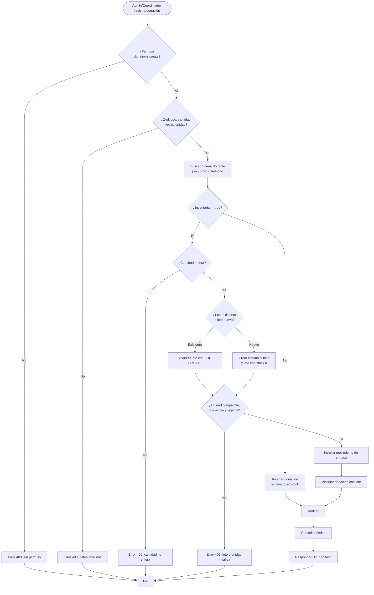
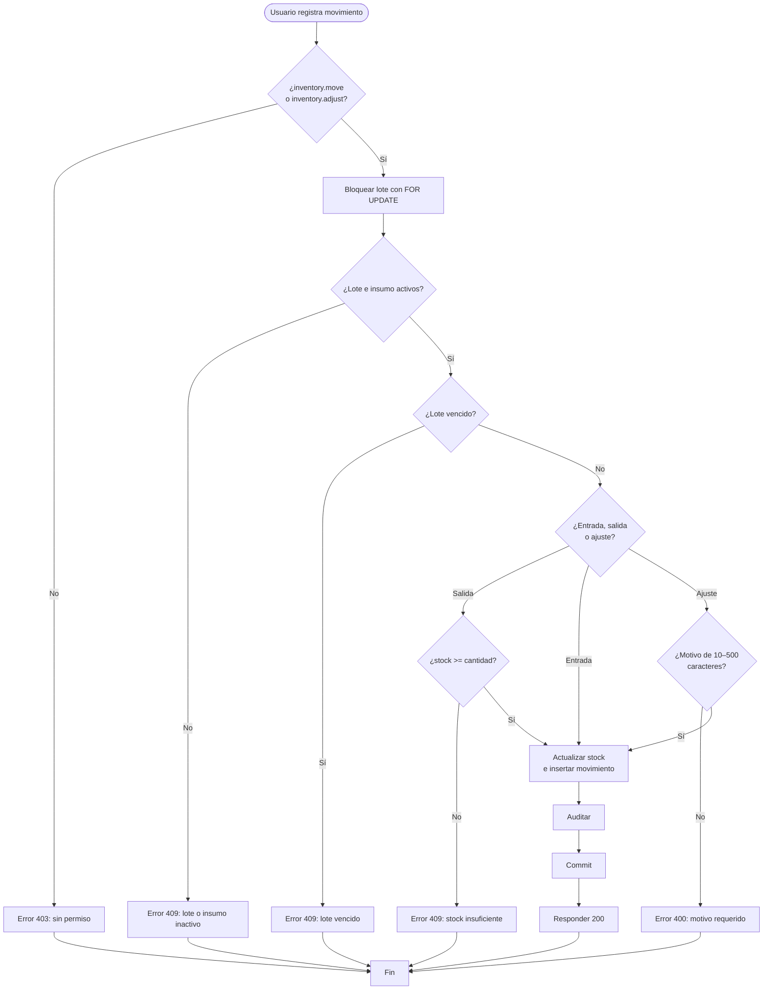
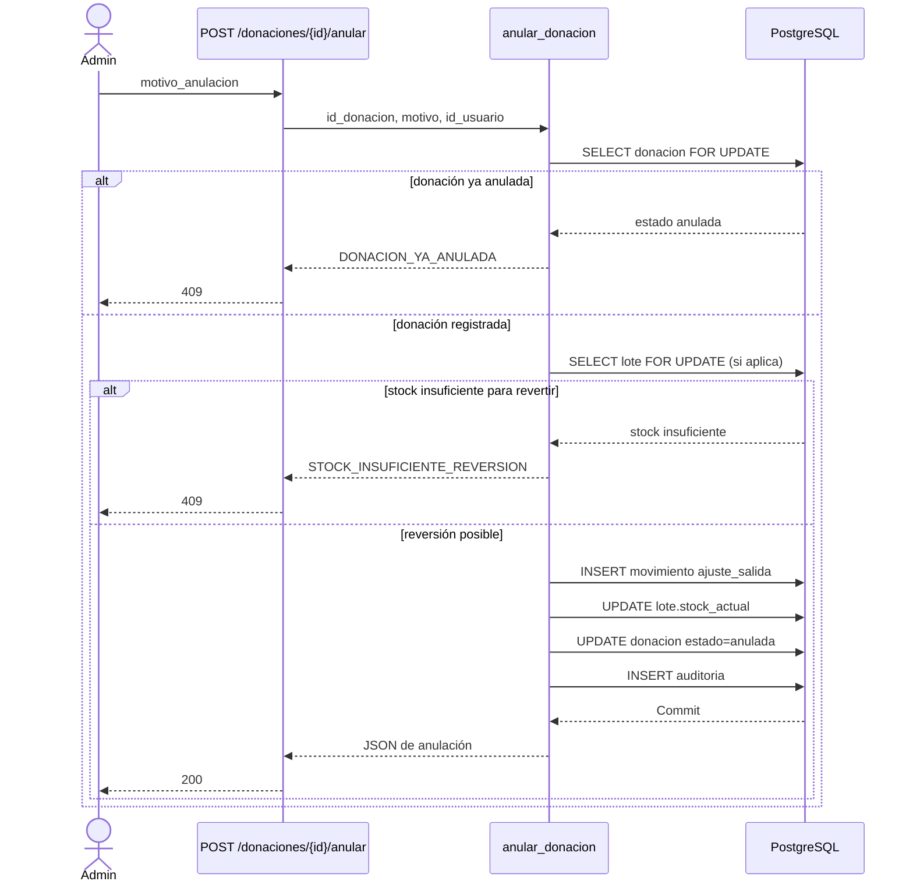
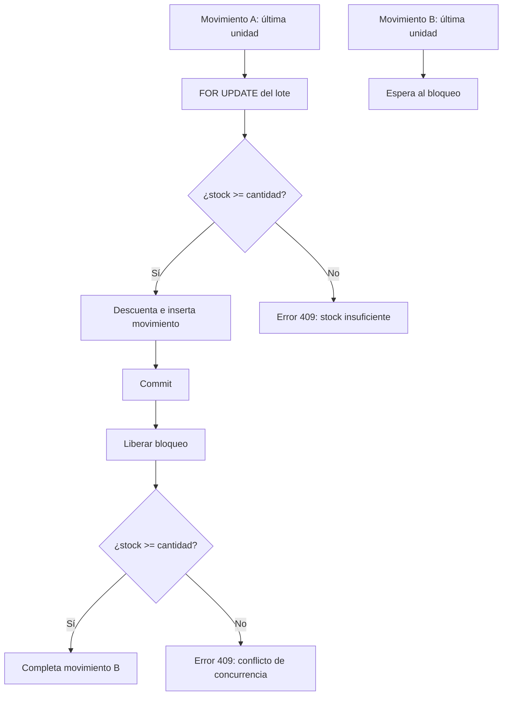
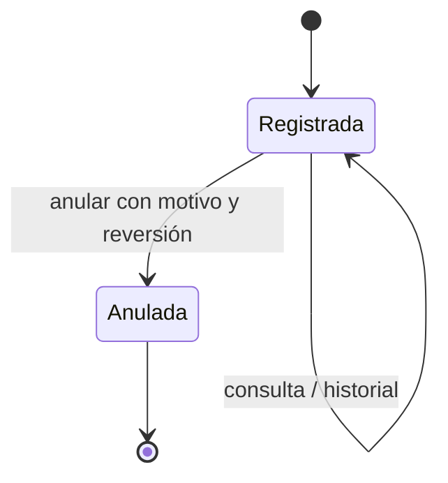

# Requerimiento 06 — Épica 6: Donaciones e Inventario

## Título

Registro de donaciones en especie, administración del inventario de insumos y trazabilidad completa del stock en los refugios Pixkki.

## Descripción

La Épica 6 dota al refugio de dos capacidades complementarias que hasta ahora solo existían como contrato mínimo para el control clínico:

1. El **registro de donaciones en especie**, que documenta qué recibió el refugio, de quién, cuándo, en qué cantidad, con qué caducidad y con qué evidencia. La donación es un hecho institucional: existe aunque el bien no se inventaríe.
2. La **gestión del inventario**, que administra insumos, lotes y movimientos de stock. Cada unidad que entra o sale queda registrada en un movimiento inmutable; el stock es siempre la consecuencia de movimientos, nunca un número editado a mano.

Ambas capacidades se conectan mediante un **vínculo opcional y explícito**: una donación de medicamento, alimento o equipo puede crear un insumo y un lote, y generar su entrada de stock en la misma transacción; o puede quedar solo como registro cuando el bien no es inventariable, se consume de inmediato o el refugio no lleva inventario de ese rubro. Nunca se inventa stock ni se duplican entradas.

El módulo `donations` es dueño de donantes y donaciones. El módulo `inventory` es dueño de insumos, lotes, movimientos y alertas. El módulo `animals` sigue consumiendo el puerto de inventario para eventos sanitarios y cirugías; esta épica amplía ese contrato sin romperlo.

> **Principio rector:** el stock no se edita, se mueve. Toda variación de `stock_actual` nace de un movimiento append-only con usuario, fecha y motivo. Un error se corrige con un movimiento de ajuste que referencia el original, nunca con un `UPDATE` silencioso.

## Objetivo

Proveer los módulos de donaciones e inventario que permitan:

1. Registrar donantes por refugio, sin exponerlos entre tenants.
2. Registrar donaciones en especie con folio, tipo, cantidad, unidad, fecha, caducidad, notas y evidencia opcional.
3. Vincular una donación a un lote existente o crear insumo y lote en la misma transacción.
4. Administrar el catálogo de insumos y lotes del refugio.
5. Registrar entradas y salidas manuales de stock con motivo obligatorio.
6. Corregir errores mediante movimientos de ajuste trazables, sin editar ni borrar movimientos.
7. Impedir stock negativo y pérdidas por concurrencia.
8. Alertar sobre stock bajo, caducidad próxima y lotes vencidos.
9. Anular una donación revirtiendo su efecto en inventario cuando sea posible.
10. Dejar los datos listos para los reportes de la Épica 7 (US22 y US23) sin implementarlos aquí.
11. Integrar el inventario con los consumos clínicos ya existentes (eventos sanitarios y cirugías).

## Alcance

Incluye:

- RF6.1: Catálogo de donantes por refugio (US20).
- RF6.2: Registro de donaciones en especie con folio y evidencia (US20).
- RF6.3: Vínculo transaccional donación → insumo/lote → entrada de stock (US20).
- RF6.4: Anulación de donación con reversión de stock (US20).
- RF6.5: CRUD de insumos y lotes (US20, soporte de US23).
- RF6.6: Movimientos de entrada, salida y ajuste, append-only (US20).
- RF6.7: Alertas de stock mínimo, caducidad próxima y vencimiento (US20).
- RF6.8: Consulta de historial de movimientos y trazabilidad por lote (US20).
- Compatibilidad con el contrato existente `GET /api/v1/inventario/lotes` consumido por `animals`.

No incluye:

- Donaciones en dinero, transferencias, cuotas, pasarelas de pago o conciliación bancaria.
- Promesas de donación, campañas de recaudación o metas de recolección.
- Formulario público de donación o portal de donantes.
- Comprobantes, constancias en PDF, cartas de agradecimiento o correos automáticos.
- Valorización monetaria de los bienes donados y reportes financieros (US22, Épica 7).
- Reportes de inventario, rotación, consumo o proyección de compras (US23, Épica 7).
- Órdenes de compra, proveedores, facturación o control de costos.
- Transferencias de stock entre refugios.
- Lectura de códigos de barras, etiquetado o integración con básculas.
- Notificaciones push, correo o WhatsApp por stock bajo o caducidad.
- Ajustes con flujo de aprobación de dos pasos.
- Importación histórica de donaciones o inventario (Épica 8).
- Gestión de adopciones, campañas o perfiles públicos.

## Actores

| Actor | Descripción |
|-------|-------------|
| Administrador de refugio | Rol `admin`/`Administrador`. Administra donantes, donaciones, insumos, lotes, movimientos y ajustes. Puede anular donaciones. |
| Coordinador | Rol `coordinador`. Registra donantes y donaciones, administra insumos y lotes, registra movimientos y ajustes dentro de su refugio. |
| Veterinario | Rol `veterinario`. Consulta inventario, registra movimientos de insumos clínicos y quirúrgicos y consume stock a través de las RPC clínicas existentes. |
| Operador | Rol `operador`. Consulta donaciones, donantes, insumos, lotes y movimientos; no muta. |
| Evaluador | Rol `evaluador`. Sin acceso funcional a esta épica; si se le concede `inventory.view`, solo consulta. |
| Personal de solo lectura | Usuario autenticado con `donations.view` o `inventory.view`. Consulta sin mutar. |
| Donante | Persona, empresa o fundación que entrega bienes. No tiene cuenta ni acceso al sistema; el personal registra la donación. |
| Superadmin | Rol global. Opera sobre cualquier refugio según la política de la Épica 0; conserva el `id_refugio` del recurso y el `id_usuario` real. |
| Sistema | Genera folios, descuenta e incrementa stock, crea movimientos, calcula alertas y audita. |

## Reglas de negocio

### Donantes (RF6.1)

1. **Donante por refugio**: `donante` incorpora `id_refugio` obligatorio. Un donante pertenece a un solo refugio y no es visible ni reutilizable por otro tenant.
2. **Tipos canónicos**: `tipo_donante` acepta exclusivamente `Persona`, `Empresa` o `Fundación`, alineado con el `CHECK` vigente.
3. **Datos mínimos**: `nombre_completo` es obligatorio (2–150 caracteres). `telefono` (7–20) y `correo` (formato válido, máx. 150) son opcionales, pero debe existir al menos uno de los dos para poder contactar al donante.
4. **Deduplicación**: se busca un donante existente del refugio por `lower(correo)` cuando hay correo; si no hay correo, por `telefono` normalizado. Si existe, se reutiliza y se actualizan sus datos; no se duplica la persona.
5. **Notas internas**: `notas` es texto libre de hasta 2000 caracteres, visible solo para el personal del refugio.
6. **Baja lógica**: un donante se desactiva (`activo = false`); no se elimina si tiene donaciones asociadas. Un donante inactivo no aparece en el buscador del formulario, pero su historial se conserva.
7. **Datos personales**: el donante es información personal. Solo el personal autenticado del refugio con `donations.view` puede consultarlo. `anon` no tiene acceso directo a la tabla.

### Donaciones en especie (RF6.2)

8. **Solo especie**: una donación representa bienes entregados. No existen campos de monto, moneda, método de pago ni estado de cobro.
9. **Tipos canónicos**: `tipo_donacion` se mantiene en `Alimento`, `Medicamento`, `Equipo`, `Ropa` u `Otro`. No se agregan valores en esta épica.
10. **Cantidad positiva**: `cantidad` es mayor que cero, con dos decimales como máximo, alineada con `numeric(10,2)`.
11. **Cantidad entera al inventariar**: si la donación genera o incrementa stock, la cantidad debe ser un entero positivo. Un valor decimal se rechaza con `400 CANTIDAD_NO_ENTERA` porque `inventario_lote.stock_actual` es entero.
12. **Unidad de medida**: `unidad_medida` es obligatoria (1–20 caracteres) y por defecto `unidad`. No se valida contra un catálogo cerrado en esta épica.
13. **Fecha de donación**: `fecha_donacion` es obligatoria y no puede ser futura. Se registra en UTC y se presenta en la zona horaria del refugio.
14. **Caducidad coherente**: si `caducidad` existe, no puede ser anterior a `fecha_donacion`. Un bien ya vencido puede registrarse como donación histórica, pero no puede generar stock consumible.
15. **Descripción obligatoria**: `descripcion` tiene entre 3 y 255 caracteres y describe el bien recibido, no al donante.
16. **Folio único**: cada donación recibe un `folio` legible y único por refugio, con formato `DON-<id_refugio>-<id_donacion:06d>`. Se genera dentro de la misma transacción; el cliente no lo envía.
17. **Evidencia opcional**: `evidencia_url` puede apuntar a una foto o documento de respaldo ya almacenado. No se implementa carga de archivos en esta épica; el contrato acepta una URL válida o `null`.
18. **Responsable**: `id_usuario` se toma de la sesión. El cliente no lo envía. Una donación siempre tiene un responsable identificable.
19. **Append-only con anulación**: una donación no se edita ni se elimina. Se corrige anulándola y registrando una nueva si corresponde.
20. **Anulación motivada**: anular exige `motivo_anulacion` de 10 a 500 caracteres y permiso `donations.manage`. La donación pasa a `estado = 'anulada'` y conserva su historial.
21. **Anulación con reversión**: si la donación generó stock y el lote aún tiene unidades suficientes, la anulación crea un movimiento `ajuste_salida` que devuelve el stock a su estado anterior. Si el stock ya se consumió, la anulación se rechaza con `409 STOCK_INSUFICIENTE_REVERSION` y se indica que debe resolverse con un ajuste manual documentado.
22. **Anulación sin inventario**: una donación no inventariada se anula sin tocar stock.
23. **Idempotencia**: reintentar la misma donación con la misma clave de idempotencia del cliente devuelve la donación existente, no una nueva. Si no se envía clave, se aplica la regla de duplicado por `(id_refugio, id_donante, tipo_donacion, descripcion, cantidad, fecha_donacion)` en una ventana de 10 minutos y se responde `409 DONACION_DUPLICADA`.

### Vínculo donación → inventario (RF6.3)

24. **Vínculo opcional**: `inventariar = false` (por defecto) registra la donación sin efecto en stock. `inventariar = true` exige resolver el destino del bien.
25. **Destino explícito**: con `inventariar = true` el cliente debe elegir una de dos modalidades:
    - `lote_existente`: `id_lote_inventario` de un lote del mismo refugio, activo y no vencido.
    - `lote_nuevo`: `id_insumo` existente, o datos para crear el insumo (`nombre`, `tipo_insumo`, `unidad_medida`), más `marca`, `lote`, `stock_minimo` y `fecha_caducidad`.
26. **Mapeo de tipos**: el tipo de donación no se traduce automáticamente al tipo de insumo. `Medicamento` puede mapearse a `vacuna`, `desparasitante`, `insumo_quirurgico` u `otro`; `Alimento`, `Equipo`, `Ropa` y `Otro` se inventarían como `otro`. La elección es explícita del usuario y se valida contra el dominio de `inventario_insumo.tipo_insumo`.
27. **Tipo de insumo válido**: `tipo_insumo` acepta `vacuna`, `desparasitante`, `insumo_quirurgico` u `otro`. El valor `insumo_quirurgico` se incorpora en la migración de esta épica si la Épica 4 aún no lo aplicó; ambas migraciones deben ser idempotentes.
28. **Unidad coherente**: la unidad de la donación y la del insumo deben coincidir. Si el insumo usa `dosis` y la donación registra `caja`, se rechaza con `409 UNIDAD_INCOMPATIBLE`.
29. **Stock inicial por movimiento**: un lote nuevo se crea con `stock_actual = 0` y la entrada de la donación crea el movimiento `entrada` que lo incrementa. Nunca se crea un lote con stock inicial sin movimiento.
30. **Atomicidad**: la donación, el alta o reutilización del donante, la creación del insumo y del lote, la entrada de stock, el vínculo `donacion.id_lote_inventario` y la auditoría ocurren en una sola RPC transaccional. Si un paso falla, no se persiste nada.
31. **Sin doble entrada**: una donación genera como máximo un movimiento de entrada. Reintentos no duplican stock.

### Insumos y lotes (RF6.5)

32. **Insumo por refugio**: `inventario_insumo` pertenece a un refugio. Nombre obligatorio (2–120), `tipo_insumo` del dominio y `unidad_medida` obligatoria.
33. **Nombre único por tipo**: no se admiten dos insumos activos con el mismo `lower(nombre)` y `tipo_insumo` en el mismo refugio. Se devuelve `409 INSUMO_DUPLICADO`.
34. **Baja de insumo**: un insumo se desactiva, no se elimina. No puede desactivarse si tiene lotes activos con stock mayor que cero (`409 INSUMO_CON_STOCK`).
35. **Lote por refugio**: `inventario_lote` pertenece al refugio de su insumo. Un lote no puede apuntar a un insumo de otro tenant.
36. **Stock no editable**: `stock_actual` nunca se modifica con un `UPDATE` directo desde la aplicación. Toda variación se produce por un movimiento. El repository no expone escritura de stock.
37. **Stock mínimo**: `stock_minimo` es un entero mayor o igual a cero y se define por lote. La alerta se calcula cuando `stock_actual <= stock_minimo`.
38. **Lote único**: se evita duplicar lotes con el mismo `(id_insumo, marca, lote, fecha_caducidad)` cuando los cuatro valores están presentes. Se devuelve `409 LOTE_DUPLICADO`.
39. **Baja de lote**: un lote se desactiva solo si `stock_actual = 0`. Si tiene stock, primero debe ajustarse o consumirse (`409 LOTE_CON_STOCK`).
40. **Caducidad**: un lote con `fecha_caducidad < today` está vencido. No puede recibir entradas nuevas ni consumirse; solo admite ajustes de salida para llevarlo a cero. Se devuelve `409 LOTE_VENCIDO`.
41. **Insumo inactivo**: un lote de un insumo inactivo no puede recibir entradas ni consumirse.

### Movimientos y ajustes (RF6.6)

42. **Tipos de movimiento**: `entrada`, `salida`, `ajuste_entrada`, `ajuste_salida`. `cantidad` es siempre entero positivo; el signo lo determina el tipo.
43. **Motivo obligatorio**: toda entrada o salida manual exige `motivo` de 3 a 120 caracteres. Las RPC clínicas existentes siguen usando `motivo = 'evento_sanitario'` y `'cirugia_reproductiva'`.
44. **Referencia**: `id_referencia` es un texto opcional que vincula el movimiento con su origen (`donacion:<id>`, `evento_sanitario:<id>`, `cirugia_reproductiva:<id>`, `ajuste:<id_movimiento>`).
45. **Append-only**: no existen endpoints de edición ni eliminación de movimientos. Cualquier corrección se hace con un ajuste.
46. **Ajuste motivado**: un ajuste exige `motivo` de 10 a 500 caracteres y, cuando corrige un movimiento concreto, `id_movimiento_origen`. No puede referenciar un movimiento de otro refugio.
47. **Ajuste sin origen**: un ajuste por conteo físico puede no referenciar un movimiento; se documenta con el motivo y el usuario.
48. **Salida validada**: una salida no puede dejar `stock_actual` negativo. Se bloquea el lote con `FOR UPDATE` antes de validar y descontar.
49. **Concurrencia**: si dos movimientos compiten por las últimas unidades, solo uno completa; el otro recibe `409 STOCK_INSUFICIENTE` o `409 CONFLICTO_CONCURRENCIA`.
50. **Trazabilidad**: cada movimiento guarda `id_usuario`, `fecha`, lote, refugio, tipo, cantidad, motivo y referencia. Es inmutable.

### Alertas (RF6.7)

51. **Stock bajo**: lote activo, insumo activo y `stock_actual <= stock_minimo`. Incluye stock cero.
52. **Caducidad próxima**: lote activo con `fecha_caducidad` entre hoy y hoy + 30 días.
53. **Vencido**: lote activo con `fecha_caducidad < today` y stock mayor que cero.
54. **Cálculo en lectura**: las alertas se calculan al consultar; no se persisten ni se envían notificaciones. El endpoint devuelve el detalle por lote y el total por categoría.
55. **Sin alertas de insumo inactivo**: un insumo o lote inactivo no genera alertas operativas.

### Transversales

56. **RBAC**: `donations.view`, `donations.create`, `donations.manage`, `inventory.view`, `inventory.manage`, `inventory.move`, `inventory.adjust`. El detalle por rol está en la matriz de permisos.
57. **Multitenant**: toda consulta y mutación filtra por `id_refugio`. Un recurso de otro refugio se responde como `404` sin revelar su existencia. RLS como segunda capa.
58. **Auditoría**: altas, ediciones, bajas, movimientos, ajustes, anulaciones y vínculos con inventario escriben en `auditoria` con `modulo = 'donations'` o `'inventory'`, `entidad_id`, `id_usuario` e `id_refugio`, sin datos personales innecesarios.
59. **Compatibilidad clínica**: las RPC `registrar_evento_sanitario` y `registrar_cirugia_reproductiva` siguen funcionando. Esta épica no cambia su firma ni su semántica; solo amplía el catálogo de insumos.
60. **Contrato existente**: `GET /api/v1/inventario/lotes` mantiene su comportamiento por defecto (solo lotes activos, vigentes y con stock). Los parámetros nuevos son opcionales y no alteran la respuesta previa.
61. **Accesibilidad**: stock bajo, caducidad y vencimiento se muestran con texto explícito, no solo con color o icono.
62. **Sin efectos en adopciones**: el inventario no cambia estados de animales ni perfiles públicos.

## Supuestos funcionales (pendientes de validación)

| ID | Supuesto | Impacto si cambia |
|----|----------|-------------------|
| S1 | El donante se modela por refugio agregando `id_refugio` con backfill; no se comparte entre tenants. | Cambia la migración, el RLS y la deduplicación. |
| S2 | El folio se genera como `DON-<id_refugio>-<id_donacion:06d>` después del insert, dentro de la misma transacción. | Cambia el formato y la estrategia de unicidad. |
| S3 | Se permite registrar una donación sin inventariarla. | Cambia la obligatoriedad de `inventariar` y el flujo de stock. |
| S4 | Al inventariar, la cantidad debe ser entera porque el stock es entero. | Si se requiere stock decimal, cambia el tipo de `stock_actual`. |
| S5 | El mapeo de `tipo_donacion` a `tipo_insumo` es explícito y no automático. | Cambia el formulario y la validación. |
| S6 | Se agrega `insumo_quirurgico` al dominio de insumos si no lo hizo la Épica 4. | Si se reutiliza `otro`, se elimina la validación. |
| S7 | Los movimientos usan `entrada`, `salida`, `ajuste_entrada` y `ajuste_salida`, con cantidad positiva. | Cambia el `CHECK` y la interpretación del signo. |
| S8 | Un ajuste no requiere aprobación de dos pasos; queda auditado. | Cambia el flujo y los permisos. |
| S9 | La anulación de una donación con stock ya consumido se bloquea en lugar de dejar stock negativo. | Cambia la regla 21 y el manejo de correcciones. |
| S10 | Un lote nuevo siempre nace con stock 0 y recibe una entrada. | Cambia la invariante de trazabilidad. |
| S11 | La unidad de la donación debe coincidir con la del insumo. | Si se permite conversión, cambia el contrato y requiere factores. |
| S12 | El umbral de caducidad próxima es 30 días. | Cambia el cálculo de alertas. |
| S13 | No se emiten comprobantes ni correos; el registro es interno. | Cambia el alcance y las integraciones. |
| S14 | `donante.activo` y `donacion.estado` se agregan como baja lógica y anulación. | Si se prefiere borrado físico, cambia la trazabilidad. |
| S15 | El máximo de donaciones o movimientos por página es 100. | Cambia la paginación y el rendimiento. |
| S16 | La evidencia es una URL ya almacenada; no se implementa carga de archivos. | Cambia el contrato y requiere almacenamiento. |
| S17 | El Superadmin puede operar en cualquier refugio, conservando el tenant del recurso. | Cambia el RBAC y el RLS. |
| S18 | El catálogo de insumos no se comparte entre refugios. | Cambia el modelo y los reportes. |

> **Decisión pendiente de aprobación:** agregar `id_refugio`, `activo` y unicidad a `donante`; ampliar `donacion` con `folio`, `estado`, `notas`, `evidencia_url`, `id_usuario` e `id_lote_inventario`; ampliar `inventario_insumo`, `inventario_lote` e `inventario_movimiento`; crear las RPC de donación, anulación, movimiento y ajuste; sembrar permisos `donations.*` e `inventory.*` son cambios de base de datos. Requieren aprobación previa y migración versionada.

## Inconsistencias y alineación con el estado actual del repositorio

| Elemento | Estado actual | Implicación para esta épica |
|----------|---------------|-----------------------------|
| `donante` | Existe con `nombre_completo`, `telefono`, `correo`, `tipo_donante`, `notas`, `fecha_registro`. No tiene `id_refugio` ni `activo`. | Requiere `id_refugio`, backfill, `activo`, índices y RLS. |
| `donacion` | Existe con `id_donante`, `id_refugio`, `tipo_donacion`, `descripcion`, `cantidad`, `unidad_medida`, `fecha_donacion`, `caducidad`. | Requiere `folio`, `estado`, `notas`, `evidencia_url`, `id_usuario`, `id_lote_inventario`, `motivo_anulacion` y fechas de anulación. |
| `chk_donacion_tipo` | `Alimento`, `Medicamento`, `Equipo`, `Ropa`, `Otro`. | Se mantiene. El mapeo a inventario es explícito. |
| `chk_donacion_cantidad` | `cantidad > 0` con `numeric(10,2)`. | Se mantiene; se agrega validación de entero cuando se inventaría. |
| `inventario_insumo` | Creada en la Épica 2 con `vacuna`, `desparasitante`, `otro`. | Requiere `insumo_quirurgico`, `descripcion`, `updated_at` e índice único por nombre y tipo. |
| `inventario_lote` | Creada en la Épica 2 con `stock_actual`, `stock_minimo`, `fecha_caducidad`, `activo`. | Se reutiliza. Requiere unicidad de lote y regla de stock solo por movimiento. |
| `inventario_movimiento` | Creada en la Épica 2 con `entrada`/`salida`, `cantidad > 0`, `motivo`, `id_referencia`, `id_usuario`, `fecha`. | Requiere `ajuste_entrada`, `ajuste_salida`, `id_movimiento_origen` e índices por fecha. |
| `inventario_movimiento.motivo` | Texto libre; las RPC usan `evento_sanitario` y `cirugia_reproductiva`. | Se conserva y se documentan los motivos canónicos. |
| `modules/inventory` | Solo expone `listAvailableLots` para `animals`. | Se amplía con insumos, lotes, movimientos, ajustes y alertas. |
| `app/api/v1/inventario/lotes` | Único endpoint de inventario; exige rol clínico. | Debe ampliarse sin romper el contrato de `animals`. |
| `modules/donations` | No existe. | Se crea el módulo completo. |
| Permisos | No existen `donations.*` ni `inventory.*`. | Requiere siembra y asignación por rol. |
| `auditoria` | Existe con `id_refugio`, `id_usuario`, `accion`, `modulo`, `entidad_id`, `descripcion`, `fecha_evento`. | Se usa para todas las mutaciones autenticadas. |
| `types/database.ts` | Incluye `donacion`, `donante` e inventario, pero no los campos nuevos. | Debe regenerarse después de aplicar la migración. |
| UI de inventario | No existe una pantalla funcional. | Fuera de alcance; el backend se implementa primero. |
| UI de donaciones | No existe. | Fuera de alcance en esta entrega. |
| `campana_publica` | No se relaciona con donaciones. | No se toca. |
| `evento_sanitario` y `cirugia_reproductiva` | Ya consumen stock vía RPC. | Se mantienen; el catálogo de insumos se amplía. |

## Historias de usuario

| ID | Historia de Usuario | Prioridad | Épica | RF relacionados |
|----|---------------------|-----------|-------|-----------------|
| US20 | Registro de donaciones en especie | Must Have | Épica 6 | RF6.1, RF6.2, RF6.3, RF6.4, RF6.5, RF6.6, RF6.7, RF6.8 |

## Contrato de API

Los endpoints siguen el patrón `/api/v1/<recurso>`. La validación de entrada se hace con Zod antes de cualquier efecto. Los errores usan el envelope uniforme del proyecto.

### Formato de respuesta de éxito

```json
{
  "success": true,
  "data": { ... }
}
```

### Formato de error uniforme

```json
{
  "success": false,
  "error": {
    "code": "ERROR_CODIGO",
    "message": "Mensaje en español para el usuario final",
    "statusCode": 400,
    "details": { ... }
  }
}
```

> `details` es opcional. En errores de stock incluye `stock_actual`, `cantidad_solicitada` y `id_lote_inventario` para que la UI explique el rechazo.

### RF6.1 — Donantes (US20)

| Método | Ruta | Descripción | Acceso |
|--------|------|-------------|--------|
| GET | `/api/v1/donantes` | Listar y buscar donantes del refugio | `donations.view` |
| POST | `/api/v1/donantes` | Registrar donante | `donations.create` |
| GET | `/api/v1/donantes/{id}` | Detalle con historial de donaciones | `donations.view` |
| PUT | `/api/v1/donantes/{id}` | Actualizar datos del donante | `donations.create` |
| DELETE | `/api/v1/donantes/{id}` | Baja lógica del donante | `donations.manage` |

**Query params (listado):** `q`, `tipo_donante`, `activo`, `page`, `pageSize`.

**Request (POST):**

```json
{
  "nombre_completo": "María López",
  "tipo_donante": "Persona",
  "telefono": "5555555555",
  "correo": "maria@example.com",
  "notas": "Donante recurrente de alimento."
}
```

**Response (201):**

```json
{
  "success": true,
  "data": {
    "id_donante": 18,
    "id_refugio": 7,
    "nombre_completo": "María López",
    "tipo_donante": "Persona",
    "telefono": "5555555555",
    "correo": "maria@example.com",
    "notas": "Donante recurrente de alimento.",
    "activo": true,
    "fecha_registro": "2026-11-16T10:00:00Z",
    "total_donaciones": 3
  }
}
```

**Errores:**

- `400` — `DATOS_INVALIDOS`, `CONTACTO_REQUERIDO`
- `403` — `ROL_SIN_PERMISO`
- `404` — `DONANTE_NO_ENCONTRADO`
- `409` — `DONANTE_DUPLICADO`, `DONANTE_CON_DONACIONES`
- `500` — `ERROR_INTERNO`

### RF6.2 / RF6.3 — Donaciones (US20)

| Método | Ruta | Descripción | Acceso |
|--------|------|-------------|--------|
| GET | `/api/v1/donaciones` | Listar donaciones con filtros | `donations.view` |
| POST | `/api/v1/donaciones` | Registrar donación en especie | `donations.create` |
| GET | `/api/v1/donaciones/{id}` | Detalle con vínculo de inventario | `donations.view` |
| POST | `/api/v1/donaciones/{id}/anular` | Anular donación y revertir stock | `donations.manage` |

**Query params (listado):** `tipo_donacion`, `id_donante`, `estado`, `desde`, `hasta`, `q`, `page`, `pageSize`.

**Request (POST) — donación sin inventario:**

```json
{
  "id_donante": 18,
  "tipo_donacion": "Ropa",
  "descripcion": "Cobijas y toallas para las camas del refugio.",
  "cantidad": 12,
  "unidad_medida": "pieza",
  "fecha_donacion": "2026-11-15",
  "caducidad": null,
  "notas": "Entrega en recepción.",
  "evidencia_url": null,
  "inventariar": false,
  "clave_idempotencia": "8f1c2b9e-8a4d-4c1e-9f7a-2b6d5e8c1a44"
}
```

**Request (POST) — donación con lote nuevo:**

```json
{
  "id_donante": 18,
  "tipo_donacion": "Medicamento",
  "descripcion": "Vacuna antirrábica para perros.",
  "cantidad": 20,
  "unidad_medida": "dosis",
  "fecha_donacion": "2026-11-15",
  "caducidad": "2027-11-15",
  "notas": "Cadena de frío verificada.",
  "evidencia_url": "https://.../evidencia.jpg",
  "inventariar": true,
  "destino": {
    "modalidad": "lote_nuevo",
    "id_insumo": 4,
    "marca": "VacunaLab",
    "lote": "L-2026-11",
    "stock_minimo": 5,
    "fecha_caducidad": "2027-11-15"
  },
  "clave_idempotencia": "3f1c2b9e-8a4d-4c1e-9f7a-2b6d5e8c1a44"
}
```

**Request (POST) — donación con insumo nuevo:**

```json
{
  "id_donante": 18,
  "tipo_donacion": "Medicamento",
  "descripcion": "Gasas estériles para cirugía.",
  "cantidad": 50,
  "unidad_medida": "paquete",
  "fecha_donacion": "2026-11-15",
  "inventariar": true,
  "destino": {
    "modalidad": "lote_nuevo",
    "insumo_nuevo": {
      "nombre": "Gasa estéril",
      "tipo_insumo": "insumo_quirurgico",
      "unidad_medida": "paquete"
    },
    "marca": "MediCare",
    "lote": "G-2026-11",
    "stock_minimo": 10,
    "fecha_caducidad": "2028-01-31"
  }
}
```

**Request (POST) — donación a lote existente:**

```json
{
  "id_donante": 18,
  "tipo_donacion": "Alimento",
  "descripcion": "Alimento seco para perros adultos.",
  "cantidad": 40,
  "unidad_medida": "kg",
  "fecha_donacion": "2026-11-15",
  "inventariar": true,
  "destino": {
    "modalidad": "lote_existente",
    "id_lote_inventario": 12
  }
}
```

**Response (201):**

```json
{
  "success": true,
  "data": {
    "id_donacion": 57,
    "folio": "DON-7-000057",
    "id_refugio": 7,
    "id_donante": 18,
    "donante": {
      "nombre_completo": "María López",
      "tipo_donante": "Persona"
    },
    "tipo_donacion": "Medicamento",
    "descripcion": "Vacuna antirrábica para perros.",
    "cantidad": 20,
    "unidad_medida": "dosis",
    "fecha_donacion": "2026-11-15",
    "caducidad": "2027-11-15",
    "estado": "registrada",
    "id_usuario": 9,
    "inventario": {
      "aplicado": true,
      "modalidad": "lote_nuevo",
      "id_lote_inventario": 31,
      "id_insumo": 4,
      "stock_anterior": 0,
      "stock_actual": 20,
      "id_movimiento": 210
    }
  }
}
```

**Response (POST anular):**

```json
{
  "success": true,
  "data": {
    "id_donacion": 57,
    "folio": "DON-7-000057",
    "estado": "anulada",
    "motivo_anulacion": "Error de captura: la cantidad real fue 12 dosis.",
    "id_usuario_anulacion": 9,
    "fecha_anulacion": "2026-11-16T12:00:00Z",
    "inventario": {
      "revertido": true,
      "id_lote_inventario": 31,
      "stock_anterior": 20,
      "stock_actual": 8,
      "id_movimiento": 214
    },
    "auditoria_id": 980
  }
}
```

**Errores:**

- `400` — `DATOS_INVALIDOS`, `FECHA_FUTURA`, `CADUCIDAD_INVALIDA`, `CANTIDAD_NO_ENTERA`, `MOTIVO_REQUERIDO`
- `403` — `ROL_SIN_PERMISO`
- `404` — `DONANTE_NO_ENCONTRADO`, `DONACION_NO_ENCONTRADA`, `INSUMO_NO_ENCONTRADO`, `LOTE_NO_ENCONTRADO`
- `409` — `DONACION_DUPLICADA`, `DONACION_YA_ANULADA`, `LOTE_INACTIVO`, `LOTE_VENCIDO`, `UNIDAD_INCOMPATIBLE`, `STOCK_INSUFICIENTE_REVERSION`, `INSUMO_INACTIVO`
- `500` — `FALLO_TRANSACCION_DONACION`

### RF6.5 — Insumos y lotes (US20)

| Método | Ruta | Descripción | Acceso |
|--------|------|-------------|--------|
| GET | `/api/v1/inventario/insumos` | Listar insumos del refugio | `inventory.view` |
| POST | `/api/v1/inventario/insumos` | Crear insumo | `inventory.manage` |
| GET | `/api/v1/inventario/insumos/{id}` | Detalle con lotes y stock total | `inventory.view` |
| PUT | `/api/v1/inventario/insumos/{id}` | Actualizar insumo | `inventory.manage` |
| DELETE | `/api/v1/inventario/insumos/{id}` | Baja lógica del insumo | `inventory.manage` |
| GET | `/api/v1/inventario/lotes` | Listar lotes (contrato compatible con US10) | `inventory.view` |
| POST | `/api/v1/inventario/lotes` | Crear lote con stock 0 | `inventory.manage` |
| GET | `/api/v1/inventario/lotes/{id}` | Detalle del lote y stock | `inventory.view` |
| PUT | `/api/v1/inventario/lotes/{id}` | Actualizar metadatos del lote | `inventory.manage` |
| DELETE | `/api/v1/inventario/lotes/{id}` | Baja lógica si stock = 0 | `inventory.manage` |
| GET | `/api/v1/inventario/lotes/{id}/movimientos` | Historial del lote | `inventory.view` |

**Request (POST insumo):**

```json
{
  "nombre": "Vacuna antirrábica",
  "tipo_insumo": "vacuna",
  "unidad_medida": "dosis",
  "descripcion": "Vacuna de uso canino y felino."
}
```

**Response (GET `/inventario/lotes`):**

```json
{
  "success": true,
  "data": {
    "lotes": [
      {
        "id_lote_inventario": 31,
        "id_insumo": 4,
        "nombre_insumo": "Vacuna antirrábica",
        "tipo_insumo": "vacuna",
        "marca": "VacunaLab",
        "lote": "L-2026-11",
        "stock_actual": 20,
        "stock_minimo": 5,
        "unidad_medida": "dosis",
        "fecha_caducidad": "2027-11-15",
        "activo": true,
        "estado_stock": "ok",
        "estado_caducidad": "vigente"
      }
    ]
  }
}
```

> **Compatibilidad:** sin parámetros nuevos, la respuesta conserva `id_lote_inventario`, `nombre_insumo`, `tipo_insumo`, `marca`, `lote`, `stock_actual`, `unidad_medida` y `fecha_caducidad`, que es lo que consume `animals`. Los campos `id_insumo`, `stock_minimo`, `activo`, `estado_stock` y `estado_caducidad` son aditivos.

**Query params nuevos (opcionales):** `tipo_insumo`, `id_insumo`, `incluir_agotados`, `incluir_vencidos`, `incluir_inactivos`, `q`, `page`, `pageSize`. Por defecto `false` en los tres `incluir_*`, preservando el comportamiento actual.

**Errores:**

- `400` — `DATOS_INVALIDOS`
- `403` — `ROL_SIN_PERMISO`
- `404` — `INSUMO_NO_ENCONTRADO`, `LOTE_NO_ENCONTRADO`
- `409` — `INSUMO_DUPLICADO`, `INSUMO_CON_STOCK`, `LOTE_DUPLICADO`, `LOTE_CON_STOCK`, `TIPO_INSUMO_INVALIDO`
- `500` — `ERROR_INTERNO`

### RF6.6 — Movimientos y ajustes (US20)

| Método | Ruta | Descripción | Acceso |
|--------|------|-------------|--------|
| GET | `/api/v1/inventario/movimientos` | Listar movimientos con filtros | `inventory.view` |
| POST | `/api/v1/inventario/movimientos` | Registrar entrada o salida manual | `inventory.move` |
| POST | `/api/v1/inventario/movimientos/{id}/ajuste` | Registrar ajuste sobre un movimiento | `inventory.adjust` |

**Query params (listado):** `id_lote_inventario`, `tipo_movimiento`, `motivo`, `desde`, `hasta`, `page`, `pageSize`.

**Request (POST movimiento):**

```json
{
  "id_lote_inventario": 31,
  "tipo_movimiento": "salida",
  "cantidad": 2,
  "motivo": "consumo_interno",
  "id_referencia": null
}
```

**Request (POST ajuste):**

```json
{
  "id_movimiento_origen": 210,
  "tipo_movimiento": "ajuste_salida",
  "cantidad": 3,
  "motivo": "Conteo físico: el lote tenía 3 dosis menos de las registradas."
}
```

**Response (POST movimiento):**

```json
{
  "success": true,
  "data": {
    "id_movimiento": 215,
    "id_lote_inventario": 31,
    "id_refugio": 7,
    "tipo_movimiento": "salida",
    "cantidad": 2,
    "motivo": "consumo_interno",
    "id_referencia": null,
    "stock_anterior": 20,
    "stock_actual": 18,
    "id_usuario": 9,
    "fecha": "2026-11-16T13:00:00Z",
    "auditoria_id": 982
  }
}
```

**Errores:**

- `400` — `DATOS_INVALIDOS`, `MOTIVO_REQUERIDO`, `CANTIDAD_INVALIDA`
- `403` — `ROL_SIN_PERMISO`
- `404` — `LOTE_NO_ENCONTRADO`, `MOVIMIENTO_NO_ENCONTRADO`
- `409` — `STOCK_INSUFICIENTE`, `CONFLICTO_CONCURRENCIA`, `LOTE_INACTIVO`, `LOTE_VENCIDO`, `INSUMO_INACTIVO`, `AJUSTE_SIN_EFECTO`
- `500` — `FALLO_TRANSACCION_INVENTARIO`

### RF6.7 — Alertas (US20)

| Método | Ruta | Descripción | Acceso |
|--------|------|-------------|--------|
| GET | `/api/v1/inventario/alertas` | Stock bajo, caducidad próxima y vencidos | `inventory.view` |

**Response:**

```json
{
  "success": true,
  "data": {
    "resumen": {
      "stock_bajo": 2,
      "caducidad_proxima": 1,
      "vencidos": 1
    },
    "stock_bajo": [
      {
        "id_lote_inventario": 31,
        "nombre_insumo": "Vacuna antirrábica",
        "stock_actual": 3,
        "stock_minimo": 5,
        "unidad_medida": "dosis"
      }
    ],
    "caducidad_proxima": [
      {
        "id_lote_inventario": 33,
        "nombre_insumo": "Desparasitante",
        "fecha_caducidad": "2026-12-05",
        "dias_restantes": 19,
        "stock_actual": 8
      }
    ],
    "vencidos": [
      {
        "id_lote_inventario": 28,
        "nombre_insumo": "Alimento seco",
        "fecha_caducidad": "2026-10-01",
        "dias_vencido": 46,
        "stock_actual": 4
      }
    ]
  }
}
```

**Errores:**

- `403` — `ROL_SIN_PERMISO`
- `500` — `ERROR_INTERNO`

## Plan de implementación backend-first

| Paso | Acción | Artefacto |
|------|--------|-----------|
| 1 | Ampliar el contrato OpenAPI de donaciones e inventario | `modules/donations/contracts/openapi.yaml`, `modules/inventory/contracts/openapi.yaml` |
| 2 | Definir schemas Zod de donante, donación, insumo, lote y movimiento | `modules/donations/validators/`, `modules/inventory/validators/` |
| 3 | Definir DTOs derivados con `z.infer` | `modules/donations/dtos/`, `modules/inventory/dtos/` |
| 4 | Definir errores de dominio y permisos | `modules/donations/errors.ts`, `modules/inventory/errors.ts`, `access.ts` |
| 5 | Implementar repositories con filtro `id_refugio` | `modules/donations/repositories/`, `modules/inventory/repositories/` |
| 6 | Implementar services con reglas y RBAC | `modules/donations/services/`, `modules/inventory/services/` |
| 7 | Implementar factories | `modules/donations/factories/`, `modules/inventory/factories/` |
| 8 | Crear y aplicar migración versionada | `supabase/migrations/YYYYMMDDHHMMSS_requerimiento_06_donaciones_inventario.sql` |
| 9 | Regenerar tipos | `npm run db:types` |
| 10 | Implementar Route Handlers | `app/api/v1/donantes/`, `app/api/v1/donaciones/`, `app/api/v1/inventario/` |
| 11 | Preservar el contrato `GET /inventario/lotes` de `animals` | `app/api/v1/inventario/lotes/route.ts`, `modules/inventory/ports/inventory.port.ts` |
| 12 | Pruebas aisladas del backend | Equipo de QA (externo a este documento) |
| 13 | Ampliar contrato v1 | Tag git `api-v1.6` |
| 14 | Frontend consume el contrato vía Server Actions | Server Actions como adaptador (fuera de alcance de esta entrega) |

## Riesgos y dependencias

| Riesgo | Mitigación |
|--------|------------|
| Stock editado a mano y pérdida de trazabilidad | `stock_actual` solo cambia dentro de RPC que insertan movimiento; el repository no expone escritura. |
| Donación registrada sin entrada de stock | RPC transaccional que crea donación, lote, movimiento y vínculo juntos. |
| Entrada duplicada por reintento | `clave_idempotencia` y verificación de duplicado; el movimiento se crea una sola vez. |
| Stock negativo por concurrencia | Bloqueo `FOR UPDATE` del lote y validación antes de descontar. |
| Anulación que deja stock negativo | Rechazar con `STOCK_INSUFICIENTE_REVERSION` y exigir ajuste documentado. |
| Movimiento de ajuste sin motivo | Validación Zod y `CHECK` de longitud mínima; auditoría obligatoria. |
| Fuga de datos del donante entre refugios | `id_refugio` en `donante`, filtro en repositories y RLS tenant. |
| Donante duplicado | Índice único por correo normalizado y búsqueda por teléfono. |
| Insumo duplicado | Índice único por `(id_refugio, lower(nombre), tipo_insumo)`. |
| Lote duplicado | Índice único parcial por `(id_insumo, marca, lote, fecha_caducidad)`. |
| Insumo desactivado con stock | Bloqueo `INSUMO_CON_STOCK`. |
| Lote vencido consumido | Validación de `fecha_caducidad` en cada salida y en las RPC clínicas. |
| Unidad incompatible | Validación de coincidencia entre donación e insumo. |
| Romper el contrato de `animals` | Parámetros nuevos opcionales y respuesta aditiva; pruebas de regresión del endpoint de lotes. |
| Migración con donantes existentes sin refugio | Backfill documentado y ventana de validación antes de `NOT NULL`. |
| `insumo_quirurgico` duplicado entre migraciones | Migración idempotente con `DROP CONSTRAINT` + `ADD CONSTRAINT` o verificación previa. |
| Alertas costosas en tablas grandes | Índices por `(id_refugio, activo, fecha_caducidad)` y filtros en la consulta. |
| Reportes de la Épica 7 con datos incompletos | El modelo guarda tipo, cantidad, unidad, fecha y caducidad; los reportes se construyen después. |
| Superadmin sin refugio propio | Usar el `id_refugio` del recurso y validar el alcance global en el servicio. |
| `types/database.ts` desactualizado | Aplicar migración y ejecutar `npm run db:types`; no editar tipos a mano. |

**Dependencias:** Épica 0 (autenticación, RBAC y `id_refugio` de sesión), Épica 2 (tablas de inventario y RPC de eventos sanitarios), Épica 4 (consumo quirúrgico y `insumo_quirurgico`), módulo `animals` (puerto de inventario), Supabase/PostgreSQL, Zod y el equipo de QA para pruebas aisladas.

## Glosario

| Término | Definición |
|---------|------------|
| Donación en especie | Entrega de bienes materiales al refugio; no incluye dinero. |
| Donante | Persona, empresa o fundación que entrega bienes; pertenece a un refugio. |
| Folio | Identificador legible y único de una donación dentro del refugio. |
| Insumo | Bien inventariable con nombre, tipo y unidad de medida. |
| Lote | Unidad de inventario con marca, caducidad, stock y stock mínimo propios. |
| Stock actual | Unidades disponibles de un lote; siempre consecuencia de movimientos. |
| Stock mínimo | Umbral a partir del cual se genera una alerta de stock bajo. |
| Movimiento | Registro inmutable de entrada, salida o ajuste de stock. |
| Ajuste | Movimiento de corrección que aumenta o disminuye stock con motivo obligatorio. |
| Append-only | Modelo en el que los registros solo se agregan; no se editan ni se eliminan. |
| Anulación | Estado de una donación registrada por error, con reversión de stock cuando es posible. |
| Evidencia | Foto o documento que respalda una donación, referenciado por URL. |
| Caducidad próxima | Lote que vence dentro de los próximos 30 días. |
| RLS | *Row Level Security*: segunda capa de defensa multitenant. |
| RPC | Función de base de datos ejecutada de forma transaccional. |
| RBAC | Control de acceso basado en roles. |
| ACID | Atomicidad, consistencia, aislamiento y durabilidad de una transacción. |
| DoR / DoD | Definition of Ready / Definition of Done. |

## Diagramas de flujo (mermaid)

### Registro de donación con y sin inventario (RF6.2 / RF6.3)



### Movimiento manual y ajuste (RF6.6)



### Anulación de donación (RF6.4)



### Concurrencia de stock (RF6.6)



### Máquina de estados de la donación (RF6.4)



## Criterios de aceptación por historia de usuario

| US | Criterios de aceptación |
|----|------------------------|
| US20 (donaciones) | Un usuario con `donations.create` registra un donante por refugio con nombre obligatorio y al menos un dato de contacto; el sistema lo deduplica por correo o teléfono. Registra una donación con tipo del dominio, descripción, cantidad positiva, unidad, fecha no futura y caducidad coherente; recibe un folio único `DON-<refugio>-<secuencia>`. Con `inventariar = false` no hay efecto en stock. Con `inventariar = true` elige lote existente o lote nuevo; la cantidad debe ser entera, la unidad debe coincidir y el lote debe ser del refugio, estar activo y vigente. La donación, el lote, el movimiento de entrada y el vínculo son atómicos. Un reintento con la misma clave de idempotencia no duplica la donación ni el stock. Solo `donations.manage` anula con motivo de 10–500 caracteres; la anulación revierte stock con un `ajuste_salida` o se rechaza si el stock ya se consumió. Los donantes y donaciones de otro refugio responden `404`. |
| US20 (inventario) | Un usuario con `inventory.manage` crea insumos con nombre, tipo del dominio y unidad; no se duplican por nombre y tipo en el refugio. Crea lotes con stock 0 y stock mínimo; el stock solo cambia por movimientos. `inventory.move` registra entradas y salidas con motivo; una salida no deja stock negativo y dos salidas simultáneas no consumen dos veces la última unidad. `inventory.adjust` registra `ajuste_entrada` o `ajuste_salida` con motivo de 10–500 caracteres y referencia opcional al movimiento original. No existen endpoints de edición ni borrado de movimientos. Un insumo con stock no se desactiva; un lote con stock no se desactiva; un lote vencido no recibe entradas ni se consume. `GET /inventario/alertas` devuelve stock bajo, caducidad próxima a 30 días y vencidos con texto explícito. `GET /inventario/lotes` conserva el contrato que consume `animals`. Toda mutación queda auditada con usuario, refugio y entidad. |

## Esquema de base de datos implicado

| Tabla | Campo clave | Descripción |
|-------|-------------|-------------|
| `donante` | `id_donante` (PK) | Tabla existente. Requiere `id_refugio`, `activo` e índices de deduplicación. |
| `donacion` | `id_donacion` (PK), `id_donante` (FK), `id_refugio` (FK) | Tabla existente. Requiere `folio`, `estado`, `notas`, `evidencia_url`, `id_usuario`, `id_lote_inventario`, `clave_idempotencia`, `motivo_anulacion`, `id_usuario_anulacion`, `fecha_anulacion`. |
| `inventario_insumo` | `id_insumo` (PK), `id_refugio` (FK) | Tabla existente. Requiere `insumo_quirurgico` en el `CHECK`, `descripcion`, `updated_at` y unicidad por nombre y tipo. |
| `inventario_lote` | `id_lote_inventario` (PK), `id_insumo` (FK), `id_refugio` (FK) | Tabla existente. `stock_actual`, `stock_minimo`, `fecha_caducidad`, `activo`. Requiere unicidad de lote. |
| `inventario_movimiento` | `id_movimiento` (PK), `id_lote_inventario` (FK) | Tabla existente. Requiere `ajuste_entrada`, `ajuste_salida`, `id_movimiento_origen` e índices por fecha. |
| `auditoria` | `id_auditoria` (PK), `id_refugio` (FK) | Tabla existente. Registra donaciones, movimientos, ajustes, bajas y anulaciones. |
| `evento_sanitario` | `id_evento` (PK) | Tabla existente. Consume stock vía RPC; no se modifica. |
| `cirugia_reproductiva` | `id_cirugia` (PK) | Tabla existente de la Épica 4. Consume stock vía RPC; no se modifica. |

**Regla multitenant:** toda consulta a `donante`, `donacion`, `inventario_insumo`, `inventario_lote` e `inventario_movimiento` filtra por `id_refugio` de la sesión. Las tablas hijas se validan además a través de su lote o donación padre. RLS como segunda capa de defensa.

**Migración requerida (aprobación previa obligatoria):**

1. Añadir `id_refugio` a `donante` con backfill; `NOT NULL`, FK a `refugio`, índice `(id_refugio, lower(correo))` único parcial y `activo boolean default true`.
2. Añadir a `donacion`: `folio text`, `estado text default 'registrada' check in ('registrada','anulada')`, `notas text`, `evidencia_url text`, `id_usuario integer`, `id_lote_inventario bigint`, `clave_idempotencia uuid`, `motivo_anulacion text`, `id_usuario_anulacion integer`, `fecha_anulacion timestamptz`.
3. Crear índices `(id_refugio, fecha_donacion DESC)`, `(id_refugio, estado)` y único `(id_refugio, folio)`; único parcial `(id_refugio, clave_idempotencia)` cuando no es nula.
4. Ampliar el `CHECK` de `inventario_insumo.tipo_insumo` con `insumo_quirurgico` (idempotente con la Épica 4); añadir `descripcion text` y `updated_at timestamptz`; índice único `(id_refugio, lower(nombre), tipo_insumo)` parcial para activos.
5. Añadir a `inventario_lote` índice único parcial `(id_insumo, marca, lote, fecha_caducidad)` cuando los cuatro no son nulos; índice `(id_refugio, activo, fecha_caducidad)`.
6. Ampliar el `CHECK` de `inventario_movimiento.tipo_movimiento` con `ajuste_entrada` y `ajuste_salida`; añadir `id_movimiento_origen bigint references inventario_movimiento(id_movimiento)` e índices `(id_refugio, fecha DESC)` y `(id_lote_inventario, fecha DESC)`.
7. Crear la RPC `public.registrar_donacion(...)` con `p_destino jsonb`, upsert de donante, folio, creación de insumo/lote, entrada de stock, vínculo y auditoría.
8. Crear la RPC `public.anular_donacion(...)` con bloqueo, reversión de stock y auditoría.
9. Crear la RPC `public.registrar_movimiento_inventario(...)` con bloqueo, validación de stock, inserción y auditoría.
10. Crear la RPC `public.ajustar_stock(...)` con validación de motivo, referencia y auditoría.
11. Habilitar RLS en `donante` y `donacion` con la política tenant de la Épica 2; verificar las políticas existentes de inventario.
12. Sembrar los permisos `donations.view`, `donations.create`, `donations.manage`, `inventory.view`, `inventory.manage`, `inventory.move` e `inventory.adjust`; asignarlos a los roles correspondientes.
13. Regenerar `types/database.ts` con `npm run db:types` después de aplicar.

## Plan de implementación backend-first (detallado por módulo)

| Módulo | Archivos clave | Endpoints `/api/v1/` |
|--------|---------------|----------------------|
| donations (donantes) | `modules/donations/validators/donor.validators.ts`<br>`modules/donations/dtos/donor.dto.ts`<br>`modules/donations/repositories/donor.repository.ts`<br>`modules/donations/services/donor.service.ts`<br>`modules/donations/factories/create-donor-service.ts` | `GET/POST /donantes`<br>`GET/PUT/DELETE /donantes/{id}` |
| donations (donaciones) | `modules/donations/validators/donation.validators.ts`<br>`modules/donations/dtos/donation.dto.ts`<br>`modules/donations/repositories/donation.repository.ts`<br>`modules/donations/services/donation.service.ts`<br>`modules/donations/factories/create-donation-service.ts` | `GET/POST /donaciones`<br>`GET /donaciones/{id}`<br>`POST /donaciones/{id}/anular` |
| inventory (insumos) | `modules/inventory/validators/supply.validators.ts`<br>`modules/inventory/repositories/supply.repository.ts`<br>`modules/inventory/services/supply.service.ts` | `GET/POST /inventario/insumos`<br>`GET/PUT/DELETE /inventario/insumos/{id}` |
| inventory (lotes) | `modules/inventory/validators/lot.validators.ts`<br>`modules/inventory/repositories/lot.repository.ts`<br>`modules/inventory/services/lot.service.ts` | `GET/POST /inventario/lotes`<br>`GET/PUT/DELETE /inventario/lotes/{id}` |
| inventory (movimientos) | `modules/inventory/validators/movement.validators.ts`<br>`modules/inventory/repositories/movement.repository.ts`<br>`modules/inventory/services/movement.service.ts` | `GET/POST /inventario/movimientos`<br>`POST /inventario/movimientos/{id}/ajuste`<br>`GET /inventario/lotes/{id}/movimientos` |
| inventory (alertas) | `modules/inventory/services/alert.service.ts`<br>`modules/inventory/repositories/alert.repository.ts` | `GET /inventario/alertas` |
| inventory (acceso y errores) | `modules/inventory/access.ts`<br>`modules/inventory/errors.ts`<br>`modules/inventory/types/inventory.types.ts` | Sin endpoints nuevos. Define permisos, códigos y tipos. |
| inventory (puerto clínico) | `modules/inventory/ports/inventory.port.ts`<br>`modules/inventory/factories/create-inventory-service.ts` | Sin endpoints nuevos. Mantiene `listAvailableLots` para `animals`. |
| Base de datos | `supabase/migrations/YYYYMMDDHHMMSS_requerimiento_06_donaciones_inventario.sql` | RPC de donación, anulación, movimiento y ajuste; permisos y RLS. |

> El módulo `donations` no escribe stock directamente: delega en la RPC transaccional y en el puerto de inventario. El módulo `inventory` no conoce donantes ni donaciones: recibe `id_referencia` y `motivo` como datos opacos. El módulo `animals` sigue consumiendo solo el puerto de lotes disponibles.

### Matriz de permisos

| Permiso | Administrador | Coordinador | Veterinario | Operador | Evaluador |
|---------|---------------|-------------|-------------|----------|-----------|
| `donations.view` | Sí | Sí | No | Sí | No |
| `donations.create` | Sí | Sí | No | No | No |
| `donations.manage` | Sí | Sí | No | No | No |
| `inventory.view` | Sí | Sí | Sí | Sí | No |
| `inventory.manage` | Sí | Sí | No | No | No |
| `inventory.move` | Sí | Sí | Sí | No | No |
| `inventory.adjust` | Sí | Sí | No | No | No |

> El Veterinario registra movimientos de insumos clínicos y quirúrgicos, pero no crea ni desactiva insumos ni lotes. El Operador consulta donaciones e inventario sin mutar.

### Catálogo de motivos de movimiento

| Motivo | Uso | Tipo permitido |
|--------|-----|----------------|
| `donacion` | Entrada generada por una donación | `entrada` |
| `evento_sanitario` | Consumo de vacuna o desparasitante | `salida` |
| `cirugia_reproductiva` | Consumo de insumo quirúrgico | `salida` |
| `consumo_interno` | Uso operativo del refugio | `salida` |
| `vencimiento` | Retiro de un lote vencido | `salida` |
| `perdida` | Pérdida, rotura o merma | `salida` |
| `ajuste_conteo` | Corrección por conteo físico | `ajuste_entrada`, `ajuste_salida` |
| `ajuste_error` | Corrección de un movimiento mal registrado | `ajuste_entrada`, `ajuste_salida` |
| `otro` | Caso documentado en el motivo | `entrada`, `salida` |

### Orden de implementación recomendado

1. Migración, RPC, RLS y permisos.
2. Regenerar tipos.
3. Validators, DTOs y errores.
4. Repositories y services.
5. Factories.
6. Route Handlers.
7. Verificación de compatibilidad con `animals`.
8. Verificación: `npm run typecheck`, `npm run lint`, `npm run build`.
9. QA aislado de casos negativos: cantidad decimal al inventariar, unidad incompatible, lote vencido, stock insuficiente, doble movimiento concurrente, ajuste sin motivo, anulación con stock consumido, donante duplicado, insumo con stock y acceso a otro refugio.

---

**Versión**: 0.1
**Estado**: Especificado — pendiente de aprobación de los supuestos y de la migración; sin implementación.
**Última actualización**: 16/11/2026
