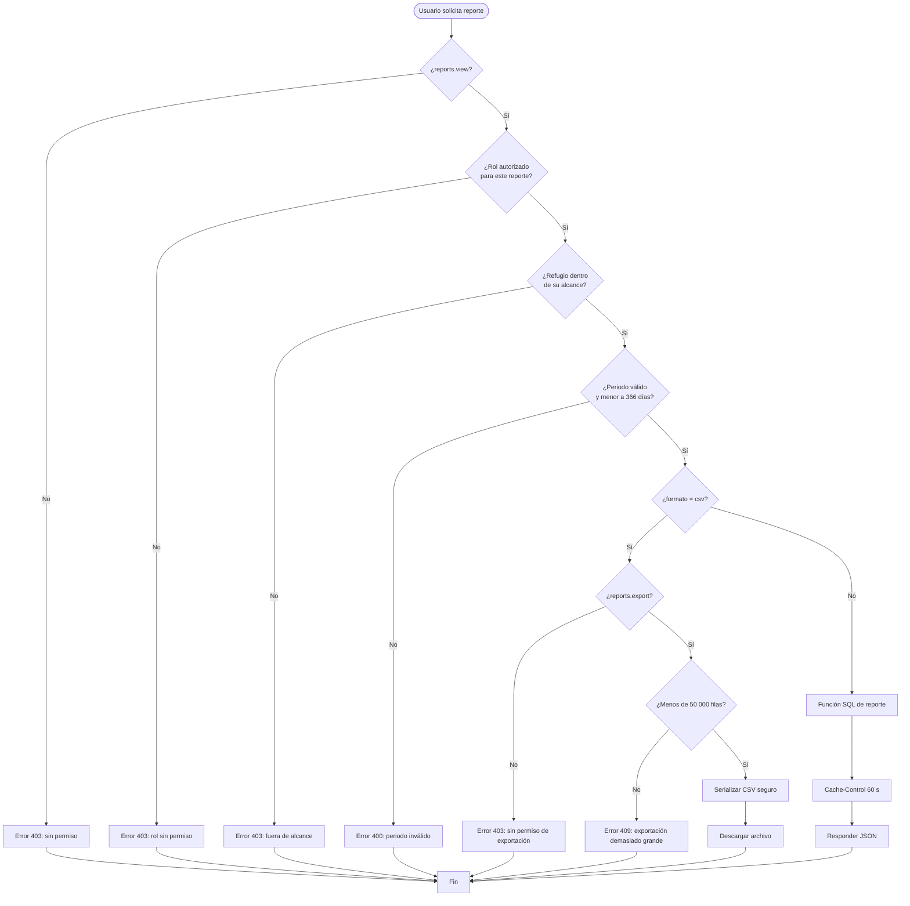
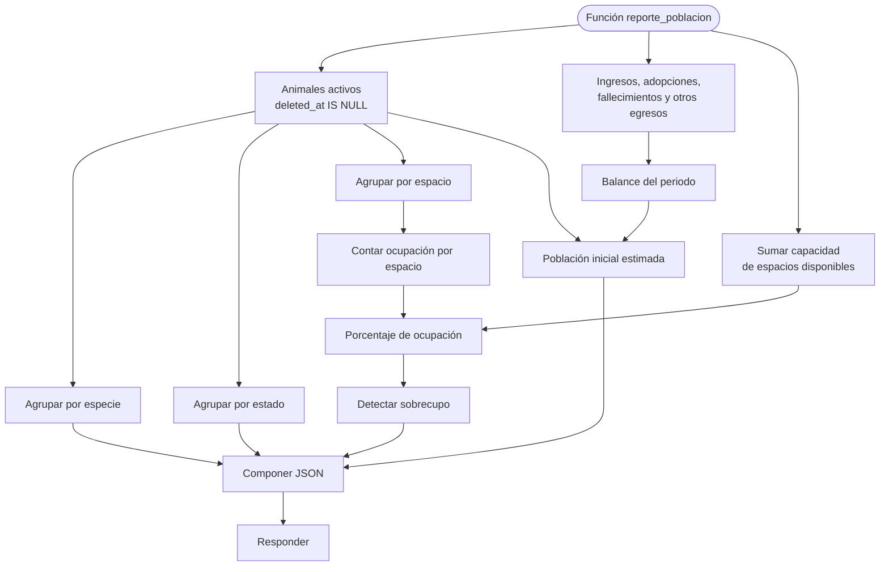
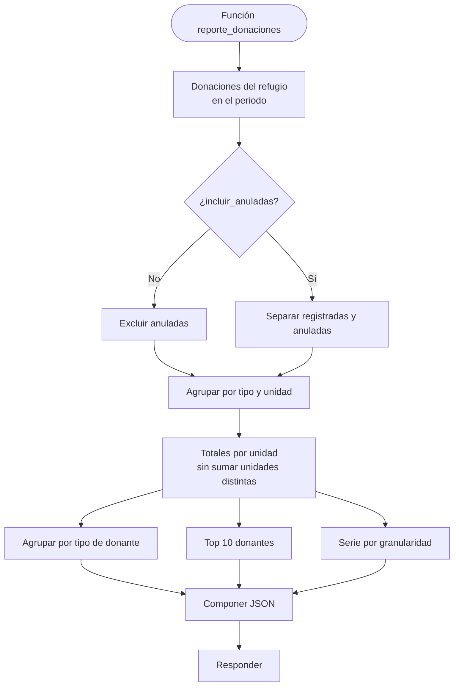
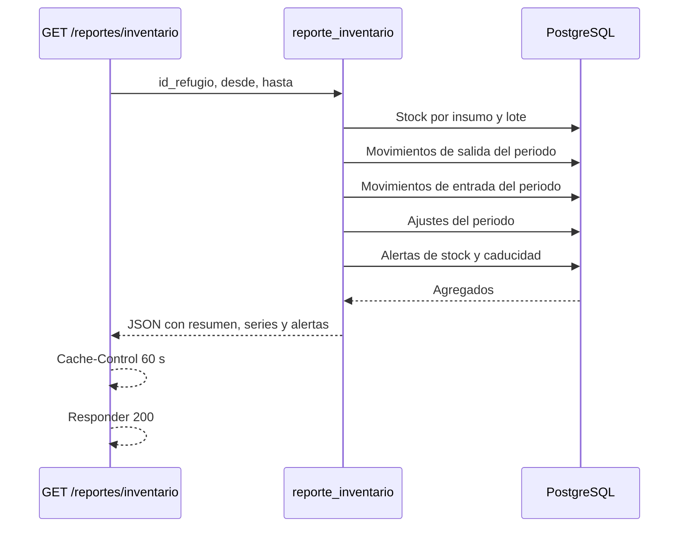
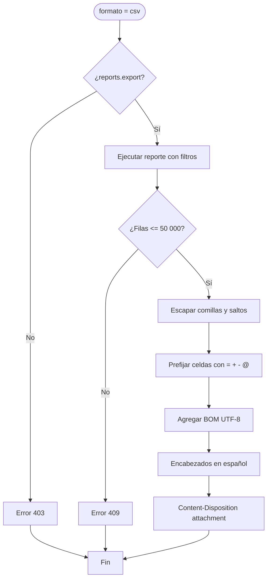

# Requerimiento 07 — Épica 7: Inteligencia de Datos

## Título

Reportes de capacidad y población animal, de donaciones en especie y de inventario de insumos, con filtros por periodo, comparación y exportación CSV en los refugios Pixkki.

## Descripción

La Épica 7 convierte los datos operativos acumulados por las épicas anteriores en información para decidir. Se compone de tres reportes y un conjunto de agregados reutilizables:

1. **Capacidad y población animal (US21)**: cuántos animales hay, de qué especie, en qué estado, en qué espacio, cuántos están en cuarentena, cuántos fueron adoptados o egresaron en el periodo y cuál es la ocupación frente a la capacidad declarada.
2. **Donaciones en especie (US22)**: qué se recibió, de quién, de qué tipo, en qué cantidad y unidad, cuántas donaciones se inventariaron y cuántas quedaron solo como registro.
3. **Inventario de insumos (US23)**: stock actual por insumo y lote, consumo del periodo por motivo, entradas, ajustes y alertas de stock mínimo y caducidad.
4. **Agregados para el dashboard**: un resumen compacto con los indicadores que alimentan la pantalla principal, sin duplicar la lógica de los reportes.

Todos los cálculos se resuelven en PostgreSQL mediante funciones `security invoker` que respetan RLS y filtran por `id_refugio`. Los services solo validan parámetros, autorizan por rol y mapean la respuesta. No se crean tablas nuevas, snapshots ni vistas materializadas.

> **Principio rector:** un reporte no inventa datos. Si una métrica no puede calcularse con el esquema vigente, se documenta la limitación y se marca como estimada, nunca se rellena con un valor ficticio. La ausencia de datos se muestra como ausencia, no como cero.

## Objetivo

Proveer los reportes que permitan:

1. Conocer la población animal actual y su distribución por especie, estado y espacio.
2. Medir ingresos, adopciones, fallecimientos y otros egresos del periodo.
3. Calcular la ocupación real frente a la capacidad de cada espacio y del refugio.
4. Detectar sobrecupo y espacios sin uso.
5. Medir el tiempo medio de estancia de los animales activos y adoptados.
6. Reportar donaciones en especie por tipo, unidad, donante y periodo.
7. Distinguir donaciones inventariadas de las que solo quedaron como registro.
8. Reportar stock actual, consumo, entradas y ajustes de inventario.
9. Exponer alertas de stock bajo, caducidad próxima y lotes vencidos.
10. Comparar el periodo consultado con el periodo inmediato anterior.
11. Exportar cualquier reporte a CSV con los mismos filtros y sin datos sensibles innecesarios.
12. Alimentar el dashboard con un resumen consistente y cacheado por pocos segundos.

## Alcance

Incluye:

- RF7.1: Reporte de población animal (US21).
- RF7.2: Reporte de capacidad y ocupación por espacio y por refugio (US21).
- RF7.3: Reporte de donaciones en especie por tipo, unidad y donante (US22).
- RF7.4: Reporte de inventario: stock, consumo, entradas, ajustes y alertas (US23).
- RF7.5: Agregados de resumen para el dashboard.
- RF7.6: Filtros por periodo, comparación con el periodo anterior y granularidad.
- RF7.7: Exportación CSV de los cuatro reportes.
- RF7.8: Permisos por rol con alcance de tenant.

No incluye:

- Valorización monetaria de donaciones o inventario. US22 se expresa en cantidades y unidades, no en dinero.
- Reportes de adopciones por adoptante, conversión del portal o embudo de postulaciones.
- Reportes clínicos, de vacunación, de cirugías o de rehabilitación.
- Reportes de personal, asistencia, turnos o nómina.
- Reportes financieros, contables, presupuestales o de compras.
- Proyección de compras, punto de reorden automático o demanda estimada.
- Snapshots históricos, vistas materializadas, data warehouse o ETL.
- Envío programado por correo, suscripciones a reportes o alertas automáticas.
- Exportación a PDF, Excel con formato, XML o integraciones con BI externo.
- Gráficas renderizadas en el servidor; el frontend las construye con el JSON.
- Comparación interanual ni proyecciones estadísticas.
- Anonimización avanzada o seudonimización de donantes.
- Importación histórica (Épica 8).

## Actores

| Actor | Descripción |
|-------|-------------|
| Administrador de refugio | Rol `admin`/`Administrador`. Consulta y exporta todos los reportes de su refugio. |
| Coordinador | Rol `coordinador`. Consulta y exporta todos los reportes de su refugio. |
| Veterinario | Rol `veterinario`. Consulta y exporta población y capacidad, e inventario. No accede al reporte de donaciones. |
| Operador | Rol `operador`. Consulta y exporta únicamente población y capacidad. |
| Evaluador | Rol `evaluador`. Sin acceso a reportes en esta épica. |
| Personal de solo lectura | Usuario con `reports.view`; el alcance depende de su rol según la matriz. |
| Superadmin | Rol global. Consulta cualquier refugio o el agregado global según la política de la Épica 0. |
| Sistema | Calcula agregados en SQL, aplica RLS, cachea respuestas y genera CSV. |

## Reglas de negocio

### Reglas comunes

1. **Periodo explícito**: todo reporte acepta `desde` y `hasta` en formato `YYYY-MM-DD`, inclusivos. Si se omiten, el periodo por defecto es el mes calendario en curso.
2. **Periodo válido**: `desde` no puede ser posterior a `hasta`. El rango máximo es de 366 días. Se devuelve `400 PERIODO_INVALIDO` o `400 RANGO_EXCEDIDO`.
3. **Comparación**: con `comparar=true` se calcula el periodo inmediato anterior de igual duración y se devuelven ambos bloques. Sin comparación, el bloque es `null`.
4. **Granularidad**: `granularidad` acepta `dia`, `semana` o `mes`. Por defecto se elige `dia` para rangos de hasta 31 días, `semana` hasta 180 y `mes` para rangos mayores.
5. **Zona horaria**: las fechas se interpretan en la zona horaria del refugio y se convierten a UTC para comparar con `timestamptz`. Las fechas `date` se comparan tal cual. La respuesta incluye `zona_horaria` para que el cliente no reinterprete.
6. **Cálculo en SQL**: los agregados se calculan en funciones `security invoker` con `search_path = public`. Los services no agregan filas en memoria.
7. **RLS efectivo**: las funciones respetan las políticas de la sesión. Un usuario de otro refugio no puede obtener datos ni pasando `id_refugio` por query string.
8. **Alcance del tenant**: el `id_refugio` se resuelve de la sesión. El Superadmin puede enviar `refugio` para elegir uno o `refugio=todos` para el agregado global; un usuario normal que envíe otro refugio recibe `403 REFUGIO_FUERA_DE_ALCANCE`.
9. **Sin datos inventados**: si una métrica no puede calcularse, se devuelve `null` con una nota en `limitaciones`. Nunca se devuelve `0` para representar “no calculable”.
10. **Conteos enteros, porcentajes decimales**: los conteos son enteros; los porcentajes y promedios se redondean a un decimal.
11. **División por cero**: si la capacidad es cero, el porcentaje de ocupación es `null`, no `0` ni `Infinity`.
12. **Datos personales**: el reporte de donaciones incluye nombre del donante solo para roles autorizados. No incluye correo, teléfono ni notas del donante en la exportación por defecto.
13. **CSV seguro**: toda celda que empiece con `=`, `+`, `-` o `@` se prefija con un apóstrofo para evitar inyección de fórmulas. El archivo se emite en UTF-8 con BOM.
14. **CSV completo**: la exportación devuelve todas las filas del filtro, no solo la página visible, con un límite de 50 000 filas. Al superarlo se devuelve `409 EXPORTACION_DEMASIADO_GRANDE` y se pide acotar el periodo.
15. **Caché corta**: las respuestas JSON pueden cachearse 60 segundos con `Cache-Control: private, max-age=60`. Las exportaciones CSV no se cachean.
16. **Idempotencia de lectura**: los reportes son de solo lectura; no escriben auditoría ni modifican datos.
17. **Accesibilidad**: los reportes entregan etiquetas en español y valores explícitos; la UI no debe depender solo del color.

### Población animal (RF7.1)

18. **Población activa**: animal con `activo = true` y `deleted_at IS NULL`. Es la base de los conteos actuales.
19. **Población por especie**: agrupa por `animal.especie` (`Perro`, `Gato`).
20. **Población por estado**: agrupa por `animal_estado.nombre_estado`. Si el catálogo no tiene filas, se devuelve el `id_estado` con etiqueta `Estado <id>` y se registra una limitación.
21. **Población por espacio**: agrupa por `espacio.nombre_espacio` y `espacio.tipo`.
22. **En cuarentena**: conteo de animales activos con `en_cuarentena = true`.
23. **Esterilizados**: conteo de animales activos con `esterilizado = true`, y porcentaje sobre la población activa.
24. **Ingresos del periodo**: animales con `fecha_ingreso` dentro del rango, sin importar su estado actual. Incluye animales ya adoptados o egresados.
25. **Adopciones del periodo**: animales con `fecha_adopcion` dentro del rango. Depende del campo introducido por la Épica 5.
26. **Fallecimientos del periodo**: animales con `motivo_egreso = 'fallecimiento'` y `fecha_egreso` dentro del rango.
27. **Otros egresos del periodo**: `motivo_egreso` distinto de `adopcion` y `fallecimiento`, con `fecha_egreso` en el rango.
28. **Egresos sin clasificar**: animales con `activo = false`, `fecha_adopcion` nula y `fecha_egreso` nula. Se informan aparte; no se suman a fallecimientos ni a otros egresos.
29. **Balance del periodo**: `ingresos - adopciones - fallecimientos - otros_egresos`. Puede ser negativo si el periodo empieza con población previa.
30. **Población al inicio estimada**: `poblacion_actual - ingresos_del_periodo + egresos_del_periodo`. Se marca como `estimada: true` porque no existen snapshots históricos.
31. **Tiempo medio de estancia de activos**: promedio de `hoy - fecha_ingreso` en días para la población activa.
32. **Tiempo medio de estancia de adoptados**: promedio de `fecha_adopcion - fecha_ingreso` en días para los adoptados del periodo.
33. **Serie temporal**: la respuesta incluye una serie por granularidad con ingresos, adopciones y egresos. La población de cada punto no se reconstruye; solo se reportan flujos.
34. **Sin doble conteo**: un animal adoptado en el periodo cuenta como ingreso y como adopción si ambas fechas caen en el rango; son métricas distintas, no una población.

### Capacidad y ocupación (RF7.2)

35. **Capacidad por espacio**: `espacio.capacidad`, que es un entero mayor que cero. Solo se consideran espacios con `disponible = true` para la capacidad total.
36. **Ocupación por espacio**: animales activos con `id_espacio` igual al espacio. Incluye animales en cuarentena alojados en ese espacio.
37. **Capacidad total**: suma de `espacio.capacidad` de los espacios disponibles del refugio.
38. **Ocupación total**: suma de animales activos asignados a espacios disponibles.
39. **Porcentaje de ocupación**: `ocupacion_total / capacidad_total * 100`, redondeado a un decimal. `null` si la capacidad es cero.
40. **Sobrecupo**: espacio donde `ocupacion > capacidad`. Se devuelve la lista con el exceso y el porcentaje.
41. **Espacios libres**: espacio disponible con `ocupacion = 0`.
42. **Desglose por tipo**: agrupa capacidad y ocupación por `espacio.tipo`. Los espacios con `tipo` nulo se agrupan como `sin_tipo`.
43. **Animales sin espacio válido**: si un animal activo apunta a un espacio eliminado o de otro refugio, se cuenta en `sin_espacio` y se registra una limitación. No se suma a ningún espacio.
44. **Capacidad no bloqueante**: el reporte informa sobrecupo, no lo impide. El control de capacidad pertenece a la Épica 3.

### Donaciones en especie (RF7.3)

45. **Base del reporte**: donaciones con `fecha_donacion` en el rango. Por defecto solo `estado = 'registrada'`; con `incluir_anuladas=true` se incluyen y se muestran por separado.
46. **Sin dinero**: el reporte no suma montos, no convierte unidades y no calcula valor. Expresa volumen en especie.
47. **Agrupación obligatoria por unidad**: las cantidades se agrupan por `(tipo_donacion, unidad_medida)`. Está prohibido sumar kilogramos con dosis, piezas o paquetes.
48. **Tipos canónicos**: `Alimento`, `Medicamento`, `Equipo`, `Ropa`, `Otro`.
49. **Resumen**: total de donaciones, donantes distintos, donaciones inventariadas, no inventariadas y anuladas.
50. **Por tipo de donante**: agrupa por `Persona`, `Empresa`, `Fundación`.
51. **Top de donantes**: los diez donantes con más donaciones en el periodo, con nombre y conteo. No incluye contacto ni notas.
52. **Serie temporal**: donaciones y cantidades por granularidad, siempre separadas por unidad.
53. **Inventariadas**: donaciones con `id_lote_inventario` no nulo. No inventariadas: el resto.
54. **Anuladas**: se excluyen de los totales operativos y se informan en un bloque aparte con su motivo agregado por categoría, sin texto libre.
55. **Privacidad**: el nombre del donante se muestra solo con `reports.view` y rol autorizado. La exportación CSV incluye nombre, tipo, fecha, tipo de donación, cantidad y unidad; nunca correo, teléfono ni notas.

### Inventario (RF7.4)

56. **Stock actual**: por insumo y lote, `stock_actual`, `stock_minimo`, unidad, caducidad y estado (`ok`, `bajo`, `agotado`, `vencido`).
57. **Consumo del periodo**: movimientos de tipo `salida` con `fecha` en el rango, agrupados por `motivo` e insumo.
58. **Entradas del periodo**: movimientos de tipo `entrada` agrupados por `motivo` e insumo.
59. **Ajustes del periodo**: movimientos `ajuste_entrada` y `ajuste_salida`, con conteo y efecto neto por insumo.
60. **Motivos canónicos**: `donacion`, `evento_sanitario`, `cirugia_reproductiva`, `consumo_interno`, `vencimiento`, `perdida`, `ajuste_conteo`, `ajuste_error`, `otro`.
61. **Alertas**: stock bajo (`stock_actual <= stock_minimo`), caducidad próxima (30 días) y vencidos con stock mayor que cero.
62. **Sin valorización**: no se reporta costo, valor ni precio. El reporte mide unidades.
63. **Insumos inactivos**: se excluyen del stock operativo y de las alertas; se informan en un conteo aparte.
64. **Lotes inactivos**: se excluyen del stock operativo; su historial de movimientos sí aparece en el consumo del periodo.
65. **Consistencia con la Épica 6**: el reporte lee `inventario_movimiento`; no recalcula stock desde donaciones ni desde eventos sanitarios.

### Resumen del dashboard (RF7.5)

66. **Contenido**: población activa, capacidad total, porcentaje de ocupación, adopciones del periodo, donaciones del periodo, insumos con stock bajo y lotes vencidos.
67. **Periodo**: el resumen usa el mes en curso por defecto y acepta `desde`/`hasta`.
68. **Consistencia**: el resumen usa las mismas funciones que los reportes; no duplica fórmulas.
69. **Tamaño**: la respuesta es compacta, sin listas largas; está pensada para una sola llamada del dashboard.

### Permisos y alcance (RF7.8)

70. **Permiso base**: `reports.view` habilita la consulta; `reports.export` habilita la descarga CSV. Ambos se siembran en `permiso` y `rol_permiso`.
71. **Matriz por rol**: el servicio autoriza cada reporte según la matriz de la sección de permisos. Un rol sin acceso recibe `403 ROL_SIN_PERMISO`.
72. **Alcance del tenant**: un usuario normal solo consulta su refugio. El Superadmin consulta cualquiera o el agregado global.
73. **Exportación**: la exportación exige `reports.export` además del acceso al reporte.
74. **Sin auditoría de lectura**: consultar o exportar no escribe en `auditoria`; son operaciones de solo lectura.

## Supuestos funcionales (pendientes de validación)

| ID | Supuesto | Impacto si cambia |
|----|----------|-------------------|
| S1 | US22 se reporta en cantidades y unidades, sin valor monetario, aunque su nombre diga “financiero”. | Si se exige dinero, se agrega valorización a `donacion` y cambia todo el reporte. |
| S2 | Se agregan `fecha_egreso` y `motivo_egreso` a `animal` para medir fallecimientos y otros egresos. | Sin ellos, solo se reportan adopciones y egresos sin clasificar. |
| S3 | `motivo_egreso` acepta `adopcion`, `fallecimiento`, `traslado`, `devolucion` y `otro`. | Cambia el dominio y los reportes. |
| S4 | La población al inicio del periodo es una estimación derivada, no un snapshot. | Si se requieren cifras exactas, se necesitan snapshots diarios. |
| S5 | La granularidad por defecto depende del rango (día, semana o mes). | Cambia el contrato y las gráficas. |
| S6 | El rango máximo es de 366 días y la exportación de 50 000 filas. | Cambia la validación y el rendimiento. |
| S7 | El reporte de donaciones incluye el nombre del donante, pero no su contacto. | Cambia la política de privacidad y la exportación. |
| S8 | El reporte de donaciones excluye anuladas por defecto. | Cambia los totales y la conciliación. |
| S9 | La capacidad se toma de `espacio.capacidad` y solo de espacios disponibles. | Cambia el cálculo de ocupación. |
| S10 | Los animales en cuarentena se cuentan en la ocupación del espacio donde están alojados. | Si se excluyen, cambia la ocupación. |
| S11 | El umbral de caducidad próxima es 30 días, coherente con la Épica 6. | Cambia la alerta. |
| S12 | Los reportes se cachean 60 segundos y no se persisten. | Si se requiere tiempo real estricto, se elimina la caché. |
| S13 | El resumen del dashboard usa el mes en curso por defecto. | Cambia la pantalla principal. |
| S14 | Los permisos son `reports.view` y `reports.export`; la restricción por reporte se aplica por rol en el servicio. | Si se requieren permisos por reporte, se migran a `reports.population`, `reports.donations` y `reports.inventory`. |
| S15 | El Superadmin puede pedir el agregado global con `refugio=todos`. | Cambia el contrato y el costo de la consulta. |
| S16 | El CSV usa coma como separador, UTF-8 con BOM y encabezados en español. | Cambia la compatibilidad con Excel regional. |
| S17 | Las fechas se interpretan en la zona horaria del refugio; el esquema no la almacena y se usa `America/Mexico_City` como valor por defecto. | Cambia los cortes de día y mes. |
| S18 | El reporte de inventario no incluye valorización ni proyección de compra. | Cambia el alcance de US23. |

> **Decisión pendiente de aprobación:** agregar `fecha_egreso` y `motivo_egreso` a `animal`, crear las funciones de reporte, los índices de apoyo y sembrar los permisos `reports.view` y `reports.export` son cambios de base de datos. Requieren aprobación previa y migración versionada. Si no se aprueba `fecha_egreso`/`motivo_egreso`, el reporte de población se limita a adopciones y egresos sin clasificar.

## Inconsistencias y alineación con el estado actual del repositorio

| Elemento | Estado actual | Implicación para esta épica |
|----------|---------------|-----------------------------|
| `modules/dashboard` | Solo contiene `DashboardLayout` y `navigation.config.ts`. No hay módulo de reportes ni servicios de datos. | Se crea `modules/reports`; el dashboard consume el resumen. |
| `app/(protected)/(dashboard)/reports` | La navegación apunta a `/reports`, pero la página no existe. | La ruta queda pendiente para el frontend; el backend se implementa primero. |
| `reports.view` | Se usa en `navigation.config.ts`, pero no está sembrado en `permiso`. | Requiere siembra y asignación por rol. |
| `app/(protected)/(dashboard)/donations/page.tsx` | Página estática con donaciones monetarias, métodos de pago y montos. | Contradice el modelo de solo especie. Se reemplazará en el frontend; el backend no la usa. |
| `app/(protected)/(dashboard)/dashboard/page.tsx` | Datos de ejemplo, sin llamadas al backend. | Se conectará al endpoint de resumen. |
| `animal.fecha_adopcion` | No existe en el esquema base; la propone la Épica 5. | Las adopciones del periodo dependen de que la Épica 5 se aplique. |
| `animal.activo` | Booleano sin motivo ni fecha de egreso. | No permite distinguir fallecimiento, traslado o baja. Requiere `motivo_egreso` y `fecha_egreso`. |
| `animal_estado` | Catálogo sin datos semilla en las migraciones. | El reporte por estado puede quedar vacío. Requiere seed o tolerancia a catálogo vacío. |
| `espacio.capacidad` | Existe como entero mayor que cero; `disponible` booleano. | Es la fuente de capacidad. La documentación de la Épica 3 usa `capacidadMaxima` como ejemplo, pero la columna real es `capacidad`. |
| `animal.id_espacio` | Obligatorio y sin FK visible en el esquema base. | Un animal puede apuntar a un espacio inexistente; el reporte lo cuenta en `sin_espacio`. |
| `donacion` | Registra tipo, cantidad, unidad, fecha y caducidad; sin valor monetario. | Coherente con US22 en cantidades. |
| `donante` | Sin `id_refugio` en el esquema base; la Épica 6 lo agrega. | El reporte por donante depende de la migración de la Épica 6. |
| `inventario_movimiento` | `entrada`/`salida`; la Épica 6 agrega `ajuste_entrada` y `ajuste_salida`. | El reporte de ajustes depende de la Épica 6. |
| `inventario_lote.stock_actual` | Entero con `CHECK >= 0`. | El reporte de stock es directo; no requiere recálculo. |
| `evento_sanitario` y `cirugia_reproductiva` | Consumen stock con `motivo` específico. | El reporte de consumo los agrupa por motivo. |
| `solicitud_adopcion` | Existe, pero el cierre de adopción se refleja en `animal.fecha_adopcion`. | El reporte no consulta solicitudes; usa el estado del animal. |
| `types/database.ts` | No incluye las funciones de reporte ni los campos nuevos. | Debe regenerarse después de aplicar la migración. |
| UI de reportes | No existe. | Fuera de alcance; el frontend se conecta después. |

## Historias de usuario

| ID | Historia de Usuario | Prioridad | Épica | RF relacionados |
|----|---------------------|-----------|-------|-----------------|
| US21 | Reporte de capacidad y población animal | Must Have | Épica 7 | RF7.1, RF7.2 |
| US22 | Reporte financiero de donaciones (solo en especie) | Should Have | Épica 7 | RF7.3 |
| US23 | Reporte de inventario de insumos | Should Have | Épica 7 | RF7.4 |

## Contrato de API

Los endpoints siguen el patrón `/api/v1/reportes/<recurso>`. La validación de entrada se hace con Zod antes de cualquier efecto. Los errores usan el envelope uniforme.

### Formato de respuesta de éxito

```json
{
  "success": true,
  "data": { ... }
}
```

### Formato de error uniforme

```json
{
  "success": false,
  "error": {
    "code": "ERROR_CODIGO",
    "message": "Mensaje en español para el usuario final",
    "statusCode": 400,
    "details": { ... }
  }
}
```

### Parámetros comunes

| Parámetro | Tipo | Descripción |
|-----------|------|-------------|
| `desde` | `YYYY-MM-DD` | Inicio del periodo, inclusivo. Por defecto, primer día del mes en curso. |
| `hasta` | `YYYY-MM-DD` | Fin del periodo, inclusivo. Por defecto, hoy. |
| `comparar` | `true`/`false` | Calcula el periodo anterior de igual duración. Por defecto `false`. |
| `granularidad` | `dia`/`semana`/`mes` | Granularidad de la serie. Por defecto según el rango. |
| `refugio` | `id`/`todos` | Solo Superadmin. Sin valor, usa el refugio de la sesión. |
| `formato` | `json`/`csv` | Por defecto `json`. |

### RF7.1 / RF7.2 — Población y capacidad (US21)

| Método | Ruta | Descripción | Acceso |
|--------|------|-------------|--------|
| GET | `/api/v1/reportes/poblacion` | Población, flujos y estancia | Admin, Coordinador, Veterinario, Operador |
| GET | `/api/v1/reportes/capacidad` | Capacidad y ocupación por espacio | Admin, Coordinador, Veterinario, Operador |

**Response (GET `/reportes/poblacion`):**

```json
{
  "success": true,
  "data": {
    "periodo": {
      "desde": "2026-10-01",
      "hasta": "2026-10-31",
      "zona_horaria": "America/Mexico_City"
    },
    "poblacion_actual": {
      "total": 128,
      "por_especie": [
        { "especie": "Perro", "total": 92 },
        { "especie": "Gato", "total": 36 }
      ],
      "por_estado": [
        { "id_estado": 1, "estado": "Disponible", "total": 54 },
        { "id_estado": 2, "estado": "En tratamiento", "total": 61 },
        { "id_estado": 3, "estado": "En cuarentena", "total": 13 }
      ],
      "en_cuarentena": 13,
      "esterilizados": 70,
      "porcentaje_esterilizados": 54.7
    },
    "flujos": {
      "ingresos": 18,
      "adopciones": 9,
      "fallecimientos": 2,
      "otros_egresos": 1,
      "egresos_sin_clasificar": 0,
      "balance": 6
    },
    "poblacion_inicio_estimada": 122,
    "estancia": {
      "promedio_dias_activos": 64.2,
      "promedio_dias_adoptados": 41.5
    },
    "serie": [
      {
        "periodo": "2026-10-01",
        "ingresos": 2,
        "adopciones": 1,
        "fallecimientos": 0,
        "otros_egresos": 0
      },
      {
        "periodo": "2026-10-02",
        "ingresos": 1,
        "adopciones": 0,
        "fallecimientos": 0,
        "otros_egresos": 0
      }
    ],
    "comparacion": {
      "desde": "2026-08-31",
      "hasta": "2026-09-30",
      "ingresos": 15,
      "adopciones": 7,
      "fallecimientos": 1,
      "otros_egresos": 2
    },
    "limitaciones": [
      "La población al inicio del periodo es estimada: no existen snapshots históricos."
    ]
  }
}
```

**Response (GET `/reportes/capacidad`):**

```json
{
  "success": true,
  "data": {
    "capacidad_total": 150,
    "ocupacion_total": 128,
    "porcentaje_ocupacion": 85.3,
    "animales_sin_espacio": 0,
    "espacios": [
      {
        "id_espacio": 12,
        "nombre": "Canil A",
        "tipo": "canil",
        "capacidad": 8,
        "ocupacion": 5,
        "disponible": true,
        "porcentaje_ocupacion": 62.5,
        "sobrecupo": false,
        "libre": 3
      }
    ],
    "por_tipo": [
      {
        "tipo": "canil",
        "capacidad": 80,
        "ocupacion": 70,
        "porcentaje_ocupacion": 87.5
      },
      {
        "tipo": "gatera",
        "capacidad": 40,
        "ocupacion": 33,
        "porcentaje_ocupacion": 82.5
      },
      {
        "tipo": "cuarentena",
        "capacidad": 30,
        "ocupacion": 25,
        "porcentaje_ocupacion": 83.3
      }
    ],
    "sobrecupo": [],
    "espacios_libres": [],
    "limitaciones": []
  }
}
```

**Errores:**

- `400` — `PERIODO_INVALIDO`, `RANGO_EXCEDIDO`, `GRANULARIDAD_INVALIDA`
- `403` — `ROL_SIN_PERMISO`, `REFUGIO_FUERA_DE_ALCANCE`
- `500` — `ERROR_INTERNO`

### RF7.3 — Donaciones en especie (US22)

| Método | Ruta | Descripción | Acceso |
|--------|------|-------------|--------|
| GET | `/api/v1/reportes/donaciones` | Donaciones en especie por tipo, unidad y donante | Admin, Coordinador |

**Query params adicionales:** `tipo_donacion`, `tipo_donante`, `incluir_anuladas`.

**Response:**

```json
{
  "success": true,
  "data": {
    "periodo": {
      "desde": "2026-10-01",
      "hasta": "2026-10-31",
      "zona_horaria": "America/Mexico_City"
    },
    "resumen": {
      "donaciones": 34,
      "donantes": 22,
      "inventariadas": 19,
      "no_inventariadas": 15,
      "anuladas": 1
    },
    "por_tipo": [
      {
        "tipo_donacion": "Alimento",
        "unidad_medida": "kg",
        "cantidad": 320,
        "donaciones": 12
      },
      {
        "tipo_donacion": "Medicamento",
        "unidad_medida": "dosis",
        "cantidad": 180,
        "donaciones": 9
      },
      {
        "tipo_donacion": "Ropa",
        "unidad_medida": "pieza",
        "cantidad": 45,
        "donaciones": 6
      }
    ],
    "por_tipo_donante": [
      { "tipo_donante": "Persona", "donaciones": 18, "donantes": 14 },
      { "tipo_donante": "Empresa", "donaciones": 10, "donantes": 6 },
      { "tipo_donante": "Fundación", "donaciones": 6, "donantes": 2 }
    ],
    "top_donantes": [
      { "id_donante": 18, "nombre": "María López", "tipo_donante": "Persona", "donaciones": 4 }
    ],
    "serie": [
      {
        "periodo": "2026-10-01",
        "donaciones": 2,
        "cantidades": [
          { "unidad_medida": "kg", "cantidad": 20 }
        ]
      }
    ],
    "anuladas": [
      {
        "motivo": "error_captura",
        "donaciones": 1
      }
    ],
    "comparacion": {
      "desde": "2026-08-31",
      "hasta": "2026-09-30",
      "donaciones": 28,
      "donantes": 19
    },
    "limitaciones": [
      "El reporte expresa cantidades en especie; no incluye valor monetario."
    ]
  }
}
```

> `anuladas[].motivo` es una categoría derivada, no el texto libre del motivo, para no exponer notas internas en el reporte.

**Errores:**

- `400` — `PERIODO_INVALIDO`, `RANGO_EXCEDIDO`, `TIPO_DONACION_INVALIDO`
- `403` — `ROL_SIN_PERMISO`, `REFUGIO_FUERA_DE_ALCANCE`
- `500` — `ERROR_INTERNO`

### RF7.4 — Inventario (US23)

| Método | Ruta | Descripción | Acceso |
|--------|------|-------------|--------|
| GET | `/api/v1/reportes/inventario` | Stock, consumo, entradas, ajustes y alertas | Admin, Coordinador, Veterinario |

**Query params adicionales:** `tipo_insumo`, `id_insumo`, `incluir_inactivos`.

**Response:**

```json
{
  "success": true,
  "data": {
    "periodo": {
      "desde": "2026-10-01",
      "hasta": "2026-10-31",
      "zona_horaria": "America/Mexico_City"
    },
    "resumen": {
      "insumos_activos": 14,
      "lotes_activos": 31,
      "stock_bajo": 2,
      "caducidad_proxima": 1,
      "vencidos": 1,
      "insumos_inactivos": 1
    },
    "stock": [
      {
        "id_insumo": 4,
        "nombre_insumo": "Vacuna antirrábica",
        "tipo_insumo": "vacuna",
        "unidad_medida": "dosis",
        "lotes": 3,
        "stock_actual": 46,
        "stock_minimo": 15,
        "estado": "ok",
        "proximo_vencimiento": "2027-11-15"
      }
    ],
    "consumo": [
      {
        "motivo": "evento_sanitario",
        "id_insumo": 4,
        "nombre_insumo": "Vacuna antirrábica",
        "unidad_medida": "dosis",
        "cantidad": 44,
        "movimientos": 44
      },
      {
        "motivo": "cirugia_reproductiva",
        "id_insumo": 9,
        "nombre_insumo": "Gasa estéril",
        "unidad_medida": "paquete",
        "cantidad": 12,
        "movimientos": 6
      }
    ],
    "entradas": [
      {
        "motivo": "donacion",
        "id_insumo": 4,
        "nombre_insumo": "Vacuna antirrábica",
        "unidad_medida": "dosis",
        "cantidad": 60,
        "movimientos": 3
      }
    ],
    "ajustes": [
      {
        "tipo_movimiento": "ajuste_salida",
        "id_insumo": 4,
        "nombre_insumo": "Vacuna antirrábica",
        "unidad_medida": "dosis",
        "cantidad": 3,
        "movimientos": 1
      }
    ],
    "alertas": {
      "stock_bajo": [
        {
          "id_lote_inventario": 31,
          "nombre_insumo": "Vacuna antirrábica",
          "stock_actual": 3,
          "stock_minimo": 5,
          "unidad_medida": "dosis"
        }
      ],
      "caducidad_proxima": [
        {
          "id_lote_inventario": 33,
          "nombre_insumo": "Desparasitante",
          "fecha_caducidad": "2026-12-05",
          "dias_restantes": 19,
          "stock_actual": 8
        }
      ],
      "vencidos": [
        {
          "id_lote_inventario": 28,
          "nombre_insumo": "Alimento seco",
          "fecha_caducidad": "2026-10-01",
          "dias_vencido": 46,
          "stock_actual": 4
        }
      ]
    },
    "comparacion": {
      "desde": "2026-08-31",
      "hasta": "2026-09-30",
      "consumo_total": 88,
      "entradas_total": 120,
      "ajustes_total": 4
    },
    "limitaciones": [
      "El reporte mide unidades; no incluye valorización monetaria."
    ]
  }
}
```

**Errores:**

- `400` — `PERIODO_INVALIDO`, `RANGO_EXCEDIDO`, `TIPO_INSUMO_INVALIDO`
- `403` — `ROL_SIN_PERMISO`, `REFUGIO_FUERA_DE_ALCANCE`
- `500` — `ERROR_INTERNO`

### RF7.5 — Resumen del dashboard

| Método | Ruta | Descripción | Acceso |
|--------|------|-------------|--------|
| GET | `/api/v1/reportes/resumen` | Indicadores compactos del periodo | Admin, Coordinador, Veterinario, Operador |

**Response:**

```json
{
  "success": true,
  "data": {
    "periodo": {
      "desde": "2026-11-01",
      "hasta": "2026-11-16",
      "zona_horaria": "America/Mexico_City"
    },
    "poblacion_activa": 128,
    "capacidad_total": 150,
    "porcentaje_ocupacion": 85.3,
    "adopciones_periodo": 9,
    "donaciones_periodo": 34,
    "stock_bajo": 2,
    "lotes_vencidos": 1,
    "alertas": {
      "sobrecupo": false,
      "cuarentena": 13
    },
    "limitaciones": []
  }
}
```

**Errores:**

- `400` — `PERIODO_INVALIDO`
- `403` — `ROL_SIN_PERMISO`
- `500` — `ERROR_INTERNO`

### RF7.7 — Exportación CSV

Cualquiera de los cuatro endpoints acepta `formato=csv`. La respuesta cambia a `text/csv; charset=utf-8` con `Content-Disposition: attachment; filename="reporte-poblacion-2026-10-01_2026-10-31.csv"`.

| Reporte | Columnas del CSV |
|---------|------------------|
| Población | `reporte`, `periodo`, `especie`, `estado`, `espacio`, `total` |
| Capacidad | `espacio`, `tipo`, `capacidad`, `ocupacion`, `porcentaje`, `sobrecupo` |
| Donaciones | `folio`, `fecha`, `donante`, `tipo_donante`, `tipo_donacion`, `cantidad`, `unidad_medida`, `inventariada`, `estado` |
| Inventario | `insumo`, `tipo_insumo`, `lote`, `marca`, `stock_actual`, `stock_minimo`, `unidad_medida`, `fecha_caducidad`, `estado` |

**Reglas del CSV:**

1. UTF-8 con BOM para compatibilidad con Excel.
2. Separador coma; valores con coma, comillas o salto de línea entre comillas dobles.
3. Celdas que empiezan con `=`, `+`, `-` o `@` se prefijan con `'`.
4. Sin datos de contacto del donante ni notas internas.
5. Sin paginación: todas las filas del filtro hasta 50 000.
6. `Cache-Control: no-store`.

**Errores:**

- `403` — `ROL_SIN_PERMISO` (falta `reports.export`)
- `409` — `EXPORTACION_DEMASIADO_GRANDE`
- `500` — `ERROR_INTERNO`

## Plan de implementación backend-first

| Paso | Acción | Artefacto |
|------|--------|-----------|
| 1 | Ampliar el contrato OpenAPI de reportes | `modules/reports/contracts/openapi.yaml` |
| 2 | Definir schemas Zod de filtros por reporte | `modules/reports/validators/` |
| 3 | Definir DTOs derivados con `z.infer` | `modules/reports/dtos/` |
| 4 | Definir errores de dominio y permisos | `modules/reports/errors.ts`, `modules/reports/access.ts` |
| 5 | Implementar repositories que invocan las funciones SQL | `modules/reports/repositories/` |
| 6 | Implementar services con autorización por rol y mapeo | `modules/reports/services/` |
| 7 | Implementar factories | `modules/reports/factories/` |
| 8 | Implementar el serializador CSV | `modules/reports/csv/` |
| 9 | Crear y aplicar migración versionada | `supabase/migrations/YYYYMMDDHHMMSS_requerimiento_07_inteligencia_datos.sql` |
| 10 | Regenerar tipos | `npm run db:types` |
| 11 | Implementar Route Handlers | `app/api/v1/reportes/` |
| 12 | Integrar el resumen en el dashboard | `modules/dashboard/` (solo contrato; UI fuera de alcance) |
| 13 | Pruebas aisladas del backend | Equipo de QA (externo a este documento) |
| 14 | Ampliar contrato v1 | Tag git `api-v1.7` |
| 15 | Frontend consume el contrato vía Server Actions | Server Actions como adaptador (fuera de alcance de esta entrega) |

## Riesgos y dependencias

| Riesgo | Mitigación |
|--------|------------|
| Población histórica inventada | Marcar la población inicial como estimada y documentar la limitación; no fabricar snapshots. |
| Fallecimientos no registrados | Requiere `motivo_egreso` y `fecha_egreso`; sin ellos se informan como egresos sin clasificar. |
| Catálogo de estados vacío | Tolerar el catálogo vacío, mostrar `Estado <id>` y sembrar el catálogo en una migración aprobada. |
| Sumar unidades incompatibles | Agrupar siempre por `(tipo_donacion, unidad_medida)` y prohibir totales cruzados. |
| Reporte “financiero” sin dinero | Documentar que US22 mide volumen en especie; si se exige valor, se agrega valorización en la Épica 6. |
| División por cero en ocupación | Devolver `null` cuando la capacidad es cero. |
| RLS y agregados lentos | Índices por refugio, estado y fechas; funciones `security invoker` con filtros explícitos. |
| Fuga entre tenants | `id_refugio` de la sesión, RLS y validación de alcance para el Superadmin. |
| Consulta global costosa para Superadmin | Limitar el rango y advertir en `limitaciones`; considerar paginación por refugio. |
| Zona horaria mal aplicada | Interpretar fechas en la zona del refugio y devolver `zona_horaria` en la respuesta. |
| CSV con inyección de fórmulas | Prefijar celdas peligrosas y escapar comillas y saltos de línea. |
| Exportación gigante | Límite de 50 000 filas y error explícito para acotar el periodo. |
| Datos personales en CSV | Incluir solo nombre y tipo de donante; excluir correo, teléfono y notas. |
| Caché muestra datos viejos | TTL de 60 segundos y `no-store` en exportaciones. |
| Dependencia de la Épica 5 | `fecha_adopcion` debe existir; si no, el reporte de adopciones se marca como no disponible. |
| Dependencia de la Épica 6 | `motivo_egreso` de donaciones, ajustes y `donante.id_refugio`; verificar migraciones aplicadas. |
| `reports.view` no sembrado | Migración de permisos y verificación en QA. |
| `types/database.ts` desactualizado | Aplicar migración y ejecutar `npm run db:types`; no editar tipos a mano. |

**Dependencias:** Épica 0 (autenticación, RBAC y `id_refugio` de sesión), Épica 1 (`animal` y expediente), Épica 2 (cuarentena e inventario), Épica 3 (espacios y capacidad), Épica 4 (esterilización y adopción), Épica 5 (`fecha_adopcion`), Épica 6 (donaciones, movimientos y ajustes), Supabase/PostgreSQL, Zod y el equipo de QA para pruebas aisladas.

## Glosario

| Término | Definición |
|---------|------------|
| Población activa | Animales con `activo = true` y `deleted_at IS NULL`. |
| Flujo | Movimiento de entrada o salida de animales en un periodo (ingreso, adopción, fallecimiento, otro egreso). |
| Ocupación | Animales activos asignados a un espacio. |
| Capacidad | Plazas declaradas por un espacio disponible. |
| Sobrecupo | Ocupación mayor que la capacidad de un espacio. |
| Estancia | Días transcurridos entre el ingreso y la adopción o el día actual. |
| Reporte en especie | Reporte de bienes expresado en cantidades y unidades, sin valor monetario. |
| Consumo | Salidas de inventario por evento sanitario, cirugía, uso interno, pérdida o vencimiento. |
| Ajuste | Movimiento de corrección de stock con motivo obligatorio. |
| Snapshot | Fotografía histórica de datos en una fecha; no se usa en esta épica. |
| Agregado | Resultado resumido calculado en SQL a partir de filas detalladas. |
| Granularidad | Unidad temporal de la serie: día, semana o mes. |
| Periodo de comparación | Periodo inmediato anterior de igual duración. |
| RLS | *Row Level Security*: segunda capa de defensa multitenant. |
| CSV | Archivo de valores separados por comas. |
| BOM | Marca de orden de bytes que ayuda a Excel a interpretar UTF-8. |
| RBAC | Control de acceso basado en roles. |
| DoR / DoD | Definition of Ready / Definition of Done. |

## Diagramas de flujo (mermaid)

### Consulta de un reporte (RF7.1–RF7.5)



### Cálculo de población y capacidad (RF7.1 / RF7.2)



### Reporte de donaciones por unidad (RF7.3)



### Reporte de inventario (RF7.4)



### Exportación CSV (RF7.7)



## Criterios de aceptación por historia de usuario

| US | Criterios de aceptación |
|----|------------------------|
| US21 | Un usuario autorizado consulta población y capacidad de su refugio con un periodo válido y obtiene: población activa total, por especie, por estado y por espacio; animales en cuarentena; esterilizados y su porcentaje; ingresos, adopciones, fallecimientos y otros egresos del periodo; balance; población inicial marcada como estimada; tiempo medio de estancia de activos y adoptados; serie por granularidad; y comparación con el periodo anterior cuando se solicita. La capacidad total suma solo espacios disponibles; la ocupación cuenta animales activos por espacio; el porcentaje es `null` si la capacidad es cero; el sobrecupo y los espacios libres se listan. Un animal sin espacio válido se informa en `sin_espacio`. Un periodo invertido o mayor a 366 días responde `400`. Un usuario de otro refugio recibe `403`. |
| US22 | Un Administrador o Coordinador consulta las donaciones en especie del periodo y obtiene total de donaciones, donantes distintos, inventariadas, no inventariadas y anuladas; cantidades agrupadas por tipo de donación y unidad de medida, sin sumar unidades distintas; distribución por tipo de donante; top de donantes con nombre y conteo; serie por granularidad; y comparación con el periodo anterior. Las anuladas se excluyen por defecto y se informan aparte con categoría, no con texto libre. El reporte no incluye montos ni valorización y lo declara en `limitaciones`. No expone correo, teléfono ni notas del donante. Un Veterinario u Operador recibe `403`. |
| US23 | Un usuario autorizado consulta el inventario del periodo y obtiene stock actual por insumo y lote con stock mínimo, unidad, caducidad y estado; consumo agrupado por motivo e insumo; entradas por motivo; ajustes con efecto neto; y alertas de stock bajo, caducidad próxima a 30 días y vencidos con stock. Los insumos y lotes inactivos se excluyen del stock operativo y se informan aparte. El reporte no incluye valorización ni proyección de compra y lo declara en `limitaciones`. Los totales del periodo coinciden con los movimientos registrados en la Épica 6. |

**Criterios transversales de exportación:** cualquier reporte admite `formato=csv` con `reports.export`; el archivo es UTF-8 con BOM, usa coma, escapa comillas y saltos, prefija celdas peligrosas, incluye encabezados en español, respeta los filtros, no pagina y falla con `409` si supera 50 000 filas.

## Esquema de base de datos implicado

| Tabla | Campo clave | Descripción |
|-------|-------------|-------------|
| `animal` | `id_animal` (PK), `id_refugio` (FK) | Fuente de población, ingresos, adopciones y estancia. Requiere `fecha_egreso` y `motivo_egreso`. |
| `animal_estado` | `id_estado` (PK) | Catálogo de estados para el desglose de población. Sin seed en el esquema base. |
| `espacio` | `id_espacio` (PK), `id_refugio` (FK) | Fuente de capacidad y ocupación. `capacidad`, `disponible`, `tipo`. |
| `donacion` | `id_donacion` (PK), `id_refugio` (FK) | Fuente del reporte de donaciones. `tipo_donacion`, `cantidad`, `unidad_medida`, `fecha_donacion`, `estado`. |
| `donante` | `id_donante` (PK), `id_refugio` (FK) | Fuente del desglose por tipo y top de donantes. |
| `inventario_insumo` | `id_insumo` (PK), `id_refugio` (FK) | Fuente del catálogo de insumos del reporte. |
| `inventario_lote` | `id_lote_inventario` (PK) | Fuente de stock, stock mínimo y caducidad. |
| `inventario_movimiento` | `id_movimiento` (PK) | Fuente de consumo, entradas y ajustes del periodo. |
| `evento_sanitario` | `id_evento` (PK) | Origen de los movimientos con motivo `evento_sanitario`. |
| `cirugia_reproductiva` | `id_cirugia` (PK) | Origen de los movimientos con motivo `cirugia_reproductiva`. |
| `auditoria` | `id_auditoria` (PK) | No se consulta en reportes; solo se usa en mutaciones de otras épicas. |

**Regla multitenant:** las funciones de reporte reciben el `id_refugio` de la sesión y respetan RLS. El Superadmin puede consultar cualquier refugio o el agregado global. Ninguna función devuelve filas de un tenant distinto al solicitado.

**Migración requerida (aprobación previa obligatoria):**

1. Añadir `fecha_egreso date` y `motivo_egreso text` a `animal`, con `CHECK (motivo_egreso in ('adopcion','fallecimiento','traslado','devolucion','otro'))`.
2. Backfill: `fecha_egreso = fecha_adopcion::date` y `motivo_egreso = 'adopcion'` cuando `fecha_adopcion` no es nula; el resto de animales inactivos queda sin clasificar.
3. Índices: `animal (id_refugio, activo, deleted_at)`, `animal (id_refugio, fecha_ingreso)`, `animal (id_refugio, fecha_adopcion)`, `animal (id_refugio, id_espacio, activo)`, `espacio (id_refugio, disponible)`, `donacion (id_refugio, fecha_donacion)`, `inventario_movimiento (id_refugio, fecha)`.
4. Crear `public.reporte_poblacion(p_id_refugio integer, p_desde date, p_hasta date)`.
5. Crear `public.reporte_capacidad(p_id_refugio integer)`.
6. Crear `public.reporte_donaciones(p_id_refugio integer, p_desde date, p_hasta date, p_incluir_anuladas boolean)`.
7. Crear `public.reporte_inventario(p_id_refugio integer, p_desde date, p_hasta date)`.
8. Crear `public.reporte_resumen(p_id_refugio integer, p_desde date, p_hasta date)`.
9. Sembrar los permisos `reports.view` y `reports.export`; asignarlos a Administrador, Coordinador, Veterinario y Operador según la matriz.
10. Regenerar `types/database.ts` con `npm run db:types` después de aplicar.

> Las funciones se declaran `security invoker`, `set search_path = public`, y no elevan privilegios. Los grants de ejecución se limitan a `authenticated`.

## Plan de implementación backend-first (detallado por módulo)

| Módulo | Archivos clave | Endpoints `/api/v1/` |
|--------|---------------|----------------------|
| reports (población) | `modules/reports/validators/population.validators.ts`<br>`modules/reports/dtos/population.dto.ts`<br>`modules/reports/repositories/population.repository.ts`<br>`modules/reports/services/population.service.ts`<br>`modules/reports/factories/create-population-report.ts` | `GET /reportes/poblacion` |
| reports (capacidad) | `modules/reports/repositories/capacity.repository.ts`<br>`modules/reports/services/capacity.service.ts` | `GET /reportes/capacidad` |
| reports (donaciones) | `modules/reports/validators/donations.validators.ts`<br>`modules/reports/repositories/donations.repository.ts`<br>`modules/reports/services/donations.service.ts` | `GET /reportes/donaciones` |
| reports (inventario) | `modules/reports/validators/inventory.validators.ts`<br>`modules/reports/repositories/inventory.repository.ts`<br>`modules/reports/services/inventory.service.ts` | `GET /reportes/inventario` |
| reports (resumen) | `modules/reports/repositories/summary.repository.ts`<br>`modules/reports/services/summary.service.ts` | `GET /reportes/resumen` |
| reports (CSV) | `modules/reports/csv/csv-serializer.ts`<br>`modules/reports/csv/csv-response.ts` | Cualquiera con `formato=csv` |
| reports (acceso y errores) | `modules/reports/access.ts`<br>`modules/reports/errors.ts`<br>`modules/reports/types.ts` | Sin endpoints nuevos. Define permisos, matriz por rol y códigos. |
| dashboard | `modules/dashboard/services/summary.port.ts`<br>`modules/dashboard/factories/` | Sin endpoints nuevos. Consume `reportes/resumen`. |
| Base de datos | `supabase/migrations/YYYYMMDDHHMMSS_requerimiento_07_inteligencia_datos.sql` | Funciones de reporte, campos de egreso, índices y permisos. |

> El módulo `reports` no accede a tablas de otros módulos desde componentes ni actions: invoca funciones SQL a través de su repository y respeta RLS. No escribe datos ni auditoría. El dashboard no calcula indicadores: consume el resumen.

### Matriz de acceso por rol

| Reporte | Administrador | Coordinador | Veterinario | Operador | Superadmin |
|---------|---------------|-------------|-------------|----------|------------|
| Población | Sí | Sí | Sí | Sí | Sí (global) |
| Capacidad | Sí | Sí | Sí | Sí | Sí (global) |
| Donaciones | Sí | Sí | No | No | Sí (global) |
| Inventario | Sí | Sí | Sí | No | Sí (global) |
| Resumen | Sí | Sí | Sí | Sí | Sí (global) |
| Exportación CSV | Sí | Sí | Sí (población, capacidad, inventario) | Sí (población, capacidad) | Sí |

### Contrato de la función SQL de población (referencia)

```sql
create or replace function public.reporte_poblacion(
  p_id_refugio integer,
  p_desde date,
  p_hasta date
) returns jsonb
language sql
security invoker
set search_path = public
as $$
  -- Agregados por especie, estado, espacio, flujos y estancia.
  -- Devuelve un JSON con población_actual, flujos, estancia y limitaciones.
  select '{}'::jsonb;
$$;
```

> El cuerpo real se implementa en la migración. La firma es el contrato que consumen los repositories.

### Orden de implementación recomendado

1. Migración: campos de egreso, índices, funciones y permisos.
2. Regenerar tipos.
3. Validators, DTOs y errores.
4. Repositories y services con matriz de roles.
5. Serializador CSV y respuestas de descarga.
6. Factories.
7. Route Handlers.
8. Integración del resumen con el dashboard.
9. Verificación: `npm run typecheck`, `npm run lint`, `npm run build`.
10. QA aislado: periodo invertido, rango excedido, capacidad cero, catálogo de estados vacío, unidades mezcladas, donaciones anuladas, insumo inactivo, exportación sobre 50 000 filas, CSV con fórmulas y acceso entre tenants.

---

**Versión**: 0.1
**Estado**: Especificado — pendiente de aprobación de los supuestos y de la migración; sin implementación.
**Última actualización**: 16/11/2026
