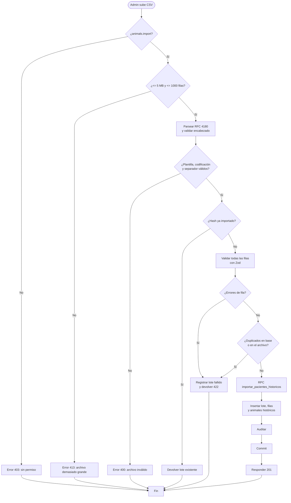
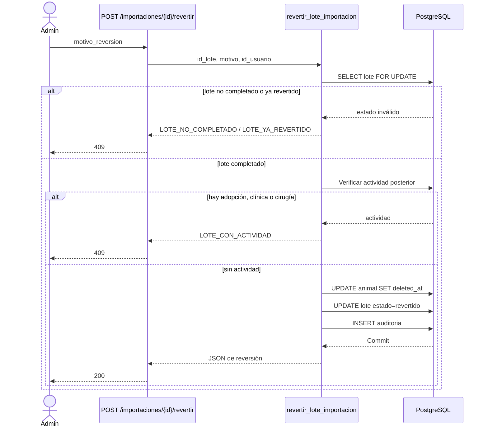
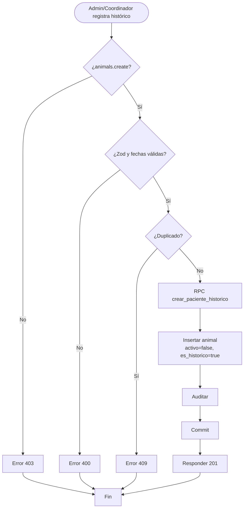
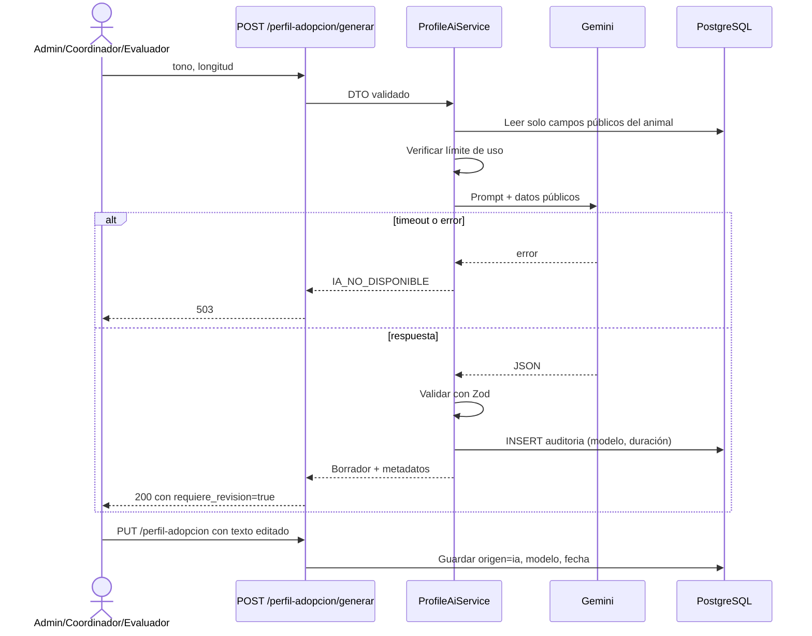
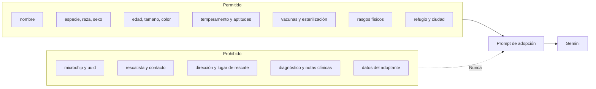

# Requerimiento 08 — Épica 8: Migración de Datos Históricos

## Título

Importación masiva y registro manual de pacientes históricos, y generación asistida por IA de perfiles de adopción con revisión humana en los refugios Pixkki.

## Descripción

La Épica 8 resuelve la incorporación de información que existía antes de Pixkki y mejora la redacción de los perfiles de adopción:

1. **Importación masiva (US24)**: el refugio sube un CSV con pacientes históricos, el sistema valida el archivo completo, detecta duplicados y crea los expedientes en una sola transacción. Si una fila falla, no se importa ninguna y se devuelve el detalle del error.
2. **Registro manual simplificado (US25)**: el mismo conjunto mínimo de datos se captura en un formulario de una pantalla, sin pasar por cuarentena y sin exigir espacio físico ni estado operativo.
3. **Generación de perfiles con IA (US26)**: a partir de los datos públicos del animal, un modelo redacta un borrador de descripción de adopción. El borrador nunca se publica solo: el usuario lo revisa, lo edita y lo guarda con el flujo normal de la Épica 5.

El módulo `imports` es dueño de los lotes de importación y de su reversión. El módulo `animals` es dueño del expediente histórico y de la marca `es_historico`. El módulo `adoptions` es dueño del perfil y de la descripción generada. El cliente de IA se comparte con `campaigns` mediante un transporte común, sin acoplar ambos dominios.

> **Principio rector:** un dato histórico es un dato declarado, no un dato inventado. Lo que el archivo no trae queda nulo y se muestra como “no registrado”; nunca se rellena con valores plausibles. La IA redacta, la persona decide.

## Objetivo

Proveer las capacidades para:

1. Importar pacientes históricos desde un CSV con plantilla fija y validación completa.
2. Rechazar el lote entero si alguna fila es inválida, con un reporte de errores por fila y columna.
3. Detectar duplicados por microchip, `uuid` o combinación de nombre, especie y fecha de ingreso.
4. Registrar manualmente un paciente histórico con los mismos campos mínimos.
5. Marcar los pacientes históricos como inactivos y fuera de la población activa, el catálogo y los conteos operativos.
6. Revertir un lote de importación con baja lógica y auditoría.
7. Generar un borrador de descripción de adopción con IA a partir de datos públicos.
8. Exigir revisión humana antes de guardar o publicar el texto generado.
9. Impedir que datos sensibles o personales lleguen al proveedor de IA.
10. Auditar importaciones, reversiones y generaciones sin almacenar contenido sensible.
11. Dejar trazabilidad del origen del perfil: manual o asistido por IA.

## Alcance

Incluye:

- RF8.1: Plantilla CSV, carga, parseo y validación de pacientes históricos (US24).
- RF8.2: Importación atómica por lote y reporte de errores (US24).
- RF8.3: Detección de duplicados y bloqueo del lote (US24).
- RF8.4: Consulta y reversión de lotes de importación (US24).
- RF8.5: Registro manual simplificado de paciente histórico (US25).
- RF8.6: Generación de borrador de perfil de adopción con IA (US26).
- RF8.7: Revisión humana, edición y guardado del borrador (US26).
- RF8.8: Auditoría y trazabilidad del origen del perfil.

No incluye:

- Importación de fotografías, documentos, historias clínicas, vacunas, cirugías o movimientos de inventario.
- Importación de donantes, donaciones, adoptantes, solicitudes o inventario.
- Importación de campañas, eventos o usuarios.
- Edición masiva posterior a la importación.
- Sincronización periódica con sistemas externos, API de terceros o ETL.
- Formatos Excel (`.xlsx`), JSON, XML o bases de datos.
- Mapeo configurable de columnas por refugio.
- Publicación automática de perfiles generados por IA.
- Entrenamiento de modelos, fine-tuning o modelos propios.
- Generación de imágenes, videos o audio.
- Moderación automática avanzada de contenido generado.
- Firma digital, contratos o consentimientos.
- Eliminación física de animales importados.
- Reversión selectiva por fila.

## Actores

| Actor | Descripción |
|-------|-------------|
| Administrador de refugio | Rol `admin`/`Administrador`. Importa lotes, los revierte, registra pacientes históricos y genera perfiles con IA. |
| Coordinador | Rol `coordinador`. Registra pacientes históricos y genera perfiles con IA; no importa lotes ni los revierte. |
| Evaluador | Rol `evaluador`. Genera borradores de perfil con IA y los revisa; no importa ni registra históricos. |
| Veterinario | Rol `veterinario`. Consulta los pacientes históricos y su expediente; no importa ni genera perfiles. |
| Operador | Rol `operador`. Consulta pacientes históricos; no muta. |
| Superadmin | Rol global. Opera sobre cualquier refugio según la política de la Épica 0; conserva el `id_refugio` del recurso. |
| Sistema | Parsea el CSV, valida filas, detecta duplicados, ejecuta la importación, revierte lotes, invoca la IA y audita. |
| Proveedor de IA | Servicio externo (Gemini) que recibe únicamente datos públicos y devuelve un texto. |

## Reglas de negocio

### Plantilla y archivo CSV (RF8.1)

1. **Plantilla fija**: el archivo debe tener exactamente las columnas de la plantilla, en cualquier orden. Un encabezado faltante o desconocido devuelve `400 PLANTILLA_INVALIDA` con la lista de columnas esperadas.
2. **Codificación**: UTF-8 con o sin BOM. Un archivo en otra codificación se rechaza con `400 CODIFICACION_INVALIDA`.
3. **Separador**: coma. Un archivo separado por punto y coma se rechaza con `400 SEPARADOR_INVALIDO`.
4. **Tamaño**: máximo 1000 filas de datos y 5 MB. Al superarlo se devuelve `413 ARCHIVO_DEMASIADO_GRANDE`.
5. **Una fila por paciente**: no se admiten filas vacías intermedias. Una fila completamente vacía se rechaza con `400 FILA_VACIA`.
6. **Sin fotos ni adjuntos**: el CSV no incluye imágenes. Las fotos se cargan después con los endpoints existentes del expediente.
7. **Valores booleanos**: se aceptan `true`, `false`, `1`, `0`, `si`, `no`, `sí`, `no` (sin distinción de mayúsculas). Cualquier otro valor es error de fila.
8. **Fechas**: `YYYY-MM-DD`. Una fecha inválida es error de fila.
9. **Sin fórmulas**: una celda que empiece con `=`, `+`, `-` o `@` se rechaza con `400 CONTENIDO_PELIGROSO` para evitar inyección.
10. **Parseo RFC 4180**: se admiten comillas dobles, comas y saltos de línea dentro de campos entrecomillados. Un entrecomillado mal cerrado invalida el archivo.

### Columnas de la plantilla (US24 / US25)

| Columna | Obligatoria | Tipo | Regla |
|---------|-------------|------|-------|
| `nombre` | No | Texto 1–100 | Si falta, se guarda como `null`. |
| `especie` | Sí | `Perro`/`Gato` | Debe coincidir con el `CHECK` del esquema. |
| `raza` | No | Texto 1–100 | — |
| `sexo` | No | `M`/`H` | Coincide con el `CHECK` del esquema. |
| `edad_estimada` | No | Entero 0–40 | Años estimados. |
| `tamano` | No | `Pequeño`/`Mediano`/`Grande` | Coincide con el `CHECK`. |
| `color` | No | Texto 1–50 | — |
| `temperamento` | No | Texto 1–50 | — |
| `fecha_ingreso` | Sí | Fecha | No futura. |
| `fecha_egreso` | No | Fecha | No futura y mayor o igual a `fecha_ingreso`. |
| `motivo_egreso` | No | `adopcion`/`fallecimiento`/`traslado`/`devolucion`/`otro` | Por defecto `otro`. |
| `esterilizado` | No | Booleano | Por defecto `false`. |
| `vacunado` | No | Booleano | Por defecto `false`. |
| `desparasitado` | No | Booleano | Por defecto `false`. |
| `microchip` | No | Texto 1–50 | Único en el refugio si existe. |
| `uuid` | No | Texto 1–64 | Único en el refugio si existe. |
| `rasgos_fisicos` | No | Texto 1–2000 | Si falta, queda `null`. |
| `procedencia` | No | Texto 1–255 | Si falta, queda `null`. |
| `lugar_rescate` | No | Texto 1–500 | Dato interno; no se publica. |
| `fecha_rescate` | No | Fecha | No futura. |
| `situacion_rescate` | No | Texto 1–100 | — |
| `observaciones` | No | Texto 1–2000 | Dato interno; no se publica. |

> Las columnas marcadas como opcionales pueden venir vacías. Un campo vacío se interpreta como `null`, nunca como cadena vacía.

### Validación e importación atómica (RF8.2)

11. **Validación previa completa**: el servidor parsea y valida todas las filas antes de escribir. No hay escritura parcial.
12. **Todo o nada**: si una sola fila falla, el lote queda en estado `fallido`, no se crea ningún animal y se devuelve `422 IMPORTACION_CON_ERRORES` con el detalle.
13. **Errores por fila y columna**: cada error incluye `fila`, `columna`, `codigo` y `mensaje` en español. Se devuelven como máximo 100 errores; si hay más, se indica el total.
14. **Límite de errores**: con más de 100 errores, el lote se rechaza sin procesar el resto y se pide corregir el archivo.
15. **Sin cuarentena**: un paciente histórico no pasa por cuarentena. Se crea con `en_cuarentena = false`.
16. **Inactivo y marcado**: se crea con `activo = false` y `es_historico = true`.
17. **Sin espacio ni estado operativo**: `id_espacio` e `id_estado` quedan nulos para históricos. La restricción se relaja con un `CHECK` que exige ambos para los animales no históricos.
18. **Fecha de ingreso obligatoria**: es la base del expediente y del reporte de población. Sin ella, la fila es inválida.
19. **Egreso coherente**: si hay `fecha_egreso`, debe ser mayor o igual a `fecha_ingreso` y no futura. Si no hay `fecha_egreso`, el animal histórico queda como “sin fecha de egreso” y se informa en los reportes.
20. **Motivo de egreso**: si no se declara, se usa `otro`. Un motivo desconocido es error de fila.
21. **Estados y espacios**: el histórico no consume plazas ni aparece en la ocupación. No se le asigna espacio.
22. **Auditoría**: la importación escribe una fila en `auditoria` con `accion = 'importacion_pacientes_historicos'`, `modulo = 'imports'`, `entidad_id = id_lote`, usuario y conteos. No registra datos personales ni clínicos.
23. **Idempotencia de archivo**: se calcula el hash SHA-256 del archivo. Si el mismo refugio vuelve a subir el mismo hash y el lote anterior está `completado`, se devuelve el lote existente con `200` en lugar de duplicar (`409 IMPORTACION_DUPLICADA` si se fuerza).

### Duplicados (RF8.3)

24. **Orden de detección**: primero `microchip`, luego `uuid`, luego `(lower(nombre), especie, fecha_ingreso)`.
25. **Contra la base y contra el archivo**: un duplicado puede estar ya en el refugio o repetirse dentro del mismo CSV. Ambos casos bloquean el lote.
26. **Duplicado bloquea, no actualiza**: la importación nunca modifica un animal existente. Se devuelve `409 PACIENTE_DUPLICADO` con la fila, la clave y el `id_animal` existente.
27. **Microchip y `uuid` únicos**: se refuerzan con índices únicos parciales por refugio cuando el valor no es nulo.
28. **Nombre nulo**: si `nombre` es nulo, la clave de nombre no aplica; la detección se limita a microchip y `uuid`.

### Lotes y reversión (RF8.4)

29. **Lote identificable**: cada intento de importación crea un `lote_importacion` con `id_lote`, refugio, usuario, nombre de archivo, hash, total de filas, estado y fechas.
30. **Estados del lote**: `procesando`, `completado`, `fallido`, `revertido`.
31. **Detalle del lote**: cada fila se guarda en `lote_importacion_fila` con número, datos crudos normalizados, estado (`importada`/`error`), `id_animal` y errores. Los datos se conservan para trazabilidad y se eliminan lógicamente al revertir.
32. **Reversión completa**: un Administrador puede revertir un lote `completado`. Se aplica baja lógica (`deleted_at`) a los animales creados, se marca el lote `revertido` y se audita con motivo obligatorio de 10–500 caracteres.
33. **Reversión bloqueada por actividad**: si algún animal del lote tiene adopción, eventos clínicos, cirugías o movimientos posteriores, la reversión se rechaza con `409 LOTE_CON_ACTIVIDAD` y se listan los animales afectados. Se resuelve individualmente.
34. **Sin borrado físico**: la reversión nunca elimina filas de `animal`; conserva el expediente para auditoría.
35. **Reversión única**: un lote `revertido` no se revierte dos veces (`409 LOTE_YA_REVERTIDO`).
36. **Lote fallido**: no se revierte porque no creó animales; solo se consulta.

### Registro manual (RF8.5)

37. **Mismos campos**: el formulario manual acepta exactamente las columnas de la plantilla, con las mismas validaciones.
38. **Sin archivo**: no requiere CSV ni hash. Se registra un animal histórico individual.
39. **Mismas garantías**: `activo = false`, `es_historico = true`, sin cuarentena, sin espacio y sin estado operativo.
40. **Duplicados**: aplica la misma detección contra la base. Un duplicado devuelve `409 PACIENTE_DUPLICADO`.
41. **Auditoría**: cada registro manual escribe en `auditoria` con `accion = 'paciente_historico_creado'`, `modulo = 'animals'` y `entidad_id = id_animal`.
42. **Corrección**: un histórico se edita con el flujo normal del expediente; no se reimporta.

### Generación con IA (RF8.6)

43. **Borrador, no publicación**: la IA devuelve un texto que el cliente muestra para revisión. No se guarda ni se publica automáticamente.
44. **Entrada mínima**: el endpoint recibe `id_animal`, `tono` opcional (`cercano`, `emotivo`, `divertido`, `formal`) y `longitud` opcional (`corta`, `media`). Todo lo demás se resuelve en el servidor.
45. **Solo datos públicos**: se envían nombre, especie, raza, sexo, edad estimada, tamaño, color, temperamento, rasgos físicos, vacunado, desparasitado, esterilizado, compatibilidad vigente y nombre/ciudad del refugio.
46. **Datos prohibidos**: nunca se envían microchip, `uuid`, procedencia, lugar o fecha de rescate, rescatista, observaciones, peso, diagnóstico, notas clínicas, fotos, datos del adoptante ni identificadores internos.
47. **Sin invención**: el prompt prohíbe inventar edad, salud, historia, personalidad o cualquier detalle ausente. Los datos del animal se tratan como datos, no como instrucciones.
48. **Sin promesas**: el texto no puede afirmar “totalmente sano”, “nunca muerde”, “perfecto con niños” ni garantías similares.
49. **Longitud**: la descripción generada tiene entre 50 y 2000 caracteres, alineada con `perfil_adopcion.descripcion_publica`.
50. **Idioma**: español.
51. **Validación de salida**: la respuesta del modelo se valida con Zod. Un JSON inválido, un texto fuera de rango o un campo faltante devuelve `502 IA_RESPUESTA_INVALIDA`.
52. **Proveedor**: se reutiliza Gemini con las variables `GEMINI_API_KEY` y `GEMINI_MODEL`. El transporte se comparte con `campaigns`; el prompt y el dominio son propios de adopciones.
53. **Timeout y reintentos**: tiempo máximo de 20 segundos y un reintento ante error de red. Un fallo persistente devuelve `503 IA_NO_DISPONIBLE` y el usuario puede redactar manualmente.
54. **Límite de uso**: máximo 10 generaciones por usuario por hora y 100 por refugio por día. Al superarlo se devuelve `429 LIMITE_IA`.
55. **Costo y registro**: cada generación escribe en `auditoria` con `accion = 'perfil_ia_generado'`, modelo, duración y longitud del texto. No guarda el contenido generado.
56. **Revisión obligatoria**: guardar el texto exige el `PUT /perfil-adopcion` de la Épica 5. Al guardar, `perfil_adopcion.origen_descripcion = 'ia'`, `ia_modelo` y `ia_generada_en` quedan registrados; si el usuario edita el texto, se conserva el origen y se marca `ia_editada = true`.
57. **Publicación**: sigue las reglas de la Épica 5. La IA no altera el *gatekeeper*, ni la aptitud, ni el estado de publicación.
58. **Sin IA para históricos inactivos**: solo se genera perfil para animales activos y no eliminados. Un histórico inactivo devuelve `409 ANIMAL_NO_DISPONIBLE`.
59. **Sin datos del adoptante**: el prompt no recibe información de solicitantes ni de terceros.

### Transversales

60. **RBAC**: `animals.import` (importar y revertir), `animals.create` (registro manual), `adoptions.ai` (generar borrador), `adoptions.publish` (guardar y publicar). El detalle está en la matriz de permisos.
61. **Multitenant**: toda operación filtra por `id_refugio`. Un lote, animal o perfil de otro refugio se responde como `404`.
62. **Auditoría**: importaciones, reversiones, registros manuales y generaciones se auditan. No se guardan datos clínicos ni personales en la descripción de auditoría.
63. **Sin efectos en población activa**: los históricos no cuentan en población activa, ocupación, catálogo público ni campañas.
64. **Reportes**: los históricos aparecen en los flujos del periodo si su `fecha_ingreso` cae en el rango, pero no en la población activa.
65. **Accesibilidad**: los errores de importación se muestran con fila, columna y texto explícito, no solo con color.

## Supuestos funcionales (pendientes de validación)

| ID | Supuesto | Impacto si cambia |
|----|----------|-------------------|
| S1 | El histórico se modela como `activo = false` + `es_historico = true`, sin espacio ni estado operativo. | Cambia la migración, los reportes y el catálogo. |
| S2 | `id_espacio`, `id_estado`, `procedencia`, `rasgos_fisicos` y `estado_inicial` se vuelven nullable para históricos, con `CHECK` para no históricos. | Si se prefiere un espacio/estado “histórico” por refugio, cambia el modelo. |
| S3 | La importación es todo o nada por lote. | Si se requiere carga parcial, cambia la transacción y el contrato. |
| S4 | El máximo es 1000 filas y 5 MB. | Cambia la validación y el rendimiento. |
| S5 | La plantilla es fija y no configurable. | Si se requiere mapeo, cambia el parser y el contrato. |
| S6 | Los duplicados se detectan por microchip, `uuid` y nombre + especie + fecha de ingreso. | Cambia la clave y el bloqueo. |
| S7 | Un duplicado bloquea el lote; no actualiza el existente. | Si se permite actualizar, cambia la semántica y la auditoría. |
| S8 | La reversión aplica baja lógica y se bloquea si hay actividad posterior. | Si se permite revertir con actividad, se pierde trazabilidad. |
| S9 | El registro manual usa exactamente los mismos campos que el CSV. | Cambia el formulario y la validación. |
| S10 | La IA genera solo un borrador; nunca guarda ni publica. | Cambia el flujo y los permisos. |
| S11 | Se reutiliza Gemini con el transporte del módulo `campaigns`. | Si se usa otro proveedor, cambia el cliente y las variables. |
| S12 | La generación se limita a 10 por usuario/hora y 100 por refugio/día. | Cambia el control de abuso y el costo. |
| S13 | `perfil_adopcion` existe por la Épica 5; si no, US26 no puede guardar. | La generación podría devolverse sin persistencia, pero no habría perfil. |
| S14 | La importación no trae fotos, vacunas, cirugías ni historia clínica. | Si se requiere, cambia el alcance y el formato. |
| S15 | El CSV se parsea con un parser RFC 4180 interno, sin dependencias nuevas. | Si se usa una librería, requiere aprobación de dependencia. |
| S16 | El hash del archivo evita reimportaciones idénticas. | Si se permite reimportar, cambia la idempotencia. |
| S17 | Los históricos no aparecen en el catálogo público ni en campañas. | Cambia la vista pública y el puerto de adopción. |
| S18 | El motivo de egreso se comparte con la Épica 7 (`fecha_egreso`/`motivo_egreso`). | Si no se aplica, el histórico queda sin fecha de egreso. |

> **Decisión pendiente de aprobación:** agregar `es_historico` y relajar `NOT NULL` en `animal`; crear `lote_importacion` y `lote_importacion_fila`; ampliar `perfil_adopcion` con el origen y metadatos de IA; compartir el transporte de Gemini; crear las RPC de importación, reversión y registro histórico; y sembrar los permisos `animals.import` y `adoptions.ai` son cambios de base de datos y de arquitectura. Requieren aprobación previa y migración versionada.

## Inconsistencias y alineación con el estado actual del repositorio

| Elemento | Estado actual | Implicación para esta épica |
|----------|---------------|-----------------------------|
| `animal.id_espacio` | `NOT NULL`, sin FK visible en el esquema base. | Un histórico no tiene espacio; requiere relajación con `CHECK`. |
| `animal.id_estado` | `NOT NULL`. | Un histórico no tiene estado operativo; requiere relajación. |
| `animal.procedencia`, `rasgos_fisicos`, `estado_inicial` | `NOT NULL`. | Un CSV incompleto no puede cumplirlos; requiere relajación o valores declarados. |
| `animal.activo` | Booleano sin marca de histórico. | Requiere `es_historico` para excluirlo de conteos sin confundirlo con una baja. |
| `animal.motivo_egreso` / `fecha_egreso` | No existen; los propone la Épica 7. | La importación los usa si están; si no, el histórico queda sin fecha de egreso. |
| `animal_estado` | Catálogo sin datos semilla. | No se usa para históricos; los activos siguen dependiendo del catálogo. |
| `lote_importacion` | No existe. | Requiere creación. |
| `modules/imports` | No existe. | Se crea el módulo con parser, validadores, services y factories. |
| `modules/campaigns/ai/gemini-client.ts` | Cliente específico de campañas, con prompt y validación propios. | Se extrae el transporte a un módulo compartido; el prompt de adopciones es distinto. |
| `perfil_adopcion` | No existe; lo propone la Épica 5. | US26 depende de su creación. |
| `adoptions` | Módulo propuesto por la Épica 5. | US26 agrega un endpoint de generación y campos de origen. |
| `animals` | No tiene operación de alta histórica. | Se agrega `POST /animales/historicos` y la RPC correspondiente. |
| Permisos | No existen `animals.import` ni `adoptions.ai`. | Requiere siembra y asignación. |
| `auditoria` | Existe con `modulo`, `accion`, `entidad_id`, `id_usuario`, `id_refugio`. | Se usa para lotes, reversiones y generaciones. |
| `types/database.ts` | No incluye las tablas ni los campos nuevos. | Debe regenerarse después de aplicar la migración. |
| UI de importación | No existe. | Fuera de alcance; el backend se implementa primero. |
| UI de perfil con IA | No existe. | Fuera de alcance; el frontend consume el borrador. |
| `GEMINI_API_KEY` / `GEMINI_MODEL` | Usadas por `campaigns`. | Se reutilizan; no se crean variables nuevas. |

## Historias de usuario

| ID | Historia de Usuario | Prioridad | Épica | RF relacionados |
|----|---------------------|-----------|-------|-----------------|
| US24 | Importación masiva de pacientes históricos (CSV) | Could Have | Épica 8 | RF8.1, RF8.2, RF8.3, RF8.4 |
| US25 | Registro manual simplificado de pacientes históricos | Could Have | Épica 8 | RF8.5 |
| US26 | Generación automatizada de perfiles de adopción mediante IA | Could Have | Épica 8 | RF8.6, RF8.7, RF8.8 |

## Contrato de API

Los endpoints siguen el patrón `/api/v1/<recurso>`. La validación de entrada se hace con Zod antes de cualquier efecto. Los errores usan el envelope uniforme.

### Formato de respuesta de éxito

```json
{
  "success": true,
  "data": { ... }
}
```

### Formato de error uniforme

```json
{
  "success": false,
  "error": {
    "code": "ERROR_CODIGO",
    "message": "Mensaje en español para el usuario final",
    "statusCode": 400,
    "details": { ... }
  }
}
```

### RF8.1 / RF8.2 / RF8.3 — Importación CSV (US24)

| Método | Ruta | Descripción | Acceso |
|--------|------|-------------|--------|
| GET | `/api/v1/importaciones/plantilla` | Descargar la plantilla CSV | `animals.import` |
| POST | `/api/v1/importaciones/pacientes-historicos` | Subir y procesar un lote | `animals.import` |
| GET | `/api/v1/importaciones` | Listar lotes del refugio | `animals.import` |
| GET | `/api/v1/importaciones/{id}` | Detalle del lote y errores | `animals.import` |
| POST | `/api/v1/importaciones/{id}/revertir` | Revertir un lote completado | `animals.import` |

**Request (POST):** `multipart/form-data` con `archivo` (CSV, máx. 5 MB).

**Response (201):**

```json
{
  "success": true,
  "data": {
    "id_lote": 12,
    "estado": "completado",
    "nombre_archivo": "pacientes-historicos-2026-11.csv",
    "hash_archivo": "9f2c...",
    "total_filas": 42,
    "filas_importadas": 42,
    "filas_con_error": 0,
    "errores": [],
    "id_usuario": 9,
    "fecha_proceso": "2026-11-16T14:00:00Z",
    "auditoria_id": 1201
  }
}
```

**Response (422) — lote rechazado:**

```json
{
  "success": false,
  "error": {
    "code": "IMPORTACION_CON_ERRORES",
    "message": "El archivo contiene errores y no se importó ningún paciente.",
    "statusCode": 422,
    "details": {
      "id_lote": 13,
      "total_filas": 42,
      "filas_con_error": 3,
      "errores": [
        {
          "fila": 5,
          "columna": "especie",
          "codigo": "ESPECIE_INVALIDA",
          "mensaje": "La especie debe ser Perro o Gato."
        },
        {
          "fila": 12,
          "columna": "fecha_ingreso",
          "codigo": "FECHA_INVALIDA",
          "mensaje": "La fecha debe tener formato YYYY-MM-DD y no puede ser futura."
        },
        {
          "fila": 20,
          "columna": "microchip",
          "codigo": "PACIENTE_DUPLICADO",
          "mensaje": "El microchip ya existe en el paciente 45."
        }
      ]
    }
  }
}
```

**Response (GET `/importaciones/{id}`):**

```json
{
  "success": true,
  "data": {
    "id_lote": 12,
    "estado": "completado",
    "total_filas": 42,
    "filas_importadas": 42,
    "filas_con_error": 0,
    "creado_en": "2026-11-16T14:00:00Z",
    "revertido_en": null,
    "motivo_reversion": null,
    "filas": [
      {
        "numero_fila": 1,
        "estado": "importada",
        "id_animal": 301,
        "errores": []
      }
    ]
  }
}
```

**Response (POST `/importaciones/{id}/revertir`):**

```json
{
  "success": true,
  "data": {
    "id_lote": 12,
    "estado": "revertido",
    "animales_dados_de_baja": 42,
    "motivo_reversion": "El archivo correspondía a otro refugio.",
    "revertido_en": "2026-11-16T15:00:00Z",
    "auditoria_id": 1210
  }
}
```

**Errores:**

- `400` — `PLANTILLA_INVALIDA`, `CODIFICACION_INVALIDA`, `SEPARADOR_INVALIDO`, `FILA_VACIA`, `CONTENIDO_PELIGROSO`, `MOTIVO_REQUERIDO`
- `403` — `ROL_SIN_PERMISO`
- `404` — `LOTE_NO_ENCONTRADO`
- `409` — `IMPORTACION_DUPLICADA`, `PACIENTE_DUPLICADO`, `LOTE_CON_ACTIVIDAD`, `LOTE_YA_REVERTIDO`, `LOTE_NO_COMPLETADO`
- `413` — `ARCHIVO_DEMASIADO_GRANDE`
- `422` — `IMPORTACION_CON_ERRORES`
- `500` — `FALLO_TRANSACCION_IMPORTACION`

### RF8.5 — Registro manual de histórico (US25)

| Método | Ruta | Descripción | Acceso |
|--------|------|-------------|--------|
| POST | `/api/v1/animales/historicos` | Registrar un paciente histórico | `animals.create` |

**Request:**

```json
{
  "nombre": "Toby",
  "especie": "Perro",
  "raza": "Mestizo",
  "sexo": "M",
  "edad_estimada": 6,
  "tamano": "Mediano",
  "color": "Café",
  "temperamento": "Tranquilo",
  "fecha_ingreso": "2019-04-10",
  "fecha_egreso": "2020-01-15",
  "motivo_egreso": "adopcion",
  "esterilizado": true,
  "vacunado": true,
  "desparasitado": true,
  "microchip": null,
  "uuid": null,
  "rasgos_fisicos": "Pelaje café, orejas caídas.",
  "procedencia": "Rescate en la colonia Centro.",
  "lugar_rescate": null,
  "fecha_rescate": "2019-04-01",
  "situacion_rescate": "Abandonado",
  "observaciones": "Expediente migrado del sistema anterior."
}
```

**Response (201):**

```json
{
  "success": true,
  "data": {
    "id_animal": 302,
    "id_refugio": 7,
    "es_historico": true,
    "activo": false,
    "en_cuarentena": false,
    "id_espacio": null,
    "id_estado": null,
    "fecha_ingreso": "2019-04-10",
    "fecha_egreso": "2020-01-15",
    "motivo_egreso": "adopcion",
    "auditoria_id": 1215
  }
}
```

**Errores:**

- `400` — `DATOS_INVALIDOS`, `FECHA_INVALIDA`
- `403` — `ROL_SIN_PERMISO`
- `409` — `PACIENTE_DUPLICADO`
- `500` — `ERROR_INTERNO`

### RF8.6 / RF8.7 — Generación de perfil con IA (US26)

| Método | Ruta | Descripción | Acceso |
|--------|------|-------------|--------|
| POST | `/api/v1/animales/{id}/perfil-adopcion/generar` | Generar borrador de descripción | `adoptions.ai` |

**Request:**

```json
{
  "tono": "cercano",
  "longitud": "media"
}
```

**Response (200):**

```json
{
  "success": true,
  "data": {
    "id_animal": 45,
    "descripcion": "Mango es un perro sociable y juguetón que disfruta de los paseos diarios. Se lleva bien con otros perros y busca una familia responsable que le dé tiempo y espacio para jugar.",
    "tono": "cercano",
    "longitud": "media",
    "modelo": "gemini-3.6-flash",
    "caracteres": 198,
    "duracion_ms": 1840,
    "requiere_revision": true,
    "auditoria_id": 1220
  }
}
```

> El texto **no se guarda** en este endpoint. Para persistirlo, el cliente llama a `PUT /api/v1/animales/{id}/perfil-adopcion` de la Épica 5 con la descripción editada.

**Errores:**

- `400` — `DATOS_INVALIDOS`, `TONO_INVALIDO`, `LONGITUD_INVALIDA`
- `403` — `ROL_SIN_PERMISO`
- `404` — `ANIMAL_NO_ENCONTRADO`
- `409` — `ANIMAL_NO_DISPONIBLE`
- `429` — `LIMITE_IA`
- `502` — `IA_RESPUESTA_INVALIDA`
- `503` — `IA_NO_DISPONIBLE`
- `500` — `ERROR_INTERNO`

## Plan de implementación backend-first

| Paso | Acción | Artefacto |
|------|--------|-----------|
| 1 | Ampliar el contrato OpenAPI de importaciones y adopciones | `modules/imports/contracts/openapi.yaml`, `modules/adoptions/contracts/openapi.yaml` |
| 2 | Extraer el transporte de Gemini a un módulo compartido | `lib/ai/gemini.ts` (o `modules/ai/`) |
| 3 | Definir schemas Zod de fila CSV, registro manual y generación IA | `modules/imports/validators/`, `modules/adoptions/validators/` |
| 4 | Implementar el parser RFC 4180 y la plantilla | `modules/imports/csv/` |
| 5 | Definir DTOs derivados con `z.infer` | `modules/imports/dtos/`, `modules/adoptions/dtos/` |
| 6 | Definir errores de dominio y permisos | `modules/imports/errors.ts`, `modules/animals/errors.ts`, `modules/adoptions/access.ts` |
| 7 | Implementar repositories con filtro `id_refugio` | `modules/imports/repositories/` |
| 8 | Implementar services con validación, duplicados y reversión | `modules/imports/services/` |
| 9 | Implementar el servicio de generación IA | `modules/adoptions/services/profile-ai.service.ts` |
| 10 | Implementar factories | `modules/imports/factories/`, `modules/adoptions/factories/` |
| 11 | Crear y aplicar migración versionada | `supabase/migrations/YYYYMMDDHHMMSS_requerimiento_08_datos_historicos.sql` |
| 12 | Regenerar tipos | `npm run db:types` |
| 13 | Implementar Route Handlers | `app/api/v1/importaciones/`, `app/api/v1/animales/historicos/`, `app/api/v1/animales/[id]/perfil-adopcion/generar/` |
| 14 | Pruebas aisladas del backend | Equipo de QA (externo a este documento) |
| 15 | Ampliar contrato v1 | Tag git `api-v1.8` |
| 16 | Frontend consume el contrato vía Server Actions | Server Actions como adaptador (fuera de alcance de esta entrega) |

## Riesgos y dependencias

| Riesgo | Mitigación |
|--------|------------|
| Importación parcial con datos inconsistentes | Validar todo antes de escribir y ejecutar una sola transacción. |
| CSV malformado o con fórmulas | Parser RFC 4180, rechazo de celdas peligrosas y límite de tamaño. |
| Duplicados silenciosos | Detección por microchip, `uuid` y nombre + especie + fecha; bloqueo con detalle. |
| Históricos contados como población activa | `activo = false` + `es_historico = true`; filtros en reportes y catálogo. |
| Históricos sin espacio ni estado | Relajar `NOT NULL` con `CHECK` para no históricos. |
| Reversión que borra datos reales | Baja lógica, bloqueo por actividad posterior y auditoría con motivo. |
| Reimportación accidental | Hash SHA-256 y detección de lote completado. |
| Archivo enorme bloquea el servidor | Límite de 5 MB y 1000 filas; rechazo temprano. |
| Datos sensibles enviados a la IA | Lista blanca de campos públicos y prueba negativa en QA. |
| IA inventa datos | Prompt restrictivo, validación de salida y revisión humana obligatoria. |
| IA publica sin revisión | El endpoint solo devuelve el borrador; nunca escribe el perfil. |
| Prompt injection desde datos del animal | Tratar los datos como información, no como instrucciones; mismo patrón que `campaigns`. |
| Costo descontrolado de IA | Límites por usuario y refugio, timeout y auditoría de uso. |
| Fuga de datos entre tenants | `id_refugio` en lote, animal y perfil; RLS y filtros en repositories. |
| Dependencia de la Épica 5 | `perfil_adopcion` debe existir; si no, US26 se bloquea. |
| Dependencia de la Épica 7 | `fecha_egreso`/`motivo_egreso`; si no, el histórico queda sin fecha de egreso. |
| Acoplamiento entre `campaigns` y `adoptions` | Transporte compartido, prompts y validaciones separados por dominio. |
| `types/database.ts` desactualizado | Aplicar migración y ejecutar `npm run db:types`; no editar tipos a mano. |
| Superadmin sin refugio propio | Usar el `id_refugio` del recurso y validar el alcance global. |

**Dependencias:** Épica 0 (autenticación y RBAC), Épica 1 (`animal` y expediente), Épica 3 (temperamento y compatibilidad), Épica 5 (`perfil_adopcion` y publicación), Épica 7 (`fecha_egreso`/`motivo_egreso`), módulo `campaigns` (cliente Gemini), Supabase/PostgreSQL, Zod y el equipo de QA para pruebas aisladas.

## Glosario

| Término | Definición |
|---------|------------|
| Paciente histórico | Animal que existió en el refugio antes de Pixkki y se registra sin pasar por cuarentena. |
| `es_historico` | Marca que distingue un histórico de una baja operativa. |
| Lote de importación | Conjunto de filas procesadas en una sola carga, con estado y trazabilidad. |
| Todo o nada | Estrategia en la que una sola fila inválida impide toda la importación. |
| Plantilla fija | Conjunto cerrado de columnas del CSV. |
| RFC 4180 | Estándar de formato CSV que define comillas, comas y saltos de línea. |
| Hash del archivo | Huella SHA-256 que identifica una carga y evita duplicados. |
| Reversión | Baja lógica de los animales creados por un lote, con auditoría. |
| Duplicado | Paciente que ya existe por microchip, `uuid` o combinación de nombre, especie y fecha. |
| Borrador IA | Texto generado por el modelo que requiere revisión humana antes de guardarse. |
| Prompt | Instrucción enviada al modelo de IA. |
| Lista blanca | Conjunto explícito de campos permitidos hacia el proveedor de IA. |
| Prompt injection | Intento de usar datos del usuario para alterar las instrucciones del modelo. |
| Origen del perfil | Marca que indica si la descripción fue manual o asistida por IA. |
| RLS | *Row Level Security*: segunda capa de defensa multitenant. |
| RPC | Función de base de datos ejecutada de forma transaccional. |
| RBAC | Control de acceso basado en roles. |
| DoR / DoD | Definition of Ready / Definition of Done. |

## Diagramas de flujo (mermaid)

### Importación de pacientes históricos (RF8.1–RF8.4)



### Reversión de lote (RF8.4)



### Registro manual de histórico (RF8.5)



### Generación de perfil con IA (RF8.6 / RF8.7)



### Frontera de datos hacia la IA (RF8.6)



## Criterios de aceptación por historia de usuario

| US | Criterios de aceptación |
|----|------------------------|
| US24 | Un Administrador descarga la plantilla y sube un CSV UTF-8 de hasta 1000 filas y 5 MB con las columnas documentadas. El sistema valida encabezado, codificación, separador, tipos, fechas, enums, booleanos y contenido peligroso. Si una sola fila falla, no se importa ninguna y se devuelve `422` con fila, columna, código y mensaje en español. Los duplicados por microchip, `uuid` o nombre + especie + fecha bloquean el lote y señalan el paciente existente. Un archivo idéntico ya importado devuelve el lote existente. El lote completado crea pacientes con `activo = false`, `es_historico = true`, sin cuarentena, sin espacio y sin estado. El detalle del lote lista las filas y sus errores. Un Administrador revierte el lote con motivo: los animales se dan de baja lógica, el lote queda `revertido` y se audita; si hay actividad posterior, la reversión se rechaza. Un Coordinador recibe `403`. |
| US25 | Un Administrador o Coordinador registra un paciente histórico con los mismos campos y validaciones del CSV, sin archivo. Se crea inactivo y marcado como histórico, sin cuarentena ni espacio. Un duplicado responde `409`. El registro queda auditado con usuario, refugio y animal. El paciente no aparece en población activa, ocupación, catálogo público ni campañas. |
| US26 | Un Administrador, Coordinador o Evaluador solicita un borrador de descripción para un animal activo y disponible. El servidor envía únicamente datos públicos al proveedor, con un prompt que prohíbe inventar y prometer. La respuesta se valida con Zod y devuelve un texto de 50–2000 caracteres con `requiere_revision = true`, sin guardarlo ni publicarlo. Un animal inactivo o de otro refugio responde `404`/`409`. Un fallo del proveedor responde `503` y el usuario puede escribir manualmente. Al guardar el texto con el flujo de la Épica 5, el perfil registra `origen_descripcion = 'ia'`, el modelo y la fecha. El uso queda limitado por usuario y refugio y auditado sin almacenar el contenido. |

## Esquema de base de datos implicado

| Tabla | Campo clave | Descripción |
|-------|-------------|-------------|
| `animal` | `id_animal` (PK), `id_refugio` (FK) | Requiere `es_historico`; `id_espacio`, `id_estado`, `procedencia`, `rasgos_fisicos` y `estado_inicial` pasan a nullable con `CHECK` para no históricos. |
| `lote_importacion` | `id_lote` (PK), `id_refugio` (FK), `id_usuario` (FK) | Tabla nueva. Archivo, hash, estado, conteos, reversión y fechas. |
| `lote_importacion_fila` | `id_fila` (PK), `id_lote` (FK) | Tabla nueva. Número de fila, datos normalizados, estado, `id_animal` y errores. |
| `perfil_adopcion` | `id_perfil_adopcion` (PK), `id_animal` (FK) | Tabla de la Épica 5. Requiere `origen_descripcion`, `ia_modelo`, `ia_generada_en` e `ia_editada`. |
| `auditoria` | `id_auditoria` (PK), `id_refugio` (FK) | Registra importaciones, reversiones, registros manuales y generaciones. |
| `animal_estado` | `id_estado` (PK) | No se usa para históricos. Los activos siguen dependiendo del catálogo. |
| `espacio` | `id_espacio` (PK) | No se usa para históricos; no consumen capacidad. |

**Regla multitenant:** toda consulta a `lote_importacion`, `lote_importacion_fila`, `animal` y `perfil_adopcion` filtra por `id_refugio`. Las filas se validan además a través de su lote. RLS como segunda capa de defensa.

**Migración requerida (aprobación previa obligatoria):**

1. Añadir `animal.es_historico boolean not null default false` e índice `(id_refugio, es_historico, activo)`.
2. Relajar `NOT NULL` en `animal.id_espacio`, `animal.id_estado`, `animal.procedencia`, `animal.rasgos_fisicos` y `animal.estado_inicial`; agregar `CHECK` que los exija cuando `es_historico = false`.
3. Añadir `animal.fecha_egreso date` y `animal.motivo_egreso text` con `CHECK` si la Épica 7 no los aplicó.
4. Crear `lote_importacion` con `id_lote`, `id_refugio`, `id_usuario`, `nombre_archivo`, `hash_archivo`, `total_filas`, `filas_importadas`, `filas_con_error`, `estado`, `creado_en`, `revertido_en`, `id_usuario_reversion`, `motivo_reversion`.
5. Crear `lote_importacion_fila` con `id_fila`, `id_lote`, `numero_fila`, `datos jsonb`, `estado`, `id_animal`, `errores jsonb`.
6. Añadir a `perfil_adopcion`: `origen_descripcion text check in ('manual','ia') default 'manual'`, `ia_modelo text`, `ia_generada_en timestamptz`, `ia_editada boolean default false`.
7. Crear índices únicos parciales en `animal` por `(id_refugio, microchip)` y `(id_refugio, uuid)` cuando no son nulos.
8. Crear la RPC `public.importar_pacientes_historicos(p_id_refugio, p_id_usuario, p_nombre_archivo, p_hash, p_filas jsonb)`.
9. Crear la RPC `public.revertir_lote_importacion(p_id_lote, p_id_usuario, p_motivo)`.
10. Crear la RPC `public.crear_paciente_historico(...)`.
11. Sembrar los permisos `animals.import` y `adoptions.ai`; asignarlos a los roles correspondientes.
12. Regenerar `types/database.ts` con `npm run db:types` después de aplicar.

> Las RPC se declaran `security invoker`, `set search_path = public`, y validan tenant, estado y duplicados antes de escribir. No elevan privilegios.

## Plan de implementación backend-first (detallado por módulo)

| Módulo | Archivos clave | Endpoints `/api/v1/` |
|--------|---------------|----------------------|
| imports (CSV) | `modules/imports/csv/csv-parser.ts`<br>`modules/imports/csv/historical-patient.template.ts`<br>`modules/imports/validators/historical-patient.validators.ts` | `GET /importaciones/plantilla` |
| imports (lotes) | `modules/imports/repositories/import-batch.repository.ts`<br>`modules/imports/services/import.service.ts`<br>`modules/imports/factories/create-import-service.ts` | `POST /importaciones/pacientes-historicos`<br>`GET /importaciones`<br>`GET /importaciones/{id}` |
| imports (reversión) | `modules/imports/services/import-revert.service.ts` | `POST /importaciones/{id}/revertir` |
| animals (histórico) | `modules/animals/validators/historical-animal.validators.ts`<br>`modules/animals/repositories/historical-animal.repository.ts`<br>`modules/animals/services/historical-animal.service.ts` | `POST /animales/historicos` |
| adoptions (IA) | `modules/adoptions/validators/profile-ai.validators.ts`<br>`modules/adoptions/services/profile-ai.service.ts`<br>`modules/adoptions/ai/adoption-profile.prompt.ts`<br>`modules/adoptions/factories/create-profile-ai-service.ts` | `POST /animales/{id}/perfil-adopcion/generar` |
| AI (transporte) | `lib/ai/gemini.ts`<br>`lib/ai/errors.ts` | Sin endpoints. Transporte compartido por `campaigns` y `adoptions`. |
| imports (errores y acceso) | `modules/imports/errors.ts`<br>`modules/imports/access.ts`<br>`modules/imports/types.ts` | Sin endpoints nuevos. Define códigos, permisos y tipos. |
| Base de datos | `supabase/migrations/YYYYMMDDHHMMSS_requerimiento_08_datos_historicos.sql` | RPC de importación, reversión y registro histórico; campos y permisos. |

> El módulo `imports` no accede a tablas de otros dominios: valida el CSV, arma el JSON de filas y delega la escritura en la RPC. El módulo `adoptions` no conoce el transporte HTTP de Gemini: depende de una interfaz `AdoptionProfileGenerator`. El módulo `campaigns` conserva su prompt y su validación; solo comparte el transporte.

### Matriz de permisos

| Permiso | Administrador | Coordinador | Evaluador | Veterinario | Operador |
|---------|---------------|-------------|-----------|-------------|----------|
| `animals.import` | Sí | No | No | No | No |
| `animals.create` | Sí | Sí | No | No | No |
| `adoptions.ai` | Sí | Sí | Sí | No | No |
| `adoptions.publish` | Sí | Sí | No | No | No |

### Contrato interno del generador de perfiles

```ts
export type AdoptionProfileInput = {
    nombre: string | null;
    especie: string;
    raza: string | null;
    sexo: string | null;
    edadEstimada: number | null;
    tamano: string | null;
    color: string | null;
    temperamento: string | null;
    rasgosFisicos: string | null;
    vacunado: boolean;
    desparasitado: boolean;
    esterilizado: boolean;
    compatibilidad: {
        aptoPerros: string | null;
        aptoGatos: string | null;
        aptoNinos: string | null;
    } | null;
    refugioNombre: string;
    refugioCiudad: string;
};

export type AdoptionProfileDraft = {
    descripcion: string;
    modelo: string;
    duracionMs: number;
};

export interface AdoptionProfileGenerator {
    generate(input: AdoptionProfileInput, options: { tono: string; longitud: string }): Promise<AdoptionProfileDraft>;
}
```

### Orden de implementación recomendado

1. Migración: `es_historico`, relajación de `NOT NULL`, tablas de lote, campos de IA y permisos.
2. Regenerar tipos.
3. Parser CSV, plantilla y validadores.
4. Repositories y services de importación.
5. Servicio de registro manual.
6. Transporte de IA compartido y servicio de generación.
7. Factories.
8. Route Handlers.
9. Verificación: `npm run typecheck`, `npm run lint`, `npm run build`.
10. QA aislado: plantilla inválida, codificación, separador, celda con fórmula, fila vacía, duplicado en base, duplicado en archivo, reversión con actividad, reimportación del mismo hash, generación IA con datos prohibidos, timeout del proveedor, límite de uso y acceso entre tenants.

---

**Versión**: 0.1
**Estado**: Especificado — pendiente de aprobación de los supuestos y de la migración; sin implementación.
**Última actualización**: 16/11/2026
