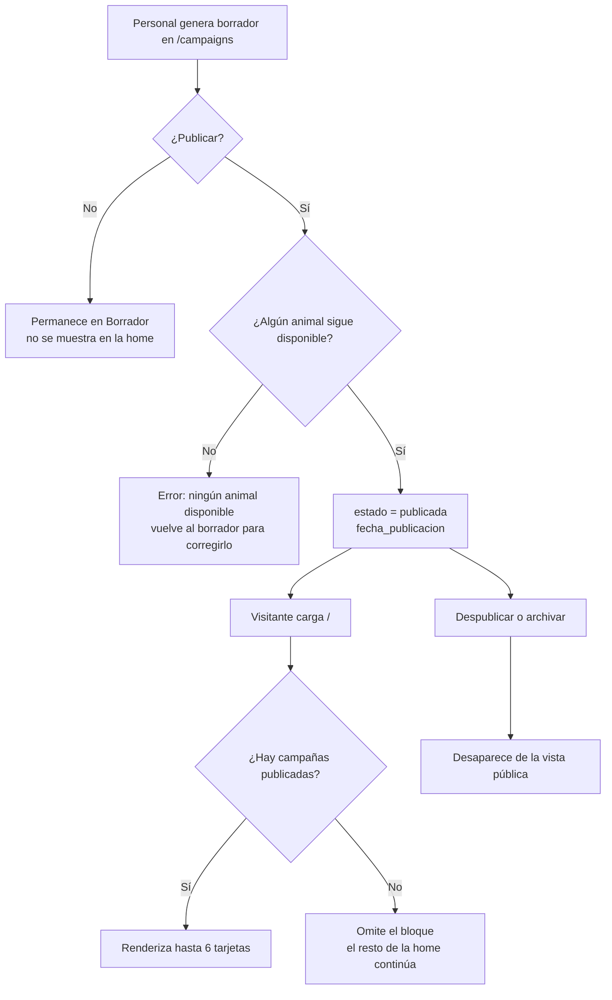

# Anexo UI/UX — Campañas publicadas en la home

> **Fuente:** `docs/features/campanas-publicacion-landing.md` y módulo `campaigns` (extensión fuera de los requerimientos 00–08).
> **Método:** `docs/ui-ux-metodologia.md` (P1, P4, P5, P6, P7, P8).
> **Actores:** Visitante sin sesión (consumo); personal con `campaigns.edit` (productor del contenido en `/campaigns`).
> **Vistas cubiertas:** `/` — bloque de campañas publicadas. No crea rutas nuevas.
> **Decisiones vigentes:** D-08 (landing única en `/`), D1–D5 del plan aprobado.

---

## 1. Inventario de contenido (E-C-S)

### Vista `/` — Visitante (bloque entre «Cómo funciona» y «Animales destacados»)

| Zona | Nivel | Elemento | Origen de datos / contrato | Comportamiento UI | Capa |
| :--- | :--- | :--- | :--- | :--- | :--- |
| Contexto del bloque | [C] | Etiqueta «Buscan hogar» y título «Ellos están esperando una familia» | Contenido editorial de `PublishedCampaigns` | Ancla el bloque como historias de adopción, no como listado técnico. | SC |
| Primary Body | [C] | Tarjeta de campaña: título, contenido, hashtags, llamado a la acción y fecha | `getPublishedCampaigns()` → vista `campana_publica` | Máximo 6 tarjetas, ordenadas por fecha de publicación descendente. Texto legible, sin datos internos. | SC |
| Primary Body | [C] | Chips de animales de la campaña | `animales[]` de la vista pública | Nombre/especie/raza en texto, nunca solo color. No son enlaces (ver supuestos). | SC |
| Primary Body | [C] | Pie de tarjeta con refugio, ciudad y estado | Campos seguros `refugio_nombre`, `refugio_ciudad`, `refugio_estado` | Ubica la historia sin exponer dirección ni contacto. | SC |
| Carga | [C] | Skeleton del mismo grid (6 tarjetas) | `PublishedCampaignsSkeleton` | `Suspense` permite que hero y destacados no esperen a la consulta. | SC |
| Vacío | [S] | Bloque omitido | `campaigns.length === 0` | No deja hueco ni mensaje: es contenido [C] y la home ya tiene otro bloque de adopción. | SC |

## 2. Flujos de usuario

### Flujo Publicar y ver en la home (extensión `campaigns`)

Notas de móvil: el grid pasa a una columna por debajo de `md`; los chips de animales se envuelven en varias filas; no hay acciones táctiles nuevas dentro de las tarjetas. El skeleton conserva la misma altura y separación para evitar *layout shift*.

## 3. Los 5 estados de interfaz

| Vista | Ideal | Vacío | Carga | Parcial | Error | Recuperación |
| :--- | :--- | :--- | :--- | :--- | :--- | :--- |
| `/` — bloque de campañas | Hasta 6 tarjetas completas con CTA de la campaña visible. | Sin campañas publicadas: el bloque no se renderiza; hero, destacados y confianza siguen operativos. | Skeleton de 6 tarjetas con la misma forma; sin bloquear el resto de la página. | Menos de 6 campañas válidas: grid adaptable, sin huecos ni mensaje de alerta. | Falla de BD o faltan variables de entorno: `getPublishedCampaigns()` devuelve `[]`; el bloque se oculta y el error se loguea en servidor. | Recargar la home; el personal puede revisar el estado en `/campaigns`. No hay reintento dentro del bloque porque es solo lectura. |

## 4. Supuestos y preguntas abiertas

- El bloque es **[C]**: el estado vacío silencioso es deliberado para no competir con el mensaje vacío de «Animales destacados». Si se prefiere un mensaje suave con CTA a `/adopciones`, requiere aprobación de un cambio de alcance.
- No se muestra banner de error en la home: la lectura pública ya degrada sin lanzar. Mostrar un error diferenciado exigiría cambiar el contrato de `getPublishedCampaigns()` (decisión aparte).
- Las tarjetas no incluyen enlaces por animal: la vista `campana_publica` no garantiza que `perfil_adopcion.publicado` esté activo, por lo que un enlace podría llevar a un perfil inexistente.
- No se modifica la landing legacy `/landing` ni el componente no usado `components/landing/LandingPage.tsx` (D-08 queda pendiente como cambio independiente).
- No hay cambios de base de datos. Antes de dar por terminado se verifica que la vista `public.campana_publica` existe en el entorno (`select * from public.campana_publica;`).
