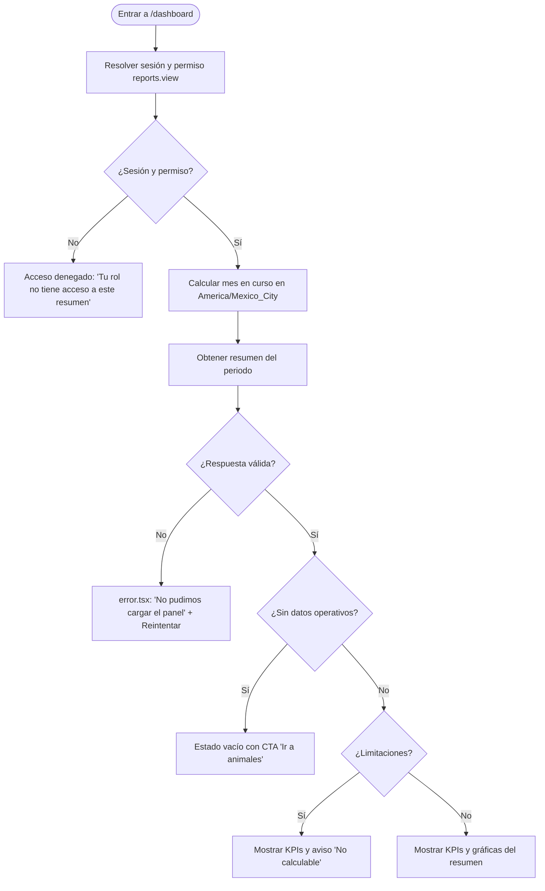

# Anexo UI/UX — Panel con resumen operativo real

> **Fuente:** `docs/features/requerimiento-07-inteligencia-datos.md` (RF7.5) y su anexo `requerimiento-07-inteligencia-datos-ui-ux.md` (S-01).
> **Método:** `docs/ui-ux-metodologia.md`.
> **Actores:** Administrador, Coordinador, Veterinario, Operador; Superadmin con alcance global.
> **Vistas cubiertas:** `/dashboard`.
> **Estado:** Diseño aprobado para implementación. El panel deja de usar `_data/mock.ts` y consume el resumen real.

---

## 1. Inventario de contenido (E-C-S)

### Vista `/dashboard` — operador del refugio

| Zona | Nivel | Elemento | Origen de datos / contrato | Comportamiento UI | Capa |
| :--- | :---: | :--- | :--- | :--- | :--- |
| Shell | C | Barra superior y navegación | `app/(protected)/layout.tsx` | Sin cambios; el panel sigue siendo el ancla de aterrizaje. | SC |
| Context summary | E | Periodo legible del resumen | `GET /api/v1/reportes/resumen` → `periodo.desde/hasta` | «1–24 de noviembre de 2026»; nunca se pide al usuario que recuerde parámetros. | SC |
| Context summary | C | Zona horaria declarada | `periodo.zona_horaria` | Texto tenue: «Hora de México». | SC |
| Primary body | E | Población activa | `poblacion_activa` | Cifra entera con etiqueta «Animales activos en el refugio». | SC |
| Primary body | E | Capacidad total | `capacidad_total` | Cifra entera; detalle «Plazas en espacios disponibles». | SC |
| Primary body | E | Adopciones del periodo | `adopciones_periodo` | Cifra entera; sin porcentajes calculados en el cliente. | SC |
| Primary body | E | Donaciones del periodo | `donaciones_periodo` | Cifra entera de registros; etiqueta «Registros en especie», nunca monto. | SC |
| Primary body | E | Ocupación del refugio | `porcentaje_ocupacion` + `capacidad_total` | Gráfica de anillo con el porcentaje. Si es `null`: «No calculable». | CC (Recharts) |
| Primary body | E | Alertas del periodo | `alertas.cuarentena`, `alertas.sobrecupo` | Barras para conteos; «Sobrecupo: sí/no» como texto, no como número inventado. | CC (Recharts) / SC |
| Primary body | C | Inventario en alerta | `stock_bajo`, `lotes_vencidos` | Barras con etiquetas en español: «Stock bajo», «Lotes vencidos». | CC (Recharts) |
| Primary body | C | Limitaciones | `limitaciones[]` | Aviso suave cuando una métrica no es calculable; nunca `0`. | SC |
| Bottom / action | C | Acceso a registro | — | En estado vacío, CTA «Ir a animales» (`/animales`) como rescate. | SC |
| Overlay | S | Sin overlays | — | El panel es solo lectura; no hay acciones transaccionales. | — |

**Regla de exclusión aplicada:** no se muestran tendencias mensuales, donaciones monetarias, "actividad reciente" ni comparativas con periodos anteriores. RF7.5 no las entrega y el requerimiento prohíbe inventarlas.

### Traducción modelo del sistema → modelo mental (P1)

| Dato del contrato | Texto visible |
| :--- | :--- |
| `poblacion_activa` | «Animales activos en el refugio» |
| `capacidad_total` | «Plazas disponibles» (solo espacios `disponible = true`) |
| `porcentaje_ocupacion: null` | «No calculable — no hay espacios disponibles» |
| `alertas.sobrecupo: true` | «Sobrecupo: sí» con badge de aviso, nunca solo color |
| `donaciones_periodo` | «Registros de donaciones en especie» |

---

## 2. Flujos de usuario

### Flujo «Abrir el panel» (RF7.5 / US21–US23)

Notas de móvil: los KPIs se apilan en una columna; las gráficas ocupan todo el ancho; el resumen no tiene CTA transaccional, por lo que no se requiere barra inferior fija. El estado vacío conserva su CTA a alcance del pulgar.

---

## 3. Los 5 estados de interfaz

| Vista | Ideal | Vacío | Carga | Parcial | Error | Recuperación |
| :--- | :--- | :--- | :--- | :--- | :--- | :--- |
| `/dashboard` | KPIs y gráficas con datos reales del mes en curso. | Población, capacidad, adopciones y donaciones en cero **y** sin alertas: «Aún no hay actividad registrada en este periodo» + «Ir a animales». | Skeleton con la misma forma: 4 tarjetas, anillo de ocupación y gráfica de alertas; el título y periodo no parpadean. | `porcentaje_ocupacion = null` o `limitaciones.length > 0`: valor «No calculable» y nota explicativa; el resto de KPIs se muestran igual. | `error.tsx` con mensaje en español, sin stack trace. | Botón «Reintentar» de `error.tsx` vuelve a ejecutar la carga conservando la ruta y la sesión. |

### Errores y su traducción

| Código | Mensaje UI |
| :--- | :--- |
| `400 PERIODO_INVALIDO` | «La fecha inicial no puede ser posterior a la final.» |
| `400 RANGO_EXCEDIDO` | «El rango máximo es de 366 días.» |
| `403 ROL_SIN_PERMISO` | «Tu rol no tiene acceso a este resumen.» |
| `403 REFUGIO_FUERA_DE_ALCANCE` | «No puedes consultar otro refugio.» |
| `500 ERROR_INTERNO` | «No pudimos cargar el panel. Inténtalo de nuevo.» |

---

## 4. Supuestos y decisiones

- **S-01:** se respeta la decisión `S-01` del anexo de la Épica 7: el panel consume el resumen de RF7.5 y abandona los mocks.
- **S-02:** el resumen usa el mes calendario en curso en `America/Mexico_City` (`desde` = primer día, `hasta` = hoy).
- **S-03:** `donaciones_periodo` cuenta **registros** de donaciones en especie; no suma unidades de distinta medida ni calcula dinero.
- **S-04:** no se añaden series temporales ni comparación de periodos: RF7.5 no las expone y ampliar el contrato queda fuera de esta entrega.
- **S-05:** el Superadmin ve el agregado global; los demás roles ven únicamente su `id_refugio` resuelto desde la sesión.
- **S-06:** la autorización se verifica en el service del módulo `reports`; la UI no decide permisos.
- **S-07:** la caché de 60 s se aplica solo a la respuesta HTTP del endpoint; el render del panel usa el service directamente para evitar un fetch de cliente.
