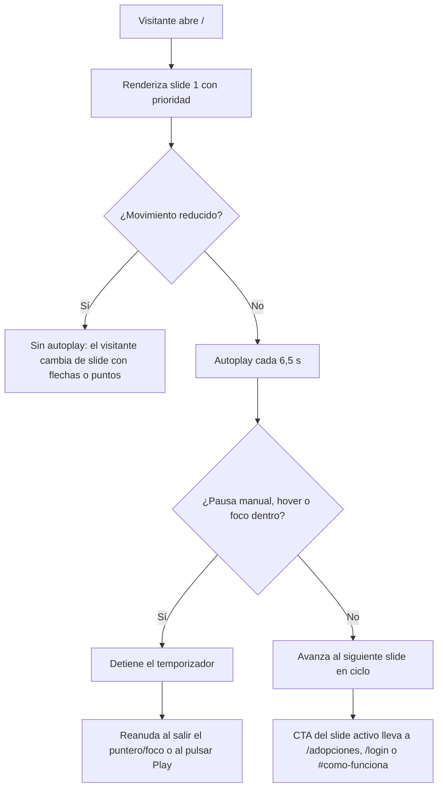

# Anexo UI/UX — Slider de portada de la home

> **Fuente:** petición de mejora visual de la homepage pública principal (`/`). Requerimiento editorial sin numerar, documentado aquí antes de su implementación.
> **Método:** `docs/ui-ux-metodologia.md` (P1, P4, P5, P6, P7, P8).
> **Actores:** Visitante sin sesión (consumo). No hay actor productor: el contenido es editorial fijo del proyecto.
> **Vistas cubiertas:** `/` — sustituye el hero actual. No crea rutas nuevas y no modifica la landing legacy (D-08: landing única en `/`).
> **Decisiones aprobadas:** slider de ancho completo («full-bleed») con 3 imágenes remotas de Unsplash servidas mediante `next/image`. Sin librería de carrusel.

---

## 1. Inventario de contenido (E-C-S)

### Vista `/` — Visitante (primera sección, bajo el header sticky)

| Zona | Nivel | Elemento | Origen de datos / contrato | Comportamiento UI | Capa |
| :--- | :--- | :--- | :--- | :--- | :--- |
| Contexto del slider | [C] | Etiqueta «Plataforma para refugios y adoptantes» | Contenido editorial de `HomeHeroSlider` | Igual que el hero anterior; mantiene el encuadre de marca. | SC cliente |
| Primary Body | [C] | Slide 1 — «Conecta animales con familias, con claridad y confianza» + CTA «Ver animales en adopción» → `/adopciones` | Contenido editorial estático | Hereda el mensaje y el destino del hero actual. Foto: perros al aire libre. | SC cliente |
| Primary Body | [C] | Slide 2 — «Cada historia merece una familia» + CTA «Explorar catálogo» → `/adopciones` | Contenido editorial estático | Refuerza el tema de adopción con otra especie. Foto: gato. | SC cliente |
| Primary Body | [C] | Slide 3 — «Soy refugio: gestiona con claridad» + CTA «Soy refugio / Iniciar sesión» → `/login` y CTA secundario «Cómo funciona» → `#como-funciona` | Contenido editorial estático | Conserva el acceso de refugios del hero actual. Foto: animales de compañía. | SC cliente |
| Controles | [C] | Flecha anterior, puntos de navegación, flecha siguiente, pausa/reanudación | Estado local del componente | Un punto por slide, `aria-current` en el activo; las flechas envuelven (de último a primero). | SC cliente |
| Carga | [S] | Fondo de reserva `bg-foreground` y altura fija | Clases Tailwind | La altura está reservada antes de que llegue la foto: sin *layout shift*. | SC cliente |
| Error | [E] | Si falla una imagen remota, se conserva el degradado y el texto legible | `next/image` + capa de gradiente | El mensaje y los CTA siguen visibles y operativos aunque la foto no cargue. | SC cliente |

> Los textos visiblemente equivalentes del hero anterior se conservan. Las cuatro tarjetas de beneficios (`PawPrint`, `Search`, `FileText`, `HeartHandshake`) se retiran porque su contenido ya está representado por los bloques «Cómo funciona» y «Transparencia y cuidado de datos» de la propia home.

## 2. Flujos de usuario

### Flujo Ver portada (visitante)

Notas de móvil: la altura se reduce a 460 px; controles y texto comparten el mismo contenedor `max-w-7xl` con padding lateral, sin desbordamiento. El autoplay no depende de hover (existe botón de pausa explícito).

## 3. Los 5 estados de interfaz

| Vista | Ideal | Vacío | Carga | Parcial | Error | Recuperación |
| :--- | :--- | :--- | :--- | :--- | :--- | :--- |
| `/` — slider | 3 slides con foto, texto y CTA; autoplay y controles operativos. | No aplica: el contenido es editorial fijo, siempre hay 3 slides. | Fondo oscuro y texto visible mientras `next/image` carga la foto activa; primera imagen con `priority`. | Si una foto tarda o falla, el degradado mantiene el contraste y los CTA funcionan. | Sin errores de datos; fallo de red solo afecta a la foto. | Recargar la página. No hay reintento propio: `next/image` ya gestiona la carga. |

## 4. Supuestos y decisiones

- El slider es **presentación pura**: no consulta Supabase, no llama a services ni define schemas Zod. El contenido es una constante tipada (`type HomeSlide`) porque no es entrada validable.
- Componente cliente (`"use client"`) únicamente para autoplay, pausa, flechas y puntos. No contiene lógica de negocio.
- Imágenes externas: `https://images.unsplash.com/photo-…?w=1600&h=900&fit=crop&q=80`. Se autoriza el host en `images.remotePatterns` de `next.config.js`. Licencia Unsplash: uso gratuito sin obligación de atribución. Riesgo asumido: dependencia de red en tiempo de ejecución para optimizar la imagen; el degradado y el texto son el fallback.
- Sin librería de carrusel: se evita una nueva dependencia y se mantiene el patrón Tailwind del proyecto.
- Se conservan sin cambios el bloque de campañas (con su `Suspense`), «Cómo funciona», «Animales destacados» y «Transparencia y cuidado de datos», además de los cambios preexistentes no commiteados en `app/page.tsx`.
- No hay cambios de base de datos, contratos ni rutas. `/landing` y `components/landing/LandingPage.tsx` quedan fuera de alcance.

## 5. Criterios de aceptación

1. La primera sección de `/` ocupa todo el ancho disponible bajo el header, sin el `max-w-7xl` del hero anterior.
2. Hay exactamente 3 slides con foto alusiva, mensaje y CTA; el primero se carga con prioridad.
3. Flechas y puntos cambian de slide en ambos sentidos y el punto activo se identifica por `aria-current`.
4. Autoplay de 6,5 s, detenido por pausa manual, hover, foco interno o `prefers-reduced-motion: reduce`.
5. Texto con contraste suficiente gracias al degradado; altura reservada en todos los breakpoints; sin `@ts-ignore` ni `any`.
6. `typecheck`, `lint` y `build` pasan; el resto de la home permanece igual.

## 6. Logo del header público

> Extensión aprobada sobre el mismo trabajo visual de la home. No modifica el slider ni sus criterios anteriores.

| Zona | Nivel | Elemento | Origen | Comportamiento UI | Capa |
| :--- | :--- | :--- | :--- | :--- | :--- |
| Header público | [C] | Marca «Pixkki» + icono | `public/images/logo.png` (2000×2000, transparente, trazos blancos) y texto «Pixkki» | Sustituye el tile con la letra «P» por el logo dentro del mismo tile `bg-primary p-1`, igual que `AppSidebar`. | SC |

- **Alcance aprobado:** `PublicShell` es compartido; el cambio se aplica a las 7 páginas públicas que lo usan, no solo a `/`.
- **Accesibilidad:** `alt=""` porque la palabra «Pixkki» adyacente ya nombra la marca; así se evita una duplicidad en lectores de pantalla. El `Link` contenedor mantiene su texto accesible.
- **Implementación:** `next/image` con `width`/`height` y `object-contain`; imagen local, sin `remotePatterns` nuevos ni dependencias.
- **Fuera de alcance:** `/landing` (legacy), `AppSidebar` (ya usa el logo) y el sidebar del dashboard.

