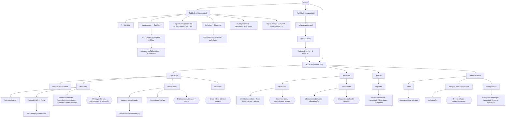

# Mapa de navegación de Pixkki

> **Fuente metodológica:** `docs/ui-ux-metodologia.md` (P2, P5, P6, P7, P8, P9).
> **Fuente funcional:** `docs/features/requerimiento-00..08-*.md` y los anexos `docs/features/ui-ux/`.
> **Estado:** PROPUESTA. No se ha modificado código. Requiere aprobación humana antes de implementar (AGENTS.md §4, fase 4).

---

## 0. Resumen ejecutivo

La aplicación tiene hoy **dos capas de layout que se contradicen**: `app/(protected)/layout.tsx` monta un shell de escritorio completo y `app/(protected)/(dashboard)/layout.tsx` es un `layout` vacío que no aporta nada. El shell real (`modules/dashboard/components/DashboardLayout.tsx`) es **100 % Client Component**, no tiene navegación móvil, filtra permisos en el cliente y contiene elementos sin requerimiento (buscador global y campana de notificaciones inoperantes).

De los 12 ítems del menú actual, **4 apuntan a rutas inexistentes** (`/reports`, `/medical`, `/vaccinations`, `/settings`) y **al menos 8 usan permisos que no están sembrados en las migraciones del repositorio**, por lo que fallan cerrados y nunca se muestran. En paralelo, los requerimientos 06, 07 y 08 **no tienen backend implementado**, por lo que sus vistas no pueden conectarse todavía.

Este mapa define la estructura objetivo, la convención de rutas, la matriz de permisos y el orden de construcción. El plan de ejecución vive en `docs/features/ui-ux/plan-implementacion-frontend.md`.

---

## 1. Principios de la capa principal

1. **Server Components por defecto.** El shell, el sidebar y el header son Server Components. Solo son Client Components los islotes que necesitan `usePathname`, estado de apertura del drawer o `onClick`.
2. **La navegación se calcula en el servidor.** El árbol de navegación se filtra por permisos en el layout; el cliente recibe solo lo que puede ver. La autorización real sigue viviendo en el service/action, no en el componente.
3. **Un único shell autenticado.** `app/(protected)/layout.tsx` es el nivel 0. No existen layouts intermedios vacíos.
4. **Máximo 3 niveles en móvil y 4 en escritorio** (P6). Las subvistas de un ancla se resuelven con **pestañas dentro de la página**, no con más niveles de sidebar.
5. **Las acciones rápidas van en overlay** (P6). Bottom sheet en móvil, modal/drawer en escritorio; nunca cambian la ruta base.
6. **Sin UI muerta.** Si un elemento no está justificado por un requerimiento, no entra (P5, regla de exclusión).
7. **Cada vista soporta los 5 estados** (P7): ideal, vacío, carga, parcial y error, con recuperación concreta.
8. **Rutas en español para el dominio.** Los requerimientos, los endpoints y los anexos usan español (`/animales`, `/adopciones`, `/espacios`, `/reportes`). Las rutas inglesas existentes se conservan mediante redirects durante la transición.

---

## 2. Diagnóstico del shell y la navegación actual

### 2.1 Inventario actual

| Pieza | Archivo | Estado |
| :--- | :--- | :--- |
| Layout raíz | `app/layout.tsx` | SC. Carga `getAuthUser()` y envuelve todo en `AuthProvider`. Importa `getCurrentUser` sin usarlo. |
| Layout protegido | `app/(protected)/layout.tsx` | SC. Aplica compuertas y monta `DashboardLayout`. |
| Layout dashboard | `app/(protected)/(dashboard)/layout.tsx` | SC. Devuelve `<>{children}</>`: **no-op**. |
| Shell real | `modules/dashboard/components/DashboardLayout.tsx` | **CC completo**. Sidebar fija de 240 px, header con saludo, buscador y campana. |
| Configuración de menú | `modules/dashboard/components/navigation.config.ts` | Array plano sin tipos; mezcla secciones, permisos y rutas muertas. |
| Shell de autenticación | `components/layouts/AuthShell.tsx` + `app/(public)/(auth)/layout.tsx` | CC completo por un único botón "Volver". |
| Landing pública | `app/page.tsx` | **CC**, 444 líneas, copy en inglés, datos mock, enlaces a `../page.tsx#features`. |
| Landing alternativa | `app/(public)/landing/page.tsx` | SC, español, **accede a Supabase directamente desde `app/`**. |
| Estados globales | `app/(protected)/(dashboard)/loading.tsx` | Solo hay 1 loading de dashboard y 1 loading/error de `/staff`. |

### 2.2 Hallazgos

| ID | Hallazgo | Impacto | Referencia |
| :--- | :--- | :--- | :--- |
| H-01 | Shell completo en `"use client"` | Hidratación innecesaria, cálculo de fecha en cliente, permisos filtrados en el navegador | AGENTS §7; ARCHITECTURE §16 |
| H-02 | `app/(protected)/(dashboard)/layout.tsx` vacío | Ruido estructural; sugiere una capa que no existe | AGENTS §3; ARCHITECTURE §6 |
| H-03 | Sin navegación móvil (sidebar fija de 240 px) | La app no es usable en móvil, incumpliendo el §2 de la metodología | Metodología §2 |
| H-04 | Rutas muertas en el menú: `/reports`, `/medical`, `/vaccinations`, `/settings` | 404 al hacer clic; el usuario percibe la app incompleta | H-04 |
| H-05 | Permisos de menú no sembrados en el repo (`dashboard.view`, `users.view`, `shelter.view`, `spaces.view`, `reports.view`, `medical.view`, `vaccinations.view`, `settings.view`, `security.view`) | Si no existen en `permiso`, `hasPermission` devuelve `false` y el ítem nunca aparece | Migraciones 00–05 |
| H-06 | Buscador global y campana de notificaciones sin acción | UI muerta; viola la regla de exclusión | Metodología P5 |
| H-07 | Header con saludo "Hola, {nombre}" + fecha, duplicado con el título de cada página | Ocupa la zona de contexto sin informar ubicación ni jerarquía | Metodología P5 |
| H-08 | `modules/shelters/authorization.ts` usa un catálogo de roles distinto (`admin`, `shelter_manager`, `volunteer`, `user`) al canónico (`admin`, `veterinario`, `superadmin`) | Código legado que contradice el RBAC real | ARCHITECTURE §7.1 |
| H-09 | Requerimientos 03–08 definen `coordinador`, `operador` y `evaluador`; el código solo modela 3 roles | Vistas y permisos de esos roles quedan inalcanzables | `modules/auth/types.ts` |
| H-10 | `app/(public)/landing/page.tsx` consulta Supabase directamente | Viola la regla de acceso exclusivo desde repositories | AGENTS §9 |
| H-11 | Landing duplicada (`/` y `/landing`) con copy distinto (inglés/español) | Fuente de verdad duplicada; enlaces rotos | `app/page.tsx` |
| H-12 | Middleware no marca como públicas `/api/v1/publico/*`, `/aviso-privacidad` ni `/landing` | El catálogo público de la Épica 5 responde 401 y los enlaces legales redirigen a login | `middleware.ts` |
| H-13 | `/adoptions`, `/donations` y `/dashboard` son mockups con datos en inglés y `any` | No consumen backend; incumplen TypeScript estricto | AGENTS §6 |
| H-14 | `CreateAnimalModal` y `AnimalDetailPanel` viven como overlays de tabla; no existe `/animales/[id]` | La ficha del animal no es enlazable ni compartible | Anexo 01 |
| H-15 | No existe `not-found.tsx` ni error boundary global del área protegida | P7 incompleto | Metodología P7 |
| H-16 | Cada página define su propio padding y cabecera (`p-8`, `px-8 py-7`, `container mx-auto`) | Inconsistencia visual y de jerarquía | Metodología P5 |
| H-17 | `/shelters/new`, `/staff/add` y `/settings` se resuelven como páginas completas | Deberían ser overlays sobre el listado (P6) | Anexos 00 |
| H-18 | `app/(public)/(auth)/layout.tsx` es `"use client"` por un botón "Volver" | Arrastra todo el árbol de autenticación al cliente | ARCHITECTURE §16 |

### 2.3 Violaciones que bloquean la implementación

- **H-10** (Supabase en `app/`) debe corregirse antes de tocar la landing pública.
- **H-12** (middleware) impide que el catálogo público funcione; es un cambio de infraestructura, no de UI.
- **H-09** (roles incompletos) y **H-05** (permisos no sembrados) son cambios de base de datos → requieren aprobación previa (AGENTS §5.2).

---

## 3. Convención de rutas

### 3.1 Decisión propuesta (D-01)

**Español canónico, inglés como alias temporal.**

| Regla | Ejemplo |
| :--- | :--- |
| Anclas de dominio en español | `/animales`, `/adopciones`, `/espacios`, `/inventario`, `/donaciones`, `/reportes`, `/refugios` |
| Recursos anidados en español | `/adopciones/solicitudes/[id]`, `/inventario/lotes/[id]` |
| Administración en español | `/refugios`, `/configuracion/seguridad`, `/configuracion/refugio` |
| Rutas existentes en inglés | Redirect 308 permanente desde `next.config.js` |
| Auth se mantiene en inglés | `/login`, `/forgot-password`, `/reset-password` (ya son estándar y están en el middleware) |

> **Conflicto detectado:** el anexo 01 documenta `/animales/[id]/ficha-clinica` y el anexo 02 documenta `/animals/[id]/clinical-record` para la misma vista. Se propone unificar en `/animales/[id]/ficha-clinica` y actualizar la referencia del anexo 02 en el mismo cambio aprobado.

### 3.2 Tabla de redirects propuesta

| Ruta legada | Ruta canónica | Motivo |
| :--- | :--- | :--- |
| `/animals` | `/animales` | Anexo 01 |
| `/animals/[id]/clinical-record` | `/animales/[id]/ficha-clinica` | Unificación de anexos 01 y 02 |
| `/adoptions` | `/adopciones` | Épica 5 |
| `/spaces` | `/espacios` | Anexo 00 / Épica 3 |
| `/shelters` | `/refugios` | Épica 0 (superadmin) |
| `/shelters/[id]` | `/refugios/[id]` | Épica 0 |
| `/shelters/new` | `/refugios/nuevo` (temporal; F4.0 → `/refugios?nuevo=1`) | P-01: overlay, no página |
| `/staff/add` | `/staff?agregar=1` | P-04: overlay |
| `/donations` | `/donaciones` | Épica 6 |
| `/reports` | `/reportes` | Épica 7 |
| `/settings/security` | `/configuracion/seguridad` | Épica 0 |
| `/settings/customize` | `/configuracion/apariencia` | Extensión existente |

> **Restricción:** el agente no modifica tests. Si algún test e2e referencia las rutas legadas, el responsable de testing debe actualizarlo antes de retirar el redirect.
>
> **Estado de implementación (F2):** los redirects 308 ya existen en `next.config.js`. `/shelters/new` apunta temporalmente a `/refugios/nuevo`; la conversión a overlay (`/refugios?nuevo=1`) queda para F4.0. `/staff/add` conserva su página hasta F4.0 para no romper el alta de personal. La allowlist pública de `/adopciones` y `/refugios` se difiere a F4.5: hoy esas URLs sirven las vistas privadas y la decisión D-05.1 exige resolver el shell por sesión antes de abrirlas sin autenticación.

---

## 4. Roles, permisos y visibilidad

### 4.1 Roles

| Rol de base | Identificador lógico | Alcance |
| :--- | :--- | :--- |
| `Administrador` | `admin` | Su refugio |
| `Veterinario` | `veterinario` | Su refugio |
| `Superadmin` | `superadmin` | Global (`id_refugio = NULL`) |
| `Coordinador` | `coordinador` | Su refugio — **no modelado en el código** |
| `Operador` | `operador` | Su refugio — **no modelado en el código** |
| `Evaluador` | `evaluador` | Su refugio — **no modelado en el código** |

> **D-04:** decidir si se amplía `UserRole` y el seed de roles, o si los permisos de coordinador/operador/evaluador se asignan al rol existente más cercano. Sin esta decisión, las vistas de las épicas 4–8 que dependen de esos roles no son alcanzables.

### 4.2 Catálogo de permisos por ancla

| Ancla | Permiso de visibilidad | ¿Sembrado en el repo? |
| :--- | :--- | :--- |
| Panel | Sesión autenticada (sin permiso) | N/A |
| Animales | `animals.view` | Sí (código) |
| Adopciones | `adoptions.view` | Sí (migración 20261116160000) |
| Espacios | `spaces.view` (propuesto) | No |
| Inventario | `inventory.view` | No |
| Donaciones | `donations.view` | No |
| Reportes | `reports.view` | No |
| Personal | `users.view` | No |
| Refugios | Rol `superadmin` (sin permiso) | N/A |
| Configuración | Sesión autenticada | N/A |
| Campañas (extensión) | `campaigns.view` | Sí (migración 20261025000000) |
| Eventos (extensión) | `events.view` | Sí (migración 20261026000000) |

> Los permisos marcados "No" deben validarse contra las tablas `permiso` y `rol_permiso` del entorno. Si no existen, el ítem no se renderiza. Sembrarlos es un cambio de base de datos y requiere aprobación.

### 4.3 Matriz de acciones por ancla

| Ancla | Ver | Crear | Editar/Gestionar | Eliminar/Anular | Permisos de la Épica |
| :--- | :--- | :--- | :--- | :--- | :--- |
| Animales | `animals.view` | `animals.create` | `animals.edit` | `animals.delete` | + `animals.import`, `adoptions.ai` |
| Adopciones | `adoptions.view` | — | `adoptions.publish`, `adoptions.evaluate`, `adoptions.manage` | — | `adoptions.complete` |
| Inventario | `inventory.view` | `inventory.manage` | `inventory.manage`, `inventory.move` | `inventory.manage` | `inventory.adjust` |
| Donaciones | `donations.view` | `donations.create` | `donations.create` | `donations.manage` | `donations.manage` |
| Reportes | `reports.view` | — | — | — | Exportación CSV |
| Personal | `users.view` | `users.create` | `users.manage` | `users.manage` | Épica 0 |
| Refugios | `superadmin` | `superadmin` | `superadmin` | — | Épica 0 |

---

## 5. Mapa de navegación

### 5.1 Nivel 0 — shells

| Shell | Layout | Contenido | Audiencia |
| :--- | :--- | :--- | :--- |
| `PublicShell` | `app/(public)/layout.tsx` | Navbar pública + footer legal | Visitantes y postulantes |
| `AuthShell` | `app/(public)/(auth)/layout.tsx` | Columna de formulario + panel visual | Login, recuperación, compuertas |
| `AppShell` | `app/(protected)/layout.tsx` | Sidebar (desktop) + bottom bar y drawer (móvil) + header | Personal autenticado |

### 5.2 Navegación pública (sin sesión)

| Nivel | Ruta | Vista | RF |
| :---: | :--- | :--- | :--- |
| 1 | `/` | Landing institucional + destacados del catálogo | RF5.2 |
| 2 | `/adopciones` | Catálogo global con filtros (refugio, especie, sexo, tamaño, edad, temperamento, texto) | RF5.2 |
| 3 | `/adopciones/[idAnimal]` | Perfil público del animal (fotos, descripción, compatibilidad, refugio) | RF5.2 |
| 4 | `/adopciones/[idAnimal]/solicitud` | Formulario público de postulación | RF5.3 |
| 2 | `/adopciones/seguimiento` | Consulta pública de estado por folio (alcance agregado, contrato propuesto G-02) | RF5.3 (ext.) |
| 2 | `/refugios` | Directorio de refugios con adoptables | RF5.2 |
| 3 | `/refugios/[slug]` | Página pública del refugio | RF5.2 |
| 1 | `/aviso-privacidad` | Aviso de privacidad | RF5.3 (consentimiento) |
| 1 | `/terminos-condiciones` | Términos y condiciones | RF0.7 |
| 1 | `/login` | Inicio de sesión | RF0.5 |
| 1 | `/forgot-password` | Recuperación de contraseña | RF0.6 |
| 1 | `/reset-password` | Restablecimiento | RF0.6 |

### 5.3 Compuertas post-login (autenticado, sin shell)

| Orden | Ruta | Condición | RF |
| :---: | :--- | :--- | :--- |
| 1 | `/change-password` | `requiresPasswordChange = true` | RF0.5 |
| 2 | `/accept-terms` | `termsAccepted = false` | RF0.7 |
| 3 | `/onboarding` | `requiresOnboarding = true` y `shelterId !== null` | RF0.9 |

> El superadmin (`shelterId === null`) no pasa por onboarding. Esta lógica ya existe y se conserva.

### 5.4 Anclas del área autenticada (nivel 1)

| Sección | Ancla | Ruta | Permiso | RF |
| :--- | :--- | :--- | :--- | :--- |
| Operación | Panel | `/dashboard` | Sesión | RF7.5 |
| Operación | Animales | `/animales` | `animals.view` | RF1.1, RF4.2 |
| Operación | Adopciones | `/adopciones` | `adoptions.view` | RF5.4 |
| Operación | Espacios | `/espacios` | `spaces.view` | RF0.8, RF3.1 |
| Recursos | Inventario | `/inventario` | `inventory.view` | RF6.5–RF6.8 |
| Recursos | Donaciones | `/donaciones` | `donations.view` | RF6.1–RF6.4 |
| Análisis | Reportes | `/reportes` | `reports.view` | RF7.1–RF7.7 |
| Administración | Personal | `/staff` | `users.view` | RF0.4 |
| Administración | Refugios | `/refugios` | Rol `superadmin` | RF0.1–RF0.3 |
| Administración | Configuración | `/configuracion` | Sesión | RF0.5 |
| Extensión | Campañas | `/campanas` | `campaigns.view` | Fuera de 00–08 |
| Extensión | Eventos | `/eventos` | `events.view` | Fuera de 00–08 |

### 5.5 Subvistas (nivel 2 y 3)

Las subvistas se presentan como **pestañas dentro del ancla**, no como nuevos niveles de sidebar.

#### Animales

| Nivel | Ruta | Vista | RF |
| :---: | :--- | :--- | :--- |
| 2 | `/animales` | Listado con búsqueda, filtros y tarjetas | RF1.1 |
| 2 | `/animales/nuevo` | Alta en stepper de 4 pasos (el 4.º es la galería) | RF1.1, RF1.2 |
| 3 | `/animales/[id]` | Ficha del animal: cabecera, galería, diagnóstico de ingreso, aptitud | RF1.2, RF1.3, RF4.2 |
| 3 | `/animales/[id]/ficha-clinica` | Línea de tiempo + paneles clínicos, sociales y quirúrgicos | RF1.4, RF2.x, RF3.x, RF4.1 |
| 2 | `/animales/importar` | Carga y validación de CSV | RF8.1–RF8.3 |
| 2 | `/animales/importaciones` | Historial de lotes | RF8.4 |
| 3 | `/animales/importaciones/[id]` | Detalle del lote y errores | RF8.4 |
| 2 | `/animales/historicos/nuevo` | Registro manual de paciente histórico | RF8.5 |

#### Adopciones

| Nivel | Ruta | Vista | RF |
| :---: | :--- | :--- | :--- |
| 2 | `/adopciones` | Resumen + acceso a solicitudes y perfiles | RF5.4 |
| 2 | `/adopciones/solicitudes` | Bandeja de solicitudes con filtros por estado | RF5.4 |
| 3 | `/adopciones/solicitudes/[id]` | Detalle, compatibilidad, evaluaciones, historial y acciones | RF5.4–RF5.7 |
| 2 | `/adopciones/perfiles` | Perfiles publicados, borradores y publicables | RF5.1 |

#### Espacios

| Nivel | Ruta | Vista | RF |
| :---: | :--- | :--- | :--- |
| 2 | `/espacios` | Tarjetas por tipo con ocupación y disponibilidad | RF0.8, RF3.1 |

#### Inventario

| Nivel | Ruta | Vista | RF |
| :---: | :--- | :--- | :--- |
| 2 | `/inventario` | Resumen, alertas y accesos | RF6.7 |
| 2 | `/inventario/insumos` | Catálogo de insumos | RF6.5 |
| 3 | `/inventario/insumos/[id]` | Detalle con lotes y stock total | RF6.5 |
| 2 | `/inventario/lotes` | Lotes con stock y caducidad | RF6.5 |
| 3 | `/inventario/lotes/[id]` | Detalle y movimientos del lote | RF6.5, RF6.8 |
| 2 | `/inventario/movimientos` | Entradas, salidas y ajustes | RF6.6, RF6.8 |
| 2 | `/inventario/alertas` | Stock mínimo, caducidad próxima y vencidos | RF6.7 |

#### Donaciones

| Nivel | Ruta | Vista | RF |
| :---: | :--- | :--- | :--- |
| 2 | `/donaciones` | Listado de donaciones en especie con folio y estado | RF6.2, RF6.4 |
| 2 | `/donaciones/donantes` | Catálogo de donantes | RF6.1 |
| 3 | `/donaciones/donantes/[id]` | Detalle con historial de donaciones | RF6.1 |

#### Reportes

| Nivel | Ruta | Vista | RF |
| :---: | :--- | :--- | :--- |
| 2 | `/reportes` | Selector de reporte y periodo | RF7.6 |
| 2 | `/reportes/poblacion` | Población, flujos y estancia | RF7.1 |
| 2 | `/reportes/capacidad` | Capacidad y ocupación por espacio | RF7.2 |
| 2 | `/reportes/donaciones` | Donaciones en especie por tipo, unidad y donante | RF7.3 |
| 2 | `/reportes/inventario` | Stock, consumo, entradas, ajustes y alertas | RF7.4 |

> La exportación CSV es una **acción**, no una ruta.

#### Personal

| Nivel | Ruta | Vista | RF |
| :---: | :--- | :--- | :--- |
| 2 | `/staff` | Listado por rol, activación y eliminación | RF0.4 |
| Overlay | `/staff?agregar=1` | Alta de miembro con rol y refugio (superadmin) | RF0.4 |

#### Refugios (superadmin)

| Nivel | Ruta | Vista | RF |
| :---: | :--- | :--- | :--- |
| 2 | `/refugios` | Listado global con búsqueda y filtro de estado | RF0.1 |
| 3 | `/refugios/[id]` | Detalle del refugio | RF0.1 |
| Overlay | `/refugios?nuevo=1` | Alta de refugio + administrador | RF0.2 |
| Overlay | `/refugios?estado=[id]` | Activar/desactivar con confirmación | RF0.3 |

#### Configuración

| Nivel | Ruta | Vista | RF |
| :---: | :--- | :--- | :--- |
| 2 | `/configuracion` | Índice de ajustes | — |
| 2 | `/configuracion/refugio` | Datos del refugio propio y perfil público (slug, descripción) | RF0.1, RF5.1 |
| 2 | `/configuracion/seguridad` | MFA (activar/desactivar) | RF0.5 |
| 2 | `/configuracion/cuenta` | Perfil y cambio de contraseña | RF0.5 |
| 2 | `/configuracion/apariencia` | Personalización existente (extensión) | Fuera de 00–08 |

### 5.6 Overlays (sin cambio de ruta base)

| Ancla | Overlay | RF | Móvil |
| :--- | :--- | :--- | :--- |
| Animales | Alta de paciente (si se opta por overlay en vez de wizard) | RF1.1 | Bottom sheet |
| Animales | Diagnóstico de ingreso | RF1.3 | Bottom sheet |
| Animales | Agregar fotos / usar como portada / eliminar foto | RF1.2 | Bottom sheet |
| Animales | Registrar chequeo médico | RF2.1 | Bottom sheet |
| Animales | Registrar evento sanitario | RF2.2, RF2.3 | Bottom sheet |
| Animales | Alta médica de cuarentena | RF2.4 | Bottom sheet |
| Animales | Registrar traslado | RF3.2 | Bottom sheet |
| Animales | Registrar evaluación de temperamento | RF3.3 | Bottom sheet |
| Animales | Registrar rehabilitación | RF3.4 | Bottom sheet |
| Animales | Registrar cirugía | RF4.1 | Bottom sheet |
| Animales | Excepción de aptitud (solo admin) | RF4.2 | Bottom sheet |
| Animales | Publicar / despublicar para adopción | RF4.2 | Bottom sheet |
| Animales | Editar / eliminar | RF1.1 | Bottom sheet |
| Animales | Generar perfil con IA (revisión humana) | RF8.6, RF8.7 | Bottom sheet |
| Adopciones | Registrar evaluación | RF5.5 | Bottom sheet |
| Adopciones | Cambiar estado / cancelar / rechazar | RF5.4 | Bottom sheet |
| Adopciones | Completar adopción | RF5.7 | Bottom sheet |
| Espacios | Crear / editar / eliminar | RF0.8, RF3.1 | Bottom sheet |
| Inventario | Crear / editar insumo, lote y movimiento | RF6.5, RF6.6 | Bottom sheet |
| Inventario | Ajuste de movimiento | RF6.6 | Bottom sheet |
| Donaciones | Registrar donación | RF6.2 | Bottom sheet |
| Donaciones | Anular donación | RF6.4 | Bottom sheet |
| Donaciones | Crear / editar donante | RF6.1 | Bottom sheet |
| Personal | Agregar miembro, desactivar, eliminar | RF0.4 | Bottom sheet |
| Refugios | Nuevo refugio, activar/desactivar | RF0.2, RF0.3 | Bottom sheet |
| Global | Confirmaciones destructivas | P9 | Bottom sheet |

### 5.7 Diagrama de navegación

### 5.8 Matriz de trazabilidad

| Ruta | Épica | Endpoint(s) | Backend | UI actual | Acción |
| :--- | :---: | :--- | :---: | :---: | :--- |
| `/login`, `/forgot-password`, `/reset-password` | 00 | `/api/v1/auth/*` | ✅ | ✅ | Pulir estados |
| `/change-password`, `/accept-terms`, `/onboarding` | 00 | Server Actions | ✅ | ✅ | Pulir estados |
| `/refugios`, `/refugios/[id]` | 00 | `/api/v1/refugios` | ✅ | ◐ (`/shelters`) | Rehacer con overlay y confirmación |
| `/espacios` | 00, 03 | `/api/v1/espacios` | ✅ | ◐ (`/spaces`) | Rehacer tarjetas y ocupación |
| `/staff` | 00 | Server Actions | ✅ | ✅ | Mover alta a overlay |
| `/configuracion/refugio` | 00, 05 | `/api/v1/refugios/[id]` | ✅ | ◐ (`/shelters/info`) | Implementar |
| `/configuracion/seguridad` | 00 | Server Actions MFA | ✅ | ✅ | Pulir |
| `/animales` | 01 | `/api/v1/animales` | ✅ | ◐ (tabla + modal) | Rehacer listado y estados |
| `/animales/nuevo` | 01 | `POST /api/v1/animales` | ✅ | ◐ (modal) | Wizard de 4 pasos |
| `/animales/[id]` | 01, 04 | `/animales/[id]`, `/imagenes`, `/diagnosticos`, `/aptitud-adopcion` | ✅ | ◐ (panel) | Página enlazable |
| `/animales/[id]/ficha-clinica` | 01–04 | `/ficha-clinica`, `/chequeos`, `/cuarentena`, `/eventos-sanitarios`, `/traslados`, `/evaluaciones-temperamento`, `/rehabilitaciones`, `/cirugias` | ✅ | ◐ | Completar paneles 04 |
| `/adopciones`, `/adopciones/solicitudes` | 05 | `/api/v1/adopciones/solicitudes` | ✅ | ✗ (mock) | Implementar |
| `/adopciones/solicitudes/[id]` | 05 | `.../[id]`, `/evaluaciones`, `/estado`, `/completar` | ✅ | ✗ | Implementar |
| `/adopciones/perfiles` | 05 | `/animales/[id]/perfil-adopcion` | ✅ | ✗ | Implementar |
| `/`, `/adopciones` (público), `/adopciones/[id]`, `/adopciones/seguimiento`, `/refugios`, `/refugios/[slug]` | 05 | `/api/v1/publico/*` (+ seguimiento propuesto G-02) | ✅ | ✗ | Implementar; seguimiento requiere contrato backend |
| `/inventario` y subvistas | 06 | `/api/v1/inventario/*` | ◐ solo `lotes` GET | ✗ | **Bloqueado por backend** |
| `/donaciones` y subvistas | 06 | `/api/v1/donaciones`, `/donantes` | ✗ | ✗ (mock) | **Bloqueado por backend** |
| `/reportes` y subvistas | 07 | `/api/v1/reportes/*` | ✗ | ✗ (mock) | **Bloqueado por backend** |
| `/animales/importar`, `/importaciones`, `/historicos/nuevo` | 08 | `/api/v1/importaciones/*`, `/animales/historicos` | ✗ | ✗ | **Bloqueado por backend** |
| `/campanas`, `/eventos` | — | Módulos propios | ✅ | ✅ | Fuera de 00–08 (D-05) |

Leyenda: ✅ implementado · ◐ parcial · ✗ inexistente.

---

## 6. Reglas de navegación

1. **Profundidad.** Nivel 0 shell → 1 ancla → 2 colección → 3 detalle/transacción. En móvil no se supera el nivel 3.
2. **Subvistas como pestañas.** Reportes, Inventario, Donaciones y Adopciones exponen sus colecciones como pestañas del ancla; las rutas siguen existiendo para enlace directo, pero no se replican en el sidebar.
3. **Sidebar.** Solo anclas, agrupadas por sección. Sin submenús anidados en escritorio.
4. **Bottom bar móvil.** Máximo 5 destinos: Panel, Animales, Adopciones, Inventario y **Más**. "Más" abre un bottom sheet con todas las anclas permitidas.
5. **Retorno al ancla.** Todo detalle (nivel 3) muestra "Volver a {ancla}" y el shell mantiene el ancla activa.
6. **Breadcrumb.** Se deriva del mapa de rutas, no de texto libre en cada página.
7. **Sin UI muerta.** No se renderizan buscador global ni notificaciones hasta que un requerimiento los justifique.
8. **Permisos.** El sidebar se filtra en el servidor; la página vuelve a validar y el service revalida. Tres capas, una autoridad.
9. **Sección vacía.** Si un usuario no tiene permiso sobre ninguna ancla de una sección, la sección no se renderiza.

---

## 7. Estados globales

| Estado | Dónde vive | Regla |
| :--- | :--- | :--- |
| Carga de navegación | `app/(protected)/loading.tsx` | Skeleton con la forma del contenido del ancla |
| Carga de vista | `app/(protected)/<ancla>/loading.tsx` | Skeleton de la misma forma; nunca spinner centrado |
| Error de vista | `app/(protected)/<ancla>/error.tsx` | `reset()` + mensaje en español; conserva filtros |
| No encontrado | `app/not-found.tsx` y `<ancla>/not-found.tsx` | Mensaje genérico; no revela existencia de recursos de otro refugio |
| Vacío / parcial | Componente del ancla | CTA de rescate obligatorio |
| Sesión expirada | `components/layouts/AuthProvider` | Redirección a `/login` con aviso, sin perder el formulario |

> Hoy solo existen `loading.tsx` de dashboard y de `/staff`, y un `error.tsx` de `/staff`. El resto de anclas no tiene estado de carga ni de error.

---

## 8. Fuera de alcance y deuda conocida

| Elemento | Decisión |
| :--- | :--- |
| `/campanas` y `/eventos` | Módulos existentes sin requerimiento 00–08. Se mantienen como extensión; no se refactorizan en este plan. |
| `/configuracion/apariencia` | Extensión existente; se conserva y se mueve de ruta, sin rediseño. |
| `AIAssistant` en el footer | Sin requerimiento asociado. Se retira de la landing pública salvo indicación contraria. |
| Datos mock en inglés | Se eliminan al conectar cada ancla con su backend. |
| `modules/shelters/authorization.ts` | Código legado con roles que no existen. Se marca para limpieza posterior, fuera de este plan. |
| Tests | Fuera del alcance del agente (AGENTS §1 y §5.3). |

---

## 9. Decisiones resueltas

> Aprobadas por el responsable del proyecto antes de iniciar F1. D-03 se resolvió manteniendo `/staff`.

| ID | Pregunta | Recomendación |
| :--- | :--- | :--- |
| **D-01** | ¿Se adopta español canónico con redirects desde inglés? | Sí. Los requerimientos y endpoints ya usan español. |
| **D-02** | ¿Qué ruta es canónica para la ficha clínica: `/animales/[id]/ficha-clinica` o `/animals/[id]/clinical-record`? | `/animales/[id]/ficha-clinica`, con redirect y actualización del anexo 02. |
| **D-03** | ¿Se renombra `/staff` a `/personal`? | **Aprobado:** mantener `/staff`. El anexo 00 la documenta así y ya funciona. |
| **D-04** | ¿Se amplía el catálogo de roles a coordinador/operador/evaluador o se reasignan permisos a los 3 roles actuales? | Ampliar el catálogo en base de datos; el frontend ya se diseña por permisos. |
| **D-05** | ¿Campañas y eventos entran al shell nuevo o se congelan? | Entran al shell (solo navegación), sin refactor de sus vistas. |
| **D-06** | ¿El alta de paciente es wizard de 4 pasos o overlay? | Wizard de 4 pasos en `/animales/nuevo` (anexo 01, P-01). |
| **D-07** | ¿Se siembran `spaces.*`, `users.*`, `inventory.*`, `donations.*` y `reports.view`? | Sí, es prerrequisito de visibilidad. Requiere migración aprobada. |
| **D-08** | ¿Se elimina `/landing` y se unifica la landing en `/`? | Sí. Una sola landing pública, servida desde un servicio, sin Supabase en `app/`. |

---

**Fin del mapa.** La ejecución se detalla en `docs/features/ui-ux/plan-implementacion-frontend.md`.
