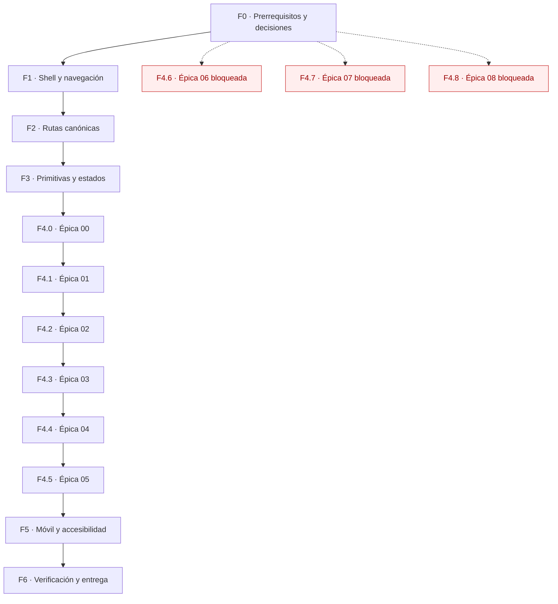

# Plan de implementación frontend — Pixkki

> Documento derivado de `docs/ui-ux-metodologia.md` y `docs/features/ui-ux/mapa-navegacion.md`.
> Define **qué** se construye, **en qué orden** y **con qué criterio de aceptación**.
> No autoriza implementación por sí mismo: requiere aprobación humana explícita (`APROBADO`) según `AGENTS.md` §4.

---

## 0. Resumen ejecutivo

El frontend actual tiene un shell único escrito íntegramente como cliente (`modules/dashboard/components/DashboardLayout.tsx`), sin navegación móvil, con enlaces muertos (`/reports`, `/medical`, `/vaccinations`, `/settings`) y permisos de menú que no existen en las migraciones del repositorio. La mitad de las vistas de las épicas 03–08 no existe o es un mock en inglés.

Este plan no rediseña el producto: **ordena la deuda en fases ejecutables** para que cada ancla del mapa de navegación llegue a sus cinco estados de UI (ideal, vacío, carga, parcial, error) sobre el backend real.

Resultado esperado al cerrar F1–F3: una persona autenticada puede navegar todo el producto en escritorio y móvil, sin rutas muertas, con permisos resueltos en tres capas y estados de carga/error en todas las anclas. Las épicas 06–08 quedan explícitamente bloqueadas hasta que exista su backend.

| Fase | Nombre | Bloquea a | Estado |
| :--- | :--- | :--- | :--- |
| **F0** | Prerrequisitos y decisiones | F1–F6 | ✅ Hecho (decisiones + anexos 03–08) |
| **F1** | Shell y navegación | F3, F5 | ✅ Hecho |
| **F2** | Rutas canónicas y redirects | F3, F4 | Requiere aprobación |
| **F3** | Primitivas compartidas y estados | F4, F5 | 🟡 Implementado — pendiente de aprobación |
| **F4** | Vistas por épica (00 → 08) | F5 | Parcialmente bloqueada |
| **F5** | Móvil y accesibilidad | F6 | Requiere aprobación |
| **F6** | Verificación y entrega | — | Requiere aprobación |

---

## 1. Alcance y exclusiones

### 1.1 Dentro del alcance

- Layout autenticado (`AppShell`) con sidebar de escritorio, bottom bar y drawer móvil.
- Configuración de navegación con permisos, validada en servidor.
- Rutas canónicas en español con redirects 308 desde las rutas inglesas existentes.
- Primitivas de estado compartidas (vacío, carga, error, parcial, no encontrado).
- Vistas listadas en el mapa de navegación, épica por épica.
- Accesibilidad: foco, teclado, contraste, `aria` y tamaños táctiles.
- Documentación: anexos UI/UX faltantes (03–08) y actualización de anexos 00–02.

### 1.2 Fuera del alcance

| Elemento | Motivo |
| :--- | :--- |
| Tests (unitarios, integración, e2e) | `AGENTS.md` §1 y §5.3. Los actualiza el responsable de testing. |
| Migraciones de base de datos | Requieren aprobación separada. Solo se listan como prerrequisito en F0. |
| Lógica de negocio en el frontend | Vive en `modules/*/services`. El frontend solo consume. |
| Backend de épicas 06, 07 y 08 | No existe endpoint. Las vistas quedan bloqueadas. |
| Rediseño de `/campanas` y `/eventos` | Solo se integran a la navegación (D-05). |
| Correo, notificaciones y buscador global | Sin requerimiento que los justifique (regla 7 del mapa). |
| Refactor de `modules/shelters/authorization.ts` | Deuda legada fuera de este plan. |

---

## 2. Prerrequisitos bloqueantes

Ningún ítem de esta tabla se ejecuta sin aprobación humana. Los marcados **DB** además requieren aprobación de migración.

| ID | Prerrequisito | Tipo | Bloquea | Recomendación |
| :--- | :--- | :--- | :--- | :--- |
| P-01 | Aprobar D-01 a D-08 del mapa de navegación | Decisión | Todo el plan | Aprobar el paquete completo |
| P-02 | Sembrar permisos `spaces.*`, `users.*`, `inventory.*`, `donations.*`, `reports.view` | **DB** | Visibilidad de anclas | Migración nueva, idempotente |
| P-03 | Definir catálogo de roles (`coordinador`, `operador`, `evaluador`) | **DB** | Vistas de épicas 4–8 | Ampliar `UserRole` + seed |
| P-04 | Confirmar canales de Servicios (services) para cada ancla | Análisis | F4 | Auditar `modules/*/services` antes de cada épica |
| P-05 | Redactar anexos UI/UX faltantes (03, 04, 05, 06, 07, 08) | Documentación | F4 por épica | Un anexo por épica, mismo formato que 00–02 |
| P-06 | Listar rutas legadas usadas por e2e | Coordinación | Retiro de redirects | El responsable de testing confirma |
| P-07 | Confirmar que `GET /api/v1/inventario/lotes` es el único endpoint de la épica 06 | Análisis | F4.6 | Verificar `app/api/v1` |

> **Regla:** si un prerrequisito no se cumple, la fase dependiente se detiene. No se simula el resultado con mocks nuevos.

---

## 3. Fases

### F0 — Prerrequisitos y decisiones

**Objetivo:** dejar el terreno legal y técnicamente despejado antes de tocar código.

**Entregables**

1. Decisiones D-01…D-08 resueltas y anotadas en `mapa-navegacion.md`.
2. Anexos UI/UX 03–08 creados en `docs/features/ui-ux/`, con el mismo esqueleto que 00–02: rutas, vistas, estados, permisos, RF trazados.
3. Inventario de permisos reales: consulta a las tablas `permiso` / `rol_permiso` del entorno y tabla de contraste.
4. Propuesta de migración de permisos y roles (solo documento, sin aplicar).
5. Confirmación del inventario de endpoints por épica.

**Archivos**

| Acción | Archivo |
| :--- | :--- |
| Crear | `docs/features/ui-ux/requerimiento-03-socializacion-espacios-ui-ux.md` |
| Crear | `docs/features/ui-ux/requerimiento-04-control-poblacional-ui-ux.md` |
| Crear | `docs/features/ui-ux/requerimiento-05-portal-adopciones-ui-ux.md` |
| Crear | `docs/features/ui-ux/requerimiento-06-donaciones-inventario-ui-ux.md` |
| Crear | `docs/features/ui-ux/requerimiento-07-inteligencia-datos-ui-ux.md` |
| Crear | `docs/features/ui-ux/requerimiento-08-datos-historicos-ui-ux.md` |
| Modificar | `docs/features/ui-ux/mapa-navegacion.md` (resolver §9) |

**DoD**

- [ ] Cada anexo declara sus rutas y sus cinco estados.
- [ ] Cada anexo mapea RF → vista → permiso.
- [ ] La tabla de permisos distingue "sembrado", "propuesto" y "no existe".
- [ ] No se aplicó ninguna migración.

---

### F1 — Shell y navegación

**Objetivo:** un solo shell autenticado, renderizado en servidor, con navegación derivada de permisos.

**Decisiones estructurales incluidas en esta fase**

- **E-01:** crear `modules/navigation/` (configuración + tipos + servicio puro de filtrado). Justificación: la navegación es transversal y no pertenece a `modules/dashboard`; `modules/dashboard` queda solo como módulo del panel.
- **E-02:** `AppShell` es Server Component; solo el sidebar y el drawer son Client Components, y reciben la navegación **ya filtrada** por props serializables.
- **E-03:** eliminar `app/(protected)/(dashboard)/layout.tsx` (layout sin efecto) y montar el shell una sola vez en `app/(protected)/layout.tsx`.

**Entregables**

1. `modules/navigation/navigation.config.ts` — anclas agrupadas por sección, con permiso, icono y ruta canónica. Sin rutas muertas.
2. `modules/navigation/navigation.types.ts` — tipos derivados de la config (`NavSection`, `NavItem`).
3. `modules/navigation/navigation.service.ts` — función pura `buildNavigation({ role, permissions })`. Sin Supabase, sin React.
4. `modules/navigation/index.ts` — API pública del módulo.
5. `components/layouts/AppShell.tsx` — Server Component: sidebar, header, contenido, bottom bar.
6. `components/layouts/AppSidebar.tsx` — Client Component: colapsable, estado activo por ruta, secciones filtradas.
7. `components/layouts/AppTopbar.tsx` — identidad del refugio, menú de usuario, cierre de sesión.
8. `components/layouts/AppMobileNav.tsx` — bottom bar (Panel, Animales, Adopciones, Inventario, Más) + `sheet` con todas las anclas.
9. `components/layouts/AppBreadcrumbs.tsx` — breadcrumb derivado de la config de rutas.
10. Refactor de `app/(protected)/layout.tsx` para usar `AppShell` y calcular la navegación en servidor.
11. Retiro de `modules/dashboard/components/navigation.config.ts` (reemplazado).
12. Retiro de `modules/dashboard/components/DashboardLayout.tsx` una vez migradas todas las páginas.

**Reglas de implementación**

- El filtro de permisos ocurre en el servidor. El cliente nunca recibe ítems que no puede ver.
- Si una sección queda sin anclas visibles, no se renderiza (regla 9 del mapa).
- `superadmin` ve Refugios y no ve anclas de refugio que dependan de `shelterId`.
- El sidebar no tiene submenús anidados; las subvistas son pestañas dentro del ancla.

**DoD**

- [ ] `navigation.config.ts` no contiene rutas inexistentes.
- [ ] Cada ancla tiene un permiso declarado y trazado al mapa.
- [ ] El shell renderiza sin `"use client"` en su raíz.
- [ ] Navegación filtrada correctamente para `admin`, `veterinario` y `superadmin`.
- [ ] `typecheck`, `lint` y `build` en verde.

---

### F2 — Rutas canónicas y redirects

**Objetivo:** una sola URL por vista, en español, con compatibilidad temporal hacia las rutas inglesas.

**Entregables**

1. Movimiento de rutas según la tabla §3.2 del mapa:
   - `/animals` → `/animales`
   - `/animals/[id]/clinical-record` → `/animales/[id]/ficha-clinica`
   - `/adoptions` → `/adopciones`
   - `/spaces` → `/espacios`
   - `/shelters` → `/refugios`
   - `/shelters/[id]` → `/refugios/[id]`
   - `/donations` → `/donaciones`
   - `/settings/security` → `/configuracion/seguridad`
   - `/settings/customize` → `/configuracion/apariencia`
   - `/staff` se conserva (D-03)
2. `next.config.js`: bloque `async redirects()` con 308 permanentes desde cada ruta legada.
3. `/shelters/new` → `/refugios?nuevo=1` y `/staff/add` → `/staff?agregar=1` como overlays, no páginas.
4. Actualización de todos los `href` internos y de `revalidatePath`/`redirect` en actions.
5. Ajuste de `middleware.ts`: allowlist pública para `/`, `/adopciones`, `/adopciones/[id]`, `/refugios`, `/refugios/[slug]`, `/aviso-privacidad`, `/terminos-condiciones`.
6. Normalización del catálogo de rutas en un único mapa exportado desde `modules/navigation`.

**Reglas**

- Ningún redirect apunta a otra ruta que también redirige (sin cadenas).
- Los redirects se retiran cuando P-06 confirme que no hay tests dependientes; hasta entonces se mantienen.
- No se renombra `/staff` (D-03).

**DoD**

- [ ] Cada ruta legada responde 308 hacia su canónica.
- [ ] No queda ningún `href` con ruta inglesa en el código.
- [ ] Las rutas públicas cargan sin sesión.
- [ ] `build` en verde.

**Estado de implementación (F2)**

- Se renombraron las rutas y se añadieron los 308 en `next.config.js`.
- `/shelters/new` redirige temporalmente a `/refugios/nuevo`; F4.0 lo convierte en el overlay `/refugios?nuevo=1`.
- `/staff/add` conserva su página hasta F4.0 (sin redirect, para no romper el alta).
- La allowlist pública de `/adopciones` y `/refugios` se difiere a F4.5: esas URLs sirven hoy las vistas privadas y D-05.1 exige resolver el shell por sesión. Sí se añadieron `/aviso-privacidad` y `/api/v1/publico/*`.
- Los tests e2e que aún usan rutas inglesas quedan a cargo del responsable de testing.

---

### F3 — Primitivas compartidas y estados

**Objetivo:** que las cinco estados de UI se resuelvan con componentes, no con texto improvisado por vista.

**Entregables**

1. `components/ui/empty-state.tsx` — icono, título, descripción, CTA obligatorio.
2. `components/ui/error-state.tsx` — mensaje en español, `reset()`, sin stack trace.
3. `components/ui/partial-state.tsx` — aviso de datos incompletos + acción de recarga.
4. `components/ui/page-header.tsx` — título, descripción, acciones, breadcrumb.
5. `components/ui/data-toolbar.tsx` — búsqueda, filtros y contador, reutilizable por ancla.
6. `components/ui/confirm-dialog.tsx` — confirmación destructiva con texto explícito.
7. `modules/shared/result.ts` — tipo `Result<T>` documentado (único tipo auxiliar permitido, `AGENTS.md` §10).
8. Convención de archivos de estado por ancla:
   - `loading.tsx` con skeleton de la forma real del contenido.
   - `error.tsx` con `ErrorState`.
   - `not-found.tsx` con mensaje genérico.
9. `app/(protected)/loading.tsx` y `app/(protected)/error.tsx` globales.

**Reglas**

- Ningún spinner centrado como único estado de carga.
- El vacío siempre ofrece una acción de rescate.
- El error conserva los filtros aplicados.
- El estado "parcial" solo aparece cuando el backend devuelve datos incompletos de forma verificable.

**DoD**

- [ ] Toda ancla tiene `loading.tsx`, `error.tsx` y estado vacío.
- [ ] Los componentes no contienen lógica de negocio ni acceso a datos.
- [ ] `typecheck` y `lint` en verde.

**Estado de implementación (F3)**

- Primitivas creadas en `components/ui/`: `empty-state`, `error-state`, `partial-state`, `page-header`, `data-toolbar` y `confirm-dialog`.
- `modules/shared/result.ts` define el único tipo auxiliar permitido (`Result<T>`, `AGENTS.md` §10) con sus constructores.
- `loading.tsx` y `error.tsx` creados por ancla: `dashboard`, `animales`, `adopciones`, `espacios`, `refugios`, `donaciones`, `configuracion`, `campaigns` y `events`. `staff` ya contaba con ambos y no se sobrescribió.
- `loading.tsx` y `error.tsx` globales en `app/(protected)/`; `not-found.tsx` genérico en `app/(protected)/(dashboard)/` para los `notFound()` de detalle.
- `ShelterList` consume `EmptyState` con CTA a `/refugios/nuevo`; el resto de vistas conserva sus estados locales hasta F4, cuando se migren a las primitivas.
- El estado "parcial" queda disponible pero sin uso: todavía ningún endpoint devuelve datos incompletos de forma verificable.
- `typecheck` solo falla en los 3 errores preexistentes de tests; `build` en verde (43 rutas).

---

### F4 — Vistas por épica

Cada subfase se ejecuta **solo** con su anexo aprobado (P-05) y su backend disponible.

#### F4.0 — Épica 00: refugios, espacios, personal y configuración

| Ruta | Vista | Backend | Estado actual |
| :--- | :--- | :--- | :--- |
| `/login`, `/forgot-password`, `/reset-password` | Autenticación | ✅ | Pulir estados |
| `/change-password`, `/accept-terms`, `/onboarding` | Compuertas | ✅ | Pulir estados |
| `/refugios`, `/refugios/[id]` | Listado y detalle (superadmin) | ✅ | Rehacer sobre `/shelters` |
| `/refugios?nuevo=1` | Overlay de alta | ✅ | Implementar |
| `/refugios?estado=[id]` | Overlay activar/desactivar | ✅ | Implementar |
| `/espacios` | Tarjetas por tipo con ocupación | ✅ | Rehacer sobre `/spaces` |
| `/staff` | Listado por rol | ✅ | Mover a overlay el alta |
| `/configuracion/refugio` | Datos del refugio | ✅ | Implementar |
| `/configuracion/seguridad` | MFA y contraseña | ✅ | Pulir |
| `/configuracion/cuenta` | Datos de la cuenta | ✅ | Implementar |
| `/configuracion/apariencia` | Tema | ✅ | Mover de ruta |

**DoD:** alta de refugio en overlay con confirmación; activar/desactivar con confirmación; espacios muestran ocupación real; personal lista por rol y desactiva con confirmación.

#### F4.1 — Épica 01: ingresos y expedientes

| Ruta | Vista |
| :--- | :--- |
| `/animales` | Listado con búsqueda, filtros y tarjetas |
| `/animales/nuevo` | Wizard de 4 pasos (datos → diagnóstico → aptitud → galería) |
| `/animales/[id]` | Ficha con cabecera, galería, diagnóstico de ingreso y aptitud |

**DoD:** el wizard valida por paso y no pierde estado al retroceder; la ficha es enlazable y recargable; el listado refleja los cinco estados.

#### F4.2 — Épica 02: control clínico y cuarentena

| Ruta | Vista |
| :--- | :--- |
| `/animales/[id]/ficha-clinica` | Línea de tiempo + chequeos + cuarentena + eventos sanitarios |

**DoD:** la línea de tiempo ordena y agrupa por tipo; cuarentena muestra días restantes y egreso; los paneles existentes (`AnimalClinicalRecord`, `AnimalClinicalPagePanels`) se integran sin duplicar lógica.

#### F4.3 — Épica 03: socialización y espacios

| Componente | Vista |
| :--- | :--- |
| Panel de traslados | `/animales/[id]/ficha-clinica` (pestaña) |
| Ocupación de espacios | `/espacios` |
| Conflicto de ocupación | Overlay de confirmación |

**DoD:** el traslado valida disponibilidad y muestra conflicto con acción explícita; la ocupación se refresca tras el movimiento.

#### F4.4 — Épica 04: control poblacional

| Componente | Vista |
| :--- | :--- |
| `AnimalRehabilitationPanel`, `AnimalTemperamentPanel`, cirugías | `/animales/[id]/ficha-clinica` |
| Aptitud y disponibilidad de adopción | `/animales/[id]` |

**DoD:** cada panel expone estado vacío propio; las evaluaciones se listan con fecha y responsable.

#### F4.5 — Épica 05: portal de adopciones

| Ruta | Vista |
| :--- | :--- |
| `/` | Landing + destacados del catálogo público |
| `/adopciones` (público) | Catálogo con filtros |
| `/adopciones/[idAnimal]` | Perfil público |
| `/adopciones/[idAnimal]/solicitud` | Formulario público |
| `/refugios`, `/refugios/[slug]` (público) | Directorio y página de refugio |
| `/adopciones` (privado) | Resumen |
| `/adopciones/solicitudes` | Bandeja por estado |
| `/adopciones/solicitudes/[id]` | Detalle y acciones |
| `/adopciones/perfiles` | Perfiles publicados y borradores |

**DoD:** la landing deja de consultar Supabase directamente (D-08) y se sirve desde un servicio; existe una sola landing; el formulario público respeta consentimiento y aviso de privacidad.

#### F4.6 — Épica 06: donaciones e inventario — **BLOQUEADA**

Solo existe `GET /api/v1/inventario/lotes`. Sin endpoints de insumos, movimientos, alertas, donaciones ni donantes.

**Se implementa cuando:** existan los endpoints y el anexo 06 aprobado.
**Mientras tanto:** el ancla no se muestra si el permiso no está sembrado; si se siembra, muestra estado vacío con "módulo en preparación" solo si el humano lo aprueba explícitamente. Recomendación: **no mostrar el ancla**.

#### F4.7 — Épica 07: reportes — **BLOQUEADA**

No existen rutas `/api/v1/reportes/*`. Se aplica la misma regla que F4.6.

#### F4.8 — Épica 08: datos históricos — **BLOQUEADA**

No existen rutas de importación. Se aplica la misma regla que F4.6.

---

### F5 — Móvil y accesibilidad

**Objetivo:** cumplir P6 del método (profundidad ≤ 3 en móvil, ≤ 4 en escritorio) y WCAG AA.

**Entregables**

1. Bottom bar con 5 destinos y drawer con todas las anclas.
2. Áreas táctiles ≥ 44×44 px.
3. Foco visible en todos los interactivos; trampa de foco en drawer y diálogos.
4. Navegación por teclado en sidebar, tabs y tablas.
5. `aria-current="page"` en el ancla activa.
6. Contraste AA sobre los tokens del tema actual.
7. Respeto de `prefers-reduced-motion`.
8. Revisión de desbordes en 320 px, 768 px y 1440 px.

**DoD**

- [ ] Ninguna vista supera 3 niveles en móvil.
- [ ] Todo overlay se cierra con `Esc` y devuelve el foco.
- [ ] Sin scroll horizontal en 320 px.
- [ ] Contraste verificado sobre los tokens existentes.

---

### F6 — Verificación y entrega

**Objetivo:** demostrar que lo construido cumple el contrato antes de commit.

**Secuencia obligatoria**

```text
npm run typecheck
npm run lint
npm run build
git diff
```

**Revisión manual por ancla**

| Comprobación | Criterio |
| :--- | :--- |
| Navegación | Se llega a toda ancla permitida en ≤ 3 clics |
| Permisos | Un rol sin permiso no ve el ítem ni puede entrar por URL |
| Estados | Ideal, vacío, carga, parcial y error comprobados |
| Multitenant | Ninguna vista muestra datos de otro refugio |
| Responsive | 320 / 768 / 1440 sin desbordes |
| Rutas | Toda ruta legada redirige 308 |
| Accesibilidad | Teclado completo y foco visible |

**DoD**

- [ ] `typecheck`, `lint` y `build` en verde.
- [ ] `git diff` presentado y aprobado.
- [ ] Checklist de `AGENTS.md` §17 completo.
- [ ] Commit convencional en inglés, un cambio comprensible por commit.

---

## 4. Inventario de archivos

### 4.1 Crear

```text
modules/navigation/
├── navigation.config.ts
├── navigation.service.ts
├── navigation.types.ts
└── index.ts

components/layouts/
├── AppShell.tsx
├── AppSidebar.tsx
├── AppTopbar.tsx
├── AppMobileNav.tsx
└── AppBreadcrumbs.tsx

components/ui/
├── empty-state.tsx
├── error-state.tsx
├── partial-state.tsx
├── page-header.tsx
├── data-toolbar.tsx
└── confirm-dialog.tsx

modules/shared/result.ts

app/(protected)/loading.tsx
app/(protected)/error.tsx
app/(protected)/<ancla>/loading.tsx
app/(protected)/<ancla>/error.tsx
app/not-found.tsx
```

### 4.2 Modificar

```text
app/(protected)/layout.tsx
middleware.ts
next.config.js
app/(public)/layout.tsx
app/(public)/landing/page.tsx
app/page.tsx
modules/*/actions/*.ts        (solo rutas de revalidate/redirect)
```

### 4.3 Eliminar

```text
app/(protected)/(dashboard)/layout.tsx
modules/dashboard/components/DashboardLayout.tsx
modules/dashboard/components/navigation.config.ts
app/(public)/landing/page.tsx        (si D-08 unifica en `/`)
```

> Toda eliminación ocurre **después** de migrar sus consumidores y con `git diff` aprobado.

---

## 5. Orden de ejecución



Las épicas 06–08 se reincorporan al flujo principal cuando exista su backend (P-07 y equivalentes).

---

## 6. Reglas de código aplicables

| Regla | Fuente |
| :--- | :--- |
| Server Components por defecto; `"use client"` solo en hojas interactivas | `AGENTS.md` §7 |
| El shell filtra permisos en servidor | mapa §6.8 |
| Zod como fuente única de tipos | `AGENTS.md` §10 |
| Sin acceso a Supabase fuera de `repositories/` | `AGENTS.md` §9 |
| Sin lógica de negocio en componentes ni actions | `AGENTS.md` §2, §8 |
| Imports absolutos con `@/` | `AGENTS.md` §12 |
| Mensajes de error en español, sin stack traces | `AGENTS.md` §13 |
| Sin `any`, sin `as` injustificado | `AGENTS.md` §6 |

---

## 7. Riesgos y mitigaciones

| ID | Riesgo | Impacto | Mitigación |
| :--- | :--- | :--- | :--- |
| R-01 | Tests e2e apuntan a rutas inglesas | Alto | Mantener redirects 308 hasta P-06; no tocar tests |
| R-02 | Permisos no sembrados ocultan anclas | Alto | P-02 aprobado antes de F4; validar en servidor |
| R-03 | Roles inexistentes rompen flujos de épicas 4–8 | Alto | P-03; diseñar por permiso, no por rol |
| R-04 | Épicas 06–08 sin backend generan UI falsa | Medio | Ancla oculta; no crear mocks nuevos |
| R-05 | Refactor del shell rompe páginas existentes | Medio | Migrar página por página, build entre lotes |
| R-06 | Dos landings y acceso directo a Supabase en `app/` | Medio | D-08; servicio único de landing |
| R-07 | Shell cliente actual arrastra estado global | Bajo | E-02: servidor compone, cliente solo interactúa |
| R-08 | Renombres de ruta rompen enlaces internos | Medio | Mapa único de rutas en `modules/navigation`; grep de `href` |

---

## 8. Estimación relativa

| Fase | Esfuerzo | Bloqueo |
| :--- | :---: | :--- |
| F0 | M | Aprobación D-01…D-08 + P-05 |
| F1 | L | F0 |
| F2 | M | F1, P-06 |
| F3 | M | F2 |
| F4.0 | L | F3, P-02, P-03 |
| F4.1 | L | F4.0 |
| F4.2 | M | F4.1 |
| F4.3 | M | F4.2 |
| F4.4 | M | F4.3 |
| F4.5 | L | F4.4 |
| F4.6–F4.8 | — | Backend inexistente |
| F5 | M | F4.5 |
| F6 | S | F5 |

`S` ≤ 1 sesión · `M` 2–3 sesiones · `L` 4+ sesiones.

---

## 9. Aprobación requerida

Este plan **no se ejecuta** hasta que el humano responda `APROBADO` indicando:

1. Paquete de decisiones D-01…D-08.
2. Creación de `modules/navigation/` (E-01).
3. Shell en servidor con islas cliente (E-02).
4. Eliminación del layout no-op y del shell cliente actual (E-03).
5. Autorización para redactar los anexos 03–08.
6. Confirmación de que P-02 y P-03 se tramitarán como migraciones separadas.

Sin esos seis puntos, el agente solo puede trabajar en F0 (documentación).

---

**Fin del plan.** El mapa de navegación vive en `docs/features/ui-ux/mapa-navegacion.md`; el método en `docs/ui-ux-metodologia.md`.
