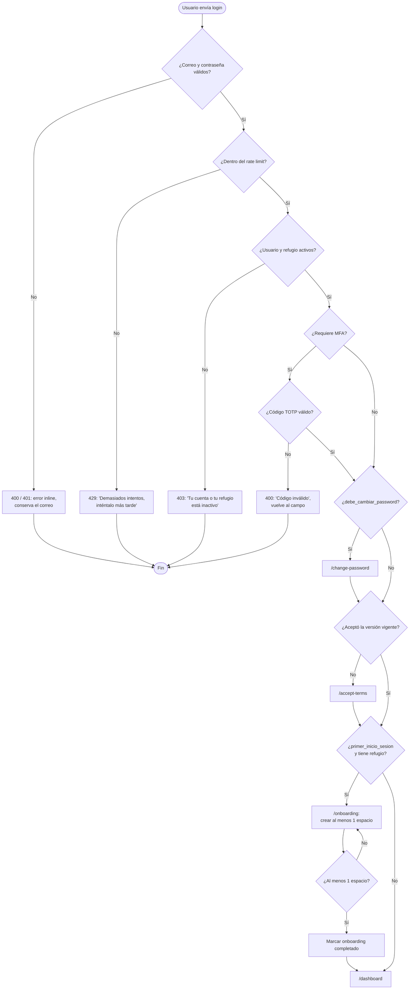
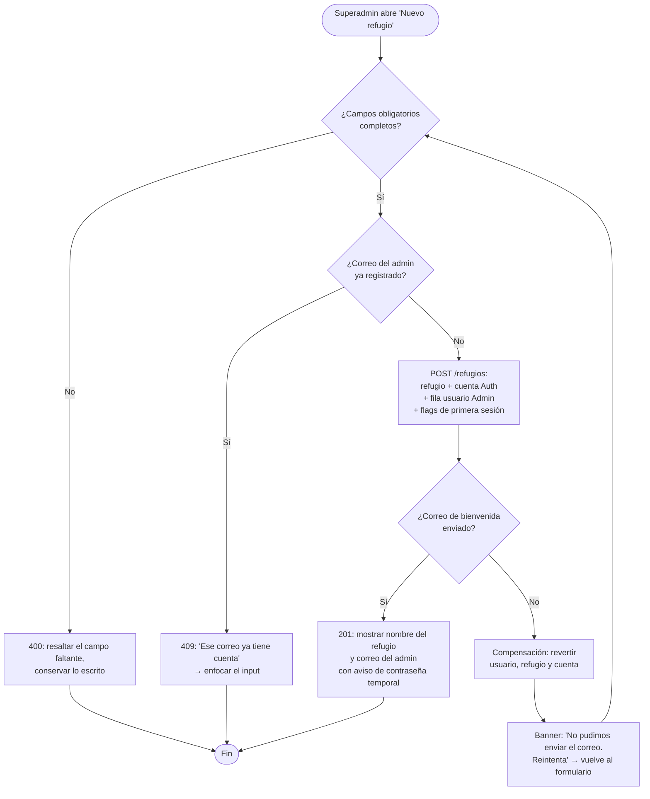
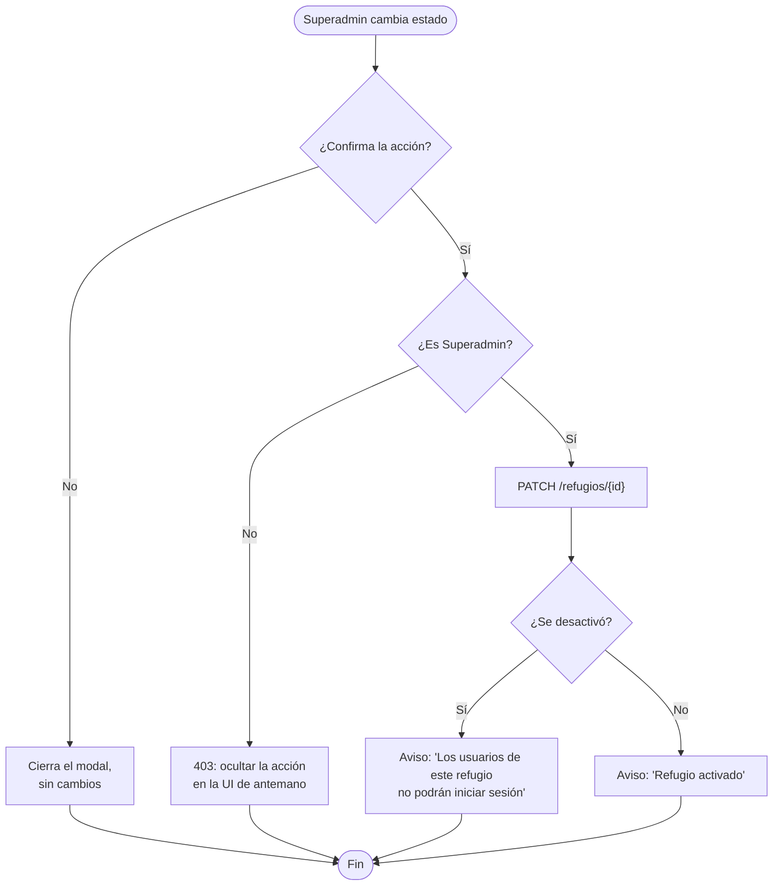
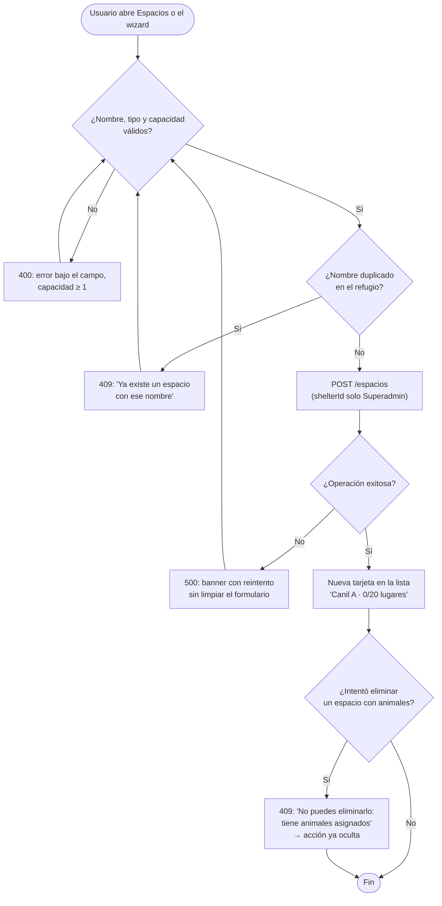
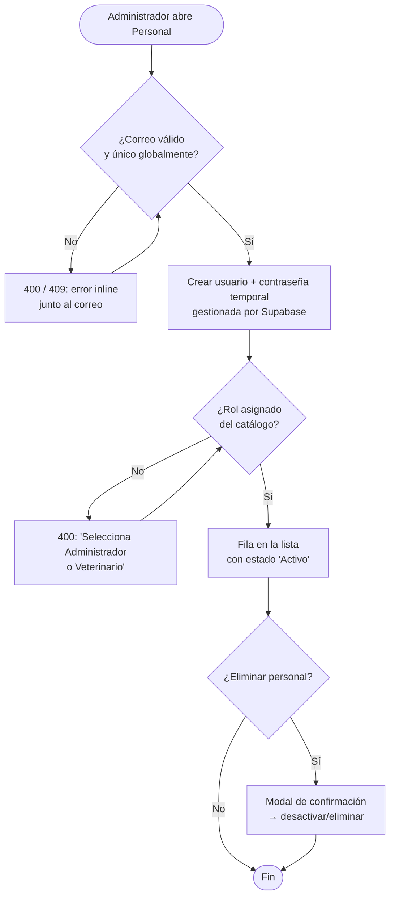

# Anexo UI/UX — Requerimiento 00 (Épica 0)

> **Fuente:** `docs/features/requerimiento-00-gestion-refugios-superusuario.md`.
> **Método:** `docs/ui-ux-metodologia.md`.
> **Actores:** Superadmin (rol `Superadmin`, `id_refugio = NULL`), Administrador de refugio, Personal (`Veterinario`), Usuario no autenticado.
> **Vistas cubiertas:** `/login`, `/change-password`, `/accept-terms`, `/onboarding`, `/superadmin/refugios`, `/espacios`, `/staff`.
> **Nota:** la autorización real se verifica en el service (RBAC); la UI solo oculta acciones. Catálogo de roles: `Administrador`, `Veterinario`, `Superadmin` (comparación por nombre normalizado).

---

## 1. Inventario de contenido (E-C-S)

### Vista `/login` — usuario no autenticado

| Zona | Nivel | Elemento | Origen de datos / contrato | Comportamiento UI | Capa |
| :--- | :---: | :--- | :--- | :--- | :--- |
| Top Bar | C | Nombre Pixkki + enlace "Términos y condiciones" | Ruta canónica `/terminos-condiciones` | Enlace secundario; abre en la misma pestaña. | SC |
| Context | C | Título "Inicia sesión" y subtítulo institucional | Texto estático | Ancla mental; sin imágenes decorativas. | SC |
| Body | E | Input Correo | `POST /api/v1/auth/login` (`email`) | Requerido, `type="email"`, autofoco. | CC |
| Body | E | Input Contraseña | `POST /api/v1/auth/login` (`password`) | Requerido, `type="password"`, toggle de visibilidad. | CC |
| Body | C | Enlace "¿Olvidaste tu contraseña?" | `POST /api/v1/auth/recover-password` | Lleva a `/recover-password`; mensaje genérico siempre. | SC |
| Body | S | Recordatorio "Mantén tu sesión" | Estado local | Checkbox opcional, no afecta RBAC. | CC |
| Bottom Bar | E | Botón "Iniciar sesión" | `POST /api/v1/auth/login` | CTA sticky en móvil (≥48 px); deshabilitado si faltan campos. | CC |
| Body | C | Mensaje de error de credenciales | `error.message` (`401` / `403` / `429`) | Inline bajo el campo correspondiente; conserva el correo escrito. | CC |

### Vista `/accept-terms` — usuario autenticado, términos pendientes

| Zona | Nivel | Elemento | Origen de datos / contrato | Comportamiento UI | Capa |
| :--- | :---: | :--- | :--- | :--- | :--- |
| Top Bar | C | Título "Términos y condiciones" + versión | `modules/auth/constants.ts` (versión vigente) | Muestra `terminos_version` legible ("v1.2"). | SC |
| Body | E | Contenido de los términos | Ruta `/terminos-condiciones` | Texto completo con scroll; no resumir. | SC |
| Body | E | Checkbox "Acepto los términos y condiciones" | `acceptTermsAction` | Obligatorio; sin marca, el CTA permanece deshabilitado (RN9). | CC |
| Bottom Bar | E | Botón "Aceptar y continuar" | `acceptTermsAction` | CTA sticky en móvil; registra `aceptado_en` e `id_usuario`. | CC |
| Body | C | Aviso "Sin aceptación no puedes entrar al panel" | RN9 | Texto de ayuda junto al checkbox, no modal. | SC |

### Vista `/change-password` — `debe_cambiar_password = true`

| Zona | Nivel | Elemento | Origen de datos / contrato | Comportamiento UI | Capa |
| :--- | :---: | :--- | :--- | :--- | :--- |
| Top Bar | C | Título "Establece tu contraseña" + stepper "1 de 3" | Flag `debeCambiarPassword` de `GET /api/v1/auth/me` | Indica progreso dentro de la compuerta post-login. | SC |
| Body | E | Contraseña nueva | `changePasswordSchema` (`modules/auth/schemas.ts`) | Requerida; muestra reglas de complejidad como helper text. | CC |
| Body | E | Confirmar contraseña | `changePasswordSchema` (`modules/auth/schemas.ts`) | Debe coincidir; error inline inmediato. | CC |
| Bottom Bar | E | Botón "Guardar y continuar" | `changePasswordAction` (`modules/auth/action.ts`) → `service.changePassword` | CTA sticky; tras éxito limpia `debe_cambiar_password` y avanza a términos. | CC |

> **Resolución P-03:** no se crea un endpoint v1 nuevo. Se reutiliza el Server Action existente `changePasswordAction` (mismo patrón que `acceptTermsAction` en RF0.7); el formulario ya vive en `app/(public)/(auth)/change-password/ChangePasswordForm.tsx`.

### Vista `/onboarding` — `primer_inicio_sesion = true`

| Zona | Nivel | Elemento | Origen de datos / contrato | Comportamiento UI | Capa |
| :--- | :---: | :--- | :--- | :--- | :--- |
| Top Bar | C | Título "Configura tu refugio" + stepper "3 de 3" | Flag `primerInicioSesion` de `GET /api/v1/auth/me` | Último paso de la compuerta. | SC |
| Context | C | Resumen "Refugio Patitas · Guadalajara, Jalisco" | `GET /api/v1/refugios/{id}` | Confirma al usuario qué refugio está configurando. | SC |
| Body | E | Formulario "Crear espacio": nombre, tipo, capacidad | `POST /api/v1/espacios` | `tipo` = Canil / Gatera / Cuarentena / Rehabilitación / Otro (Zod). | CC |
| Body | C | Helper "Necesitas al menos 1 espacio para terminar" | RN11 | Texto visible; el CTA final se bloquea hasta cumplirlo. | SC |
| Body | C | Lista de espacios creados en el wizard | `GET /api/v1/espacios` | Tarjetas compactas con nombre, tipo y "3/20 lugares". | SC |
| Bottom Bar | E | Botón "Finalizar configuración" | `POST /api/v1/espacios` + marcado de onboarding | CTA sticky; deshabilitado con 0 espacios. | CC |

### Vista `/superadmin/refugios` — Superadmin

| Zona | Nivel | Elemento | Origen de datos / contrato | Comportamiento UI | Capa |
| :--- | :---: | :--- | :--- | :--- | :--- |
| Top Bar | C | Título "Refugios" + total global | `GET /api/v1/refugios` | "24 refugios · 22 activos". | SC |
| Body | E | Tabla: nombre, ciudad/estado, fecha registro, estado | `GET /api/v1/refugios` | En móvil, tarjetas apiladas con el mismo inventario. | SC |
| Body | E | Buscador por nombre | `GET /api/v1/refugios` (`search`) | Pegado a la cabecera de la tabla (Ley de Proximidad). | CC |
| Body | C | Filtro por estado operativo | `GET /api/v1/refugios` | Chips "Todos / Activos / Inactivos". | CC |
| Body | C | Botón "Nuevo refugio" | `POST /api/v1/refugios` | Abre overlay (modal / bottom sheet en móvil) — ver P-01. | CC |
| Body | C | Acción "Activar / Desactivar" por fila | `PATCH /api/v1/refugios/{id}` | Requiere confirmación (P-02); avisa del efecto en el login. | CC |
| Bottom Bar | S | Enlace "Ver términos vigentes" | `/terminos-condiciones` | Enlace de texto, peso bajo. | SC |

### Overlay "Nuevo refugio" — Superadmin

| Zona | Nivel | Elemento | Origen de datos / contrato | Comportamiento UI | Capa |
| :--- | :---: | :--- | :--- | :--- | :--- |
| Context | C | Título "Dar de alta refugio" | Texto estático | Explica que se crea también la cuenta del administrador. | SC |
| Body | E | Nombre del refugio | `POST /api/v1/refugios` (`nombre_albergue`) | Requerido; error `409` si duplicado. | CC |
| Body | E | Nombre y correo del administrador | `POST /api/v1/refugios` (`nombre_admin`, `correo_admin`) | Correo único global; validación inline. | CC |
| Body | E | Ciudad / estado y correo de contacto | `POST /api/v1/refugios` | Requeridos. | CC |
| Body | C | Teléfono | `POST /api/v1/refugios` (`telefono`) | Opcional, `inputMode="tel"`. | CC |
| Body | C | Aviso "Se enviará un correo de bienvenida con la contraseña temporal" | RN4 | Texto de ayuda antes del envío. | SC |
| Bottom Bar | E | Botón "Crear refugio" | `POST /api/v1/refugios` | CTA sticky; deshabilitado hasta validar campos. | CC |

### Vista `/espacios` — Administrador / Superadmin

| Zona | Nivel | Elemento | Origen de datos / contrato | Comportamiento UI | Capa |
| :--- | :---: | :--- | :--- | :--- | :--- |
| Top Bar | C | Título "Espacios" + ocupación total | `GET /api/v1/espacios` | "38/72 lugares ocupados". | SC |
| Body | E | Tarjetas por espacio: nombre, tipo, capacidad, disponible | `GET /api/v1/espacios` | Agrupadas por tipo (Ley de Proximidad). | SC |
| Body | C | Selector de tipo y disponibilidad | `GET /api/v1/espacios` (`type`, `available`) | Chips de filtro pegados al encabezado. | CC |
| Body | E | Botón "Nuevo espacio" | `POST /api/v1/espacios` | Abre overlay; `shelterId` solo para Superadmin. | CC |
| Body | C | Acciones Editar / Eliminar por tarjeta | `PATCH` / `DELETE /api/v1/espacios/{id}` | Eliminar se oculta si el espacio tiene animales (RN10); confirmación obligatoria. | CC |
| Bottom Bar | S | Ayuda "No puedes eliminar un espacio con animales asignados" | RN10 | Enlace/texto de ayuda, peso bajo. | SC |

### Vista `/staff` — Administrador

| Zona | Nivel | Elemento | Origen de datos / contrato | Comportamiento UI | Capa |
| :--- | :---: | :--- | :--- | :--- | :--- |
| Top Bar | C | Título "Personal del albergue" | Texto estático | — | SC |
| Body | E | Lista de usuarios: nombre, correo, rol, activo | `getStaffAction()` (`modules/users/actions/user.actions.ts`) | Tarjetas agrupadas por rol; en móvil, una columna. | SC |
| Body | E | Botón "Agregar miembro" | `createStaffAction()` (`modules/users/actions/user.actions.ts`) | Valida correo único global (RN6); abre overlay. | CC |
| Body | C | Acciones Activar / Desactivar | `toggleStaffStatusAction(id, activo)` | Confirma antes de desactivar. | CC |
| Body | C | Acción Eliminar | `deleteStaffAction(id)` | Confirmación obligatoria; estilo de peligro separado. | CC |
| Body | C | Aviso "Contraseña temporal gestionada por Supabase" | RN6 | Helper text junto a "Agregar miembro". | SC |

> **Resolución P-04:** la gestión de personal vive en la ruta `/staff` y en las acciones de `modules/users/actions/user.actions.ts`. Esta vista queda pendiente de un refactor separado (ver sección 4).

---

## 2. Flujos de usuario

### Flujo A — Acceso y compuertas post-login (RF0.5, RF0.7, RF0.9)

**Notas de móvil:** `/change-password`, `/accept-terms` y `/onboarding` son pasos de una sola columna con CTA sticky; el stepper va arriba (zona de contexto), nunca cerca del pulgar. No se permite salir del wizard por un enlace flotante: solo tras completar el espacio.

### Flujo B — Alta de refugio y provisión de credenciales (RF0.2)

**Notas de móvil:** el formulario del overlay se presenta como *bottom sheet* desplazable; el CTA "Crear refugio" queda fijo abajo. Tras el éxito se cierra el overlay y se recarga el listado sin perder los filtros activos.

### Flujo C — Modulación del estado operativo (RF0.3)

**Notas de móvil:** la confirmación es un *bottom sheet* con el botón destructivo separado y en rojo; nunca un `alert()` del navegador.

### Flujo D — Gestión de espacios y onboarding (RF0.8, RF0.9)

**Notas de móvil:** la lista de espacios es una pila de tarjetas; el botón "Nuevo espacio" queda en la barra inferior fija. En el wizard, el mismo componente se reutiliza sin duplicar validación (mismo schema Zod).

### Flujo E — Gestión de personal interno (RF0.4)

**Notas de móvil:** acciones de fila se agrupan en un menú `...` para no saturar la tarjeta; el menú se abre como *bottom sheet*.

---

## 3. Los 5 estados de interfaz

| Vista | Ideal | Vacío | Carga | Parcial | Error | Recuperación |
| :--- | :--- | :--- | :--- | :--- | :--- | :--- |
| `/login` | Correo recordado y CTA habilitado. | Sin historial: helper "Usa el correo que te dio el refugio". | Botón con spinner "Iniciando sesión…"; bloquea doble clic. | Correo autocompletado, contraseña pendiente. | `401`/`403`/`429`: mensaje bajo el campo, correo conservado. | Corrige el campo o usa "Olvidaste tu contraseña". |
| `/accept-terms` | Texto legible y checkbox marcado → CTA activo. | Sin versión vigente: aviso "Contacta al administrador". | Skeleton del documento. | Texto cargado, checkbox sin marcar. | `400` al aceptar: no se escribe nada; banner con motivo. | Vuelve a marcar y reenvía; no pierde el scroll. |
| `/change-password` | Ambas contraseñas coinciden → CTA activo. | — | Botón "Guardando…". | Contraseña nueva escrita, confirmación pendiente. | `400`: resalta el campo que falló y muestra la regla incumplida. | Corrige sin limpiar el otro campo. |
| `/onboarding` | 1+ espacios creados → "Finalizar" habilitado. | 0 espacios: ilustración + CTA "Crear mi primer espacio" (RN11). | Skeleton de la lista de espacios. | 1 espacio de varios esperados; aviso "Puedes agregar más después". | `409` nombre duplicado / `500` de creación: conserva el formulario. | Reintento enfoca el nombre; el espacio creado sigue en la lista. |
| `/superadmin/refugios` | Tabla completa con totales y filtros. | Sin refugios: "Aún no hay refugios" + CTA "Dar de alta refugio". | Skeleton de filas con la misma altura. | 1–2 refugios: tarjeta informativa "Los nuevos refugios aparecerán aquí". | `500` al cargar: banner con "Reintentar". | Reintento mantiene búsqueda y filtro de estado. |
| Overlay "Nuevo refugio" | Campos válidos → CTA activo. | — | Botón "Creando…" con progreso; bloquea cierre accidental. | Correo escrito, faltan ciudad/estado. | `409` correo duplicado / fallo de correo de bienvenida. | Corrige el correo o reintenta el envío sin perder los datos (Flujo B). |
| `/espacios` | Tarjetas por tipo con ocupación legible. | Sin espacios: "Configura tu primer espacio" + CTA (mismo que onboarding). | Skeleton de tarjetas. | Un solo espacio: aviso "Agrega cuarentena y rehabilitación". | `409` eliminar con animales / `409` capacidad menor a ocupación. | Oculta la acción inválida; si llega el error, explica el motivo en español. |
| `/staff` | Lista con roles y estados claros. | Solo el administrador: "Invita a tu equipo" + CTA. | Skeleton de filas. | Pocos usuarios: aviso "Veterinario pendiente de aceptar invitación". | `409` correo duplicado; `403` si el rol no puede gestionar. | Enfoca el correo; la UI ya ocultó el botón para roles sin permiso. |

---

## 4. Decisiones aplicadas

| ID | Decisión | Origen |
| :--- | :--- | :--- |
| P-01 | Alta de refugio en **overlay** sobre el listado (bottom sheet en móvil). | Confirmado por el usuario. |
| P-02 | Activar/desactivar exige **confirmación** con aviso del efecto en el login. | Confirmado por el usuario. |
| P-03 | `/change-password` usa el Server Action existente `changePasswordAction`; **no se crea endpoint v1**. | Resuelto por delegación: ya existe en `modules/auth/action.ts`, con `changePasswordSchema` y `service.changePassword`. |
| P-04 | Gestión de personal = ruta `/staff` + acciones de `modules/users/actions/user.actions.ts`. | Confirmado por el usuario. |
| P-05 | Wizard de onboarding: **mínimo 1 espacio**; el resto se agrega después. | Confirmado por el usuario. |
| P-06 | Listado global en móvil: **tarjetas apiladas**. | Confirmado por el usuario. |

### Refactor de `/staff` — implementado

Aprobado por el usuario. Cambios realizados:

- `app/(protected)/(dashboard)/staff/page.tsx` pasó de `"use client"` a **Server Component**; la interacción vive en `modules/users/components/StaffList.tsx`.
- Catálogo de roles alineado a los **3 reales** (`administrador`, `veterinario`, `superadmin`; ids 1–3) en `modules/users/types.ts`, `schemas.ts` y `modules/auth/types.ts`. Eliminados `operador`, `coordinador` y `evaluador`. `Superadmin` no es asignable desde `/staff` (tiene `id_refugio = NULL`).
- Las 4 Server Actions devuelven `UserActionResult<T>` con mensajes en español (`modules/users/actions/user-action-result.ts`), en lugar de lanzar excepciones crudas.
- Alcance global del superadmin: listado, activación/desactivación y eliminación de personal de cualquier refugio (`findByIdGlobal` en el repository). Para crear personal, el superadmin selecciona el refugio en el modal.
- Confirmación obligatoria antes de eliminar, CTA sticky en móvil y estados vacío / carga / parcial / error en `StaffList`.
- `revalidatePath` corregido de `/dashboard/staff` a `/staff` (los route groups no afectan la URL).
