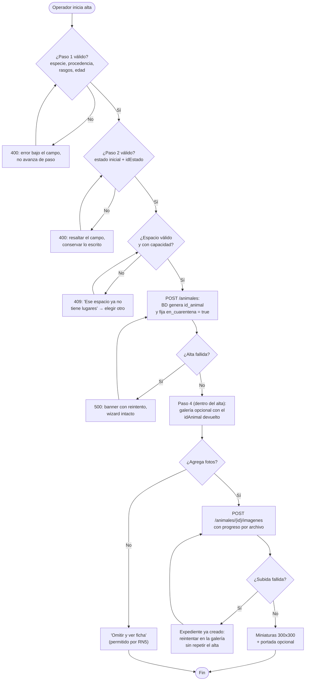
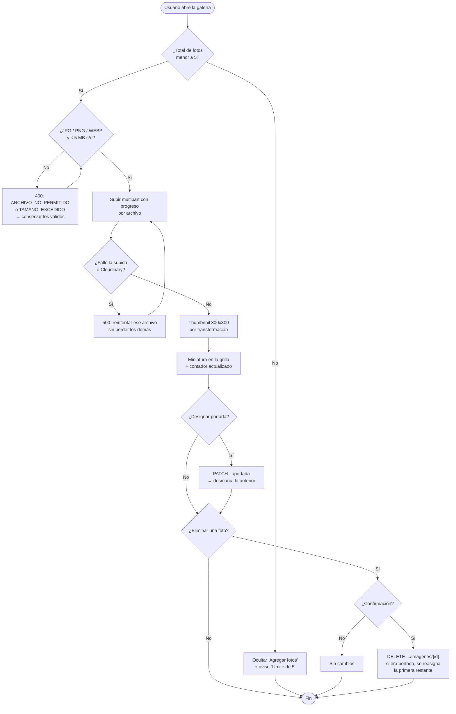
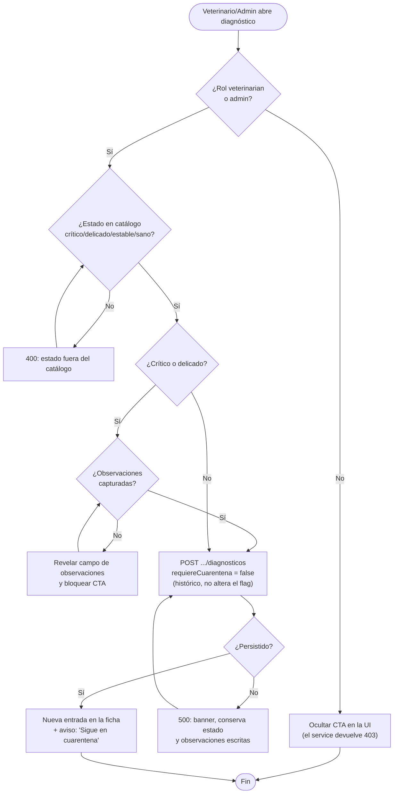

# Anexo UI/UX — Requerimiento 01 (Épica 1)

> **Fuente:** `docs/features/requerimiento-01-ingresos-expedientes.md`.
> **Método:** `docs/ui-ux-metodologia.md`.
> **Actores:** Personal del refugio (operador/coordinador), Veterinario, Administrador, Sistema (Cloudinary).
> **Vistas cubiertas:** `/animales`, `/animales/nuevo`, ficha del animal (galería + diagnóstico), `/animales/[id]/ficha-clinica`.
> **Nota de dominio:** todo ingreso nace con `en_cuarentena = true`. La UI lo comunica; **el diagnóstico nunca libera la cuarentena** (solo lo hace la Épica 2).

---

## 1. Inventario de contenido (E-C-S)

### Vista `/animales` — listado de pacientes

| Zona | Nivel | Elemento | Origen de datos / contrato | Comportamiento UI | Capa |
| :--- | :---: | :--- | :--- | :--- | :--- |
| Top Bar | C | Título "Animales" + total | `GET /api/v1/animales` | "128 pacientes · 14 en cuarentena". | SC |
| Body | E | Tarjetas de paciente: portada, nombre/identidad, especie, badges | `GET /api/v1/animales`, `url_thumbnail` | En móvil, tarjeta apilada; badge "En cuarentena" siempre visible. | SC |
| Body | E | Buscador por nombre/rasgos | `GET /api/v1/animales` (`q`) | Pegado a la cabecera (Ley de Proximidad). | CC |
| Body | C | Filtros: especie, estado de salud, en cuarentena | `GET /api/v1/animales` | Chips compactos; conservan su valor al volver de la ficha. | CC |
| Body | E | Botón "Dar de alta" | `POST /api/v1/animales` | CTA principal; en móvil, barra inferior fija. | SC |
| Bottom Bar | S | Leyenda de badges | Texto estático | Explica "Cuarentena" y "Crítico" con texto, no solo color (accesibilidad). | SC |

### Vista `/animales/nuevo` — alta del paciente (RF1.1)

| Zona | Nivel | Elemento | Origen de datos / contrato | Comportamiento UI | Capa |
| :--- | :---: | :--- | :--- | :--- | :--- |
| Top Bar | C | Título "Nuevo paciente" + stepper "Paso X de 4" | Estado local del wizard | Muestra progreso; permite retroceder sin perder datos. | CC |
| Context | C | Resumen del paso anterior | Borrador local | "Perro · Procedencia: Calle · 12 meses". | CC |
| Body (Paso 1) | E | Especie (Perro / Gato) | `POST /api/v1/animales` (`especie`) | Segmented control; requerido. | CC |
| Body (Paso 1) | E | Procedencia (2–200) | `POST /api/v1/animales` (`procedencia`) | Input texto; contador de caracteres. | CC |
| Body (Paso 1) | C | Edad estimada en meses (0–300, opcional) | `POST /api/v1/animales` (`edadEstimada`) | `inputMode="numeric"`; helper "En meses, deja vacío si se desconoce". | CC |
| Body (Paso 1) | E | Rasgos físicos distintivos (2–500) | `POST /api/v1/animales` (`rasgosFisicos`) | Textarea; requerida. | CC |
| Body (Paso 2) | E | Estado inicial (descripción, 2–100) | `POST /api/v1/animales` (`estadoInicial`) | Textarea; requerida. | CC |
| Body (Paso 2) | E | Estado (catálogo `idEstado`) | `POST /api/v1/animales` (`idEstado`) | Select con etiqueta legible; **nunca mostrar el id**. | CC |
| Body (Paso 2) | C | Datos de rescate: lugar, fecha, situación, rescatista | `POST /api/v1/animales` | Opcionales; divulgación progresiva (sección colapsable "Datos de rescate"). | CC |
| Body (Paso 3) | E | Espacio (`idEspacio`) | `POST /api/v1/animales` (`idEspacio`) | Select con "Canil A · 3/20 lugares"; **nunca mostrar el id**. | CC |
| Body (Paso 3) | C | Datos opcionales: nombre, raza, sexo, peso, color, tamaño, microchip | `POST /api/v1/animales` | Segunda sección colapsable "Datos adicionales". | CC |
| Body (Paso 3) | C | Aviso "El paciente ingresará en cuarentena" | RN3 | Banner informativo, no editable. | SC |
| Bottom Bar | E | Botón "Continuar" / "Guardar expediente" | `POST /api/v1/animales` | CTA sticky; en el paso 3 crea el expediente y devuelve `idAnimal`. | CC |
| Body (Paso 4) | E | Galería de fotos (0–5 imágenes) | `POST /api/v1/animales/{id}/imagenes` | Misma grilla y reglas de la ficha; **opcional** (RN5) y omisible. | CC |
| Body (Paso 4) | C | Botón "Omitir y ver ficha" | Router | CTA secundario; el expediente ya existe. | SC |
| Bottom Bar (Paso 4) | E | Botón "Finalizar" | Galería + ficha | CTA sticky; cierra el wizard y lleva a la ficha del animal. | CC |

> El `id_animal` se genera en base de datos (RN2): **no existe campo para él en el formulario**. El paso 4 usa el `idAnimal` devuelto por el alta; las imágenes se suben después con `POST /api/v1/animales/{id}/imagenes` (RN5), sin cambiar el contrato. Si la subida falla, el expediente permanece creado y se ofrece reintentar desde la galería de la ficha, sin repetir el alta.

### Vista ficha del animal — galería (RF1.2)

| Zona | Nivel | Elemento | Origen de datos / contrato | Comportamiento UI | Capa |
| :--- | :---: | :--- | :--- | :--- | :--- |
| Context | C | Cabecera con portada, nombre/rasgos y badges | `GET /api/v1/animales/{id}`, `url_thumbnail` | Ancla mental; badge de cuarentena. | SC |
| Body | E | Grilla de miniaturas 300×300 | `GET /api/v1/animales/{id}/imagenes` | Orden: portada primero, luego `orden`. | SC |
| Body | E | Botón "Agregar fotos" | `POST /api/v1/animales/{id}/imagenes` | Abre selector multiple; oculto si ya hay 5 (RN5). | CC |
| Body | C | Contador "3 de 5 fotos" | Conteo de la galería | Se actualiza después de cada subida. | SC |
| Body | E | Barra de progreso por archivo | Progreso de la petición multipart | "Subiendo foto 2 de 5… 60%"; bloquea reenvío (RN6). | CC |
| Body | C | Botón "Usar como portada" por miniatura | `PATCH .../imagenes/{idImagen}/portada` | Acción explícita y accesible; desmarca la anterior (RN8). | CC |
| Body | C | Badge "Portada" en la imagen principal | `esPortada` | Texto + ícono, no solo color. | SC |
| Body | E | Acción "Eliminar" por miniatura | `DELETE .../imagenes/{idImagen}` | Confirmación obligatoria; si era portada, avisa de la reasignación automática (RN8). | CC |
| Body | C | Helper "JPG, PNG o WEBP · máx. 5 MB c/u" | RN5 | Junto al botón de agregar; prevención antes del error. | SC |

### Vista ficha del animal — diagnóstico de ingreso (RF1.3)

| Zona | Nivel | Elemento | Origen de datos / contrato | Comportamiento UI | Capa |
| :--- | :---: | :--- | :--- | :--- | :--- |
| Context | C | Tarjeta resumen del paciente | `GET /api/v1/animales/{id}` | Foto, rasgos, badge "En cuarentena". | SC |
| Body | E | Estado general de salud | `POST /api/v1/animales/{id}/diagnosticos` | Crítico / Delicado / Estable / Sano (RN9). | CC |
| Body | E | Observaciones médicas | `POST .../diagnosticos` (`observaciones`) | Obligatoria solo si Crítico o Delicado (RN9); se revela al elegir esas opciones (divulgación progresiva). | CC |
| Body | C | Aviso "Este diagnóstico no libera la cuarentena. La alta médica (Épica 2) la decide." | RN9, RN10 | Helper text sintetizado, visible junto al selector; evita expectativa errónea. | SC |
| Body | S | Historial de diagnósticos | `GET .../diagnosticos` | Colapsable; fecha + estado + observaciones. | SC |
| Bottom Bar | E | Botón "Registrar diagnóstico" | `POST .../diagnosticos` | CTA sticky; deshabilitado sin rol o sin observaciones requeridas. Puede ocultarse para roles sin permiso (RN10). | CC |

### Vista `/animales/[id]/ficha-clinica` (RF1.4)

| Zona | Nivel | Elemento | Origen de datos / contrato | Comportamiento UI | Capa |
| :--- | :---: | :--- | :--- | :--- | :--- |
| Top Bar | C | Título "Ficha clínica" + identidad del paciente | `GET .../ficha-clinica` | Retroceso a la ficha del animal. | SC |
| Context | E | Banner rojo de alta prioridad | `alertas` (`cuarentena`, `estado_critico`) | Aparece si `en_cuarentena = true` **o** estado Crítico (RN11); texto explícito, no solo color. | SC |
| Body | E | Línea de tiempo cronológica | `linea_tiempo` | Ordenada por fecha; entradas de todas las épicas. | SC |
| Body | C | Entradas: diagnóstico, constantes, vacunas, temperamento, esterilización | `linea_tiempo[].tipo` | Cada tipo con ícono y etiqueta legible; datos de épicas futuras en solo lectura. | SC |
| Body | C | Placeholder por tipo sin registros | Derivado de `linea_tiempo` | "Aún sin registros de vacunas" en lugar de ocultar el tipo (decisión P-05). | SC |
| Bottom Bar | S | Acción "Volver a la ficha" | Router | Enlace de texto, peso bajo. | SC |

---

## 2. Flujos de usuario

### Flujo A — Alta de paciente (RF1.1)

**Notas de móvil:** stepper de 4 pasos, un campo por fila, teclado numérico para edad. El paso 4 reutiliza la galería de la ficha (mismo componente, mismo schema) con CTA "Finalizar" fijo abajo y salida "Omitir" como enlace secundario. El resumen del paso anterior va arriba (zona de contexto).

### Flujo B — Carga de imágenes y portada (RF1.2)

**Notas de móvil:** selector multiple nativo; barra de progreso por archivo bajo la grilla; el botón "Usar como portada" va en el menú `...` de cada miniatura (bottom sheet) para no saturar la tarjeta.

### Flujo C — Diagnóstico veterinario de ingreso (RF1.3)

**Notas de móvil:** el overlay es un *bottom sheet* sobre la ficha del animal; el campo de observaciones aparece justo debajo del selector al elegir Crítico/Delicado (divulgación progresiva). El aviso de cuarentena va en texto, no solo en un color rojo.

### Flujo D — Consulta de ficha clínica (RF1.4)

**Notas de móvil:** el banner de prioridad va arriba (zona de contexto) y la línea de tiempo se lee en una sola columna, con etiquetas de fecha pegadas a cada entrada (Ley de Proximidad).

---

## 3. Los 5 estados de interfaz

| Vista | Ideal | Vacío | Carga | Parcial | Error | Recuperación |
| :--- | :--- | :--- | :--- | :--- | :--- | :--- |
| `/animales` | Tarjetas con portada y badges claros. | Sin pacientes: "Aún no hay expedientes" + CTA "Dar de alta". | Skeleton de tarjetas con la misma altura. | 1–2 pacientes: aviso "Los nuevos ingresos aparecerán aquí". | `500` al listar: banner con "Reintentar". | Reintento conserva búsqueda y filtros. |
| `/animales/nuevo` | Stepper de 4 pasos completo y CTA "Finalizar" habilitado. | Sin datos: primer campo con autofoco y helper. | Botón "Guardando…"; bloquea doble envío. | Paso 4 con 0–4 fotos (válido, RN5). | `400` por campo / `409` espacio sin capacidad / `500` en alta o subida. | Alta: vuelve al paso exacto y conserva lo escrito. Subida: el expediente ya existe; reintenta solo la galería. |
| Galería | 1–5 miniaturas con portada marcada. | 0 fotos: "Este expediente aún no tiene fotos" + CTA "Agregar fotos" (permitido por RN5). | Bloques grises con forma de miniatura + "Subiendo foto 2 de 5…". | 1 foto de 5: aviso "Agrega más fotos para ayudar a identificarlo". | `400` tipo/tamaño, `500` fallo Cloudinary. | Conserva las fotos válidas; reintenta solo el archivo fallido. |
| Diagnóstico | Estado elegido y observaciones válidas → CTA activo. | Sin diagnósticos: "Aún no se registró el diagnóstico de ingreso". | Botón "Registrando…". | Estado Estable/Sano sin observaciones (válido). | `400` observaciones requeridas / `403` rol / `500`. | Revela el campo faltante, enfoca el cursor y no limpia el estado elegido. |
| `/animales/[id]/ficha-clinica` | Banner correcto + línea de tiempo completa. | Sin eventos aún: "El historial clínico se construye con cada registro" + placeholders por tipo. | Skeleton de la línea de tiempo. | Solo diagnóstico de ingreso: aviso "Faltan constantes, vacunas y evaluaciones". | `404` acceso cruzado / `500`. | Mensaje genérico sin revelar existencia; reintento disponible. |

---

## 4. Decisiones aplicadas

| ID | Decisión | Origen |
| :--- | :--- | :--- |
| P-01 | Alta en **stepper de 4 pasos** (el cuarto es la galería). | Confirmado por el usuario. |
| P-02 | Galería **dentro del alta**, como paso 4 opcional y omisible; el backend sigue creando el expediente antes de subir imágenes. | Confirmado por el usuario; implementado sin cambiar el contrato `/api/v1/`. |
| P-03 | Diagnóstico en **overlay** sobre la ficha. | Confirmado por el usuario. |
| P-04 | Aviso sintetizado: *"Este diagnóstico no libera la cuarentena. La alta médica (Épica 2) la decide."* | Confirmado por el usuario. |
| P-05 | Tipos sin registros se **muestran** como placeholders en la línea de tiempo. | Confirmado por el usuario. |
| P-06 | Portada con **botón explícito** en el menú de cada miniatura. | Confirmado por el usuario. |
