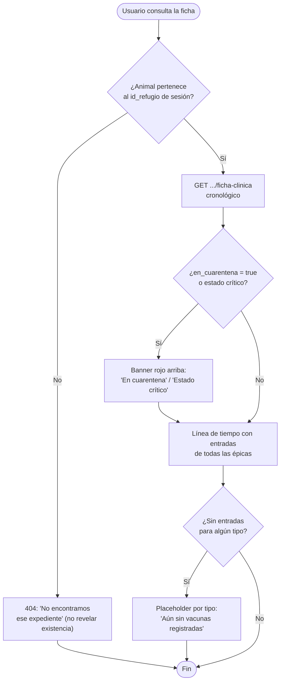
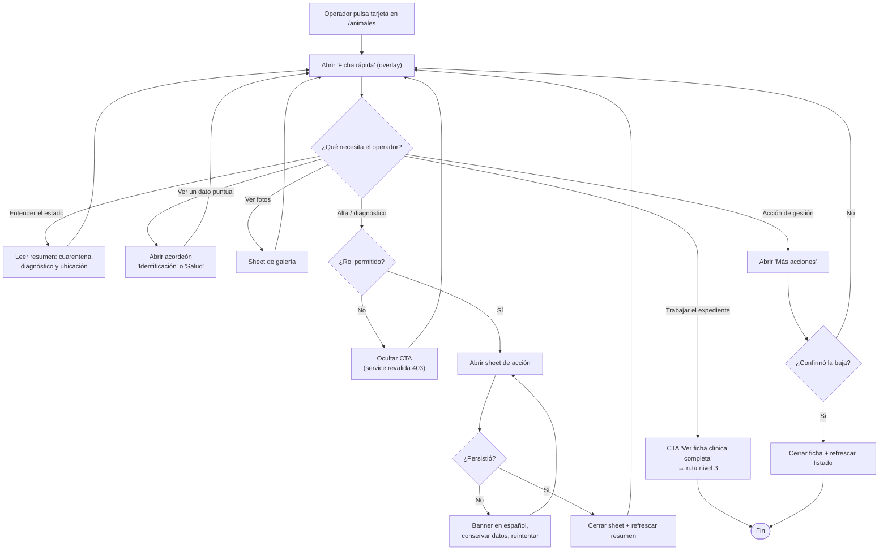

# Anexo UI/UX — Requerimiento 01 (Épica 1)

> **Fuente:** `docs/features/requerimiento-01-ingresos-expedientes.md`.
> **Método:** `docs/ui-ux-metodologia.md`.
> **Actores:** Personal del refugio (operador/coordinador), Veterinario, Administrador, Sistema (Cloudinary).
> **Vistas cubiertas:** `/animales` (listado + modal de alta), ficha del animal (galería + diagnóstico), `/animales/[id]/ficha-clinica`.
> **Nota de dominio:** todo ingreso nace con `en_cuarentena = true`. La UI lo comunica; **el diagnóstico nunca libera la cuarentena** (solo lo hace la Épica 2).

---

## 1. Inventario de contenido (E-C-S)

### Vista `/animales` — listado de pacientes

| Zona | Nivel | Elemento | Origen de datos / contrato | Comportamiento UI | Capa |
| :--- | :---: | :--- | :--- | :--- | :--- |
| Top Bar | C | Título "Animales" + total | `GET /api/v1/animales` | "128 pacientes · 14 en cuarentena". | SC |
| Body | E | Tarjetas de paciente: portada, nombre/identidad, especie, badges | `GET /api/v1/animales`, `url_thumbnail` | En móvil, tarjeta apilada; badge "En cuarentena" siempre visible. | SC |
| Body | E | Buscador por nombre/rasgos | `GET /api/v1/animales` (`q`) | Pegado a la cabecera (Ley de Proximidad). | CC |
| Body | C | Filtros: especie, estado de salud, en cuarentena | `GET /api/v1/animales` | Chips compactos; conservan su valor al volver de la ficha. | CC |
| Body | E | Botón "Registrar animal" | `POST /api/v1/animales` | CTA principal; en móvil, barra inferior fija. | SC |
| Bottom Bar | S | Leyenda de badges | Texto estático | Explica "Cuarentena" y "Crítico" con texto, no solo color (accesibilidad). | SC |

### Vista `/animales` — ficha rápida del animal (overlay)

| Zona | Nivel | Elemento | Origen de datos / contrato | Comportamiento UI | Capa |
| :--- | :---: | :--- | :--- | :--- | :--- |
| Top Bar | C | Nombre, avatar, especie/raza, badges de estado, cuarentena (texto explícito) y adopción | `GET /api/v1/animales` | Ancla mental; nunca mostrar ids (P1). | CC |
| Top Bar | S | Cerrar (X + Escape) | Router local | Sin confirmación si no hay cambios. | CC |
| Context Summary | E | «Estado ahora»: cuarentena/alta médica, alerta crítica y último diagnóstico | `en_cuarentena`, `GET /animales/{id}/diagnosticos` | Banner arriba; rojo con texto, nunca solo color. | CC / Action |
| Context Summary | E | Ubicación legible: refugio · espacio · fecha de ingreso | `refugioNombre`, `espacioNombre`, `fechaIngreso` | Una línea de chips. | CC |
| Context Summary | C | Solo 3 datos clave: edad, sexo, peso | `GET /api/v1/animales` | El resto se traslada a «Detalles». | CC |
| Primary Body | C | Acordeón «Identificación y rescate» | `GET /api/v1/animales` | Cerrado por defecto; contenido montado y oculto (sin layout shift). | CC |
| Primary Body | C | Acordeón «Salud y comportamiento» | `GET /api/v1/animales` | Cerrado por defecto; incluye observaciones. | CC |
| Primary Body | C | «Fotos (n)»: portada + contador | `GET /api/v1/animales/{id}/imagenes` | Miniatura única; «Ver galería» abre un Sheet. Vacío: «Aún no tiene fotos». | CC / Action |
| Primary Body | E/C | «Cuarentena»: estado + fecha de ingreso + «Alta médica» | `GET /animales/{id}/cuarentena` | Strip compacto; el botón abre el sheet existente. Historial solo en la ruta 3. | CC / Action |
| Primary Body | C | «Diagnóstico»: último estado + «Registrar diagnóstico» | `GET/POST /animales/{id}/diagnosticos` | Chip + botón → sheet. Aviso: *no libera cuarentena*. Historial en ruta 3. | CC / Action |
| Bottom Bar | E | «Ver ficha clínica completa» | Router (nivel 3) | CTA sticky, ≥44 px, zona del pulgar. | CC |
| Bottom Bar | C/S | «Más acciones» → «Marcar disponible/no disponible» y «Dar de baja» | `updateAnimalAction`, `deleteAnimalAction` | Menú desplegable en la barra; oculto si el rol no puede. | CC / Action |
| Overlay | S | Galería, alta médica, diagnóstico | Acciones existentes | Sheets; no alteran la ruta base (P6). | CC / Action |

### Vista `/animales` — modal "Registrar animal" (RF1.1)

| Zona | Nivel | Elemento | Origen de datos / contrato | Comportamiento UI | Capa |
| :--- | :---: | :--- | :--- | :--- | :--- |
| Top Bar | C | Título "Registrar animal" + aviso "Todo ingreso se registra en cuarentena" | `POST /api/v1/animales` | Banner informativo; el estado no es editable. | SC |
| Body | C | Fotos (opcional): selector multiple, miniaturas y progreso | `POST /api/v1/animales/{id}/imagenes` | Hasta 5 imágenes JPG/PNG/WEBP de 5 MB; se suben después de crear el expediente. | CC / Action |
| Body | E | Especie (Perro / Gato) | `POST /api/v1/animales` (`especie`) | Select; requerido. | CC |
| Body | E | Procedencia (2–200) | `POST /api/v1/animales` (`procedencia`) | Input texto; requerido. | CC |
| Body | E | Rasgos físicos distintivos (2–500) | `POST /api/v1/animales` (`rasgosFisicos`) | Textarea; requerida. | CC |
| Body | E | Estado inicial de salud (2–100) | `POST /api/v1/animales` (`estadoInicial`) | Textarea; requerida. | CC |
| Body | E | Espacio (`idEspacio`) | `POST /api/v1/animales` (`idEspacio`) | Select con etiqueta legible; **nunca mostrar el id**. | CC |
| Body | C | Estado del paciente: "Cuarentena" | Resuelto en servidor | Campo de solo lectura; no se envía `idEstado` desde el cliente. | SC |
| Body | C | Nombre (opcional) | `POST /api/v1/animales` (`nombre`) | Input texto; visible junto a especie. | CC |
| Body | C | Sección colapsable "Más datos (opcional)" | `POST /api/v1/animales` | Agrupa identificación, rescate, salud/comportamiento y observaciones. | CC |
| Bottom Bar | E | Botón "Guardar expediente" | `POST /api/v1/animales` | CTA sticky; bloquea doble envío. | CC |

> El `id_animal` se genera en base de datos (RN2): **no existe campo para él en el formulario**. El servidor resuelve la fila "Cuarentena" del catálogo `animal_estado` por nombre normalizado; si no existe, el alta se rechaza con `409 ESTADO_CUARENTENA_NO_CONFIGURADO`. Las imágenes se suben después con `POST /api/v1/animales/{id}/imagenes` (RN5), desde la ficha del animal, sin repetir el alta.

### Vista ficha del animal — galería (RF1.2)

| Zona | Nivel | Elemento | Origen de datos / contrato | Comportamiento UI | Capa |
| :--- | :---: | :--- | :--- | :--- | :--- |
| Context | C | Cabecera con portada, nombre/rasgos y badges | `GET /api/v1/animales/{id}`, `url_thumbnail` | Ancla mental; badge de cuarentena. | SC |
| Body | E | Grilla de miniaturas 300×300 | `GET /api/v1/animales/{id}/imagenes` | Orden: portada primero, luego `orden`. | SC |
| Body | E | Botón "Agregar fotos" | `POST /api/v1/animales/{id}/imagenes` | Abre selector multiple; oculto si ya hay 5 (RN5). | CC |
| Body | C | Contador "3 de 5 fotos" | Conteo de la galería | Se actualiza después de cada subida. | SC |
| Body | E | Barra de progreso por archivo | Progreso de la petición multipart | "Subiendo foto 2 de 5… 60%"; bloquea reenvío (RN6). | CC |
| Body | C | Botón "Usar como portada" por miniatura | `PATCH .../imagenes/{idImagen}/portada` | Acción explícita y accesible; desmarca la anterior (RN8). | CC |
| Body | C | Badge "Portada" en la imagen principal | `esPortada` | Texto + ícono, no solo color. | SC |
| Body | E | Acción "Eliminar" por miniatura | `DELETE .../imagenes/{idImagen}` | Confirmación obligatoria; si era portada, avisa de la reasignación automática (RN8). | CC |
| Body | C | Helper "JPG, PNG o WEBP · máx. 5 MB c/u" | RN5 | Junto al botón de agregar; prevención antes del error. | SC |

### Vista ficha del animal — diagnóstico de ingreso (RF1.3)

| Zona | Nivel | Elemento | Origen de datos / contrato | Comportamiento UI | Capa |
| :--- | :---: | :--- | :--- | :--- | :--- |
| Context | C | Tarjeta resumen del paciente | `GET /api/v1/animales/{id}` | Foto, rasgos, badge "En cuarentena". | SC |
| Body | E | Estado general de salud | `POST /api/v1/animales/{id}/diagnosticos` | Crítico / Delicado / Estable / Sano (RN9). | CC |
| Body | E | Observaciones médicas | `POST .../diagnosticos` (`observaciones`) | Obligatoria solo si Crítico o Delicado (RN9); se revela al elegir esas opciones (divulgación progresiva). | CC |
| Body | C | Aviso "Este diagnóstico no libera la cuarentena. La alta médica (Épica 2) la decide." | RN9, RN10 | Helper text sintetizado, visible junto al selector; evita expectativa errónea. | SC |
| Body | S | Historial de diagnósticos | `GET .../diagnosticos` | Colapsable; fecha + estado + observaciones. | SC |
| Bottom Bar | E | Botón "Registrar diagnóstico" | `POST .../diagnosticos` | CTA sticky; deshabilitado sin rol o sin observaciones requeridas. Puede ocultarse para roles sin permiso (RN10). | CC |

### Vista `/animales/[id]/ficha-clinica` (RF1.4)

| Zona | Nivel | Elemento | Origen de datos / contrato | Comportamiento UI | Capa |
| :--- | :---: | :--- | :--- | :--- | :--- |
| Top Bar | C | Título "Ficha clínica" + identidad del paciente | `GET .../ficha-clinica` | Retroceso a la ficha del animal. | SC |
| Context | E | Banner rojo de alta prioridad | `alertas` (`cuarentena`, `estado_critico`) | Aparece si `en_cuarentena = true` **o** estado Crítico (RN11); texto explícito, no solo color. | SC |
| Body | E | Línea de tiempo cronológica | `linea_tiempo` | Ordenada por fecha; entradas de todas las épicas. | SC |
| Body | C | Entradas: diagnóstico, constantes, vacunas, temperamento, esterilización | `linea_tiempo[].tipo` | Cada tipo con ícono y etiqueta legible; datos de épicas futuras en solo lectura. | SC |
| Body | C | Placeholder por tipo sin registros | Derivado de `linea_tiempo` | "Aún sin registros de vacunas" en lugar de ocultar el tipo (decisión P-05). | SC |
| Bottom Bar | S | Acción "Volver a la ficha" | Router | Enlace de texto, peso bajo. | SC |

---

## 2. Flujos de usuario

### Flujo A — Alta de paciente (RF1.1)

```mermaid
flowchart TD
    Start([Operador abre "Registrar animal"]) --> Form{"¿Datos mínimos válidos?<br/>especie, procedencia,<br/>rasgos, estado inicial, espacio"}
    Form -- "No" --> Err1["400: error bajo el campo,<br/>conservar lo escrito"]
    Err1 --> Form
    Form -- "Sí" --> Quarantine{"¿El catálogo tiene<br/>el estado Cuarentena?"}
    Quarantine -- "No" --> ErrState["409 ESTADO_CUARENTENA_NO_CONFIGURADO:<br/>avisar al administrador"]
    Quarantine -- "Sí" --> Save["POST /animales:<br/>servidor fija idEstado = Cuarentena<br/>y BD genera id_animal"]
    Save --> Err2{"¿Alta fallida?"}
    Err2 -- "Sí" --> Retry["500: banner con reintento,<br/>formulario intacto"]
    Retry --> Save
    Err2 -- "No" --> Photos{"¿Seleccionó fotos?"}
    Photos -- "Sí" --> Upload["POST /animales/{id}/imagenes<br/>por archivo, con progreso"]
    Upload --> UploadResult{"¿Subida correcta?"}
    UploadResult -- "No" --> Warn["Aviso: 'No se pudieron subir las fotos.<br/>Agrega imágenes desde su ficha'"]
    UploadResult -- "Sí" --> Done
    Photos -- "No" --> Done
    Warn --> Done
    Done["Cerrar modal + refrescar listado<br/>El paciente queda en cuarentena"] --> End([Fin])
```

**Notas de móvil:** formulario en una sola columna; los campos mínimos quedan visibles y "Más datos (opcional)" se colapsa para no abrumar. El estado "Cuarentena" se muestra como dato de solo lectura, no como selector.

### Flujo B — Carga de imágenes y portada (RF1.2)


**Notas de móvil:** selector multiple nativo; barra de progreso por archivo bajo la grilla; el botón "Usar como portada" va en el menú `...` de cada miniatura (bottom sheet) para no saturar la tarjeta.

### Flujo C — Diagnóstico veterinario de ingreso (RF1.3)


**Notas de móvil:** el overlay es un *bottom sheet* sobre la ficha del animal; el campo de observaciones aparece justo debajo del selector al elegir Crítico/Delicado (divulgación progresiva). El aviso de cuarentena va en texto, no solo en un color rojo.

### Flujo D — Consulta de ficha clínica (RF1.4)



**Notas de móvil:** el banner de prioridad va arriba (zona de contexto) y la línea de tiempo se lee en una sola columna, con etiquetas de fecha pegadas a cada entrada (Ley de Proximidad).

### Flujo E — Consulta rápida desde el listado (ficha rápida)



**Notas de móvil:** el drawer ocupa el ancho completo; el resumen queda arriba (contexto), un único desplegable «Más datos del expediente» en la zona media (exploración) y la barra de acciones fija abajo (pulgar). «Más acciones» se despliega hacia arriba para no tapar el CTA principal.

---

## 3. Los 5 estados de interfaz

| Vista | Ideal | Vacío | Carga | Parcial | Error | Recuperación |
| :--- | :--- | :--- | :--- | :--- | :--- | :--- |
| `/animales` | Tarjetas con portada y badges claros. | Sin pacientes: "Aún no hay expedientes" + CTA "Dar de alta". | Skeleton de tarjetas con la misma altura. | 1–2 pacientes: aviso "Los nuevos ingresos aparecerán aquí". | `500` al listar: banner con "Reintentar". | Reintento conserva búsqueda y filtros. |
| `/animales` (modal de alta) | Campos mínimos completos + CTA "Guardar expediente" habilitado. | Sin datos: primer campo con autofoco y helper. | Botón "Guardando…"; bloquea doble envío. | "Más datos (opcional)" colapsado (válido). | `400` por campo / `409` estado Cuarentena ausente o espacio sin capacidad / `500`. | Conserva lo escrito y señala el campo exacto. |
| `/animales` (ficha rápida) | Resumen + CTA "Ver ficha clínica completa" habilitado. | Sin datos clínicos: "Aún no hay información clínica" + CTA a la ficha. | Skeleton con la forma del resumen. | Solo identidad y cuarentena: aviso suave "Faltan datos del expediente", sin "—" repetidos. | `404` acceso cruzado / `500`: banner genérico sin revelar existencia. | Reintento mantiene el overlay abierto. |
| Ficha rápida · desplegable | Datos legibles al abrir «Más datos del expediente». | Sin campos opcionales: "—" en lo que falta. | N/A (datos ya cargados). | Solo campos principales visibles; el resto bajo demanda. | N/A. | — |
| Ficha rápida · fotos | Portada + contador. | "Aún no tiene fotos" + "Agregar fotos". | Miniatura gris del mismo tamaño. | 1 foto: "Agrega más fotos para identificarlo". | `400`/`500` al subir. | Reintenta solo el archivo fallido. |
| Ficha rápida · cuarentena | Estado + alta médica. | "No hay altas registradas". | Skeleton del strip. | Alta registrada sin historial. | `409` ya liberada / `500`. | Reintento conserva observaciones. |
| Ficha rápida · diagnóstico | Último estado + CTA. | "Sin diagnóstico registrado" + CTA. | Skeleton del chip. | Estado Sano sin observaciones (válido). | `400`/`403`/`500`. | Vuelve al sheet, conserva la selección. |
| Ficha rápida · barra de acciones | CTA principal visible. | N/A. | "Procesando…", bloquea doble clic. | Acciones ocultas por rol. | `403`/`500`. | Reintento desde la misma barra. |
| Galería | 1–5 miniaturas con portada marcada. | 0 fotos: "Este expediente aún no tiene fotos" + CTA "Agregar fotos" (permitido por RN5). | Bloques grises con forma de miniatura + "Subiendo foto 2 de 5…". | 1 foto de 5: aviso "Agrega más fotos para ayudar a identificarlo". | `400` tipo/tamaño, `500` fallo Cloudinary. | Conserva las fotos válidas; reintenta solo el archivo fallido. |
| Diagnóstico | Estado elegido y observaciones válidas → CTA activo. | Sin diagnósticos: "Aún no se registró el diagnóstico de ingreso". | Botón "Registrando…". | Estado Estable/Sano sin observaciones (válido). | `400` observaciones requeridas / `403` rol / `500`. | Revela el campo faltante, enfoca el cursor y no limpia el estado elegido. |
| `/animales/[id]/ficha-clinica` | Banner correcto + línea de tiempo completa. | Sin eventos aún: "El historial clínico se construye con cada registro" + placeholders por tipo. | Skeleton de la línea de tiempo. | Solo diagnóstico de ingreso: aviso "Faltan constantes, vacunas y evaluaciones". | `404` acceso cruzado / `500`. | Mensaje genérico sin revelar existencia; reintento disponible. |

---

## 4. Decisiones aplicadas

| ID | Decisión | Origen |
| :--- | :--- | :--- |
| P-01 | Alta en **modal** sobre `/animales`, con campos mínimos visibles y "Más datos (opcional)" colapsable. | Implementación actual; reemplaza el stepper de 4 pasos. |
| P-02 | El alta permite **seleccionar fotos (opcional)**; se suben con `POST /api/v1/animales/{id}/imagenes` justo después de crear el expediente. Si falla la subida, el animal queda registrado y se ofrece completar la galería desde su ficha. | Ajuste solicitado por el usuario; sin cambiar el contrato `/api/v1/`. |
| P-03 | Diagnóstico en **overlay** sobre la ficha. | Confirmado por el usuario. |
| P-04 | Aviso sintetizado: *"Este diagnóstico no libera la cuarentena. La alta médica (Épica 2) la decide."* | Confirmado por el usuario. |
| P-05 | Tipos sin registros se **muestran** como placeholders en la línea de tiempo. | Confirmado por el usuario. |
| P-06 | Portada con **botón explícito** en el menú de cada miniatura. | Confirmado por el usuario. |
| P-07 | El alta **no elige estado**: el servidor resuelve "Cuarentena" por nombre normalizado y el campo se muestra de solo lectura. | Requerimiento 02 (RF2.4) + decisión del usuario. |
| P-08 | Si el catálogo no tiene "Cuarentena", el botón de alta se deshabilita y el servidor responde `409 ESTADO_CUARENTENA_NO_CONFIGURADO`. | Defensa en profundidad; evita expedientes sin estado válido. |
| P-09 | La tarjeta abre una **ficha rápida** de una sola pantalla; el detalle completo vive en la ruta nivel 3. | Metodología P6 (overlay = lectura + acción rápida). |
| P-10 | **Divulgación progresiva** con un único desplegable; el contenido se monta solo al abrirlo (sin keyframes de acordeón inexistentes). | Metodología P4 ley 2 + corrección del desplegable. |
| P-11 | Un único CTA principal sticky abajo (**"Ver ficha clínica completa"**); las acciones de gestión se agrupan en **"Más acciones"**. | Metodología P2 / cobertura móvil + decisión del usuario. |
| P-12 | Galería, alta médica y diagnóstico se registran en **sheets**; sin formularios permanentes en el overlay. | Coherencia con la ficha clínica (requerimiento 02). |
| P-13 | Alerta de cuarentena con **texto explícito** y aviso de que el diagnóstico no libera la cuarentena. | Accesibilidad + RF2.4. |
| P-14 | Sin nuevos endpoints ni dependencias: se reutilizan `Animal`, las acciones existentes y las primitivas locales. | Restricción arquitectónica del proyecto. |
