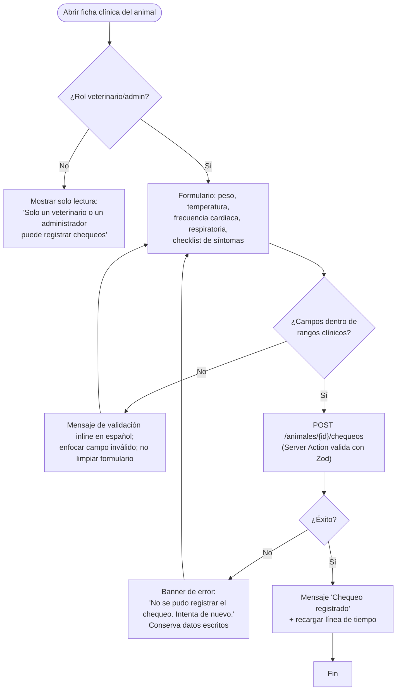
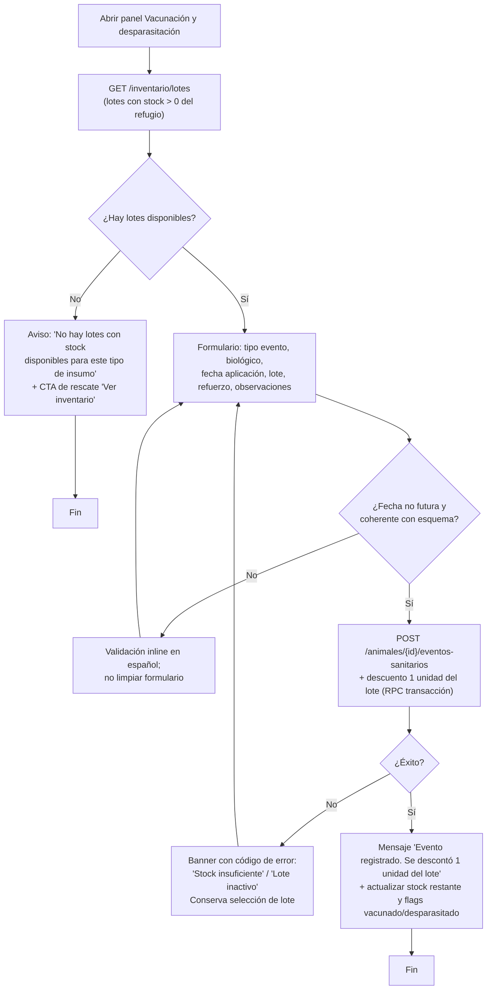
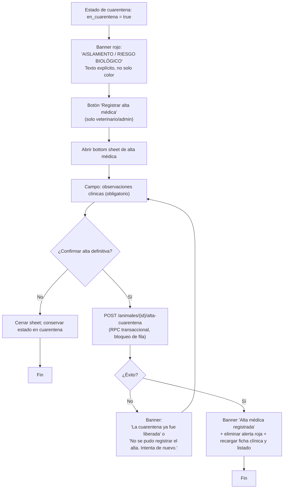

# Anexo UI/UX — Requerimiento 02 (Épica 2)

> **Fuente:** `docs/features/requerimiento-02-control-clinico-cuarentena.md`.
> **Método:** `docs/ui-ux-metodologia.md`.
> **Actores:** Veterinario, Administrador de refugio, Personal del refugio (operador/coordinador/evaluador), Sistema de inventario.
> **Vistas cubiertas:** `/animals/[id]/clinical-record` (ficha clínica con paneles de chequeo, eventos sanitarios y cuarentena).
> **Nota de dominio:** todo ingreso nace con `en_cuarentena = true`. La UI comunica el aislamiento con texto explícito (no solo color). Solo el alta médica (registrada por Veterinario o Administrador) libera la cuarentena.

---

## 1. Inventario de contenido (E-C-S)

### Vista `/animals/[id]/clinical-record` — Veterinario / Administrador / Personal

| Zona | Nivel | Elemento | Origen de datos / contrato | Comportamiento UI | Capa |
| :--- | :---: | :--- | :--- | :--- | :--- |
| Top Bar | C | Título "Ficha clínica" + nombre del animal + expediente # | `GET /animales/{id}/ficha-clinica` | Retroceso a `/animals`; nunca mostrar `id_` sin etiqueta legible. | SC |
| Context Summary | C | Badge "En cuarentena" + banner rojo con texto "AISLAMIENTO / RIESGO BIOLÓGICO" cuando `en_cuarentena = true` | `GET /animales/{id}/cuarentena` | Alerta roja con texto explícito; no hay control para salir salvo alta médica. | SC |
| Primary Body | E | Panel "Cuarentena" (estado, historial de altas, formulario de alta médica) | `GET /animales/{id}/cuarentena`, `POST /animales/{id}/alta-cuarentena` | Solo veterinario/admin ven el formulario; servidor revalida rol. | CC / Action |
| Primary Body | E | Panel "Chequeos médicos" (constantes vitales + síntomas) | `POST /animales/{id}/chequeos`, `GET /animales/{id}/chequeos` | Formulario con rangos clínicos; CTA inferior "Registrar chequeo". | CC / Action |
| Primary Body | E | Panel "Vacunación y desparasitación" (evento sanitario + lote de inventario) | `POST /animales/{id}/eventos-sanitarios`, `GET /animales/{id}/eventos-sanitarios`, `GET /inventario/lotes` | Select de lote con stock real; descuento atómico de 1 unidad. | CC / Action |
| Primary Body | E | Panel "Traslados y ubicación" | `POST/GET /animales/{id}/traslados` | Bloqueado si `en_cuarentena = true` salvo alta médica incluida. | CC / Action |
| Primary Body | E | Panel "Temperamento y compatibilidad" | `POST/GET /animales/{id}/evaluaciones-temperamento` | Evaluación conductual; refleja rasgo vigente en expediente. | CC / Action |
| Primary Body | E | Panel "Rehabilitación" | `POST/GET /animales/{id}/rehabilitaciones` | Bitácora física y emocional cronológica. | CC / Action |
| Bottom / Sticky Action Bar | E | CTA principal de cada panel (anclado abajo, ≥44–48 px) | Endpoint correspondiente | Bloqueado durante carga; nunca al final de scroll infinito. | CC |
| Overlay (bottom sheet) | E | Alta médica de cuarentena (confirmación destructiva) | `POST /animales/{id}/alta-cuarentena` | Botón separado con estilo de peligro; texto "El alta es definitiva". | CC / Action |

---

## 2. Flujos de usuario

### Flujo "Registrar chequeo médico" (RF2.1 / US09)

**Notas de móvil:** el formulario se apila en una sola columna; el CTA "Registrar chequeo" queda anclado en la zona del pulgar.

### Flujo "Registrar evento sanitario con descuento de inventario" (RF2.2 / RF2.3 / US10)

### Flujo "Registrar alta médica de cuarentena" (RF2.4 / US11)

**Notas de móvil:** el alta médica es un bottom sheet; el botón destructivo va separado y con estilo de peligro.

---

## 3. Los 5 estados de interfaz

| Vista | Ideal | Vacío | Carga | Parcial | Error | Recuperación |
| :--- | :--- | :--- | :--- | :--- | :--- | :--- |
| `/animals/[id]/clinical-record` (resumen + línea de tiempo) | Banner correcto + línea de tiempo completa con todos los eventos | Sin eventos aún: "El historial clínico se construye con cada registro" + placeholders por tipo | Skeleton de la línea de tiempo con la misma forma del contenido final | Solo diagnóstico de ingreso: aviso "Faltan constantes, vacunas y evaluaciones" | `404` acceso cruzado / `500`: mensaje genérico sin revelar existencia | Mensaje con "Reintentar"; conserva el id del animal |
| Panel "Cuarentena" | Estado de aislamiento + historial de altas + formulario de alta (si aplica) | Sin altas registradas: "No hay altas médicas para este paciente" | Skeleton del panel de cuarentena | Sin datos de alta: aviso informativo | `409` ya liberada / `500`: banner con mensaje en español | Reintento del alta conserva observaciones escritas |
| Panel "Chequeos médicos" | Lista de chequeos con constantes vitales y síntomas | Sin chequeos: "Aún no hay chequeos médicos registrados" + CTA "Registrar primer chequeo" | Skeleton de lista de chequeos | 1 chequeo sin síntomas: aviso "Registro asintomático" | `400` campos inválidos / `500`: conserva lo escrito en el formulario | Reintento desde el campo exacto con error |
| Panel "Vacunación y desparasitación" | Historial de eventos con lote y stock restante | Sin eventos: "Sin vacunas ni desparasitaciones registradas" | Skeleton de tabla de eventos + carga de lotes | Sin lotes disponibles: aviso "No hay lotes con stock" | `409` stock insuficiente / `500`: conserva selección de lote | Reintento con selección de lote preservada |
| Alta médica (bottom sheet) | Formulario de observaciones + botón de confirmación | N/A | Botón "Registrando…" deshabilitado, bloquea doble envío | N/A | `409` ya liberada / `500`: mensaje dentro del sheet | Reintento dentro del sheet sin cerrarlo |

---

## 4. Supuestos y preguntas abiertas

- **Estructura de rutas:** los paneles de los requerimientos 02, 03 y 04 conviven hoy en una sola página `/animals/[id]/clinical-record`. Se asume que mantener esa vista única es válido; si se decide dividir en pestañas por requerimiento, el inventario E-C-S y los flujos se replican por pestaña sin cambiar contratos.
- **Derivación de autorización (`canOperate` / `canEvaluate`):** se deriva del rol del usuario en el Server Component de la página (`puedeEjecutarOperacionClinica`, `puedeRegistrarSocializacion`). El servidor revalida en cada Server Action.
- **Alta médica en bottom sheet:** se presenta como bottom sheet en móvil y modal/drawer en escritorio, sin alterar la ruta base, conforme a P6 de la metodología.

---

## 5. Decisiones aplicadas

| ID | Decisión | Origen |
| :--- | :--- | :--- |
| P-01 | Alta de cuarentena en **bottom sheet** (móvil) / modal (escritorio), no en línea dentro del panel. | Metodología P6 (overlay sin cambiar ruta base). |
| P-02 | CTA principal de cada panel **anclado abajo** (zona del pulgar, ≥44–48 px). | Metodología P2 (zona inferior del lienzo). |
| P-03 | Alertas de aislamiento con **texto explícito** ("AISLAMIENTO / RIESGO BIOLÓGICO"), no solo color rojo. | Metodología P1 + accesibilidad. |
| P-04 | Los 5 estados de interfaz (ideal/vacío/carga/parcial/error) con **skeleton misma forma** y **CTA de rescate** en vacío/parcial. | Metodología P7. |
| P-05 | Errores en español desde `modules/animals/errors.ts`; envelope uniforme `{ success, data/error }`; sin stack traces al cliente. | Metodología P13 + contrato de API del requerimiento. |

