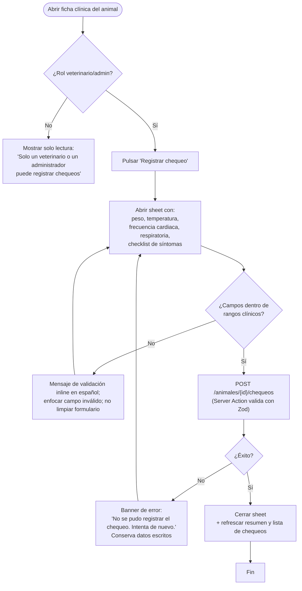
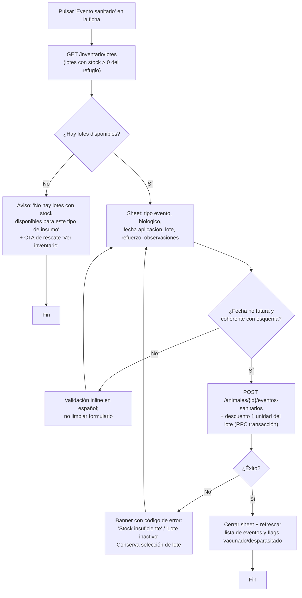
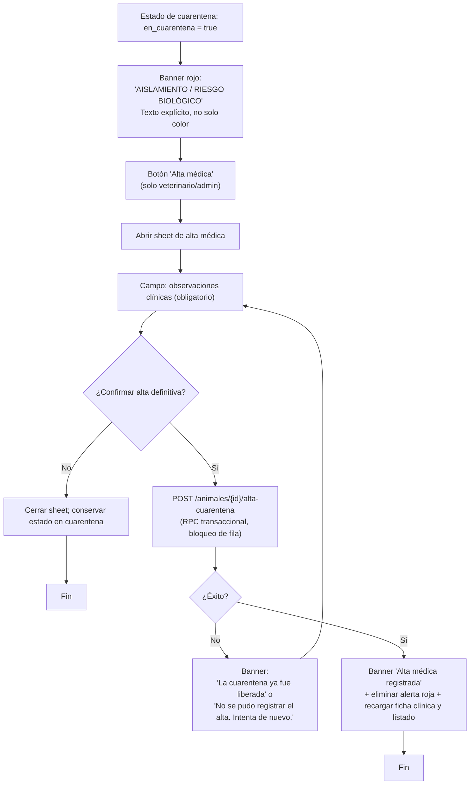

# Anexo UI/UX — Requerimiento 02 (Épica 2)

> **Fuente:** `docs/features/requerimiento-02-control-clinico-cuarentena.md`.
> **Método:** `docs/ui-ux-metodologia.md`.
> **Actores:** Veterinario, Administrador de refugio, Personal del refugio (operador/coordinador/evaluador), Sistema de inventario.
> **Vista cubierta:** `/animales/[id]/ficha-clinica` (ficha clínica con pestañas "Clínico" y "Socialización").
> **Nota de dominio:** todo ingreso nace con `en_cuarentena = true`. La UI comunica el aislamiento con texto explícito (no solo color). Solo el alta médica (registrada por Veterinario o Administrador) libera la cuarentena.

---

## 1. Inventario de contenido (E-C-S)

### Vista `/animales/[id]/ficha-clinica` — Veterinario / Administrador / Personal

| Zona | Nivel | Elemento | Origen de datos / contrato | Comportamiento UI | Capa |
| :--- | :---: | :--- | :--- | :--- | :--- |
| Top Bar | C | Título "Ficha clínica" + nombre del animal + expediente # | `GET /animales/{id}/ficha-clinica` | Retroceso a `/animales`; nunca mostrar `id_` sin etiqueta legible. | SC |
| Top Bar | C | Badges: especie, estado del catálogo, "AISLAMIENTO / RIESGO BIOLÓGICO" y "En adopción" | `GET /animales/{id}/ficha-clinica` | Texto explícito; el badge de cuarentena solo aparece si `en_cuarentena = true`. | SC |
| Tabs | E | Pestañas "Clínico" y "Socialización" | Estado local | Navegación por teclado (flechas/Home/End); "Clínico" es la pestaña inicial. | CC |
| Resumen clínico | E | Estadísticas, alertas y últimos 5 eventos de la línea de tiempo | `GET /animales/{id}/ficha-clinica` | Si hay más eventos, botón "Ver historial completo" que abre un sheet. | CC |
| Resumen clínico | E | Barra de acciones: "Registrar chequeo", "Evento sanitario", "Alta médica", "Historial completo" | Server Actions de la Épica 2 | Cada acción abre un sheet; "Alta médica" solo si `en_cuarentena = true` y el rol lo permite. | CC / Action |
| Resumen clínico | C | Panel "Cuarentena" (estado e historial de altas) | `GET /animales/{id}/cuarentena` | Muestra el estado sin duplicar el botón de alta, que vive en la barra de acciones. | CC |
| Clínico | E | Panel "Chequeos médicos" (historial de constantes vitales y síntomas) | `GET /animales/{id}/chequeos` | Lista los últimos 5; "Ver todos" abre el historial completo. Sin formulario permanente. | CC / Action |
| Clínico | E | Panel "Vacunación y desparasitación" (historial de eventos) | `GET /animales/{id}/eventos-sanitarios` | Lista los últimos 5; el registro se abre en un sheet y descuenta 1 unidad del lote. | CC / Action |
| Clínico | E | Panel "Diagnóstico de ingreso" | `POST/GET /animales/{id}/diagnosticos` | Solo veterinario/admin registran; el diagnóstico no libera la cuarentena. | CC / Action |
| Clínico | E | Panel "Traslados y ubicación" | `POST/GET /animales/{id}/traslados` | Bloqueado si `en_cuarentena = true` salvo que el traslado incluya el alta médica. | CC / Action |
| Socialización | E | Panel "Temperamento y compatibilidad" | `POST/GET /animales/{id}/evaluaciones-temperamento` | Evaluación conductual; refleja el rasgo vigente en el expediente. | CC / Action |
| Socialización | E | Panel "Rehabilitación" | `POST/GET /animales/{id}/rehabilitaciones` | Bitácora física y emocional cronológica. | CC / Action |
| Overlay | E | Sheet "Registrar chequeo médico" | `POST /animales/{id}/chequeos` | Formulario con rangos clínicos; al guardar cierra y refresca el resumen. | CC / Action |
| Overlay | E | Sheet "Registrar evento sanitario" | `POST /animales/{id}/eventos-sanitarios`, `GET /inventario/lotes` | Select de lote con stock real; descuento atómico de 1 unidad. | CC / Action |
| Overlay | E | Sheet "Historial clínico completo" | `GET /animales/{id}/ficha-clinica` | Reutiliza la línea de tiempo sin estadísticas ni alertas duplicadas. | CC |
| Overlay | E | Alta médica de cuarentena (confirmación destructiva) | `POST /animales/{id}/alta-cuarentena` | Botón separado con estilo de peligro; texto "El alta es definitiva". | CC / Action |

---

## 2. Flujos de usuario

### Flujo "Registrar chequeo médico" (RF2.1 / US09)

**Notas de móvil:** el sheet ocupa el ancho completo y el formulario se apila en una columna; el CTA "Registrar chequeo" queda al final del sheet, en la zona del pulgar.

### Flujo "Registrar evento sanitario con descuento de inventario" (RF2.2 / RF2.3 / US10)

### Flujo "Registrar alta médica de cuarentena" (RF2.4 / US11)

**Notas de móvil:** el alta médica se confirma en un overlay; el botón destructivo va separado y con estilo de peligro.

---

## 3. Los 5 estados de interfaz

| Vista | Ideal | Vacío | Carga | Parcial | Error | Recuperación |
| :--- | :--- | :--- | :--- | :--- | :--- | :--- |
| `/animales/[id]/ficha-clinica` (resumen) | Badges correctos + alertas + últimos 5 eventos | Sin eventos aún: "El historial clínico se construye con cada registro" | Skeleton de la línea de tiempo con la misma forma del contenido final | Solo diagnóstico de ingreso: aviso "Faltan constantes, vacunas y evaluaciones" | `404` acceso cruzado / `500`: mensaje genérico sin revelar existencia | Mensaje con "Reintentar"; conserva el id del animal |
| Panel "Cuarentena" | Estado de aislamiento + historial de altas | Sin altas registradas: "No hay altas médicas para este paciente" | Skeleton del panel de cuarentena | Sin datos de alta: aviso informativo | `409` ya liberada / `500`: banner con mensaje en español | Reintento del alta conserva observaciones escritas |
| Panel "Chequeos médicos" | Lista de chequeos con constantes vitales y síntomas | Sin chequeos: "Aún no hay chequeos médicos registrados" + CTA "Registrar primer chequeo" | Skeleton de lista de chequeos | 1 chequeo sin síntomas: aviso "Registro asintomático" | `400` campos inválidos / `500`: conserva lo escrito en el sheet | Reintento desde el campo exacto con error |
| Panel "Vacunación y desparasitación" | Historial de eventos con lote y stock restante | Sin eventos: "Sin vacunas ni desparasitaciones registradas" | Skeleton de tabla de eventos + carga de lotes | Sin lotes disponibles: aviso "No hay lotes con stock" | `409` stock insuficiente / `500`: conserva selección de lote | Reintento con selección de lote preservada |
| Sheet "Registrar chequeo" | Formulario completo y CTA habilitado | N/A | Botón "Registrando…" deshabilitado, bloquea doble envío | N/A | `400`/`500`: mensaje dentro del sheet | Reintento dentro del sheet sin cerrarlo |
| Sheet "Registrar evento sanitario" | Lote seleccionado y CTA habilitado | Sin lotes: aviso + enlace a inventario | Carga de lotes con skeleton | N/A | `409` stock insuficiente / `500`: conserva selección | Reintento dentro del sheet sin cerrarlo |
| Sheet "Historial completo" | Línea de tiempo completa | "Aún no hay eventos clínicos registrados" | Skeleton de la línea de tiempo | N/A | `500`: mensaje genérico | Reintento al cerrar y abrir de nuevo |

---

## 4. Supuestos y preguntas abiertas

- **Estructura de rutas:** los paneles de los requerimientos 02, 03 y 04 conviven en `/animales/[id]/ficha-clinica`. La vista se divide en pestañas "Clínico" y "Socialización" sin cambiar contratos.
- **Derivación de autorización (`canOperate` / `canEvaluate`):** se deriva del rol del usuario en el Server Component de la página (`puedeEjecutarOperacionClinica`, `puedeRegistrarSocializacion`). El servidor revalida en cada Server Action.
- **Alta médica en overlay:** se presenta como sheet/overlay sin alterar la ruta base, conforme a P6 de la metodología.
- **Historial completo:** se abre en un sheet para que el resumen no se convierta en una lista interminable; reutiliza el mismo componente de línea de tiempo.

---

## 5. Decisiones aplicadas

| ID | Decisión | Origen |
| :--- | :--- | :--- |
| P-01 | Alta de cuarentena en **overlay** (sheet/modal), no en línea dentro del panel. | Metodología P6 (overlay sin cambiar ruta base). |
| P-02 | CTA principal de cada panel **anclado abajo** (zona del pulgar, ≥44–48 px). | Metodología P2 (zona inferior del lienzo). |
| P-03 | Alertas de aislamiento con **texto explícito** ("AISLAMIENTO / RIESGO BIOLÓGICO"), no solo color rojo. | Metodología P1 + accesibilidad. |
| P-04 | Los 5 estados de interfaz (ideal/vacío/carga/parcial/error) con **skeleton misma forma** y **CTA de rescate** en vacío/parcial. | Metodología P7. |
| P-05 | Errores en español desde `modules/animals/errors.ts`; envelope uniforme `{ success, data/error }`; sin stack traces al cliente. | Metodología P13 + contrato de API del requerimiento. |
| P-06 | **Pestañas "Clínico" y "Socialización"** para separar el trabajo clínico del conductual. | Decisión del usuario. |
| P-07 | Chequeos y eventos sanitarios se registran desde **botones + sheets**, no desde formularios permanentes. | Decisión del usuario; reduce ruido visual y prioriza el estado del paciente. |
| P-08 | El resumen muestra **solo los últimos 5 eventos**; el historial completo se abre en un sheet. | Decisión del usuario. |
| P-09 | El **alta médica** vive en la barra de acciones del resumen y no se duplica dentro del panel de cuarentena. | Consistencia de acciones primarias. |
