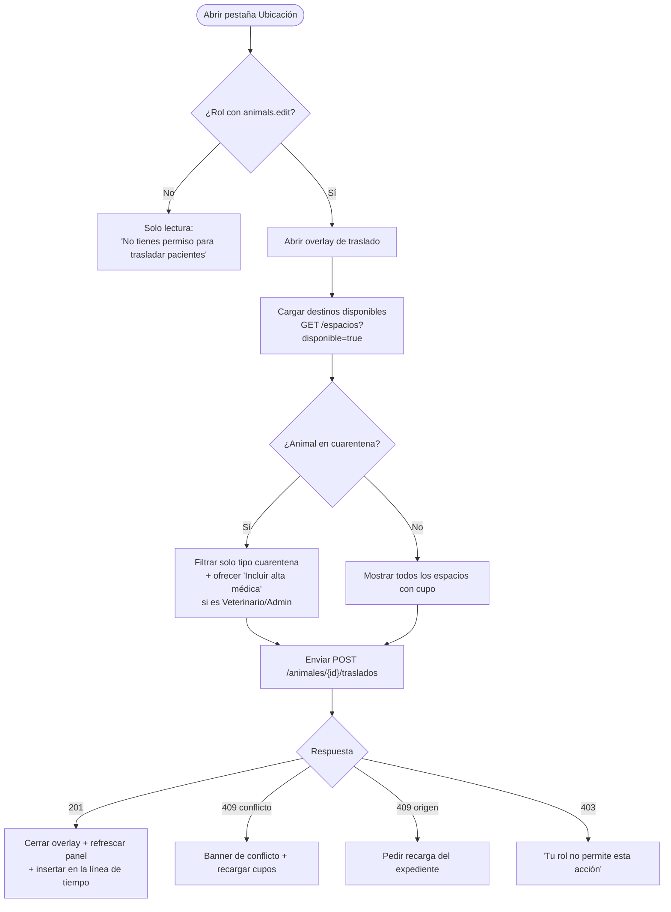
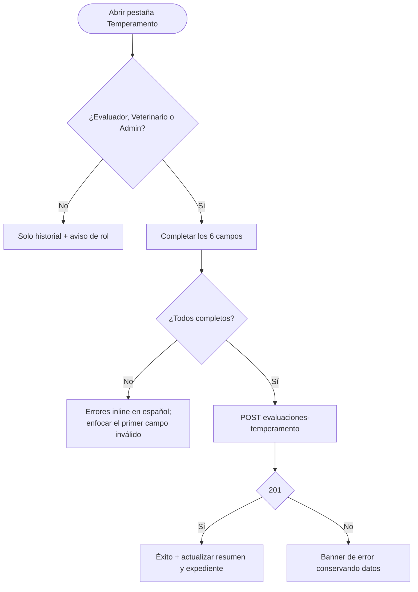

# Anexo UI/UX — Requerimiento 03 (Épica 3)

> **Fuente:** `docs/features/requerimiento-03-socializacion-espacios.md`.
> **Método:** `docs/ui-ux-metodologia.md`.
> **Actores:** Coordinador, Veterinario, Administrador, Evaluador, Operador (solo lectura).
> **Vistas cubiertas:** `/espacios` y las pestañas «Ubicación», «Temperamento» y «Rehabilitación» de `/animales/[id]/ficha-clinica`.
> **Ruta vigente hasta F2:** `/spaces` y `/animals/[id]/clinical-record`.

---

## 1. Inventario de contenido (E-C-S)

### Vista `/espacios` — todo el personal del refugio

| Zona | Nivel | Elemento | Origen de datos | Comportamiento UI | Capa |
| :--- | :---: | :--- | :--- | :--- | :--- |
| Header | C | Título «Espacios» + contador «N espacios · M plazas libres» | `GET /espacios` | El contador se calcula en servidor; no se recalcula en cliente. | SC |
| Toolbar | C | Filtro por tipo (`canil`, `gatera`, `cuarentena`, `rehabilitacion`, `otro`), buscador por nombre y toggle «Solo con cupo» | `GET /espacios?tipo=&q=` | Filtros en la URL para que el enlace sea compartible. | CC |
| Grid | E | Tarjeta de espacio: nombre, tipo, ocupación `2/4`, barra de capacidad, texto «2 plazas libres» / «Sin cupo», badge «No disponible» | `GET /espacios` | La ocupación se comunica con texto además del color (regla 23). | SC |
| Acción de tarjeta | E | «Ver animales» | `GET /animales` | Enlace al listado; el filtro por espacio se añadirá cuando el contrato lo soporte. | CC |
| Overlay | E | Crear / editar espacio | `POST/PUT /espacios` | Formulario en `sheet`; nunca página completa. | CC / Action |
| Confirmación | E | Desactivar espacio | `DELETE` lógico | Diálogo destructivo con nombre del espacio y advertencia si tiene ocupación. | CC |

### Pestaña «Ubicación» — `/animales/[id]/ficha-clinica`

| Zona | Nivel | Elemento | Origen de datos | Comportamiento UI | Capa |
| :--- | :---: | :--- | :--- | :--- | :--- |
| Cabecera del panel | C | Espacio actual + tipo + «En cuarentena» si aplica | `GET /animales/{id}/ficha-clinica` | Si `en_cuarentena = true`, banner: «Solo puede trasladarse a un espacio de cuarentena». | SC |
| Cuerpo | E | Botón «Cambiar ubicación» | `GET /espacios?disponible=true` | Deshabilitado sin cupo; el destino se filtra por tipo cuando hay cuarentena. | CC |
| Overlay | E | Traslado: destino, motivo, «Incluir alta médica» (solo Veterinario/Admin) | `POST /animales/{id}/traslados` | El origen no se captura: lo pone el servidor. | CC / Action |
| Historial | E | Lista append-only de traslados: fecha, origen → destino, motivo, usuario | `GET /animales/{id}/traslados` | Orden descendente; sin acciones de edición. | SC |
| Conflicto | E | Aviso `409 CONFLICTO_OCUPACION` | Respuesta del endpoint | «Otra persona ocupó la última plaza. Elige otro espacio.» + recargar disponibilidad. | CC |
| Conflicto | E | Aviso `TRASLADO_ORIGEN_DESACTUALIZADO` | Respuesta del endpoint | «La ubicación cambió mientras editabas. Recarga el expediente.» | CC |

### Pestaña «Temperamento» — `/animales/[id]/ficha-clinica`

| Zona | Nivel | Elemento | Origen de datos | Comportamiento UI | Capa |
| :--- | :---: | :--- | :--- | :--- | :--- |
| Resumen | C | Última evaluación: comportamiento, energía, apto perros/gatos/niños | `GET /animales/{id}/evaluaciones-temperamento` | Etiquetas en español (`con_supervision` → «Con supervisión»). | SC |
| Cuerpo | E | Formulario de evaluación (6 campos obligatorios) | `POST /animales/{id}/evaluaciones-temperamento` | Solo visible para Evaluador, Veterinario y Admin. | CC / Action |
| Historial | E | Lista append-only con fecha y evaluador | `GET .../evaluaciones-temperamento` | Sin editar ni eliminar; la corrección es una evaluación nueva. | SC |
| Aviso | C | «El temperamento del expediente se actualiza con la evaluación más reciente» | — | Texto informativo bajo el formulario. | SC |

### Pestaña «Rehabilitación» — `/animales/[id]/ficha-clinica`

| Zona | Nivel | Elemento | Origen de datos | Comportamiento UI | Capa |
| :--- | :---: | :--- | :--- | :--- | :--- |
| Cuerpo | E | Formulario: tipo, fecha inicio, fecha fin (opcional), objetivo, observaciones | `POST /animales/{id}/rehabilitaciones` | Fecha fin ≥ fecha inicio; ninguna futura. | CC / Action |
| Historial | E | Bitácora cronológica con badge «Abierta» cuando `fecha_fin` es nula | `GET .../rehabilitaciones` | El badge «Abierta» bloquea la aptitud de adopción (épica 4). | SC |

---

## 2. Flujos de usuario

### Flujo «Traslado con validación de cuarentena» (RF3.1 / RF3.2 / US12)

### Flujo «Evaluación de temperamento» (RF3.3 / US13)

### Flujo «Rehabilitación» (RF3.4 / US14)

Formulario en una columna → validación de fechas → `POST` → la bitácora muestra «Abierta» → el panel de aptitud (épica 4) refleja el bloqueo sin recargar la página.

---

## 3. Los 5 estados de interfaz

| Estado | `/espacios` | Pestañas clínicas |
| :--- | :--- | :--- |
| **Ideal** | Tarjetas con ocupación real y cupo visible. | Paneles con datos e historial. |
| **Vacío** | «Aún no hay espacios registrados» + CTA «Crear espacio» (solo si `spaces.manage`). | «Sin traslados registrados», «Sin evaluaciones», «Sin rehabilitaciones» + CTA contextual. |
| **Carga** | Skeleton de 6 tarjetas con la misma altura; nunca spinner centrado. | Skeleton de la lista y del formulario. |
| **Parcial** | Si la ocupación falla pero los espacios cargan: tarjeta sin barra y texto «Ocupación no disponible». | Si el historial falla: «No se pudo cargar el historial» + botón «Reintentar». |
| **Error** | `error.tsx` con «No se pudieron cargar los espacios» + `reset()`. | `error.tsx` del ancla Animales; conserva el animal seleccionado. |

### Errores de negocio y su traducción

| Código | Mensaje UI |
| :--- | :--- |
| `409 ANIMAL_EN_CUARENTENA` | «El paciente está en cuarentena: solo puede ir a un espacio de cuarentena.» |
| `409 CONFLICTO_OCUPACION` | «Otra persona ocupó la última plaza. Elige otro espacio.» |
| `TRASLADO_ORIGEN_DESACTUALIZADO` | «La ubicación cambió mientras editabas. Recarga el expediente.» |
| `CUARENTENA_YA_LIBERADA` | «El paciente ya fue dado de alta de cuarentena.» |
| `403 ROL_SIN_PERMISO` | «Tu rol no permite esta acción.» |

---

## 4. Permisos

| Acción | Permiso / rol | UI |
| :--- | :--- | :--- |
| Ver espacios y ocupación | `spaces.view` | Ancla visible |
| Crear / editar / desactivar espacio | `spaces.manage` | Botones visibles; servidor revalida |
| Trasladar | `animals.edit` | Botón «Cambiar ubicación» |
| Incluir alta médica en traslado | Veterinario o Admin | Checkbox visible solo a esos roles |
| Evaluar temperamento | Evaluador, Veterinario, Admin | Formulario visible |
| Registrar rehabilitación | Evaluador, Veterinario, Admin | Formulario visible |
| Consultar historial | Personal del refugio | Siempre visible |

---

## 5. Supuestos y decisiones

- **S-01:** `spaces.manage` no existe todavía en el catálogo; hasta sembrarlo (P-02) los botones de alta/edición no se muestran. El backend sigue autorizando.
- **S-02:** la ocupación se refresca al cerrar el overlay de traslado, no por sondeo.
- **D-03.1:** «Trasladar aquí» desde `/espacios` abre el mismo overlay con el destino preseleccionado; no crea una ruta nueva.
- **D-03.2:** las tres pestañas clínicas viven dentro de la ficha, no como anclas del sidebar (regla 2 del mapa).
