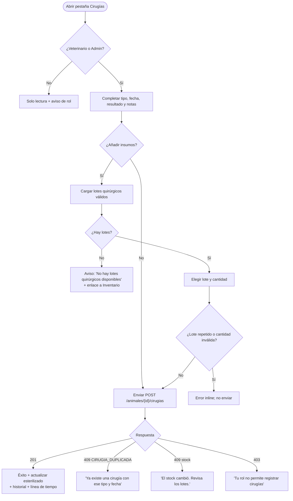
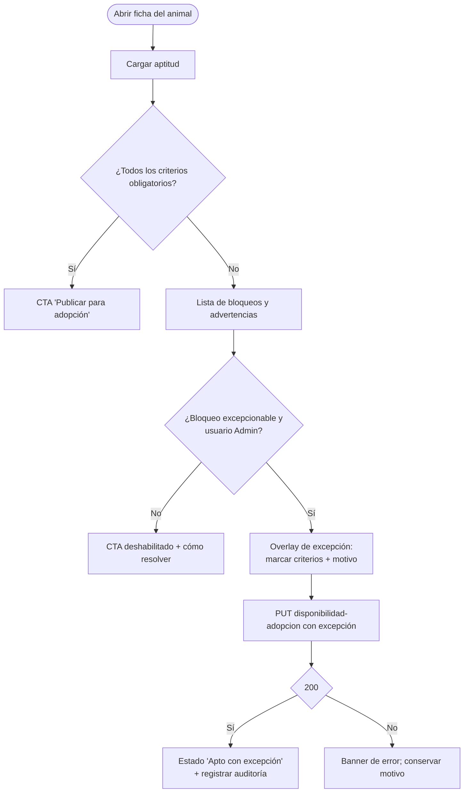

# Anexo UI/UX — Requerimiento 04 (Épica 4)

> **Fuente:** `docs/features/requerimiento-04-control-poblacional.md`.
> **Método:** `docs/ui-ux-metodologia.md`.
> **Actores:** Veterinario, Administrador, Coordinador, Evaluador, Operador (solo lectura).
> **Vistas cubiertas:** pestaña «Cirugías» de `/animales/[id]/ficha-clinica` y bloque «Aptitud para adopción» de `/animales/[id]`.
> **Ruta vigente hasta F2:** `/animals/[id]/clinical-record`.

---

## 1. Inventario de contenido (E-C-S)

### Pestaña «Cirugías» — `/animales/[id]/ficha-clinica`

| Zona | Nivel | Elemento | Origen de datos | Comportamiento UI | Capa |
| :--- | :---: | :--- | :--- | :--- | :--- |
| Resumen | C | Badge «Esterilizado» / «No esterilizado» + fecha de la última cirugía | `GET /animales/{id}/cirugias` | El badge deriva de `animal.esterilizado`, no se recalcula en cliente. | SC |
| Cuerpo | E | Formulario: tipo (`Esterilización`/`Castración`), fecha, resultado (`exitosa`), notas postoperatorias | `POST /animales/{id}/cirugias` | Solo Veterinario/Admin. Fecha no futura. | CC / Action |
| Cuerpo | E | Subpanel «Insumos utilizados» (opcional, múltiples lotes) | `GET /inventario/lotes` | Solo lotes activos, no vencidos, con stock y de insumo quirúrgico; sin repetir lote. | CC |
| Cuerpo | E | Tabla de insumos añadidos: lote, cantidad, stock disponible | — | Cantidad entera ≥ 1; el stock se valida en servidor. | CC |
| Historial | E | Lista append-only: tipo, fecha, resultado, notas, insumos consumidos | `GET /animales/{id}/cirugias` | Cirugía fallida se muestra con etiqueta «No exitosa», sin ocultarse. | SC |
| Aviso | C | «Una cirugía registrada no se edita ni se elimina» | — | Texto fijo bajo el formulario. | SC |

### Bloque «Aptitud para adopción» — `/animales/[id]`

| Zona | Nivel | Elemento | Origen de datos | Comportamiento UI | Capa |
| :--- | :---: | :--- | :--- | :--- | :--- |
| Cabecera | C | Estado global: «Apto para publicar» / «No apto» / «Apto con excepción» | `GET /animales/{id}/aptitud-adopcion` | Texto explícito, nunca solo color (regla 30). | SC |
| Criterios | E | Lista de 6 criterios con estado `ok` / `bloqueo` / `advertencia` y texto («Falta esterilización», «En cuarentena», «Rehabilitación abierta») | Mismo endpoint | Cada criterio explica cómo resolverlo con un enlace a su panel. | SC |
| Bloqueos | E | Bloqueos no excepcionables marcados como «No se puede omitir» | Mismo endpoint | `expediente_activo`, `sin_cuarentena` y diagnóstico `Crítico` no ofrecen excepción. | SC |
| Acción | E | Botón «Publicar para adopción» / «Despublicar» | `PUT /animales/{id}/disponibilidad-adopcion` | Publicar deshabilitado si hay bloqueo; despublicar siempre disponible. | CC / Action |
| Overlay | E | Excepción administrativa: criterios omitidos + motivo (20–1000) | Mismo endpoint con excepción | Solo Admin/Superadmin; confirmación destructiva con texto de auditoría. | CC / Action |
| Resultado | E | `409` de gatekeeper | Respuesta | «No se puede publicar: revisa los criterios marcados.» + foco en el primero. | CC |

---

## 2. Flujos de usuario

### Flujo «Registrar cirugía con consumo de inventario» (RF4.1 / US15)

### Flujo «Gatekeeper de adopción» (RF4.2 / US16)

### Flujo «Despublicar»

Acción directa con confirmación de una línea. No exige aptitud y revoca la excepción vigente.

---

## 3. Los 5 estados de interfaz

| Estado | Cirugías | Aptitud |
| :--- | :--- | :--- |
| **Ideal** | Historial con cirugías e insumos; badge de esterilización coherente. | Criterios resueltos y CTA de publicación activo. |
| **Vacío** | «Sin cirugías registradas» + CTA (solo Veterinario/Admin). | «Aún no se evaluó la aptitud» + lista de criterios pendientes. |
| **Carga** | Skeleton de formulario + 3 filas de historial. | Skeleton de 6 criterios. |
| **Parcial** | Si falla el historial: «No se pudo cargar el historial» + reintentar; el formulario sigue usable. | Si falla un criterio: ese criterio muestra «No verificable» y el CTA queda deshabilitado. |
| **Error** | `error.tsx` del ancla Animales. | `error.tsx` del ancla Animales. |

### Errores de negocio y su traducción

| Código | Mensaje UI |
| :--- | :--- |
| `409 CIRUGIA_DUPLICADA` | «Ya existe una cirugía con ese tipo y fecha para este paciente.» |
| `409 CONFLICTO_CONCURRENCIA` | «El stock cambió mientras registrabas. Revisa los lotes.» |
| `403 ROL_SIN_PERMISO` | «Tu rol no permite registrar cirugías.» |
| `403 EXCEPCION_NO_AUTORIZADA` | «Solo un administrador puede autorizar la excepción.» |
| `400 MOTIVO_EXCEPCION_REQUERIDO` | «El motivo debe tener entre 20 y 1000 caracteres.» |
| `409` gatekeeper | «No se puede publicar: revisa los criterios marcados.» |

---

## 4. Permisos

| Acción | Permiso / rol | UI |
| :--- | :--- | :--- |
| Ver cirugías y aptitud | `animals.view` | Siempre visible |
| Registrar cirugía | Veterinario / Admin | Formulario visible |
| Publicar o despublicar | `animals.edit` | Botón visible |
| Autorizar excepción | Admin / Superadmin | Overlay visible solo a esos roles |
| Consumir insumos | `inventory.view` (selección) + lógica de servicio | Subpanel visible si hay lotes |

---

## 5. Supuestos y decisiones

- **S-01:** el bloque «Aptitud» vive en `/animales/[id]`, no en la ficha clínica: es estado del expediente, no un evento clínico (regla 29).
- **S-02:** los insumos son opcionales; la UI no obliga a inventariar una cirugía (regla 10).
- **D-04.1:** «Publicar» y la excepción son acciones del bloque de aptitud; no se duplican en la tabla de animales.
- **D-04.2:** la confirmación de excepción muestra los criterios omitidos antes de enviar, para que el motivo se redacte con contexto.
