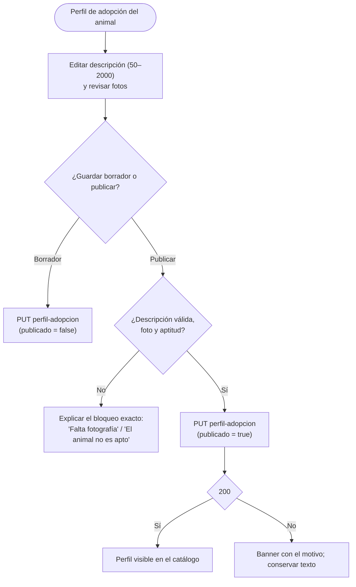
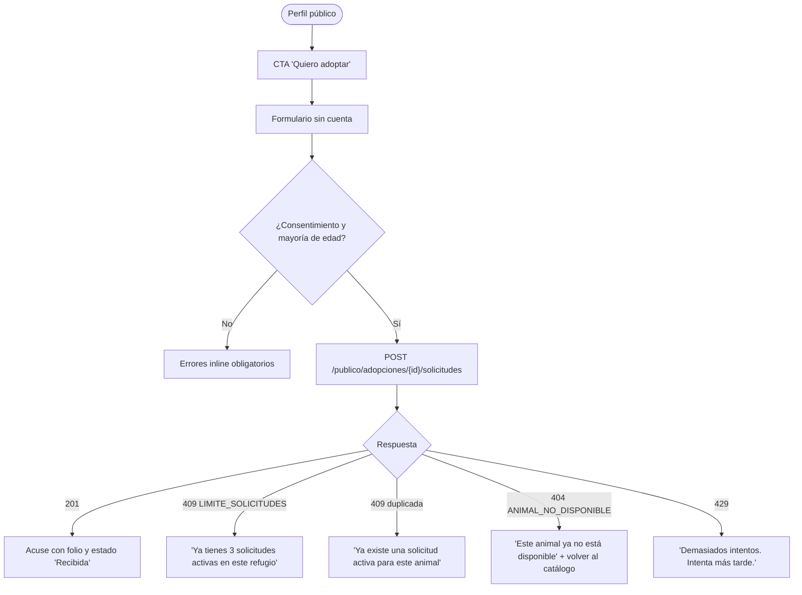
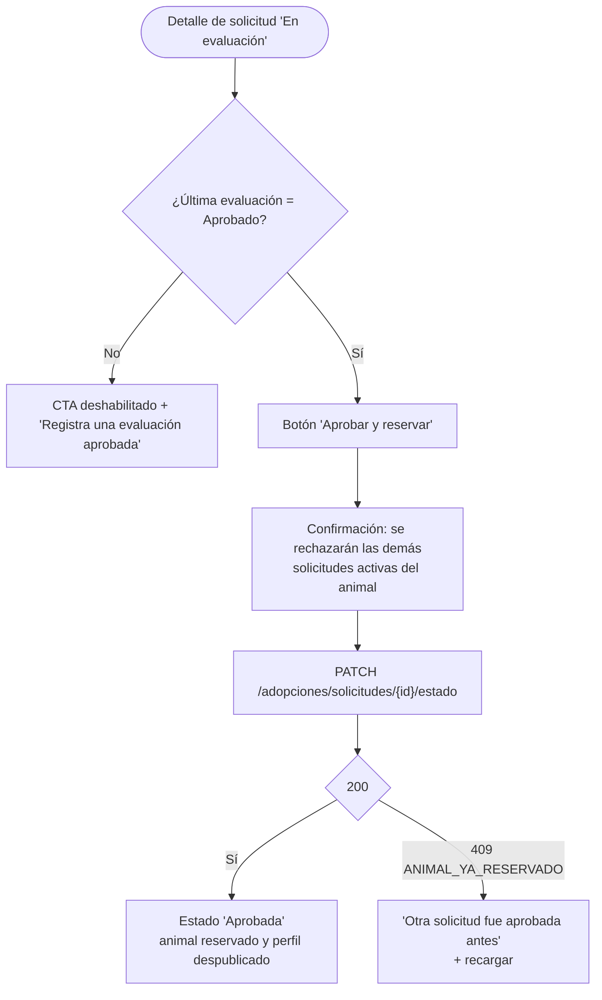

# Anexo UI/UX — Requerimiento 05 (Épica 5)

> **Fuente:** `docs/features/requerimiento-05-portal-adopciones.md`.
> **Método:** `docs/ui-ux-metodologia.md`.
> **Actores:** Visitante y postulante (sin sesión); Administrador, Coordinador, Evaluador y Operador (sesión).
> **Vistas cubiertas:** catálogo público, perfil público, postulación, gestión de solicitudes y perfiles.
> **Rutas:** `/`, `/adopciones`, `/adopciones/[idAnimal]`, `/adopciones/[idAnimal]/solicitud`, `/refugios`, `/refugios/[slug]`, `/adopciones/solicitudes`, `/adopciones/solicitudes/[id]`, `/adopciones/perfiles`.

---

## 1. Inventario de contenido (E-C-S)

### Público — `PublicShell`

| Ruta | Zona | Elemento | Origen de datos | Comportamiento UI | Capa |
| :--- | :--- | :--- | :--- | :--- | :--- |
| `/` | Hero | Propuesta institucional + CTA «Ver adopciones» | Contenido editorial | Sin datos de Supabase en `app/` (D-08); servicio único. | SC |
| `/` | Destacados | Carrusel/grid de 6–8 animales publicados | `GET /publico/adopciones?pageSize=8` | Si falla, la landing sigue mostrando el hero sin bloque de destacados. | SC |
| `/adopciones` | Toolbar | Filtros: refugio, especie, sexo, tamaño, edad, temperamento, texto | `GET /publico/adopciones` | Filtros en URL; contador de resultados visible. | CC |
| `/adopciones` | Grid | Tarjeta: foto, nombre, especie, edad, tamaño, refugio, «Ver perfil» | Mismo endpoint | Solo animales publicados, activos, sin cuarentena ni reserva. | SC |
| `/adopciones` | Paginación | `page` / `pageSize` (máx. 50) + total | Mismo endpoint | Paginación por enlaces, no scroll infinito. | SC |
| `/adopciones/[idAnimal]` | Galería | Foto principal + thumbnails ordenados | `GET /publico/adopciones/{id}` | Nunca expone microchip, procedencia, rescate ni datos clínicos. | SC |
| `/adopciones/[idAnimal]` | Ficha | Nombre, especie, raza, sexo, edad, tamaño, color, temperamento, vacunas, esterilización, rasgos, descripción | Mismo endpoint | Datos seguros de la regla 10. | SC |
| `/adopciones/[idAnimal]` | Compatibilidad | Señales de `apto_perros`, `apto_gatos`, `apto_ninos` | Mismo endpoint | Texto orientativo: «No sustituye la evaluación del refugio». | SC |
| `/adopciones/[idAnimal]` | Refugio | Nombre, ciudad, estado, correo, teléfono | Mismo endpoint | Enlace a `/refugios/[slug]`. | SC |
| `/adopciones/[idAnimal]` | CTA | «Quiero adoptar» | — | Lleva a la solicitud; oculto si el animal dejó de estar disponible. | SC |
| `/adopciones/[idAnimal]/solicitud` | Formulario | Datos del adoptante + consentimiento + campo trampa | `POST /publico/adopciones/{id}/solicitudes` | Sin cuenta. Consentimiento obligatorio. | CC / Action |
| `/adopciones/[idAnimal]/solicitud` | Acuse | Folio `codigo_seguimiento` + estado «Recibida» | Respuesta | «El refugio te contactará». No promete adopción ni plazos. | SC |
| `/refugios` | Grid | Refugios activos con adoptables | `GET /publico/refugios` | Refugios inactivos no aparecen. | SC |
| `/refugios/[slug]` | Página | Datos institucionales + adoptables del refugio | `GET /publico/refugios/{slug}` + `.../adopciones` | Slug único y estable. | SC |

### Interno — `AppShell`

| Ruta | Zona | Elemento | Origen de datos | Comportamiento UI | Capa |
| :--- | :--- | :--- | :--- | :--- | :--- |
| `/adopciones` | Resumen | Contadores por estado + accesos a solicitudes y perfiles | `GET /adopciones/solicitudes` | Pestañas, no submenús (regla 2 del mapa). | SC |
| `/adopciones/solicitudes` | Bandeja | Tabla con folio, animal, adoptante, estado, fecha; filtros por estado y texto | Mismo endpoint | Estados con texto, no solo color. | SC |
| `/adopciones/solicitudes/[id]` | Detalle | Adoptante, animal, compatibilidad, evaluaciones, historial | `GET /adopciones/solicitudes/{id}` | Datos personales solo con `adoptions.view`. | SC |
| `/adopciones/solicitudes/[id]` | Acciones | Cambiar estado, registrar evaluación, completar adopción | `PATCH .../estado`, `POST .../evaluaciones`, `POST .../completar` | Acciones visibles según permiso y estado. | CC / Action |
| `/adopciones/solicitudes/[id]` | Compatibilidad | Señales frente a `tiene_ninos`, `tiene_otras_mascotas`, `espacio_techado` | Mismo detalle | Advertencias para el evaluador; no deciden. | SC |
| `/adopciones/perfiles` | Listado | Perfiles publicados, borradores y publicables | `GET /animales` + `GET /animales/{id}/perfil-adopcion` | Estado «Sin foto» / «Sin descripción» explica por qué no publica. Requiere confirmar el listado (G-01). | SC |
| `/adopciones/perfiles` | Overlay | Editar perfil y publicar/despublicar | `PUT /animales/{id}/perfil-adopcion` | Borrador con descripción vacía permitido; publicar no. | CC / Action |

---

## 2. Flujos de usuario

### Flujo «Publicar perfil» (RF5.1 / US17)

### Flujo «Postulación pública» (RF5.3 / US18)

### Flujo «Aprobar con reserva» (RF5.6 / US19)

### Flujo «Completar adopción» (RF5.7 / US19)

Desde `Aprobada`: fecha de adopción (no futura), observaciones opcionales, confirmación destructiva. Al completar, el animal sale del catálogo y de la población activa.

---

## 3. Los 5 estados de interfaz

| Estado | Público | Interno |
| :--- | :--- | :--- |
| **Ideal** | Catálogo con resultados y filtros aplicados. | Bandeja con solicitudes y acciones por estado. |
| **Vacío** | «No hay animales que coincidan con los filtros» + «Limpiar filtros». | «Sin solicitudes en este estado» + filtro alternativo. |
| **Carga** | Skeleton de tarjetas (misma proporción de imagen). | Skeleton de tabla y de detalle. |
| **Parcial** | Si falla una foto: placeholder con nombre; el perfil sigue visible. | Si falla el historial: «No se pudo cargar el historial» + reintentar. |
| **Error** | `app/(public)/error.tsx`: «No pudimos cargar el catálogo» + reintentar. | `error.tsx` del ancla Adopciones. |

### Errores de negocio y su traducción

| Código | Mensaje UI |
| :--- | :--- |
| `409 PERFIL_SIN_FOTOGRAFIA` | «Añade al menos una fotografía antes de publicar.» |
| `409` aptitud | «El paciente no cumple los criterios de adopción.» |
| `404 ANIMAL_NO_DISPONIBLE` | «Este animal ya no está disponible.» |
| `409 LIMITE_SOLICITUDES` | «Ya tienes el máximo de solicitudes activas en este refugio.» |
| `409 LIMITE_IA` | «Alcanzaste el límite de generaciones. Redacta la descripción manualmente.» |
| `409 TRANSICION_INVALIDA` | «Ese cambio de estado no está permitido.» |
| `409 EVALUACION_REQUERIDA` | «Registra una evaluación antes de aprobar.» |
| `409 ULTIMA_EVALUACION_NO_APROBADA` | «La última evaluación no está aprobada.» |
| `409 ANIMAL_YA_RESERVADO` | «Otra solicitud fue aprobada antes.» |
| `409 EXPORTACION_DEMASIADO_GRANDE` | «Acota el periodo: hay más de 50 000 filas.» |

---

## 4. Permisos

| Acción | Permiso / rol | UI |
| :--- | :--- | :--- |
| Ver catálogo y perfil público | Público | Sin sesión |
| Postular | Público | Sin sesión |
| Ver solicitudes y perfiles | `adoptions.view` | Ancla visible |
| Publicar / despublicar perfil | `adoptions.publish` | Botón visible |
| Cambiar estado / aprobar / cancelar | `adoptions.manage` | Acciones visibles |
| Registrar evaluación | `adoptions.evaluate` | Formulario visible |
| Completar adopción | `adoptions.complete` | Botón visible |
| Generar descripción con IA | `adoptions.ai` | Botón «Generar borrador» |

> `adoptions.view`, `adoptions.publish`, `adoptions.evaluate`, `adoptions.manage` y `adoptions.complete` existen en la migración de la épica 5. `adoptions.ai` se siembra en la épica 8.

---

## 5. Supuestos y decisiones

- **S-01:** el catálogo público se sirve desde `/api/v1/publico/*`; el middleware debe permitir esas rutas (H-12). Sin ese cambio la épica no es navegable sin sesión.
- **S-02:** el postulante no tiene cuenta ni consulta posterior por folio (fuera de alcance de la épica).
- **D-05.1:** `/adopciones` es el ancla interna y también la ruta pública del catálogo. El shell se decide por sesión: `PublicShell` sin sesión, `AppShell` con sesión.
- **D-05.2:** el resumen interno usa pestañas (`Solicitudes`, `Perfiles`); no se añaden anclas al sidebar.
- **D-05.3:** la landing única vive en `/` y se alimenta de un servicio; se elimina `/landing` (D-08).
- **G-01 (hueco de contrato):** el requerimiento 05 no define un endpoint de listado de perfiles. `/adopciones/perfiles` se compone de `GET /animales` + `GET /animales/{id}/perfil-adopcion` hasta que exista un contrato específico. Requiere confirmación de backend antes de implementar.
