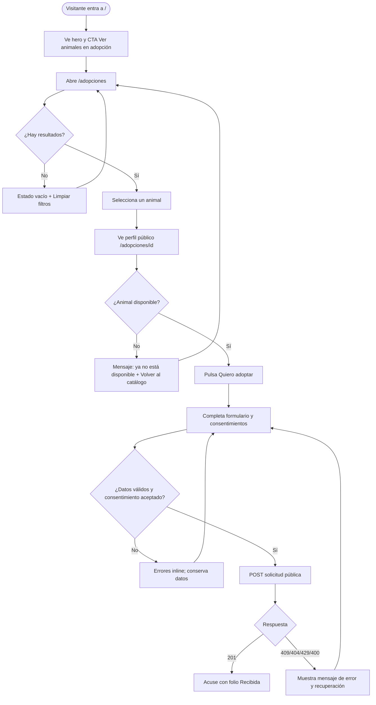
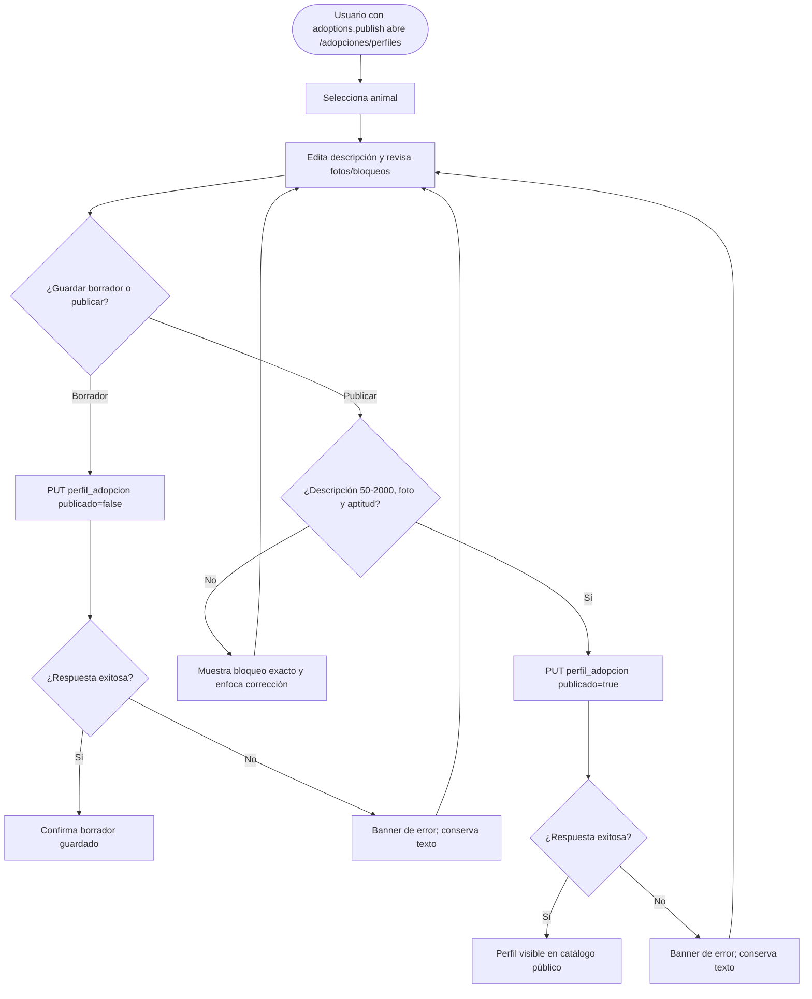
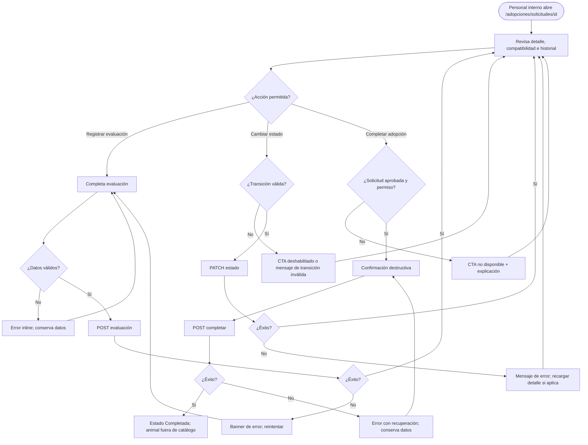
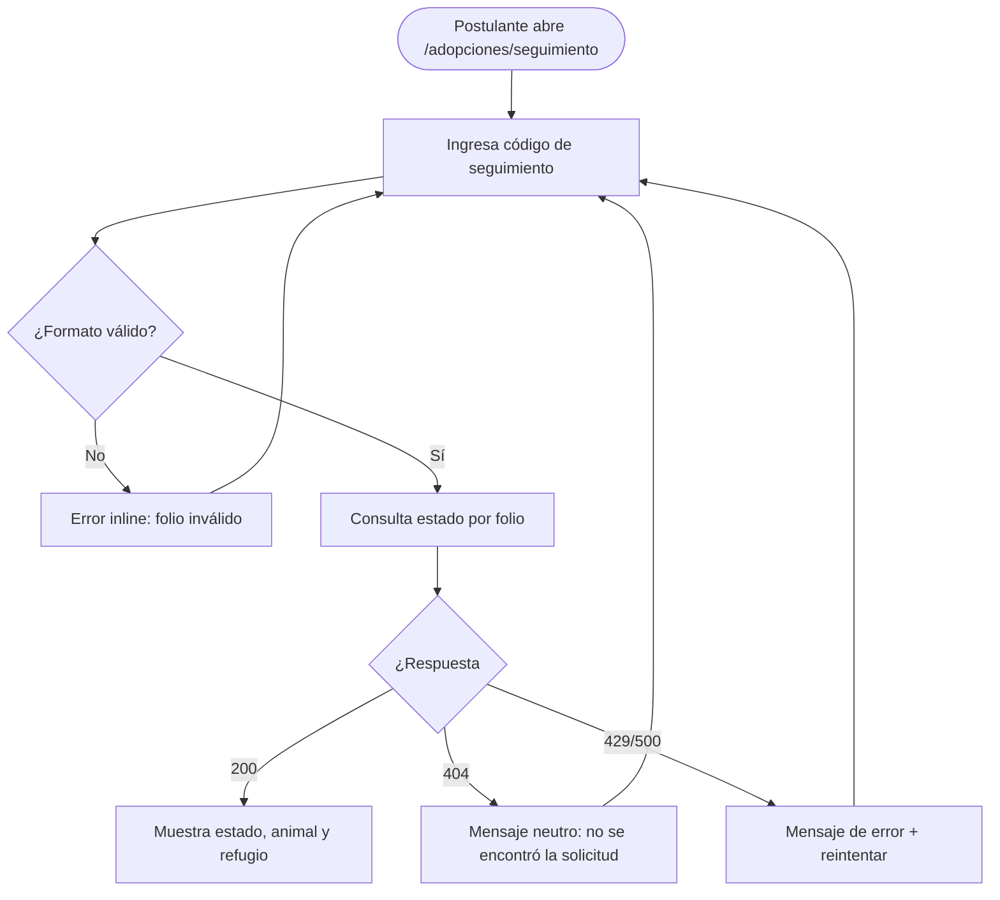

# Anexo UI/UX — Requerimiento 05 (Épica 5)

> **Fuente:** `docs/features/requerimiento-05-portal-adopciones.md`.
> **Método:** `docs/ui-ux-metodologia.md`.
> **Actores:** Visitante (sin sesión), Postulante (sin sesión, con folio), Administrador, Coordinador, Evaluador, Operador, Personal de solo lectura (`adoptions.view`), Superadmin.
> **Vistas cubiertas:** landing pública, catálogo público, perfil público, postulación, seguimiento por folio, página pública de refugio, resumen interno de adopciones, bandeja de solicitudes, detalle de solicitud, gestión de perfiles.
> **Rutas:** `/`, `/adopciones`, `/adopciones/[idAnimal]`, `/adopciones/[idAnimal]/solicitud`, `/adopciones/seguimiento`, `/refugios`, `/refugios/[slug]`, `/adopciones/solicitudes`, `/adopciones/solicitudes/[id]`, `/adopciones/perfiles`.
> **Decisiones vigentes:** D-05.1 (`/adopciones` resuelve shell por sesión: `PublicShell` sin sesión, `AppShell` con sesión), D-05.2 (pestañas Solicitudes/Perfiles, sin subanclas nuevas), D-05.3/D-08 (landing única en `/`, sin `/landing`).

---

## 1. Inventario de contenido (E-C-S)

### Vista `/` — Visitante

| Zona | Nivel | Elemento | Origen de datos / contrato | Comportamiento UI | Capa |
| :--- | :--- | :--- | :--- | :--- | :--- |
| Top Bar / Shell | [C] | Encabezado público con marca Pixkki, acceso a `Adopciones`, `Refugios` y `Seguimiento` | Navegación pública; shell por sesión (D-05.1) | En móvil, acciones secundarias en menú; CTA principal visible. | SC |
| Hero | [E] | Propuesta de valor institucional: conectar refugios y adoptantes con confianza | Contenido editorial estático (D-08, sin consulta Supabase en `app/`) | Mensaje claro, una sola acción principal. No depende de disponibilidad de datos. | SC |
| Hero | [E] | CTA principal «Ver animales en adopción» | — | Navega a `/adopciones`. Área táctil >= 44 px; en móvil se ancla en zona de pulgar dentro del hero. | SC |
| Hero | [C] | CTA secundario «Soy refugio / Iniciar sesión» | Ruta de autenticación existente | Acción secundaria visual; no compite con el CTA principal. | SC |
| Cómo funciona | [C] | 3 pasos: conoce el perfil, envía solicitud, el refugio te contacta | Contenido editorial | Reduce incertidumbre del postulante; lenguaje simple, sin jerga técnica. | SC |
| Destacados | [C] | Grid/carrusel de animales publicados (máx. 8) con foto, nombre, especie, refugio | `GET /api/v1/publico/adopciones?page=1&pageSize=8` | Si la carga falla o no hay datos, el bloque se oculta o muestra estado vacío suave; el hero sigue funcional. | SC |
| Confianza | [C] | Señales de seguridad: datos protegidos, refugios activos, proceso con seguimiento | Contenido editorial + reglas Req. 05 | Explica privacidad y expectativas sin prometer tiempos ni adopción. | SC |
| Footer | [S] | Enlaces a refugios, política de privacidad, contacto institucional | Contenido editorial / rutas públicas | Información de soporte, baja prioridad visual. | SC |

### Vista `/adopciones` — Visitante

| Zona | Nivel | Elemento | Origen de datos / contrato | Comportamiento UI | Capa |
| :--- | :--- | :--- | :--- | :--- | :--- |
| Context Summary | [C] | Título «Animales en adopción» + contador de resultados | `GET /api/v1/publico/adopciones` (`total`) | Actualiza al cambiar filtros; comunica el alcance del listado. | SC |
| Toolbar | [E] | Filtros: refugio, especie, sexo, tamaño, edad, temperamiento, texto (`q`) | Query params de `GET /api/v1/publico/adopciones` | Filtros sincronizados con URL; cambiar filtro reinicia a página 1. | CC |
| Toolbar | [C] | Chips de filtros activos + acción «Limpiar filtros» | Estado derivado de URL | Visible solo con filtros activos; limpieza restaura listado base. | CC |
| Primary Body | [E] | Tarjetas de animal: foto principal, nombre, especie, edad, tamaño, refugio, CTA «Ver perfil» | `GET /api/v1/publico/adopciones` | Solo muestra animales publicados, activos, sin cuarentena ni reserva. Nunca expone datos sensibles. | SC |
| Primary Body | [C] | Badges de compatibilidad/atributos seguros (vacunado, esterilizado, temperamento) | Campos seguros del catálogo público | Texto visible, no solo color. | SC |
| Paginación | [C] | Controles `page`/`pageSize` (máx. 50) y total | `GET /api/v1/publico/adopciones` | Paginación por enlaces; conserva filtros en URL. No scroll infinito. | SC |
| Estado vacío | [E] | Mensaje «No hay animales que coincidan con los filtros» + CTA de rescate | Resultado vacío del endpoint | CTA «Limpiar filtros» o «Ver todos los animales». | SC/CC |

### Vista `/adopciones/[idAnimal]` — Visitante

| Zona | Nivel | Elemento | Origen de datos / contrato | Comportamiento UI | Capa |
| :--- | :--- | :--- | :--- | :--- | :--- |
| Context Summary | [C] | Breadcrumb/retroceso a catálogo + nombre del animal | `GET /api/v1/publico/adopciones/{id}` | Permite volver sin perder contexto de filtros cuando sea posible. | SC |
| Galería | [E] | Foto principal + miniaturas ordenadas | `fotos[]` de `GET /api/v1/publico/adopciones/{id}` | Orden por principal/orden/id; en móvil, galería deslizable. | SC/CC |
| Ficha | [E] | Nombre, especie, raza, sexo, edad estimada, tamaño, color, temperamento, vacunado, desparasitado, esterilizado, rasgos, descripción pública | Campos seguros de `GET /api/v1/publico/adopciones/{id}` | Nunca muestra microchip, procedencia, rescate, rescatista, observaciones internas, peso, diagnóstico ni notas clínicas. | SC |
| Compatibilidad | [C] | Señales `apto_perros`, `apto_gatos`, `apto_ninos`, nivel de energía/comportamiento | `compatibilidad` del endpoint público | Texto orientativo: «No sustituye la evaluación del refugio». | SC |
| Refugio | [C] | Nombre, ciudad, estado, correo, teléfono y enlace a página del refugio | `refugio` del endpoint público | Enlace a `/refugios/[slug]`. No expone dirección exacta (S10). | SC |
| Bottom Action Bar | [E] | CTA «Quiero adoptar» | Disponibilidad pública del perfil | Visible solo si el perfil sigue disponible; en móvil sticky bottom. Si no disponible, muestra estado informativo y CTA «Volver al catálogo». | SC |

### Vista `/adopciones/[idAnimal]/solicitud` — Postulante

| Zona | Nivel | Elemento | Origen de datos / contrato | Comportamiento UI | Capa |
| :--- | :--- | :--- | :--- | :--- | :--- |
| Context Summary | [C] | Resumen del animal y refugio seleccionado | `GET /api/v1/publico/adopciones/{id}` | Ancla mental: a quién estoy postulando. Si el animal ya no está disponible, bloquea el formulario. | SC |
| Primary Body | [E] | Formulario de postulante: nombre, teléfono, correo, dirección, convivencia, experiencia, motivación, comentarios | `POST /api/v1/publico/adopciones/{id}/solicitudes` | Validación inline en español; conserva datos ante error recuperable. | CC |
| Primary Body | [E] | Casillas obligatorias: `acepta_politica_privacidad`, `declara_mayor_edad` | Mismo endpoint; reglas 19 | No permite enviar sin ambas. Texto claro y accesible. | CC |
| Primary Body | [S] | Campo trampa `sitio_web` | Regla 23 antispam | Oculto visualmente/accesiblemente para humanos; si llega completo, el backend rechaza. | CC |
| Bottom Action Bar | [E] | CTA «Enviar solicitud» | `POST /api/v1/publico/adopciones/{id}/solicitudes` | Deshabilitado durante envío; muestra estado «Enviando…». Mínimo 44 px, sticky en móvil. | CC / Action |
| Acuse | [E] | Confirmación con folio `codigo_seguimiento`, estado `Recibida` y mensaje de contacto | Respuesta 201 del endpoint | Muestra folio copiable; indica que el refugio contactará. No promete adopción ni plazos. | SC/CC |
| Acuse | [C] | Enlace a seguimiento por folio | `/adopciones/seguimiento` (alcance agregado, ver Supuestos) | Permite consultar estado después; no requiere cuenta. | SC |

### Vista `/adopciones/seguimiento` — Postulante / Visitante

| Zona | Nivel | Elemento | Origen de datos / contrato | Comportamiento UI | Capa |
| :--- | :--- | :--- | :--- | :--- | :--- |
| Context Summary | [C] | Explicación: consulta el estado de tu solicitud con tu folio | Contenido UI; contrato público pendiente (ver G-02) | Lenguaje claro; no solicita datos personales adicionales innecesarios. | SC |
| Primary Body | [E] | Campo de folio + CTA «Consultar estado» | Contrato propuesto: `GET /api/v1/publico/adopciones/seguimiento/{codigo}` | Valida formato UUID antes de enviar; conserva folio ingresado ante error. | CC / Action |
| Resultado | [E] | Estado actual, fecha de solicitud, nombre del animal y refugio (datos mínimos) | Contrato propuesto (G-02) | No expone datos sensibles del adoptante ni notas internas. Estados con texto. | SC |
| Resultado | [C] | Mensaje de siguiente paso según estado | Reglas de negocio Req. 05 | Ej.: `Recibida`/`En entrevista`/`En evaluación`: «El refugio te contactará»; terminales: mensaje informativo. | SC |
| Error/Recuperación | [E] | Folio no encontrado o inválido | Error propuesto `404 FOLIO_NO_ENCONTRADO` / `400 FOLIO_INVALIDO` | Mensaje neutro, sin confirmar existencia de datos personales; CTA reintentar. | CC |

### Vista `/refugios` — Visitante

| Zona | Nivel | Elemento | Origen de datos / contrato | Comportamiento UI | Capa |
| :--- | :--- | :--- | :--- | :--- | :--- |
| Context Summary | [C] | Título «Refugios» + descripción breve | Contenido editorial | Contexto de navegación pública. | SC |
| Primary Body | [E] | Grid de refugios activos con adoptables: nombre, ciudad, estado, cantidad de adoptables | `GET /api/v1/publico/refugios` | Solo refugios activos. Enlace a `/refugios/[slug]`. | SC |
| Estado vacío | [C] | «No hay refugios con animales disponibles por ahora» | Respuesta vacía | CTA a `/adopciones` o mensaje informativo. | SC |

### Vista `/refugios/[slug]` — Visitante

| Zona | Nivel | Elemento | Origen de datos / contrato | Comportamiento UI | Capa |
| :--- | :--- | :--- | :--- | :--- | :--- |
| Context Summary | [E] | Nombre del refugio, ciudad, estado, descripción pública, contacto | `GET /api/v1/publico/refugios/{slug}` | Datos institucionales seguros; sin dirección exacta. | SC |
| Primary Body | [E] | Listado de adoptables del refugio | `GET /api/v1/publico/refugios/{slug}/adopciones` | Reutiliza patrón de tarjeta del catálogo; paginación si aplica. | SC |
| Estado vacío | [C] | «Este refugio no tiene animales disponibles actualmente» | Respuesta vacía | CTA a `/adopciones`. | SC |

### Vista `/adopciones` — Administrador / Coordinador / Evaluador / Operador / Solo lectura (sesión)

| Zona | Nivel | Elemento | Origen de datos / contrato | Comportamiento UI | Capa |
| :--- | :--- | :--- | :--- | :--- | :--- |
| Context Summary | [C] | Título «Adopciones» y resumen del módulo | `GET /api/v1/adopciones/solicitudes` (agregados/filtros) | Ancla interna; misma ruta que catálogo público, resuelta por sesión (D-05.1). | SC |
| Primary Body | [E] | Pestañas `Solicitudes` y `Perfiles` | D-05.2 | No crea subanclas en sidebar. Conserva pestaña activa en URL o estado local visible. | CC |
| Primary Body | [C] | Contadores por estado de solicitud | `GET /api/v1/adopciones/solicitudes` | Ayuda a priorizar trabajo; texto y número, no solo color. | SC |
| Primary Body | [C] | Accesos rápidos a bandeja y perfiles | Rutas internas | Enlaces claros; visibles según permiso. | SC |

### Vista `/adopciones/solicitudes` — Personal interno con `adoptions.view`

| Zona | Nivel | Elemento | Origen de datos / contrato | Comportamiento UI | Capa |
| :--- | :--- | :--- | :--- | :--- | :--- |
| Context Summary | [C] | Título, pestaña activa `Solicitudes`, contador de resultados | `GET /api/v1/adopciones/solicitudes` | Contexto de bandeja y alcance del filtro. | SC |
| Toolbar | [E] | Filtros por estado, texto (`q`), animal, rango de fechas | Query params de `GET /api/v1/adopciones/solicitudes` | Filtros en URL; reinician paginación. | CC |
| Primary Body | [E] | Tabla/lista: folio, animal, adoptante, estado, fecha, acción «Ver detalle» | `GET /api/v1/adopciones/solicitudes` | Estados con texto y badge accesible. En móvil se renderiza como tarjetas. | SC |
| Primary Body | [C] | Indicador de última actividad/evaluación cuando esté disponible | Datos del listado/detalle según contrato | Ayuda a priorizar; no bloquea la tarea principal. | SC |
| Paginación | [C] | `page`, `pageSize`, `total` | `GET /api/v1/adopciones/solicitudes` | Conserva filtros. | SC |
| Estado vacío | [E] | «No hay solicitudes en este estado» + CTA para limpiar filtro/cambiar estado | Resultado vacío | CTA de rescate contextual. | SC/CC |

### Vista `/adopciones/solicitudes/[id]` — Personal interno con `adoptions.view`

| Zona | Nivel | Elemento | Origen de datos / contrato | Comportamiento UI | Capa |
| :--- | :--- | :--- | :--- | :--- | :--- |
| Context Summary | [E] | Encabezado con folio, estado actual, animal y adoptante | `GET /api/v1/adopciones/solicitudes/{id}` | Identifica claramente el caso; estado con texto. | SC |
| Primary Body | [E] | Datos del adoptante y formulario recibido | Detalle de solicitud/adoptante | Datos personales visibles solo con `adoptions.view`; no exponer fuera del refugio. | SC |
| Primary Body | [E] | Datos del animal y enlace a expediente interno | Detalle de solicitud/animal | Da contexto para evaluar; respeta permisos de otras áreas. | SC |
| Primary Body | [C] | Compatibilidad asistida: señales del animal vs condiciones del adoptante | `compatibilidad`/campos del detalle | Advertencias orientativas; la decisión formal la registra el evaluador. | SC |
| Primary Body | [E] | Historial de evaluaciones | `GET /api/v1/adopciones/solicitudes/{id}/evaluaciones` | Lista cronológica; si falla, permite reintentar sin ocultar el resto del detalle. | SC |
| Primary Body | [C] | Historial de estado/auditoría visible al usuario | Datos de detalle/auditoría según contrato disponible | Muestra trazabilidad; sin datos sensibles innecesarios. | SC |
| Actions | [E] | Cambiar estado | `PATCH /api/v1/adopciones/solicitudes/{id}/estado` | Visible solo con `adoptions.manage` y transición válida. Rechazar/cancelar exige motivo. | CC / Action |
| Actions | [E] | Registrar evaluación | `POST /api/v1/adopciones/solicitudes/{id}/evaluaciones` | Visible con `adoptions.evaluate`. Valida tipo, resultado, puntuación 0–100, fecha no futura. | CC / Action |
| Actions | [E] | Aprobar y reservar | `PATCH .../estado` a `Aprobada` | Solo si última evaluación es `Aprobado` y usuario tiene `adoptions.manage`. Confirmación previa. | CC / Action |
| Actions | [E] | Completar adopción | `POST /api/v1/adopciones/solicitudes/{id}/completar` | Solo desde `Aprobada` y con `adoptions.complete`. Confirmación destructiva. | CC / Action |
| Overlay | [C] | Confirmaciones de aprobar/cancelar aprobada/completar | Acciones transaccionales | Bottom sheet en móvil, modal en desktop; botón destructivo separado. | CC |

### Vista `/adopciones/perfiles` — Personal interno con `adoptions.view` / `adoptions.publish`

| Zona | Nivel | Elemento | Origen de datos / contrato | Comportamiento UI | Capa |
| :--- | :--- | :--- | :--- | :--- | :--- |
| Context Summary | [C] | Título, pestaña activa `Perfiles`, explicación breve | D-05.2 | Indica que publicar exige aptitud, descripción y foto. | SC |
| Toolbar | [E] | Búsqueda/filtros por estado de perfil, nombre, especie | Composición actual (G-01): `GET /api/v1/animales` + `GET /api/v1/animales/{id}/perfil-adopcion` | Hasta definir contrato de listado, la UI debe manejar carga parcial y paginación/consulta progresiva. | CC / Service |
| Primary Body | [E] | Listado de perfiles: animal, estado publicación, bloqueos, última actualización | Composición G-01 | Estados visibles: `Publicado`, `Borrador`, `No publicable`, `Sin foto`, `Sin descripción`. | SC/CC |
| Primary Body | [C] | Motivo de bloqueo de publicación | `puede_publicarse`, `bloqueos` de `GET /api/v1/animales/{id}/perfil-adopcion` | Explica el bloqueo exacto antes del intento de publicar. | SC |
| Overlay / Panel | [E] | Editar perfil: descripción pública y estado publicado | `PUT /api/v1/animales/{id}/perfil-adopcion` | Borrador con descripción vacía permitido; publicar valida 50–2000, foto y aptitud. Conserva texto ante error. | CC / Action |
| Overlay / Panel | [C] | Previsualización de fotos/galería | `GET /api/v1/animales/{id}/perfil-adopcion` / fotos del animal | Ayuda a validar requisito de foto; no duplica la gestión de fotos. | SC |
| Action | [E] | Publicar / Despublicar | `PUT /api/v1/animales/{id}/perfil-adopcion` | Visible con `adoptions.publish`. Despublicar siempre posible; publicar sujeto a bloqueos. | CC / Action |

---

## 2. Flujos de usuario

### Flujo A — Descubrimiento público y postulación (RF5.2, RF5.3)

**Notas de móvil:** el CTA del hero y «Quiero adoptar» deben quedar en zona de pulgar; el formulario usa campos de una columna, `inputMode` adecuado para teléfono/correo y teclado numérico donde aplique; el acuse muestra el folio copiable y botón visible sin scroll largo.

### Flujo B — Publicar o guardar borrador de perfil (RF5.1)

**Notas de móvil:** el editor se abre en panel/bottom sheet de pantalla completa; el contador de caracteres de descripción es visible; acciones Guardar borrador/Publicar quedan en barra inferior fija con estados de carga.

### Flujo C — Gestión interna de solicitud (RF5.4, RF5.5, RF5.6, RF5.7)

**Notas de móvil:** las acciones críticas se agrupan en una barra inferior o menú de acciones; las confirmaciones destructivas usan bottom sheet con botón de peligro separado; el historial de evaluaciones se colapsa por secciones para evitar scroll excesivo.

### Flujo D — Seguimiento por folio (alcance agregado)

**Notas de móvil:** campo de folio con pegado fácil, botón de consulta sticky en zona inferior, resultado en tarjeta simple con estado textual y fecha.

---

## 3. Los 5 estados de interfaz

| Vista | Ideal | Vacío | Carga | Parcial | Error | Recuperación |
| :--- | :--- | :--- | :--- | :--- | :--- | :--- |
| `/` — Visitante | Hero visible, destacados cargados y CTA principal disponible. | Sin destacados: se mantiene hero y se muestra mensaje suave «Pronto habrá animales disponibles». | Skeleton del bloque de destacados con misma proporción de tarjetas; hero ya renderizado. | Fallan algunos destacados/fotos: se muestran tarjetas disponibles y placeholder en imagen faltante. | Falla carga de destacados: el hero y navegación siguen operativos; bloque con «No pudimos cargar destacados». | Reintentar carga de destacados sin recargar toda la landing. |
| `/adopciones` — Visitante | Grid con resultados, filtros activos visibles y paginación. | Sin coincidencias: «No hay animales que coincidan con los filtros». | Skeleton grid con misma proporción de imagen/texto. | Falla imagen de una tarjeta: placeholder con nombre; resto del grid visible. | `400 FILTROS_INVALIDOS`: mensaje y reset de filtros. `500/timeout`: error de carga. | CTA «Limpiar filtros», «Reintentar» o volver a página 1. |
| `/adopciones/[idAnimal]` — Visitante | Perfil completo con galería, ficha, compatibilidad y CTA. | No aplica como vacío normal; ausencia de perfil es estado de error/no disponible. | Skeleton de galería, ficha y barra de acción. | Falta foto secundaria: se oculta miniatura rota y se mantiene principal/placeholder. | `404 PERFIL_NO_ENCONTRADO`/`ANIMAL_NO_DISPONIBLE`: mensaje claro y salida al catálogo. | CTA «Volver al catálogo»; recarga de perfil. |
| `/adopciones/[idAnimal]/solicitud` — Postulante | Formulario listo, animal disponible, envío exitoso con acuse. | No aplica; si animal no disponible se bloquea antes de capturar. | Carga inicial: skeleton de resumen/formulario. Envío: botón en «Enviando…» y bloqueo de doble clic. | Validación parcial por campo: errores inline campo por campo. | `400 DATOS_INVALIDOS/PRIVACIDAD_NO_ACEPTADA/MAYORIA_DE_EDAD_NO_DECLARADA/SOLICITUD_INVALIDA`; `404 ANIMAL_NO_DISPONIBLE`; `409 SOLICITUD_DUPLICADA/LIMITE_SOLICITUDES/ANIMAL_YA_RESERVADO`; `429 DEMASIADAS_SOLICITUDES`; `500`. | Conservar datos ingresados, enfocar primer campo con error, ofrecer reintento o volver al catálogo según código. |
| `/adopciones/seguimiento` — Postulante | Folio válido y estado actual visible. | Antes de consultar: estado inicial con instrucción y campo vacío. | Skeleton/loader de resultado tras enviar consulta. | Respuesta parcial si faltan datos opcionales: mostrar estado y datos mínimos disponibles. | `400 FOLIO_INVALIDO` (propuesto): error inline. `404 FOLIO_NO_ENCONTRADO` (propuesto): mensaje neutro. `429/500`: error temporal. | Conservar folio, permitir corregir/reintentar; no exponer existencia de datos personales. |
| `/refugios` — Visitante | Grid de refugios activos con adoptables. | «No hay refugios con animales disponibles por ahora». | Skeleton de tarjetas de refugio. | Faltan datos opcionales del refugio: ocultar campo vacío, mantener tarjeta. | `500/timeout`: «No pudimos cargar los refugios». | Reintentar; CTA a `/adopciones`. |
| `/refugios/[slug]` — Visitante | Datos del refugio y adoptables visibles. | Refugio sin adoptables: mensaje y CTA al catálogo global. | Skeleton de cabecera y grid de adoptables. | Falla imagen de adoptable: placeholder; resto visible. | `404 REFUGIO_NO_ENCONTRADO`; `500/timeout`. | Volver a `/refugios` o reintentar. |
| `/adopciones` — Interno | Resumen con pestañas, contadores y accesos rápidos. | Sin solicitudes/perfiles: mostrar contadores en cero y CTA contextual. | Skeleton de contadores y tarjetas de acceso. | Falla un contador: mostrar «—» o último valor no disponible con aviso suave; resto operativo. | `403 ROL_SIN_PERMISO`; `500/timeout`. | Reintentar carga; si es permiso, ocultar acción y mostrar mensaje de acceso. |
| `/adopciones/solicitudes` — Interno | Bandeja con resultados, filtros y paginación. | «No hay solicitudes en este estado». | Skeleton de tabla/tarjetas. | Falla carga de un dato secundario: mostrar fila con dato faltante marcado. | `403 ROL_SIN_PERMISO`; `400 FILTROS_INVALIDOS`; `500/timeout`. | Limpiar filtros, reintentar, conservar filtros activos. |
| `/adopciones/solicitudes/[id]` — Interno | Detalle completo, historial y acciones disponibles según permiso/estado. | No aplica; solicitud inexistente es error. | Skeleton de encabezado, bloques y acciones. | Falla historial de evaluaciones: detalle principal visible y bloque de historial con reintento. | `403 ROL_SIN_PERMISO`; `404 SOLICITUD_NO_ENCONTRADA`; `409 TRANSICION_INVALIDA/EVALUACION_REQUERIDA/ULTIMA_EVALUACION_NO_APROBADA/ANIMAL_YA_RESERVADO/SOLICITUD_YA_CERRADA/SOLICITUD_NO_APROBADA/ADOPCION_YA_COMPLETADA`; `400 DATOS_INVALIDOS/MOTIVO_REQUERIDO/FECHA_FUTURA`; `500`. | Conservar datos del formulario, recargar detalle tras conflicto de concurrencia, enfocar acción/campo fallido. |
| `/adopciones/perfiles` — Interno | Listado de perfiles con estado y acciones por permiso. | «No hay perfiles para mostrar» + guía para seleccionar animal elegible. | Skeleton de listado; carga progresiva por composición G-01. | Composición G-01 parcial: mostrar perfiles cargados y aviso «Algunos perfiles no pudieron cargarse». | `403 ROL_SIN_PERMISO`; `404 ANIMAL_NO_ENCONTRADO`; `409 PERFIL_SIN_FOTOGRAFIA/ANIMAL_NO_DISPONIBLE/PERFIL_YA_PUBLICADO`; `400 DATOS_INVALIDOS/DESCRIPCION_INVALIDA`; `500`. | Reintentar por ítem/lote, conservar descripción editada, explicar bloqueo exacto. |

### Errores de negocio y manifestación UI

| Código | Contexto | Mensaje UI | Recuperación |
| :--- | :--- | :--- | :--- |
| `400 DATOS_INVALIDOS` | Formularios públicos/internos | «Revisa los datos ingresados.» | Errores inline; conservar datos. |
| `400 DESCRIPCION_INVALIDA` | Perfil de adopción | «La descripción debe tener entre 50 y 2000 caracteres.» | Enfocar descripción; contador visible. |
| `400 FILTROS_INVALIDOS` | Catálogos/bandejas | «Algunos filtros no son válidos.» | Restablecer filtros inválidos. |
| `400 PRIVACIDAD_NO_ACEPTADA` | Postulación | «Debes aceptar la política de privacidad para continuar.» | Enfocar casilla obligatoria. |
| `400 MAYORIA_DE_EDAD_NO_DECLARADA` | Postulación | «Debes declarar que eres mayor de edad.» | Enfocar casilla obligatoria. |
| `400 SOLICITUD_INVALIDA` | Postulación | «No pudimos procesar la solicitud. Revisa la información.» | Conservar datos válidos; reintentar. |
| `400 MOTIVO_REQUERIDO` | Rechazo/cancelación | «Indica un motivo para continuar.» | Enfocar campo motivo. |
| `400 FECHA_FUTURA` | Evaluación/completar | «La fecha no puede ser futura.» | Enfocar fecha; bloquear futuras en picker. |
| `400 FOLIO_INVALIDO` | Seguimiento (propuesto) | «El folio ingresado no es válido.» | Enfocar campo folio. |
| `403 ROL_SIN_PERMISO` | Vistas/acciones internas | «No tienes permiso para realizar esta acción.» | Ocultar acción; ofrecer volver. |
| `404 ANIMAL_NO_DISPONIBLE` | Perfil/postulación pública | «Este animal ya no está disponible.» | CTA «Volver al catálogo». |
| `404 PERFIL_NO_ENCONTRADO` | Perfil público | «No encontramos el perfil que buscas.» | CTA «Volver al catálogo». |
| `404 REFUGIO_NO_ENCONTRADO` | Refugio público | «No encontramos este refugio.» | CTA «Ver refugios». |
| `404 ANIMAL_NO_ENCONTRADO` | Perfil interno | «No encontramos el animal seleccionado.» | Volver a listado. |
| `404 SOLICITUD_NO_ENCONTRADA` | Detalle interno | «No encontramos la solicitud.» | Volver a bandeja. |
| `404 FOLIO_NO_ENCONTRADO` | Seguimiento (propuesto) | «No encontramos una solicitud con ese folio.» | Permitir corregir folio; mensaje neutro. |
| `409 PERFIL_SIN_FOTOGRAFIA` | Publicar perfil | «Añade al menos una fotografía antes de publicar.» | Enlazar a gestión de fotos del animal. |
| `409 ANIMAL_NO_DISPONIBLE` | Publicar perfil | «El animal no cumple los criterios de adopción.» | Mostrar bloqueos; no publicar. |
| `409 PERFIL_YA_PUBLICADO` | Publicar perfil | «Este perfil ya está publicado.» | Refrescar estado del perfil. |
| `409 SOLICITUD_DUPLICADA` | Postulación | «Ya existe una solicitud activa para este animal.» | Ofrecer seguimiento por folio o volver al catálogo. |
| `409 LIMITE_SOLICITUDES` | Postulación | «Ya tienes el máximo de solicitudes activas en este refugio.» | Explicar límite; volver al catálogo. |
| `409 ANIMAL_YA_RESERVADO` | Postulación/aprobación | «Este animal ya fue reservado por otra solicitud.» | Recargar detalle/listado; ofrecer catálogo. |
| `409 TRANSICION_INVALIDA` | Gestión solicitud | «Ese cambio de estado no está permitido.» | Recargar detalle; mostrar transición válida. |
| `409 EVALUACION_REQUERIDA` | Aprobar | «Registra una evaluación antes de aprobar.» | Enfocar acción «Registrar evaluación». |
| `409 ULTIMA_EVALUACION_NO_APROBADA` | Aprobar | «La última evaluación no está aprobada.» | Mostrar última evaluación y acción. |
| `409 SOLICITUD_YA_CERRADA` | Gestión solicitud | «La solicitud ya está cerrada.» | Recargar detalle en modo lectura. |
| `409 SOLICITUD_NO_APROBADA` | Completar adopción | «Solo se puede completar una solicitud aprobada.» | Recargar detalle. |
| `409 ADOPCION_YA_COMPLETADA` | Completar adopción | «La adopción ya fue completada.» | Recargar detalle; mostrar estado final. |
| `429 DEMASIADAS_SOLICITUDES` | Postulación/seguimiento | «Demasiados intentos. Intenta más tarde.» | Mantener datos; deshabilitar reintento breve. |
| `500 ERROR_INTERNO` | Todas | «Ocurrió un error inesperado. Intenta nuevamente.» | Reintentar; conservar datos cuando aplique. |

---

## 4. Permisos

| Acción | Permiso / condición | UI |
| :--- | :--- | :--- |
| Ver landing, catálogo, perfil público y refugios públicos | Público, sin sesión | Rutas públicas en `PublicShell`. |
| Postular a adopción | Público, sin sesión | Formulario público; sin cuenta. |
| Consultar seguimiento por folio | Público, sin sesión | Ruta `/adopciones/seguimiento`; solo datos mínimos (alcance agregado, G-02). |
| Ver resumen interno, solicitudes y perfiles | `adoptions.view` | Ancla/sección interna visible; sin mutaciones. |
| Publicar / despublicar perfil | `adoptions.publish` | Botones y overlay de edición/publicación. |
| Cambiar estado / aprobar / cancelar | `adoptions.manage` | Acciones de estado; motivo obligatorio en rechazo/cancelación. |
| Registrar evaluación | `adoptions.evaluate` | Formulario de evaluación. |
| Completar adopción | `adoptions.complete` | Acción destructiva con confirmación. |
| Generar descripción con IA | `adoptions.ai` | **Fuera de alcance de Req. 05** (US26/Épica 8); no se incluye en UI de esta épica. |

> Los permisos visibles en UI son prevención; la autorización real se valida en service/RBAC (P10).

---

## 5. Supuestos y preguntas abiertas

- **S-01:** las rutas `/api/v1/publico/*` deben ser accesibles sin sesión; el middleware/allowlist debe alinearse con D-05.1 para resolver shell por sesión en `/adopciones`.
- **S-02 (actualizado por decisión de producto):** se agrega consulta pública por folio al alcance UI. Esto **no existe hoy** en `docs/features/requerimiento-05-portal-adopciones.md` ni en el contrato OpenAPI; requiere actualización de requerimiento, contrato y backend antes de implementar.
- **G-01 (pregunta abierta):** no existe endpoint dedicado para listado de perfiles de adopción. La vista `/adopciones/perfiles` se compone temporalmente de `GET /api/v1/animales` + `GET /api/v1/animales/{id}/perfil-adopcion`. Se requiere confirmación de backend para contrato óptimo (paginación, filtros, bloqueos).
- **G-02 (pregunta abierta, derivada de S-02):** definir contrato público de seguimiento por folio. Propuesta UI: `GET /api/v1/publico/adopciones/seguimiento/{codigo}` con respuesta mínima (`estado_solicitud`, `fecha_solicitud`, `animal.nombre`, `refugio.nombre`) y errores `400 FOLIO_INVALIDO`, `404 FOLIO_NO_ENCONTRADO`, `429 DEMASIADAS_SOLICITUDES`. Requiere validación de privacidad y seguridad.
- **D-05.1:** `/adopciones` mantiene la misma ruta y cambia shell por sesión.
- **D-05.2:** el resumen interno usa pestañas `Solicitudes` y `Perfiles`; no se agregan subanclas al sidebar.
- **D-05.3/D-08:** landing única en `/`; `/landing` queda fuera del mapa activo y debe redirigir/eliminarse según plan de implementación.
- **A-01:** la consulta por folio no debe exponer PII del adoptante; solo estado y datos mínimos del caso.
- **A-02:** los códigos `LIMITE_IA` y `EXPORTACION_DEMASIADO_GRANDE` se excluyen de este anexo por pertenecer a otras épicas/fuera de alcance de Req. 05.
- **A-03:** la implementación de la “nueva landing” en código no se ejecuta en este refactor documental salvo instrucción explícita adicional; este anexo define el contrato UI/UX esperado para `/`.
