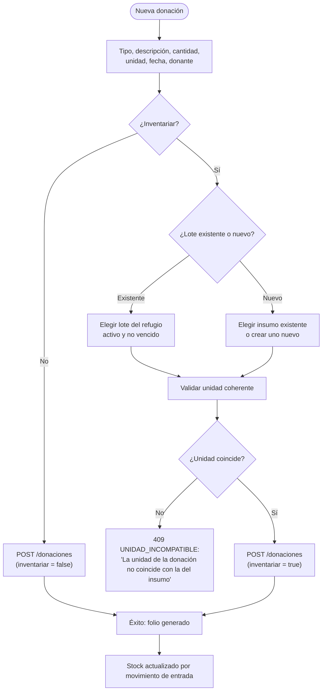
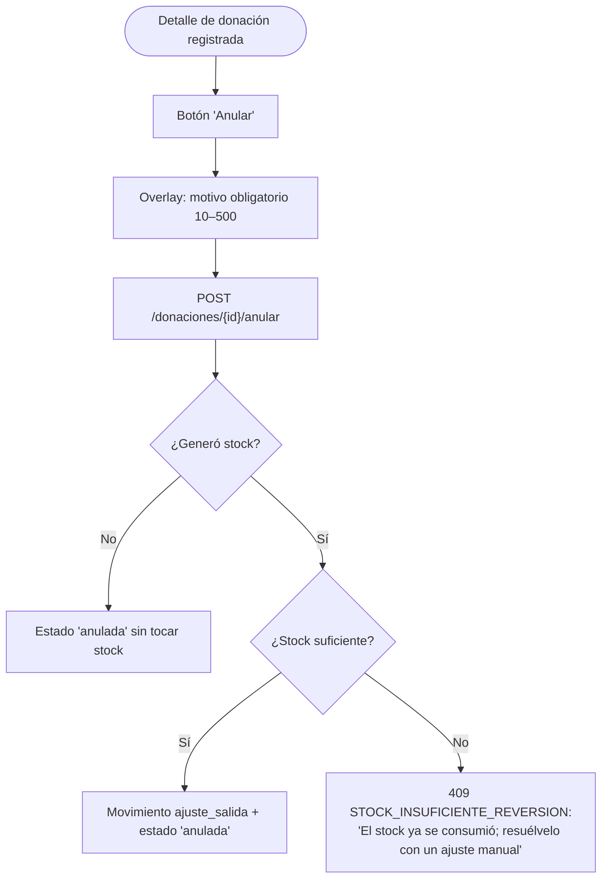

# Anexo UI/UX — Requerimiento 06 (Épica 6)

> **Fuente:** `docs/features/requerimiento-06-donaciones-inventario.md`.
> **Método:** `docs/ui-ux-metodologia.md`.
> **Actores:** Administrador, Coordinador, Veterinario, Operador, Evaluador (según permiso).
> **Vistas cubiertas:** `/inventario` y subvistas; `/donaciones` y subvistas.
> **Estado:** **BLOQUEADA por backend.** Solo existe `GET /api/v1/inventario/lotes`. Las anclas no se muestran hasta que existan los endpoints.

---

## 1. Inventario de contenido (E-C-S)

### `/inventario` — ancla

| Zona | Nivel | Elemento | Origen de datos | Comportamiento UI | Capa |
| :--- | :---: | :--- | :--- | :--- | :--- |
| Header | C | Título + resumen «N insumos · M lotes · K alertas» | `GET /inventario/insumos`, `/lotes`, `/alertas` | Contadores en servidor. | SC |
| Tabs | C | Insumos · Lotes · Movimientos · Alertas | — | Pestañas del ancla (regla 2 del mapa). | SC |
| Alertas | E | Tarjetas: stock bajo, caducidad próxima (30 días), vencidos | `GET /inventario/alertas` | Texto explícito («Stock bajo», «Vence en 12 días»), no solo color. | SC |
| Accesos | E | Enlaces a las subvistas con el filtro aplicado | — | Cada tarjeta de alerta enlaza a la lista filtrada. | SC |

### `/inventario/insumos` y `/inventario/insumos/[id]`

| Zona | Nivel | Elemento | Origen de datos | Comportamiento UI | Capa |
| :--- | :---: | :--- | :--- | :--- | :--- |
| Toolbar | C | Buscador + filtro por tipo (`vacuna`, `desparasitante`, `insumo_quirurgico`, `otro`) | `GET /inventario/insumos` | Filtros en URL. | CC |
| Tabla | E | Nombre, tipo, unidad, stock total, lotes activos, estado | Mismo endpoint | Orden por nombre; stock con texto. | SC |
| Overlay | E | Crear / editar insumo | `POST/PUT /inventario/insumos` | `inventory.manage`. Nombre único por tipo. | CC / Action |
| Confirmación | E | Desactivar insumo | `DELETE` lógico | Bloqueado si hay lotes con stock (`409 INSUMO_CON_STOCK`). | CC |
| Detalle | E | Lotes del insumo, stock total y movimientos recientes | `GET /inventario/insumos/{id}` | Sin edición de stock directo. | SC |

### `/inventario/lotes` y `/inventario/lotes/[id]`

| Zona | Nivel | Elemento | Origen de datos | Comportamiento UI | Capa |
| :--- | :---: | :--- | :--- | :--- | :--- |
| Toolbar | C | Buscador, filtro por insumo y por estado (`ok`, `bajo`, `agotado`, `vencido`) | `GET /inventario/lotes` | Compatible con el contrato que consume `animals`. | CC |
| Tabla | E | Insumo, marca, lote, caducidad, stock actual, stock mínimo, estado | Mismo endpoint | Badge de estado con texto. | SC |
| Overlay | E | Crear lote (stock 0) / editar metadatos | `POST/PUT /inventario/lotes` | El stock inicial siempre es 0; se carga por movimiento. | CC / Action |
| Detalle | E | Stock, caducidad, movimientos del lote y ajustes | `GET /inventario/lotes/{id}` + `/lotes/{id}/movimientos` | Lote vencido: «No admite entradas ni consumo». | SC |

### `/inventario/movimientos`

| Zona | Nivel | Elemento | Origen de datos | Comportamiento UI | Capa |
| :--- | :---: | :--- | :--- | :--- | :--- |
| Toolbar | C | Filtros: tipo, insumo, motivo, rango de fechas | `GET /inventario/movimientos` | Rango por defecto: mes en curso. | CC |
| Tabla | E | Fecha, lote, tipo, cantidad, motivo, referencia, usuario | Mismo endpoint | Append-only; sin acciones de edición. | SC |
| Overlay | E | Registrar entrada/salida manual | `POST /inventario/movimientos` | `inventory.move`; motivo 3–120; salida no deja stock negativo. | CC / Action |
| Overlay | E | Ajuste sobre movimiento | `POST /inventario/movimientos/{id}/ajuste` | `inventory.adjust`; motivo 10–500; referencia opcional. | CC / Action |

### `/donaciones` y `/donaciones/donantes`

| Zona | Nivel | Elemento | Origen de datos | Comportamiento UI | Capa |
| :--- | :---: | :--- | :--- | :--- | :--- |
| Header | C | Título + total de donaciones del periodo | `GET /donaciones` | Sin montos: solo especie. | SC |
| Toolbar | C | Filtros: tipo, estado (`registrada`/`anulada`), donante, fechas | Mismo endpoint | — | CC |
| Tabla | E | Folio `DON-<refugio>-<id>`, fecha, donante, tipo, cantidad + unidad, inventariada, estado | Mismo endpoint | La unidad nunca se suma entre tipos distintos. | SC |
| Overlay | E | Registrar donación | `POST /donaciones` | `donations.create`; cantidad positiva; vínculo opcional a inventario. | CC / Action |
| Overlay | E | Anular donación | `POST /donaciones/{id}/anular` | `donations.manage`; motivo 10–500; confirmación destructiva. | CC / Action |
| Donantes | E | Listado con tipo, contacto y número de donaciones | `GET /donantes` | Sin correo/teléfono en exportaciones. | SC |
| Detalle donante | E | Datos + historial de donaciones | `GET /donantes/{id}` | Baja lógica si no hay donaciones. | SC |

---

## 2. Flujos de usuario

### Flujo «Registrar donación con vínculo a inventario» (RF6.2 / RF6.3 / US20)

### Flujo «Anular donación» (RF6.4)

### Flujo «Movimiento y ajuste» (RF6.6)

Entrada o salida manual con motivo → validación de stock → si dos personas compiten por la última unidad, una recibe `409 STOCK_INSUFICIENTE` y la UI recarga el stock del lote.

---

## 3. Los 5 estados de interfaz

| Estado | Inventario | Donaciones |
| :--- | :--- | :--- |
| **Ideal** | Stock, lotes y alertas coherentes. | Donaciones con folio y estado. |
| **Vacío** | «Aún no hay insumos» + CTA (si `inventory.manage`). | «Sin donaciones en el periodo» + CTA (si `donations.create`). |
| **Carga** | Skeleton de tabla y de tarjetas de alerta. | Skeleton de tabla. |
| **Parcial** | Si fallan las alertas: «Alertas no disponibles» + reintentar; la tabla sigue. | Si falla el donante: «Donante no disponible» en la fila. |
| **Error** | `error.tsx` del ancla Inventario. | `error.tsx` del ancla Donaciones. |

### Errores de negocio y su traducción

| Código | Mensaje UI |
| :--- | :--- |
| `409 INSUMO_CON_STOCK` | «No puedes desactivar un insumo con stock.» |
| `409 LOTE_CON_STOCK` | «Ajusta el stock a cero antes de desactivar el lote.» |
| `409 LOTE_VENCIDO` | «El lote está vencido: no admite entradas ni consumo.» |
| `409 INSUMO_DUPLICADO` | «Ya existe un insumo con ese nombre y tipo.» |
| `409 LOTE_DUPLICADO` | «Ya existe un lote con esa marca, número y caducidad.» |
| `409 STOCK_INSUFICIENTE` | «No hay stock suficiente en ese lote.» |
| `409 UNIDAD_INCOMPATIBLE` | «La unidad de la donación no coincide con la del insumo.» |
| `409 DONACION_DUPLICADA` | «Parece una donación duplicada. Revisa el registro.» |
| `409 STOCK_INSUFICIENTE_REVERSION` | «El stock ya se consumió; resuélvelo con un ajuste manual.» |

---

## 4. Permisos

| Acción | Permiso | UI |
| :--- | :--- | :--- |
| Ver inventario | `inventory.view` | Ancla Inventario |
| Crear/editar/desactivar insumo o lote | `inventory.manage` | Botones visibles |
| Registrar entrada/salida | `inventory.move` | Overlay visible |
| Registrar ajuste | `inventory.adjust` | Acción visible |
| Ver donaciones y donantes | `donations.view` | Ancla Donaciones |
| Registrar donación/donante | `donations.create` | Overlay visible |
| Anular donación / baja de donante | `donations.manage` | Acción visible |

---

## 5. Supuestos y decisiones

- **Bloqueo:** esta épica no se implementa hasta que existan `/api/v1/donaciones`, `/donantes` e `/inventario/*`. Mostrar el ancla con datos mock violaría «sin UI muerta».
- **S-01:** `inventory.*` y `donations.*` no están sembrados (P-02). Aunque las vistas existieran, el filtro de navegación las ocultaría.
- **D-06.1:** Inventario y Donaciones son dos anclas separadas, aunque compartan el vínculo donación → lote.
- **D-06.2:** el folio de donación se muestra tal cual lo genera el servidor; el cliente nunca lo envía.
- **D-06.3:** no se implementa carga de archivos para `evidencia_url`; solo se acepta una URL existente.
