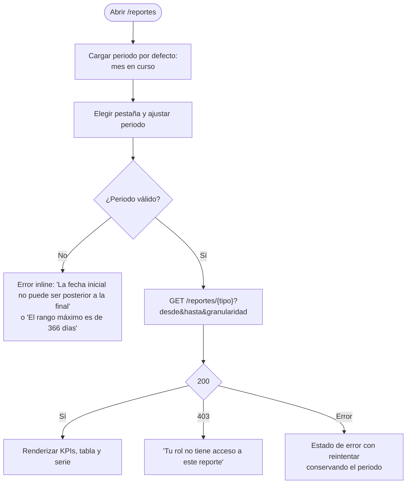
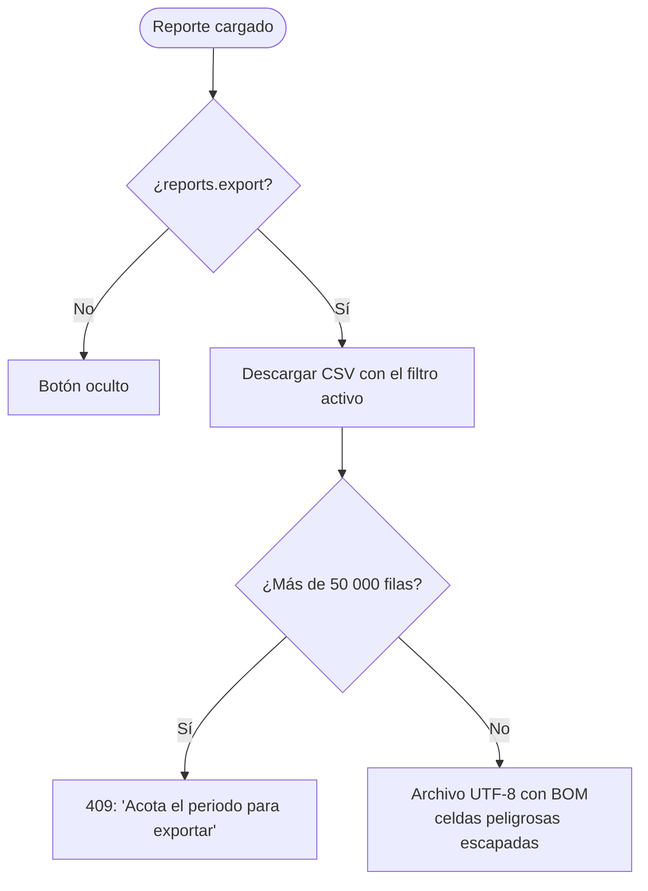

# Anexo UI/UX — Requerimiento 07 (Épica 7)

> **Fuente:** `docs/features/requerimiento-07-inteligencia-datos.md`.
> **Método:** `docs/ui-ux-metodologia.md`.
> **Actores:** Administrador, Coordinador, Veterinario, Operador (según reporte); Superadmin (alcance global).
> **Vistas cubiertas:** `/reportes` y subvistas `/poblacion`, `/capacidad`, `/donaciones`, `/inventario`.
> **Estado:** **BLOQUEADA por backend.** No existe `/api/v1/reportes/*`.

---

## 1. Inventario de contenido (E-C-S)

### Estructura común del ancla

| Zona | Nivel | Elemento | Origen de datos | Comportamiento UI | Capa |
| :--- | :---: | :--- | :--- | :--- | :--- |
| Header | C | Título del reporte + periodo activo | — | Periodo legible: «1–30 de noviembre de 2026». | SC |
| Barra de periodo | E | `desde`, `hasta`, presets (mes actual, mes anterior, 90 días), toggle «Comparar con periodo anterior» | `GET /reportes/*` | Máximo 366 días; error si `desde > hasta`. | CC |
| Tabs | C | Población · Capacidad · Donaciones · Inventario | — | Pestañas, no anclas del sidebar. | SC |
| Contenido | E | KPIs + tabla/gráfica del reporte | Endpoint del reporte | Etiquetas en español; sin depender del color. | SC |
| Acción | E | «Exportar CSV» | `GET /reportes/*?formato=csv` | Requiere `reports.export`; exporta todo el filtro, no la página. | CC / Action |
| Limitaciones | C | Nota cuando una métrica no es calculable | `limitaciones[]` | «No calculable» explícito; nunca `0` (regla 9). | SC |

### `/reportes/poblacion` (RF7.1)

| Elemento | Contenido |
| :--- | :--- |
| KPIs | Población activa, ingresos, adopciones, fallecimientos, otros egresos, egresos sin clasificar |
| Distribución | Por especie, por estado, por espacio |
| Indicadores | En cuarentena, esterilizados y porcentaje |
| Estancia | Media de activos y de adoptados (días) |
| Serie | Ingresos / adopciones / egresos por granularidad (`dia`, `semana`, `mes`) |
| Balance | `ingresos − adopciones − fallecimientos − otros egresos`; puede ser negativo |
| Aviso | «Población al inicio estimada» cuando aplica |

### `/reportes/capacidad` (RF7.2)

| Elemento | Contenido |
| :--- | :--- |
| KPIs | Capacidad total, ocupación total, porcentaje de ocupación |
| Tabla | Espacio, tipo, capacidad, ocupación, exceso, porcentaje |
| Listas | Sobrecupo y espacios libres |
| Desglose | Capacidad y ocupación por tipo (`sin_tipo` cuando falta) |
| Aviso | Animales sin espacio válido (`sin_espacio`) |

### `/reportes/donaciones` (RF7.3)

| Elemento | Contenido |
| :--- | :--- |
| KPIs | Total de donaciones, donantes distintos, inventariadas, no inventariadas, anuladas |
| Tabla | Tipo de donación, unidad, cantidad (agrupada por unidad, nunca sumada entre unidades) |
| Donantes | Por tipo (`Persona`, `Empresa`, `Fundación`) y top 10 por conteo |
| Serie | Donaciones y cantidades por granularidad, separadas por unidad |
| Anuladas | Bloque aparte con motivo agregado |
| Privacidad | Nombre del donante solo con rol autorizado; nunca correo, teléfono ni notas |

### `/reportes/inventario` (RF7.4)

| Elemento | Contenido |
| :--- | :--- |
| KPIs | Insumos activos, lotes, stock bajo, vencidos |
| Stock | Por insumo y lote: stock, mínimo, unidad, caducidad, estado |
| Movimientos | Consumo, entradas y ajustes del periodo por motivo e insumo |
| Alertas | Stock bajo, caducidad próxima y vencidos |
| Aviso | Insumos y lotes inactivos se informan aparte |

---

## 2. Flujos de usuario

### Flujo «Consultar un reporte» (RF7.1–RF7.5 / US21–US23)

### Flujo «Exportar CSV» (RF7.7)

### Flujo «Comparar periodos»

Activar «Comparar» duplica los bloques de KPI y añade la variación porcentual (un decimal). Si el periodo anterior no tiene datos, se muestra «Sin datos del periodo anterior», no `0`.

---

## 3. Los 5 estados de interfaz

| Estado | Comportamiento |
| :--- | :--- |
| **Ideal** | KPIs, tabla y serie con datos del periodo. |
| **Vacío** | «No hay datos en este periodo» + presets de rescate («Ver mes anterior»). |
| **Carga** | Skeleton de KPIs y tabla; el periodo elegido permanece visible. |
| **Parcial** | Métricas no calculables: valor «No calculable» + nota en `limitaciones`. |
| **Error** | `error.tsx` del ancla Reportes con «No se pudo generar el reporte» + `reset()` conservando filtros. |

### Errores de negocio y su traducción

| Código | Mensaje UI |
| :--- | :--- |
| `400 PERIODO_INVALIDO` | «La fecha inicial no puede ser posterior a la final.» |
| `400 RANGO_EXCEDIDO` | «El rango máximo es de 366 días.» |
| `403 ROL_SIN_PERMISO` | «Tu rol no tiene acceso a este reporte.» |
| `403 REFUGIO_FUERA_DE_ALCANCE` | «No puedes consultar otro refugio.» |
| `409 EXPORTACION_DEMASIADO_GRANDE` | «Acota el periodo: hay más de 50 000 filas.» |

---

## 4. Permisos

| Reporte | Roles | Permiso base |
| :--- | :--- | :--- |
| Población | Admin, Coordinador, Veterinario, Operador | `reports.view` |
| Capacidad | Admin, Coordinador, Veterinario, Operador | `reports.view` |
| Donaciones | Admin, Coordinador | `reports.view` |
| Inventario | Admin, Coordinador, Veterinario | `reports.view` |
| Resumen del panel | Admin, Coordinador, Veterinario, Operador | `reports.view` |
| Exportar CSV | Cualquiera con acceso al reporte | `reports.export` |

> `reports.view` y `reports.export` no están sembrados (P-02). Hasta entonces el ancla Reportes no se muestra.

---

## 5. Supuestos y decisiones

- **S-01:** el panel (`/dashboard`) consume `GET /reportes/resumen` y deja de usar datos mock. Mientras el endpoint no exista, el panel mantiene su estado actual y se marca como deuda (H-13).
- **S-02:** el Superadmin puede elegir refugio o «todos»; la UI muestra un selector solo para ese rol.
- **D-07.1:** la exportación es una acción del reporte, no una ruta (`/reportes/poblacion/exportar` no existe).
- **D-07.2:** la granularidad se sugiere automáticamente según el rango (≤31 días → día; ≤180 → semana; resto → mes), pero el usuario puede cambiarla.
- **D-07.3:** no se añaden notificaciones ni programación de reportes: no están en el requerimiento.
