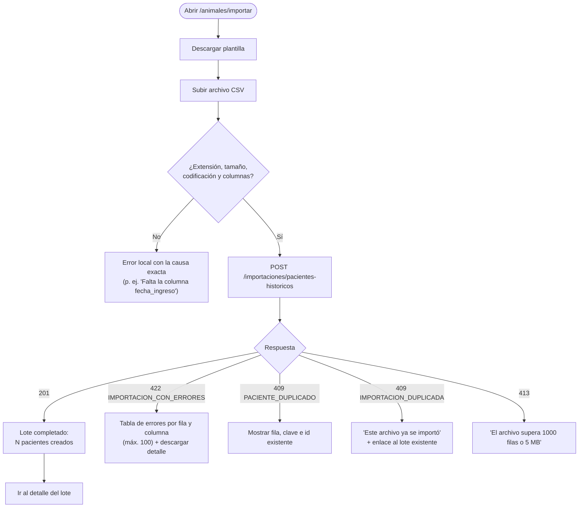
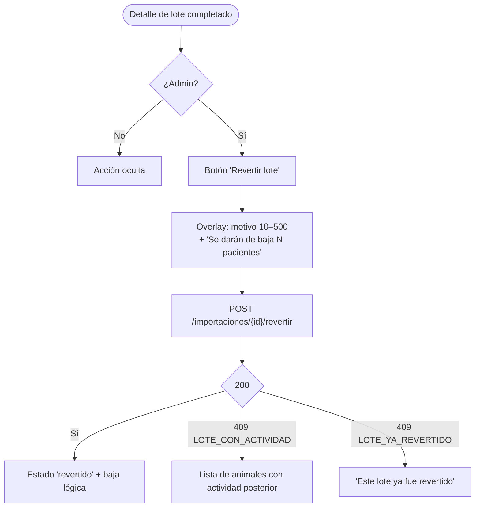

# Anexo UI/UX — Requerimiento 08 (Épica 8)

> **Fuente:** `docs/features/requerimiento-08-datos-historicos.md`.
> **Método:** `docs/ui-ux-metodologia.md`.
> **Actores:** Administrador, Coordinador (`animals.import`); Evaluador/Admin (`adoptions.ai`).
> **Vistas cubiertas:** `/animales/importar`, `/animales/importaciones`, `/animales/importaciones/[id]`, `/animales/historicos/nuevo` y la generación de perfil con IA.
> **Estado:** **BLOQUEADA por backend.** No existe `/api/v1/importaciones/*` ni `/animales/historicos`.

---

## 1. Inventario de contenido (E-C-S)

### `/animales/importar` — carga de CSV (RF8.1 / RF8.2 / RF8.3)

| Zona | Nivel | Elemento | Origen de datos | Comportamiento UI | Capa |
| :--- | :---: | :--- | :--- | :--- | :--- |
| Header | C | Título «Importar pacientes históricos» + enlace «Descargar plantilla» | `GET /importaciones/plantilla` | La plantilla es la fuente de verdad de columnas. | SC |
| Instrucciones | C | Columnas obligatorias, límites (1000 filas / 5 MB), codificación UTF-8 y separador coma | — | Texto fijo, no tooltip escondido. | SC |
| Dropzone | E | Zona de arrastre + selector de archivo | — | Muestra nombre, tamaño y hash antes de subir. | CC |
| Validación local | E | Comprobación previa: extensión, tamaño y columnas | — | Errores locales antes de llamar al servidor. | CC |
| Resultado | E | Resumen: filas válidas, errores por fila/columna (máx. 100) | `POST /importaciones/pacientes-historicos` | Tabla de errores con fila, columna y mensaje en español. | SC |
| Acción | E | «Importar» | Mismo endpoint | Deshabilitado si hay errores locales. Confirmación: «Se crearán N pacientes históricos inactivos». | CC / Action |

### `/animales/importaciones` — historial de lotes (RF8.4)

| Zona | Nivel | Elemento | Origen de datos | Comportamiento UI | Capa |
| :--- | :---: | :--- | :--- | :--- | :--- |
| Tabla | E | Fecha, archivo, usuario, filas, estado (`procesando`, `completado`, `fallido`, `revertido`) | `GET /importaciones` | Estados con texto y color. | SC |
| Filtros | C | Estado y rango de fechas | Mismo endpoint | Filtros en URL. | CC |
| Acción | E | «Revertir lote» (solo `completado` y Admin) | `POST /importaciones/{id}/revertir` | Motivo obligatorio 10–500; confirmación destructiva. | CC / Action |

### `/animales/importaciones/[id]` — detalle del lote

| Zona | Nivel | Elemento | Origen de datos | Comportamiento UI | Capa |
| :--- | :---: | :--- | :--- | :--- | :--- |
| Cabecera | C | Archivo, hash, usuario, fechas, estado, total de filas | `GET /importaciones/{id}` | Hash abreviado con copia. | SC |
| Tabla de filas | E | Número, datos normalizados, estado (`importada`/`error`), animal creado, errores | Mismo endpoint | Paginada; los errores se agrupan por columna. | SC |
| Reversión | E | Bloqueo `409 LOTE_CON_ACTIVIDAD` con la lista de animales afectados | Respuesta | «No se puede revertir: estos pacientes tienen actividad posterior.» | SC |

### `/animales/historicos/nuevo` — registro manual (RF8.5)

| Zona | Nivel | Elemento | Origen de datos | Comportamiento UI | Capa |
| :--- | :---: | :--- | :--- | :--- | :--- |
| Formulario | E | Mismos campos que la plantilla, agrupados en 3 pasos: identificación, ingreso/egreso, datos internos | `POST /animales/historicos` | Mismas validaciones que el CSV, inline en español. | CC / Action |
| Aviso | C | «Se registrará como histórico inactivo, sin espacio ni cuarentena» | — | Visible antes de guardar. | SC |
| Duplicado | E | `409 PACIENTE_DUPLICADO` | Respuesta | «Ya existe un paciente con ese microchip/UUID/nombre y fecha.» | CC |

### Generación de perfil con IA (RF8.6 / RF8.7)

| Zona | Nivel | Elemento | Origen de datos | Comportamiento UI | Capa |
| :--- | :---: | :--- | :--- | :--- | :--- |
| Panel de perfil | E | Botón «Generar borrador» + tono y longitud opcionales | `POST /animales/{id}/perfil-adopcion/generar` | Solo animales activos y no eliminados. | CC / Action |
| Resultado | E | Texto editable en un `textarea`, contador 50–2000 | Respuesta del modelo | «Borrador generado. Revísalo antes de guardar.» No se publica solo. | CC |
| Acciones | E | «Descartar», «Usar este texto» | `PUT /animales/{id}/perfil-adopcion` | Al guardar se registra `origen_descripcion = 'ia'`; si se edita, `ia_editada = true`. | CC / Action |
| Errores | E | `502 IA_RESPUESTA_INVALIDA`, `503 IA_NO_DISPONIBLE`, `429 LIMITE_IA` | Respuesta | «No se pudo generar el texto. Puedes redactarlo manualmente.» | CC |

---

## 2. Flujos de usuario

### Flujo «Importación CSV» (RF8.1–RF8.4 / US24)

### Flujo «Reversión de lote» (RF8.4)

### Flujo «Registro manual de histórico» (RF8.5)

Tres pasos con validación por paso → confirmación «Se creará como inactivo» → `POST` → redirección al expediente del paciente creado.

---

## 3. Los 5 estados de interfaz

| Estado | Importación | Historial / detalle |
| :--- | :--- | :--- |
| **Ideal** | Dropzone + resumen de validación. | Tabla de lotes o de filas. |
| **Vacío** | «Aún no has subido archivos» + instrucciones + plantilla. | «Sin importaciones registradas» + CTA «Importar CSV». |
| **Carga** | Barra de progreso determinada por filas procesadas; nunca spinner infinito. | Skeleton de tabla. |
| **Parcial** | Si el servidor devuelve más de 100 errores: «Se muestran los primeros 100» + total. | Si falla el detalle de una fila: «No disponible» sin romper la tabla. |
| **Error** | `error.tsx` del ancla Animales: «No se pudo procesar el archivo» + reintentar. | `error.tsx` del ancla Animales. |

### Errores de negocio y su traducción

| Código | Mensaje UI |
| :--- | :--- |
| `400 PLANTILLA_INVALIDA` | «El archivo no tiene las columnas de la plantilla.» |
| `400 CODIFICACION_INVALIDA` | «Guarda el archivo en UTF-8.» |
| `400 SEPARADOR_INVALIDO` | «El archivo debe usar coma como separador.» |
| `413 ARCHIVO_DEMASIADO_GRANDE` | «El archivo supera 1000 filas o 5 MB.» |
| `422 IMPORTACION_CON_ERRORES` | «Hay errores en el archivo. Revisa la tabla.» |
| `409 PACIENTE_DUPLICADO` | «Ya existe un paciente con esos datos.» |
| `409 LOTE_CON_ACTIVIDAD` | «No se puede revertir: hay pacientes con actividad posterior.» |
| `409 LOTE_YA_REVERTIDO` | «Este lote ya fue revertido.» |
| `502 IA_RESPUESTA_INVALIDA` | «La descripción generada no es válida. Intenta de nuevo.» |
| `503 IA_NO_DISPONIBLE` | «El generador no está disponible. Redacta manualmente.» |
| `429 LIMITE_IA` | «Alcanzaste el límite de generaciones por hora.» |

---

## 4. Permisos

| Acción | Permiso / rol | UI |
| :--- | :--- | :--- |
| Descargar plantilla, importar y revertir | `animals.import` | Botones y acciones visibles |
| Registrar histórico manual | `animals.create` | CTA visible |
| Generar borrador con IA | `adoptions.ai` | Botón visible |
| Guardar y publicar el perfil | `adoptions.publish` | Acciones del perfil |
| Revertir lote | `animals.import` + Admin | Acción visible solo a Admin |

---

## 5. Supuestos y decisiones

- **Bloqueo:** no se implementa hasta que existan `/api/v1/importaciones/*`, `/animales/historicos` y `/perfil-adopcion/generar`.
- **S-01:** los históricos no consumen plazas ni aparecen en ocupación, catálogo ni campañas (regla 63).
- **S-02:** el CSV no incluye fotos; se cargan después con los endpoints del expediente.
- **D-08.1:** importación y registro manual son dos rutas (`/animales/importar`, `/animales/historicos/nuevo`), no pestañas, porque tienen flujos y permisos distintos.
- **D-08.2:** el historial de lotes vive en `/animales/importaciones`, dentro del ancla Animales.
- **D-08.3:** la IA nunca publica; su salida siempre pasa por revisión y por `PUT /perfil-adopcion`.
