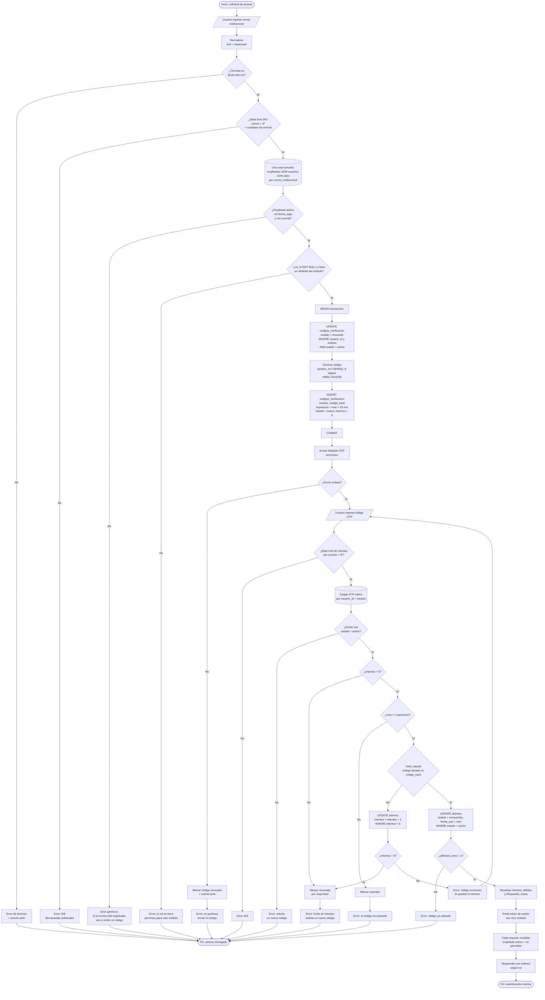

# Requerimiento 01 — US 01

## Título

Inicio de sesión por código de un solo uso (OTP) para el backoffice de Recursos Humanos.

## Descripción

El backoffice de Recursos Humanos es una de las dos plataformas que comparten la misma base de datos institucional. La otra es la plataforma donde el personal empleado crea sus propias solicitudes.

Toda persona registrada en el sistema es, ante todo, un **empleado**. El registro de empleado es la identidad: define la existencia de la persona, su área, su puesto y su vigencia laboral, incluida la baja. Sobre esa identidad, y de forma opcional, la persona puede tener **un rol funcional** que le habilita módulos adicionales.

Esta plataforma **no se abre por el solo hecho de ser empleado**. Exige un rol funcional habilitado. Un empleado sin rol funcional no puede ingresar, aunque su registro esté vigente.

El acceso se realiza con el correo institucional y un código de un solo uso enviado a ese mismo correo. No hay contraseña.

### Objetivo

Permitir que los usuarios con un rol funcional habilitado accedan al backoffice de Recursos Humanos mediante un código de un solo uso enviado a su correo institucional, garantizando que la identidad sea válida, que el rol esté autorizado para este módulo y que el código no pueda reutilizarse ni adivinarse.

### Alcance

Incluye:

- Solicitud del código de acceso al correo institucional.
- Validación de dominio institucional.
- Validación de identidad laboral vigente (empleado activo y sin fecha de baja).
- Validación del rol funcional contra la lista de roles habilitados del módulo.
- Emisión, envío, revocación y consumo del código.
- Límites de solicitudes, intentos y reenvío.
- Emisión de la sesión autenticada y revalidación continua del acceso.

No incluye:

- Alta, edición o baja de empleados y usuarios.
- Gestión de roles desde la aplicación.
- Recuperación de contraseña (el acceso no usa contraseña).
- Notificaciones internas de la plataforma (se abordan en otro requerimiento).

### Actores

| Actor | Descripción |
|---|---|
| Usuario con rol funcional | Empleado con un rol habilitado para este módulo. Es el único que completa el acceso. |
| Empleado sin rol funcional | Persona registrada y vigente sin rol habilitado. No accede a este módulo. |
| Empleado dado de baja | Persona con baja registrada. No accede, aunque conserve su correo institucional. |
| Administrador de personal | Personal de Recursos Humanos que asigna roles fuera de esta aplicación. |

### Reglas de negocio

1. Solo se aceptan correos del dominio institucional (`@utn.edu.mx`).
2. El correo institucional identifica de forma única a una persona y a una sola cuenta.
3. El acceso requiere que el empleado esté activo y sin fecha de baja. La baja se valida contra la identidad del empleado, no contra la cuenta.
4. El acceso requiere que la cuenta tenga un rol funcional y que ese rol esté habilitado para este módulo.
5. Un usuario tiene como máximo un rol funcional. Los roles no se acumulan.
6. El código tiene una vigencia de 10 minutos y un máximo de 5 intentos.
7. Un código solo puede usarse una vez. Al consumirse, deja de ser válido.
8. Solicitar un código nuevo invalida cualquier código anterior vigente del mismo usuario y módulo.
9. Debe existir un tiempo mínimo entre solicitudes de código para el mismo correo y origen.
10. Si el correo no existe o la persona no está habilitada, la respuesta es la misma que en el caso exitoso, para no revelar información.
11. Si el envío del correo falla, el código emitido se invalida; nunca queda un código vigente que nadie recibió.
12. La sesión emitida debe revalidarse de forma continua: una baja o un cambio de rol tienen efecto inmediato, sin esperar el vencimiento del token.

### Criterios de aceptación

- [x] Un empleado activo con rol habilitado recibe el código en su correo institucional.
- [x] Un correo de otro dominio es rechazado antes de consultar la base.
- [x] Un empleado dado de baja no recibe código.
- [x] Un empleado sin rol funcional no recibe código.
- [x] Un rol no habilitado para el módulo recibe denegación explícita.
- [x] Un correo inexistente obtiene la misma respuesta que uno válido, sin recibir código.
- [x] Un código nuevo invalida el anterior.
- [x] Un código con más de 10 minutos no autentica.
- [x] Un código usado no puede reutilizarse.
- [x] Cinco intentos fallidos invalidan el código.
- [x] Una sesión emitida deja de servir si el empleado es dado de baja o pierde el rol.
- [x] El acceso exitoso devuelve la sesión y la vista inicial correspondiente al rol.

## Diagrama de flujo

## Interfaz expuesta

| Método | Ruta | Descripción |
|---|---|---|
| `POST` | `/api/auth/otp` | Solicita el código de acceso. |
| `POST` | `/api/auth/otp/verificar` | Valida el código y emite la sesión. |
| `GET` | `/api/auth/sesion` | Devuelve la sesión actual. Requiere autenticación. |

## Parámetros del módulo

| Parámetro | Valor |
|---|---|
| Dominio permitido | `utn.edu.mx` |
| Roles habilitados | `SECRETARIA`, `SECRETARIA_CIRCULARES`, `ADMIN`, `SUPER_ADMIN`, `SISTEMAS` |
| Vigencia del código | 10 minutos |
| Intentos por código | 5 |
| Tiempo mínimo entre solicitudes | 60 segundos |
| Solicitudes por correo | 5 por hora |
| Solicitudes por IP | 20 por hora |
| Vigencia de la sesión | 8 horas |
